# FSM-plattformen

Et feltvennlig service- og vedlikeholdssystem (FSM) bygget med Next.js, Prisma og
PostgreSQL. Plattformen dekker flyten fra oppdraget planlegges til den signerte
servicerapporten kan vises eller lastes ned som PDF.

## Hva systemet gjør

- **Oppdrag og kalender** – planlegg, fordel og følg opp serviceoppdrag i liste,
  tavle, kalender, dispatch og ruteplan, med avdelingssperre og montørtildeling.
- **Servicerapporter** – sjekklister per enhet, kommentarer, bilder og signaturer,
  og ferdig PDF som kan vises i appen eller lastes ned.
- **Enheter og servicehistorikk** – hver kunde har oversikt over utstyret sitt, og
  hver enhet viser tidligere servicer med resultat, kommentarer og bilder.
  Enheter kan flyttes til en annen kunde med hele servicehistorikken.
- **Kunder og kundeportal** – kundekort med kontakter, avtaler, steder og egne
  portalbrukere som bare ser sin egen bedrift.
- **Avdelinger, roller og rettigheter** – oppdrag og serviceavtaler tilhører en
  avdeling, og administrator kan opprette egne roller og tilpasse rettigheter.
- **Serviceavtaler, SLA og bookinger** – gjentagende service, frister og
  bookingkø med bekreftelse og varsling.
- **SMS, kontorinnboks og påminnelser** – toveis SMS med samtykke, samtaler i
  kontorinnboksen og automatiske SMS-/e-postpåminnelser før besøk.
- **Dokumentbibliotek, OCR, tags og globalt søk** – PDF-er med mapper, tags,
  versjonering og fulltekstsøk.
- **SSO, SCIM og sikkerhet** – OIDC mot Entra ID, Keycloak, Authentik og Zitadel,
  SCIM-brukerprovisjonering, 2FA og revisjonslogg.
- **PWA og feltapp** – installerbar feltapp med offline-kladder, kamera/QR,
  strekkodeskanning, navigasjon og manuell kode når kameraet ikke er tilgjengelig.
- **REST-API** – egne Bearer-nøkler og samme rettighetskontroll som i appen.

## Skjermbilder

| Dashbord | Oppdrag |
| --- | --- |
| 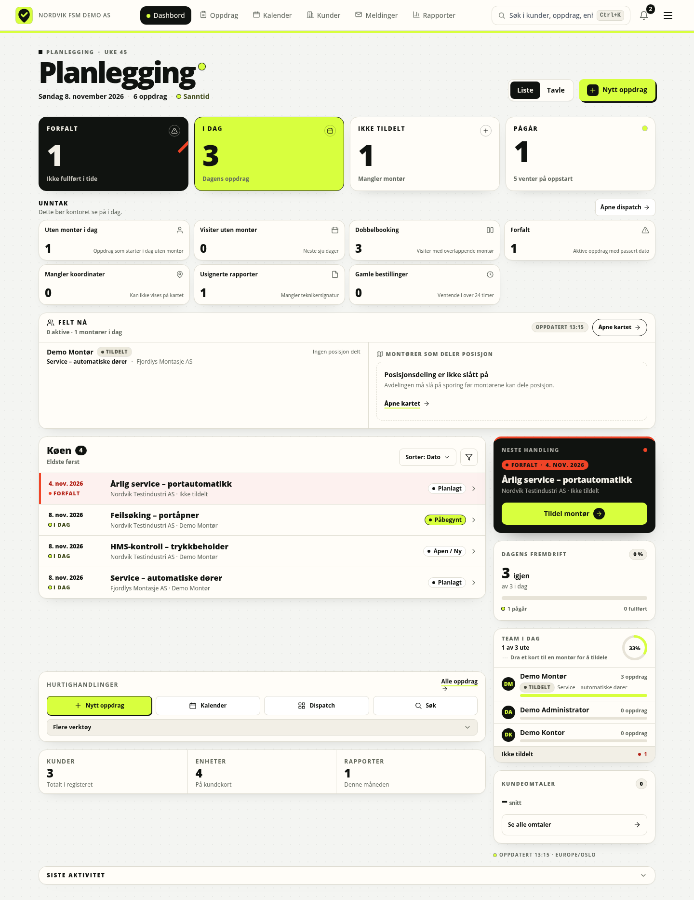 | 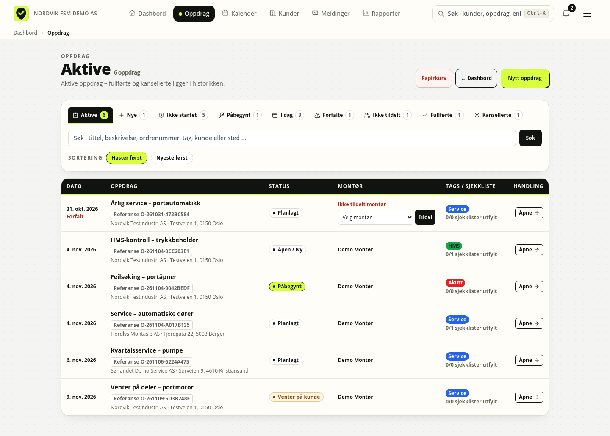 |

| Kalender | Kunder |
| --- | --- |
| 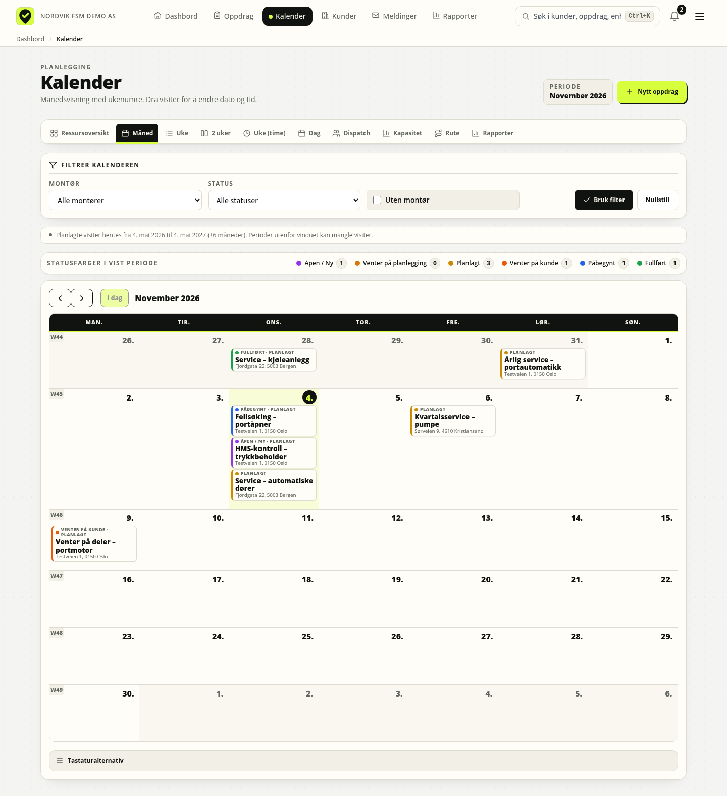 | 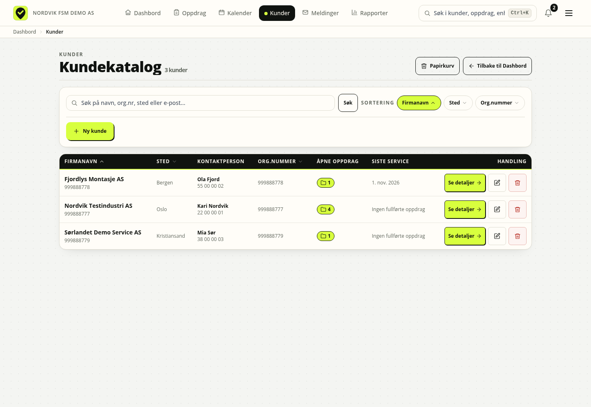 |

| Dokumentbibliotek | Kundeportal |
| --- | --- |
| 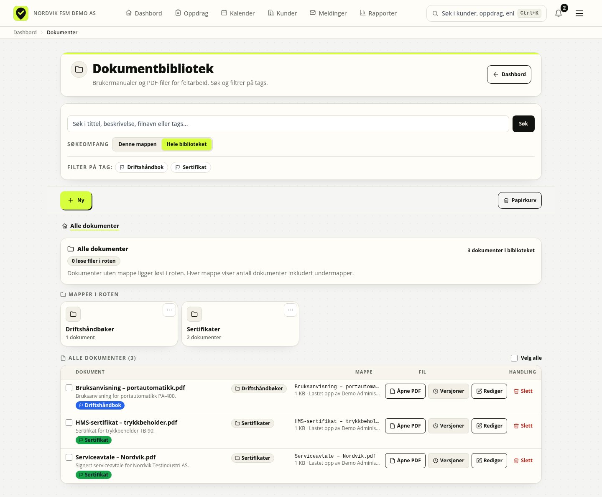 | 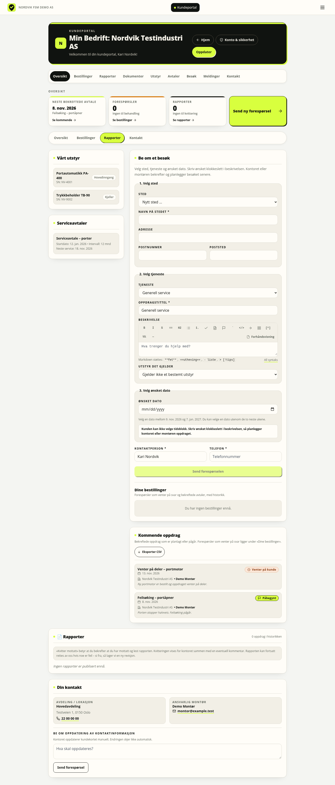 |

<details>
<summary>Flere skjermbilder (oppdragsdetaljer, kundekort, rapporter, innstillinger og mobil)</summary>

| | |
| --- | --- |
| 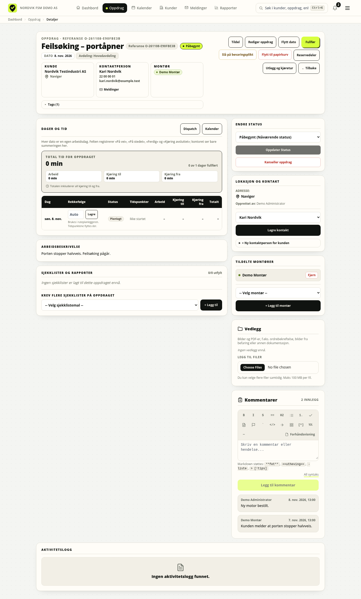 | 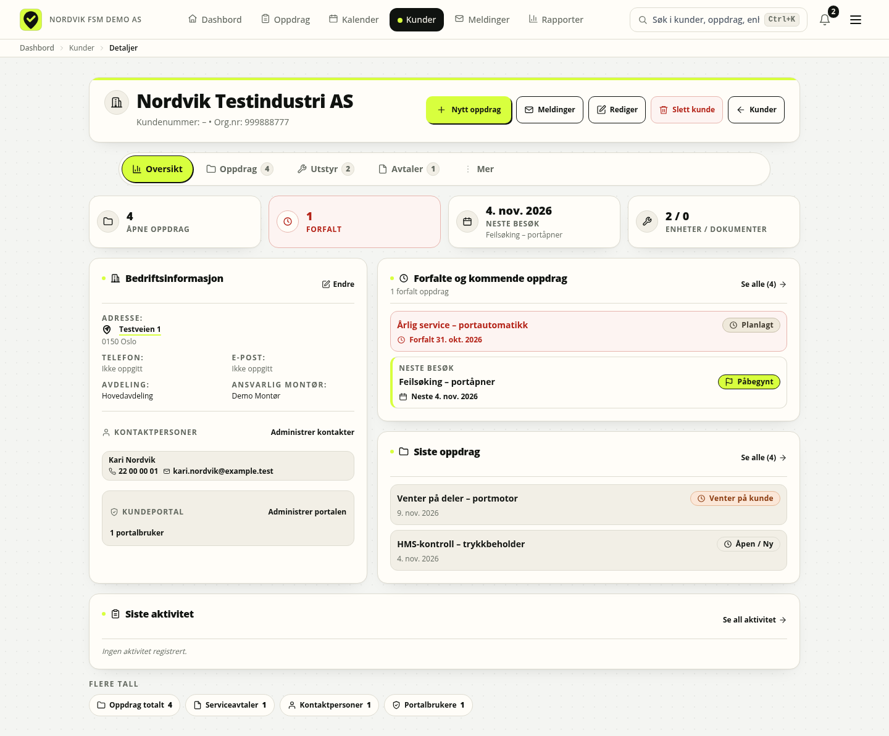 |
| 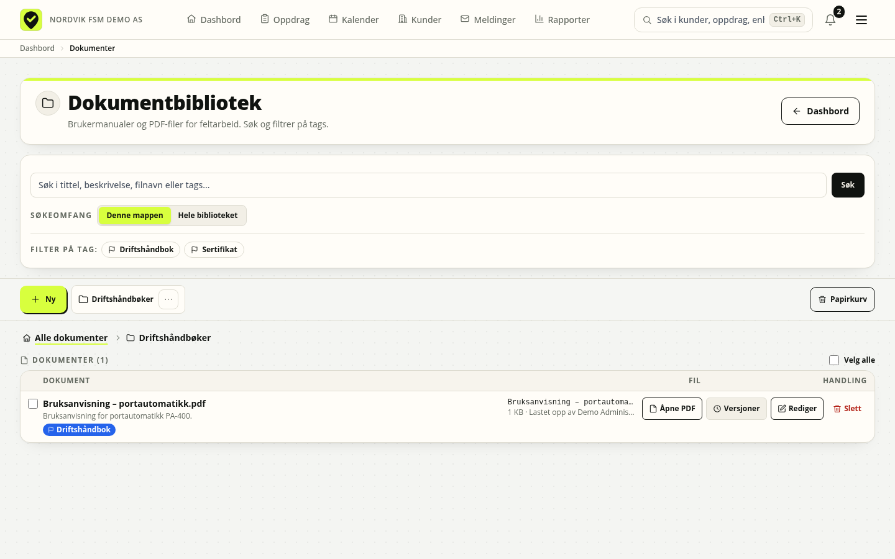 | 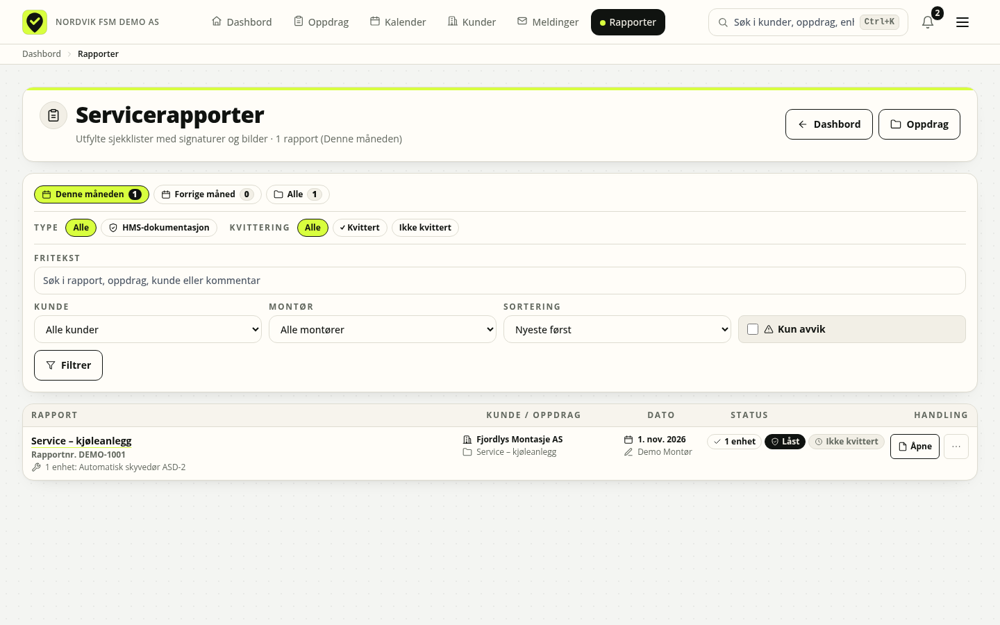 |
| 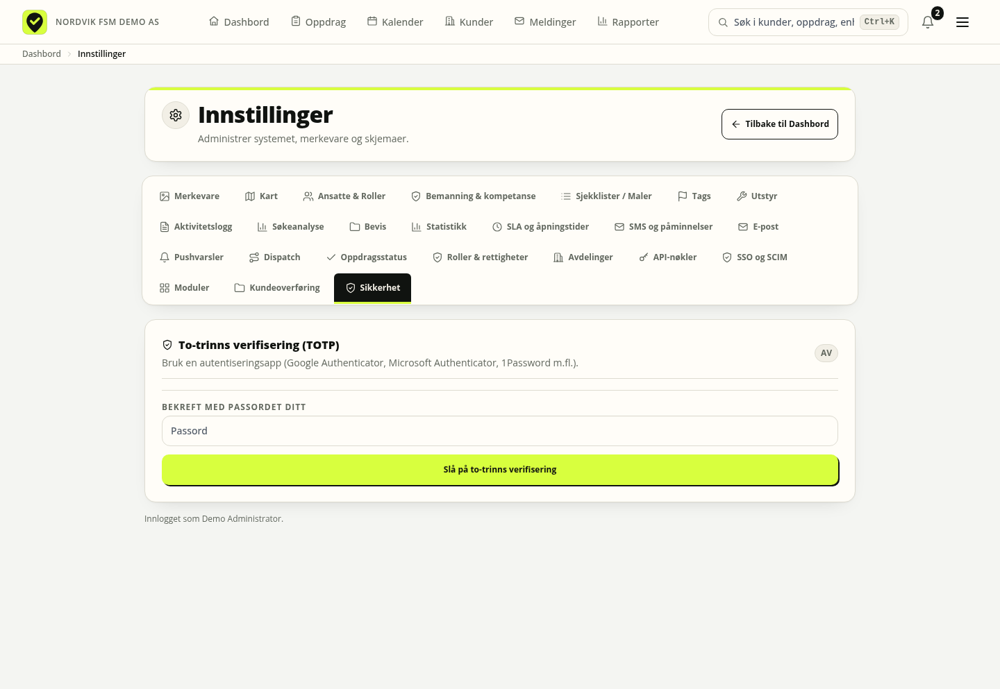 | 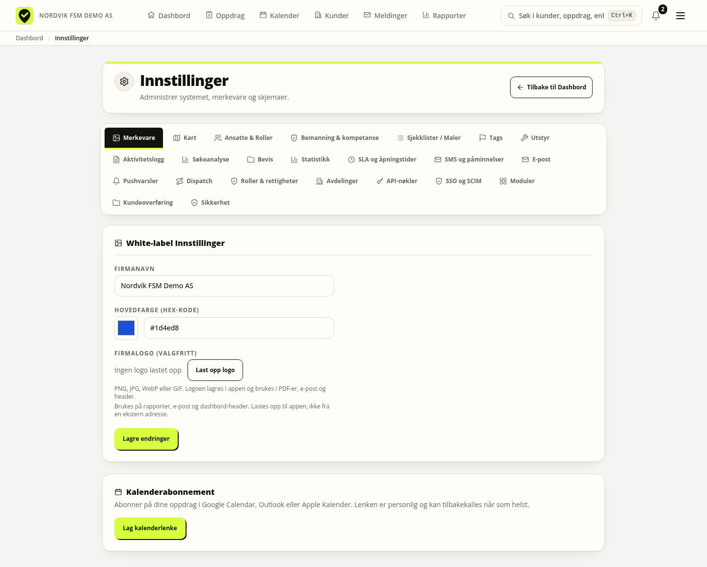 |
| 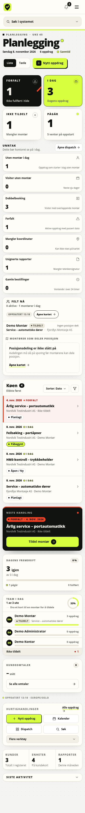 | 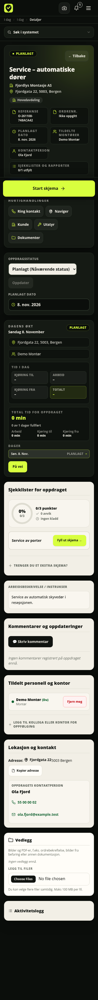 |
| 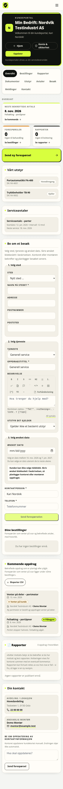 | |

</details>

Alle sidevisninger er også fanget i desktop- og mobilformat under
[`screenshots/pages/`](screenshots/pages/), med rutedekning i
`manifest.json`. `npm run screenshots:verify` kontrollerer at hver `page.tsx`
er dekket.

## Hurtigstart med Docker

Dette er anbefalt måte å kjøre produksjon på. Du trenger Docker med Compose v2,
et domenenavn og minst 1 GB RAM og 2 GB swap. Sett opp reverse proxy etterpå – se
[Caddy](#caddy-reverse-proxy).

1. Hent koden og lag miljøfilen:

   ```bash
   git clone <repo-url> fsm-platform
   cd fsm-platform
   cp .env.example .env
   chmod 600 .env
   ```

2. Fyll inn de påkrevde verdiene i `.env`:

   ```dotenv
   POSTGRES_PASSWORD=<langt-tilfeldig-passord>
   NEXTAUTH_SECRET=<openssl rand -base64 32>
   NEXTAUTH_URL=https://fsm.example.com
   APP_URL=https://fsm.example.com

   # Pinn til en publisert versjon, ikke latest.
   APP_IMAGE=ghcr.io/eroticd/fsm-platform:v0.8.9
   POSTGRES_IMAGE=postgres:15.13
   ```

   `POSTGRES_PASSWORD`, `NEXTAUTH_SECRET`, `NEXTAUTH_URL` og `APP_URL` er
   påkrevd i produksjons-Compose. `NEXTAUTH_URL` og `APP_URL` må være `https://`.
   Alle variabler er dokumentert i [`.env.example`](.env.example).

3. Hent imaget og start tjenestene:

   ```bash
   docker compose -f docker-compose.prod.yml pull
   docker compose -f docker-compose.prod.yml up -d
   ```

   Compose starter Postgres først, venter til databasen er frisk, og appen kjører
   `prisma migrate deploy` ved oppstart. Første gang kan du opprette administrator
   med `SEED_DATABASE=true` og `SEED_ADMIN_*` mot en tom database. Slå
   `SEED_DATABASE` av igjen etterpå.

4. Kontroller at tjenesten er klar:

   ```bash
   docker compose -f docker-compose.prod.yml ps
   curl -fsS http://127.0.0.1:3000/api/health
   curl -fsS http://127.0.0.1:3000/api/ready
   docker compose -f docker-compose.prod.yml logs -f app
   ```

   `/api/health` er liveness, og `/api/ready` sjekker database. Med
   `READY_SECRET` eller `CRON_SECRET` sjekker den også opplastingsvolum og
   jobbkø. Produksjons-Compose bruker readiness som healthcheck uten å
   restart-loope ved databaseutfall. Appen lytter bare på `127.0.0.1:3000`.

## Caddy reverse proxy

Appen skal ikke eksponeres direkte. Caddy gir HTTPS automatisk, begrenser
request-body og overskriver videresendingsheadere slik at en klient ikke kan
spoofe IP eller protokoll. Fullt eksempel ligger i
[`deploy/proxy/Caddyfile`](deploy/proxy/Caddyfile).

```caddyfile
fsm.example.com {
	encode zstd gzip

	# Litt over appens egen grense (50 MB PDF), slik at appen kan svare 413.
	request_body {
		max_size 55MB
	}

	reverse_proxy 127.0.0.1:3000 {
		header_up Host {host}
		header_up X-Forwarded-Host {host}
		header_up X-Forwarded-Proto {scheme}
		header_up X-Forwarded-For {remote_host}
		header_up X-Real-IP {remote_host}

		transport http {
			dial_timeout 5s
			response_header_timeout 300s
			read_timeout 300s
			write_timeout 300s
		}
	}

	header {
		-Server
		Strict-Transport-Security "max-age=31536000; includeSubDomains"
	}
}
```

Sett disse i `.env` når appen står bak én proxy:

```dotenv
TRUST_PROXY=true
TRUST_PROXY_HOPS=1
```

`TRUST_PROXY_HOPS` er antallet betrodde proxyer, ikke antallet
`X-Forwarded-For`-oppføringer. Ved flere hopp må bare kantsonen overskrive
headeren. Uten `TRUST_PROXY` ignoreres `X-Forwarded-For`, og IP-baserte
rate limits er inaktive. Sjekk gjerne at en klientstyrt header ikke endrer
nøkkelen:

```bash
curl -sS -H 'X-Forwarded-For: 6.6.6.6' https://fsm.example.com/api/health
```

nginx-eksempel, feilsøking av 502 og flere proxy-detaljer står i
[`deploy/proxy/README.md`](deploy/proxy/README.md) og
[`docs/OPERATIONS.md`](docs/OPERATIONS.md).

## Flytte database og data

Produksjons-Compose bruker to navngitte volumer:

| Volum | Innhold | Må sikkerhetskopieres |
| --- | --- | --- |
| `fsm_postgres_data` | Selve databasen | Ja, med `pg_dump` eller volumkopi |
| `fsm_uploads` | Opplastede bilder, PDF-er og vedlegg | Ja, med arkivkopi |

`.next`-cachen er **ikke** et volum. Den ligger i en `tmpfs` i containeren og kan
trygt forkastes ved nytt image eller ny container. Det samme gjelder
mellomlagrede PDF-jobber under `/tmp`.

Flytt alltid database og opplastinger fra **samme tidspunkt**. En databasekopi
uten filene gir vedlegg som peker på filer som mangler.

1. **Ta backup først.** Bruk skriptene når du kan:

   ```bash
   NODE_ENV=production COMPOSE_FILE=docker-compose.prod.yml ./scripts/backup.sh
   ./scripts/backup-freshness.sh
   ```

   Manuelt kan du bruke `pg_dump` og en arkivkopi av volumet:

   ```bash
   COMPOSE="docker compose -f docker-compose.prod.yml"
   mkdir -p backups
   $COMPOSE stop app

   $COMPOSE exec -T postgres pg_dump -U admin -d fsm_db -Fc \
     > backups/fsm-$(date +%Y%m%d-%H%M%S).dump

   VOLUME="$(docker volume ls --format '{{.Name}}' | grep -E '_fsm_uploads$' | head -n 1)"
   docker run --rm -v "$VOLUME:/data:ro" -v "$PWD/backups:/backup" postgres:15 \
     tar czf "/backup/uploads-$(date +%Y%m%d-%H%M%S).tar.gz" -C /data .
   ```

2. **Flytt til ny maskin.** Opprett volumene og gjenopprett i riktig rekkefølge:

   ```bash
   COMPOSE="docker compose -f docker-compose.prod.yml"
   $COMPOSE up -d postgres

   $COMPOSE exec -T postgres pg_restore -U admin -d fsm_db --clean --if-exists \
     < backups/fsm-YYYYMMDD-HHMMSS.dump

   VOLUME="$(docker volume ls --format '{{.Name}}' | grep -E '_fsm_uploads$' | head -n 1)"
   docker run --rm -v "$VOLUME:/data" -v "$PWD/backups:/backup:ro" postgres:15 \
     sh -c 'cd /data && tar xzf /backup/uploads-YYYYMMDD-HHMMSS.tar.gz'
   ```

   Behold eierskap og rettigheter fra arkivet. Postgres-volumet må eies av
   postgres-brukeren i imaget, og opplastingsvolumet må være skrivbart for
   appbrukeren. Ikke bruk `chmod 777`; sammenlign eierskap med en fersk
   installasjon hvis du er usikker.

3. **Verifiser før du kutter over:** start appen, sjekk `/api/ready`, åpne en
   kunde, en rapport-PDF og et vedlegg. Kontroller at antall rader og filer
   stemmer med kilden.

4. **Rull tilbake** ved feil: stopp appen, bytt tilbake til de gamle volumene
   eller gjenopprett dumpen og opplastingsarkivet fra samme tidspunkt. Behold
   den gamle kopien til den nye er verifisert.

> **Advarsel:** Kjør aldri `docker system prune --volumes` på en
> produksjonsmaskin. Det sletter `fsm_postgres_data` og `fsm_uploads`.

Backup, kryptering, restore-test og rollback er beskrevet i
[`docs/OPERATIONS.md`](docs/OPERATIONS.md#backup-og-restore).

## Oppdatere til ny versjon

1. Les [endringsloggen](CHANGELOG.md) og ta en fersk backup. I produksjon kan du
   kreve backup før migrering med `REQUIRE_BACKUP_BEFORE_MIGRATE=true` og
   `BACKUP_CONFIRMED=true`.
2. Bytt `APP_IMAGE` til den nye, pinnede taggen i `.env`:

   ```dotenv
   APP_IMAGE=ghcr.io/eroticd/fsm-platform:v0.8.9
   ```

3. Kontroller hvilke images som faktisk brukes, hent og recreate:

   ```bash
   docker compose -f docker-compose.prod.yml config --images
   docker compose -f docker-compose.prod.yml pull app
   docker compose -f docker-compose.prod.yml up -d --force-recreate app
   ```

   Migrasjonene kjøres ved oppstart med `prisma migrate deploy`. De er additive
   med mindre annet er dokumentert; sjekk endringsloggen ved store hopp.

4. Verifiser:

   ```bash
   docker compose -f docker-compose.prod.yml ps
   curl -fsS https://fsm.example.com/api/health
   curl -fsS https://fsm.example.com/api/ready
   docker compose -f docker-compose.prod.yml logs --tail=100 app
   ```

   Gjør en røyktest: logg inn, åpne en kunde, last opp en fil og åpne en
   rapport-PDF.

5. **Rull tilbake** ved feil: sett `APP_IMAGE` tilbake til forrige kjente gode
   tag eller digest, kjør `pull app` og `up -d app`, og verifiser igjen. Er
   databasen migrert destruktivt, må du også gjenopprette database og
   opplastinger fra backup.

Rydd gamle images bevisst med `docker image prune`, men behold minst forrige
kjente gode image. Volumer skal ikke ryddes automatisk. Se
[`docs/OPERATIONS.md`](docs/OPERATIONS.md#rollback) for full rollback og
[`docs/OPERATIONS.md`](docs/OPERATIONS.md#produksjonssett-image-pinning) for
pinning til digest.

## Lokal utvikling

Forutsetninger: Node.js 22+, Docker og npm.

```bash
npm ci
cp .env.example .env      # sett DATABASE_URL og NEXTAUTH_SECRET
docker compose up -d postgres
npm run db:migrate
npm run seed              # valgfritt: oppretter administrator
npm run dev
```

Appen er da på <http://localhost:3000>. For OCR av skannede PDF-er trengs
`poppler-utils` lokalt (`pdftotext`/`pdftoppm`); i Docker-imaget er det
installert med norsk og engelsk språkdata. E2E, skjermbilder og
utviklingsdetaljer står i [`CONTRIBUTING.md`](CONTRIBUTING.md).

## Brukermanual

- [Norsk brukermanual (PDF)](docs/manual/FSM-brukermanual-nb.pdf)
- [English user manual (PDF)](docs/manual/FSM-user-manual-en.pdf)
- [Markdown-kilder og byggeinstruksjoner](docs/manual/README.md)

Manualen er delt i kontor, tekniker og administrator, med egen introduksjon,
SSO/SCIM-kapittel og oppslagsdel. `npm run manual:build` bygger PDF-ene på nytt.

## Dokumentasjon

| Dokument | Innhold |
| --- | --- |
| [`docs/OPERATIONS.md`](docs/OPERATIONS.md) | Produksjon, backup, rollback, proxy, SSO, opplasting og feilsøking |
| [`docs/API.md`](docs/API.md) | REST-API med eksempler; OpenAPI på `/api/v1/openapi.json` |
| [`docs/NATIVE.md`](docs/NATIVE.md) | Capacitor-skallet for Android/iOS |
| [`docs/DESIGN.md`](docs/DESIGN.md) | Designsystem, farger og komponentregler |
| [`SECURITY.md`](SECURITY.md) | Sikkerhetsmodell og rapportering |
| [`CONTRIBUTING.md`](CONTRIBUTING.md) | Oppsett, tester og pull requests |

## Sikkerhet

- Passord hashes med bcrypt, og innlogging, opplasting, søk og kommentarer har
  hastighetsbegrensning.
- All autorisasjon sjekkes på serveren; oppdrag er avdelingssperret, og
  kundeportalbrukere ser bare egen kundedata.
- Opplastede filer har tilgangskontroll per fil, og økter ugyldiggjøres når
  passord, rolle, rettigheter eller 2FA endres.
- 2FA (TOTP) kan kreves for utvalgte roller. Signerte rapporter fryses med et
  øyeblikksbilde, og PDF-er saneres før de vises i appen.
- Skjemafelt renses på serveren, og responsene får sikkerhetsheadere. Se
  [`SECURITY.md`](SECURITY.md) for rapportering.

## Lisens

Programmet er tilgjengelig under **Business Source License 1.1 (BSL 1.1)** – en
kildeåpen lisens, ikke en OSI-godkjent åpen kildekodelisens. Uten en ekstra
bruksrett krever all produksjonsbruk en egen kommersiell avtale med
lisensgiveren. Fra endringsdatoen 2030-10-19 gjelder Apache License 2.0 for den
aktuelle versjonen. Se [LICENSE](LICENSE) for den fullstendige teksten.
