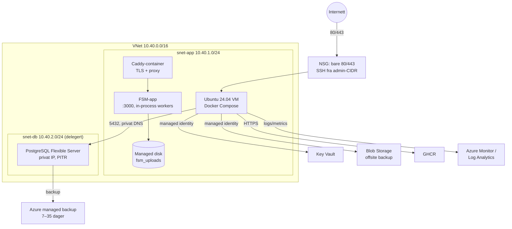

# Azure-drift av FSM-plattformen

Denne guiden beskriver en produksjonsnær Azure-topologi for FSM-plattformen
versjon **0.9.4**:

- én Ubuntu 24.04 LTS VM med Docker Compose
- appen og Caddy på samme VM, uten lokal PostgreSQL
- Azure Database for PostgreSQL Flexible Server med privat VNet-tilgang
- Azure Key Vault for hemmeligheter og managed identity
- Azure Blob Storage for offsite backup
- Azure Monitor, Log Analytics og varsler

Guiden er skrevet for driftspersonell som kan Azure og Docker. Kommandoene er
ment å kunne kopieres, men **Azure CLI-versjoner og portalopplevelse endrer
seg**. Kjør `az <kommando> --help` hvis en parameter avvikes.

> **Status og avgrensning**
>
> Dette er en primærarkitektur for én app-instans. Appen har nå
> storage-abstraksjon med S3/MinIO-driver, Redis-basert kø/cache/rate limit med
> database-fallback, og PITR-verktøy for Compose. Se
> [Skalering og HA](#10-skalering-og-ha), [`STORAGE.md`](STORAGE.md) og
> [`SCALING.md`](SCALING.md). Azure-oppsettet under bruker fortsatt lokal disk
> som standard og må konfigureres bevisst for flere replikaer.
>
> Alle `az`-kommandoer under er **ikke kjørt mot et ekte Azure-abonnement** i
> denne guiden. Det som er verifisert lokalt, står i tabellen nedenfor.

## Verifisert i repo, og hva som må testes i Azure

| Område | Status |
| --- | --- |
| `deploy/azure/docker-compose.azure.yml` | ✅ `docker compose config` er kjørt med dummy-verdier i denne guiden |
| `deploy/azure/Caddyfile` | ✅ `caddy validate` med `caddy:2.10-alpine` |
| `deploy/azure/fsm-fetch-secrets.sh` | ✅ `bash -n`; ikke kjørt mot Key Vault |
| `deploy/azure/cloud-init.yaml` | ✅ YAML parset; ikke kjørt i Azure |
| `deploy/azure/fsm-compose.service` | ✅ Gjennomgått; ikke installert på en Azure VM |
| PostgreSQL 15+ | ✅ Krevet av repoet (`.env.example` og `docs/OPERATIONS.md`) |
| Migrasjoner ved oppstart, separate DB-roller, readiness | ✅ Verifisert i `docker-entrypoint.sh`, `src/app/api/ready/route.ts` og `docs/OPERATIONS.md` |
| Caddy bak proxy, `TRUST_PROXY`, body-grenser | ✅ Verifisert i `deploy/proxy/Caddyfile` og `deploy/proxy/README.md` |
| Private DNS, NSG, managed identity, Key Vault RBAC | ☁️ Må verifiseres i et ekte abonnement |
| `sslmode=verify-full` fra Prisma/`pg` mot Flexible Server | ☁️ Må røyktestes; `require` er dokumentert fallback |
| Rollene `fsm_migrator`/`fsm_app` på Flexible Server | ☁️ SQL-en er hentet fra repoet, men Azure-admin er ikke superbruker; se [Databaseroller](#44-databaseroller-og-migrasjoner) |
| Caddy/Let's Encrypt, DNS og TLS | ☁️ Må verifiseres med det faktiske domenet |
| Backup/PITR, Blob-opplasting og restore | ☁️ Må kjøres som en restore-øvelse |
| Azure Monitor-varsler og kostnad | ☁️ Må verifiseres i abonnementet og med priskalkulatoren |

## Arkitektur



### Dataflyt

1. Caddy lytter på 80/443, henter og fornyer Let's Encrypt-sertifikat og
   videresender til `app:3000` over Compose-nettverket. Appen har ingen publik
   port.
2. Appen kobler til PostgreSQL med `DATABASE_URL` (runtime, DML) og kjører
   `prisma migrate deploy` med `DATABASE_MIGRATION_URL` (DDL) ved oppstart.
3. Opplastede filer ligger i `UPLOAD_DIR=/app/uploads`, som er et Docker-volum
   på VM-ens managed disk. De ligger **ikke** i Blob.
4. Hemmeligheter hentes fra Key Vault ved boot av
   `deploy/azure/fsm-fetch-secrets.sh` og skrives til `/etc/fsm/fsm.env` (0600).
5. Blob Storage brukes bare til offsite kopi av database- og
   opplastingsbackuper. PostgreSQL sine automatiske backuper og PITR ligger i
   Azure.
6. Azure Monitor samler VM-metrikker, syslog og eventuelt containerlogger, og
   varsler på tilgjengelighet, CPU, disk, database og backup.

### Hvorfor app + Caddy bare

`docker-compose.prod.yml` har lokal PostgreSQL fordi den er laget for en enkel
Droplet. På Azure flyttes databasen til en administrert tjeneste. Da blir
Compose-filen i `deploy/azure/` bevisst mindre:

- ingen `postgres`-tjeneste, ingen lokal databasebackup i containeren
- ingen `depends_on: postgres`
- Caddy får publik port, appen bare internt nett
- samme image, samme miljøvariabler, samme readiness-healthcheck og samme
  herding (`read_only`, `tmpfs`, `cap_drop`, `no-new-privileges`)

## Størrelse, region og kostnad

### Region

Bruk samme region for VM, VNet, PostgreSQL, Key Vault og Storage. `norwayeast`
er nær norske brukere, men ikke alle SKU-er er tilgjengelige i alle regioner.
Sjekk med:

```bash
az account list-locations --query "[?name=='norwayeast'].{name:name,displayName:displayName}" -o table
az postgres flexible-server list-skus -l norwayeast -o table
```

### VM-størrelse

| Størrelse | CPU/RAM | Bruk |
| --- | --- | --- |
| `Standard_B2s` | 2 vCPU / 4 GiB | Minimum for lett bruk. PDF/OCR og kundeimport kan bli trange. |
| `Standard_B2ms` | 2 vCPU / 8 GiB | **Anbefalt standard** for denne guiden. God margin til Node-heap, OCR, PDF og kundeimport. |
| `Standard_D2as_v5` / `D2ds_v5` | 2 vCPU / 8 GiB | Forutsigbar ytelse uten burst-kreditter; velg denne ved jevn PDF-last. |
| `Standard_D4as_v5` | 4 vCPU / 16 GiB | Større installasjoner med mye OCR/PDF. |

App-containeren får `APP_MEM_LIMIT=3g` og
`NODE_OPTIONS=--max-old-space-size=1536` som standard. På 4 GiB bør dere senke
begge bevisst, for eksempel `APP_MEM_LIMIT=2g` og
`NODE_OPTIONS=--max-old-space-size=1024`. Kundeimport kan holde en ZIP på opptil
500 MiB i minnet i v1, så 4 GiB er ikke anbefalt for den funksjonen.

### Disk

- OS-disk: 64 GiB Premium SSD er nok for OS, Docker-images og logger.
- Opplastingsvolumet ligger på samme disk i denne minimaloppskriften. Ved mye
  vedlegg bør dere legge et eget data-disk-volum bak `/var/lib/docker` eller
  bruke en større OS-disk. Azure kan utvide managed disks uten ny VM.
- Hold minst 30 % ledig disk. Overvåk `fsm_disk_used_ratio` fra
  `/api/metrics` og Azure Monitor.

### Database

| SKU | CPU/RAM | Bruk |
| --- | --- | --- |
| `Standard_B1ms` | 1 vCPU / 2 GiB | Små installasjoner og test. Burstable kan gå tom for CPU-kreditter. |
| `Standard_B2ms` | 2 vCPU / 8 GiB | **Anbefalt standard** for produksjon. |
| `Standard_D2ds_v5` | 2 vCPU / 8 GiB | Forutsigbar ytelse ved jevn last. |

Velg PostgreSQL **16** i denne guiden. Repoet krever 15 eller nyere; 16 er en
støttet hovedversjon i Flexible Server. Test alltid en mindre versjonsoppgradering
i staging først.

### Kostnadsestimat

Veiledende månedspriser i USD, betalt etter forbruk, uten rabatter og uten mva.
Prisene varierer med region, valuta og avtale. Bruk
[Azure Pricing Calculator](https://azure.microsoft.com/pricing/calculator/)
for et faktisk tall.

| Ressurs | Liten | Anbefalt |
| --- | --- | --- |
| VM (`B2s`/`B2ms`) | 35–70 | 60–100 |
| 64 GiB Premium SSD + snapshots | 8–15 | 10–20 |
| Statisk public IP | 3–5 | 3–5 |
| PostgreSQL (`B1ms`/`B2ms`) | 30–60 | 110–180 |
| PostgreSQL storage 64 GiB + backup | 5–15 | 10–25 |
| Key Vault | < 1 | < 1 |
| Blob Storage (100 GiB, hot/cool) | 2–8 | 3–10 |
| Log Analytics (5 GiB/ måned) | 10–20 | 15–30 |
| Egress/bandbredde | 0–20 | 5–30 |
| **Sum per måned** | **ca. 95–215** | **ca. 220–400** |

Merk:

- B-serien er burstable. Jevn PDF/OCR-last kan bruke opp CPU-kredittene og gi
  dårlig responstid. Velg D-serien hvis lasten er jevn.
- Geo-redundant backup og sone-redundant database koster ekstra.
- Azure Monitor kan bli den største variable posten hvis dere sender mye
  containerlogg. Begrens Log Analytics med datainnsamlingsregler og
  oppbevaring.

## Forutsetninger

- Azure-abonnement med `Contributor` eller tilsvarende på resource group.
- `az` CLI 2.60+ (nyere er bedre), `jq`, `openssl` og `ssh-keygen`.
- Et domene dere kontrollerer. Caddy må kunne nås på port 80 og 443 for
  ACME-utfordringen.
- En SSH-nøkkel. Ikke bruk passordinnlogging på VM-en.
- Et GHCR-image. Er pakken privat, trenger VM-en en read-only token med
  `read:packages`.

Logg inn og velg abonnement:

```bash
az login
az account set --subscription "<abonnements-id-eller-navn>"
az account show --query "{name:name,id:id,tenantId:tenantId}" -o table
```

## 0. Variabler

Kommandoene under bruker disse shellvariablene. De inneholder **ingen
hemmeligheter**. Legg dem gjerne i en lokal, ikke-committet fil og `source`
den.

```bash
export RG="rg-fsm-prod"
export LOC="norwayeast"
export PREFIX="fsm-prod"
export VNET="vnet-fsm-prod"
export APP_SUBNET="snet-app"
export DB_SUBNET="snet-db"
export APP_NSG="nsg-app"
export DB_NSG="nsg-db"
export VM_NAME="vm-fsm-app"
export VM_SIZE="Standard_B2ms"
export ADMIN_CIDR="203.0.113.10/32"      # bytt til din faste IP
export DOMAIN="fsm.example.no"
export PG_NAME="pg-fsm-prod"
export KV_NAME="kv-fsm-prod-$RANDOM"
export ST_NAME="stfsmprod$RANDOM"
export APP_IMAGE="ghcr.io/eroticd/fsm-platform:v0.9.4"
```

> `ADMIN_CIDR` er eksempelet `203.0.113.10/32` fra dokumentasjonsblokken
> (TEST-NET-3). Bruk din egen offentlige IP, ikke denne.

Kommandoene forutsetter at variabler fra tidligere steg er satt i samme shell.
Bruk `export`, og ikke legg hemmeligheter i en fil som committes. Hvis dere
bytter shell underveis, må dere sette variablene på nytt.

## 1. Resource group, nettverk, NSG og DNS

### 1.1 Resource group

```bash
az group create --name "$RG" --location "$LOC"
```

### 1.2 VNet og subneter

App-subnettet er vanlig. Database-subnettet må delegeres til
`Microsoft.DBforPostgreSQL/flexibleServers` og kan ikke brukes av andre
ressurser.

```bash
az network vnet create \
  --resource-group "$RG" \
  --name "$VNET" \
  --location "$LOC" \
  --address-prefixes 10.40.0.0/16 \
  --subnet-name "$APP_SUBNET" \
  --subnet-prefixes 10.40.1.0/24

az network vnet subnet create \
  --resource-group "$RG" \
  --vnet-name "$VNET" \
  --name "$DB_SUBNET" \
  --address-prefixes 10.40.2.0/24 \
  --delegations Microsoft.DBforPostgreSQL/flexibleServers
```

### 1.3 NSG for app-subnettet

Bare 80/443 skal være åpne mot Internett. SSH begrenses til admin-CIDR.
Azure sine standardregler avviser annen inbound trafikk; vi trenger ikke en
eksplisitt «deny all»-regel.

```bash
az network nsg create \
  --resource-group "$RG" \
  --name "$APP_NSG" \
  --location "$LOC"

az network nsg rule create \
  --resource-group "$RG" \
  --nsg-name "$APP_NSG" \
  --name allow-http-80 \
  --priority 100 \
  --direction Inbound \
  --access Allow \
  --protocol Tcp \
  --source-address-prefixes Internet \
  --destination-port-ranges 80

az network nsg rule create \
  --resource-group "$RG" \
  --nsg-name "$APP_NSG" \
  --name allow-https-443 \
  --priority 110 \
  --direction Inbound \
  --access Allow \
  --protocol Tcp \
  --source-address-prefixes Internet \
  --destination-port-ranges 443

az network nsg rule create \
  --resource-group "$RG" \
  --nsg-name "$APP_NSG" \
  --name allow-ssh-admin \
  --priority 120 \
  --direction Inbound \
  --access Allow \
  --protocol Tcp \
  --source-address-prefixes "$ADMIN_CIDR" \
  --destination-port-ranges 22

az network vnet subnet update \
  --resource-group "$RG" \
  --vnet-name "$VNET" \
  --name "$APP_SUBNET" \
  --network-security-group "$APP_NSG"
```

### 1.4 NSG for database-subnettet

Tillat 5432 bare fra app-subnettet. Ikke åpne 5432 mot Internett.

```bash
az network nsg create \
  --resource-group "$RG" \
  --name "$DB_NSG" \
  --location "$LOC"

az network nsg rule create \
  --resource-group "$RG" \
  --nsg-name "$DB_NSG" \
  --name allow-app-postgres \
  --priority 100 \
  --direction Inbound \
  --access Allow \
  --protocol Tcp \
  --source-address-prefixes 10.40.1.0/24 \
  --destination-port-ranges 5432

az network vnet subnet update \
  --resource-group "$RG" \
  --vnet-name "$VNET" \
  --name "$DB_SUBNET" \
  --network-security-group "$DB_NSG"
```

Ved høy tilgjengelighet (HA) på databasen krever Azure også trafikk på 5432
internt i database-subnettet og til Storage. Siden vi ikke legger på noen
utgående «deny»-regel, er standard utbound tillatt. Legg eventuelt til:

```bash
az network nsg rule create \
  --resource-group "$RG" \
  --nsg-name "$DB_NSG" \
  --name allow-db-self-5432 \
  --priority 110 \
  --direction Inbound \
  --access Allow \
  --protocol Tcp \
  --source-address-prefixes 10.40.2.0/24 \
  --destination-port-ranges 5432
```

### 1.5 Statisk public IP og DNS

```bash
az network public-ip create \
  --resource-group "$RG" \
  --name "pip-$PREFIX" \
  --location "$LOC" \
  --sku Standard \
  --allocation-method Static \
  --dns-name "$PREFIX-app"

IP="$(az network public-ip show \
  --resource-group "$RG" \
  --name "pip-$PREFIX" \
  --query ipAddress -o tsv)"
echo "$IP"
```

Lag en `A`-record for `$DOMAIN` mot `$IP` hos DNS-leverandøren. Har dere sonen
i Azure DNS i samme resource group:

```bash
az network dns record-set a add-record \
  --resource-group "$RG" \
  --zone-name "example.no" \
  --record-set-name "fsm" \
  --ipv4-address "$IP" \
  --ttl 300
```

> **Cloudflare eller annen proxy foran:** En oransje Cloudflare-proxy skjuler
> origin og kan blokkere Caddys HTTP-01-utfordring. Bruk «DNS only» (grå sky)
> for `$DOMAIN`, eller sett opp DNS-01 hos Caddy. Cloudflare Free har også en
> body-grense på 100 MB, som blokkerer kundeimport på opptil 500 MiB. Se
> [Caddy 413](#caddy-413).

## 2. VM med cloud-init

### 2.1 Lag NIC og VM

`deploy/azure/cloud-init.yaml` installerer Docker, Azure CLI, `age`,
`postgresql-client`, swap og kataloger. Den lager **ikke** appbrukeren
`azureuser`; Azure gjør det når `--admin-username azureuser` brukes. Har dere
et annet admin-navn, må cloud-init-filen justeres, eller katalogene opprettes
manuelt.

```bash
az network nic create \
  --resource-group "$RG" \
  --name "nic-$VM_NAME" \
  --location "$LOC" \
  --vnet-name "$VNET" \
  --subnet "$APP_SUBNET" \
  --network-security-group "$APP_NSG" \
  --public-ip-address "pip-$PREFIX"

az vm create \
  --resource-group "$RG" \
  --name "$VM_NAME" \
  --location "$LOC" \
  --nics "nic-$VM_NAME" \
  --image Ubuntu2404 \
  --size "$VM_SIZE" \
  --admin-username azureuser \
  --ssh-key-values "$HOME/.ssh/id_ed25519.pub" \
  --custom-data deploy/azure/cloud-init.yaml \
  --os-disk-size-gb 64 \
  --storage-sku Premium_LRS \
  --security-type TrustedLaunch \
  --enable-secure-boot true \
  --enable-vtpm true \
  --assign-identity "[system]" \
  --tags project=fsm environment=prod
```

`--image Ubuntu2404` er Azure CLI-aliaset for Ubuntu 24.04 LTS. Er aliaset
ikke tilgjengelig i deres CLI-versjon, bruk en URN fra
`az vm image list --publisher Canonical --offer ubuntu-24_04-lts --all -o table`.

### 2.2 Verifiser VM og cloud-init

```bash
az vm show -g "$RG" -n "$VM_NAME" -d \
  --query "{publicIp:publicIps,privateIp:privateIps,size:hardwareProfile.vmSize,identity:identity.type}" \
  -o table

ssh azureuser@"$IP" 'cloud-init status --long; docker --version; docker compose version; az version | head -5'
```

Hvis cloud-init feiler:

```bash
ssh azureuser@"$IP" 'sudo tail -n 200 /var/log/cloud-init-output.log'
```

### 2.3 Identitet og OS-herding

VM-en fikk system-assigned managed identity i `az vm create`. Hent
principal-ID-en; den brukes til Key Vault og Storage:

```bash
VM_PRINCIPAL="$(az vm show -g "$RG" -n "$VM_NAME" --query identity.principalId -o tsv)"
echo "$VM_PRINCIPAL"
```

Anbefalt på VM-en:

- SSH bare fra `ADMIN_CIDR`. Vurder Azure Bastion eller Just-in-Time-access i
  stedet for å åpne 22 mot Internett.
- Ikke legg brukere i `docker`-gruppen. `docker` er i praksis root.
- La `unattended-upgrades` stå på. Reboot bevisst etter kjerneoppdateringer.
- Logg inn med nøkkel, ikke passord. Deaktiver passordinnlogging i
  `/etc/ssh/sshd_config.d/` hvis Azure-imaget har det på.
- Bruk Azure Disk Encryption/plattformkryptering (standard) og vurder
  customer-managed keys hvis kravet finnes.

## 3. Key Vault og managed identity

Key Vault opprettes før PostgreSQL, slik at databasepassordet kan legges der
med en gang.

### 3.1 Opprett vault med RBAC

```bash
az keyvault create \
  --resource-group "$RG" \
  --name "$KV_NAME" \
  --location "$LOC" \
  --enable-rbac-authorization true \
  --enable-purge-protection true \
  --retention-days 90 \
  --sku standard

KV_ID="$(az keyvault show -g "$RG" -n "$KV_NAME" --query id -o tsv)"
KV_URL="https://${KV_NAME}.vault.azure.net/"
echo "$KV_URL"
```

`--enable-purge-protection true` gjør at vaulten ikke kan slettes permanent
før oppbevaringstiden er ute. Det er et bevisst vern mot feiltrykk, men gjør
også opprydding tregere. Ikke slå det av i produksjon.

### 3.2 Gi deg selv rett til å skrive hemmeligheter

RBAC kan ta noen minutter å propagere.

```bash
SIGNED_IN_USER_ID="$(az ad signed-in-user show --query id -o tsv)"

az role assignment create \
  --assignee-object-id "$SIGNED_IN_USER_ID" \
  --assignee-principal-type User \
  --role "Key Vault Secrets Officer" \
  --scope "$KV_ID"
```

### 3.3 Gi VM-en lesetilgang

```bash
az role assignment create \
  --assignee-object-id "$VM_PRINCIPAL" \
  --assignee-principal-type ServicePrincipal \
  --role "Key Vault Secrets User" \
  --scope "$KV_ID"
```

Vil dere bruke user-assigned identity i stedet, opprett den, knytt den til
VM-en og sett `AZURE_CLIENT_ID` i `/etc/fsm/azure.env`. Scriptet støtter begge.

### 3.4 Legg inn hemmelighetene

Lag passord og tokens i shellen, og skriv dem til Key Vault via en midlertidig
fil med 0600. Unngå `--value` på kommandolinjen, som kan havne i historikk og
prosessliste.

```bash
set_secret() {
  local name="$1" value="$2" tmp
  tmp="$(mktemp)"
  chmod 600 "$tmp"
  printf '%s' "$value" >"$tmp"
  az keyvault secret set \
    --vault-name "$KV_NAME" \
    --name "$name" \
    --file "$tmp" \
    --only-show-errors >/dev/null
  rm -f "$tmp"
}

# Azure krever minst 3 av 4 tegnkategorier for admin-passordet. Prefikset
# gir stor/liten bokstav, tall og symbol; resten er tilfeldig.
PG_ADMIN_PASSWORD="Aa1-$(openssl rand -hex 20)"
# Rollene opprettes av SQL og kan bruke heksadesimale passord. De er
# URL-trygge og trenger ikke koding i DATABASE_URL.
DB_MIGRATION_PASSWORD="$(openssl rand -hex 24)"
DB_RUNTIME_PASSWORD="$(openssl rand -hex 24)"
NEXTAUTH_SECRET="$(openssl rand -base64 32)"

set_secret db-admin-password "$PG_ADMIN_PASSWORD"
set_secret db-migration-password "$DB_MIGRATION_PASSWORD"
set_secret db-runtime-password "$DB_RUNTIME_PASSWORD"
set_secret nextauth-secret "$NEXTAUTH_SECRET"
set_secret metrics-secret "$(openssl rand -base64 32)"
set_secret ready-secret "$(openssl rand -base64 32)"
set_secret cron-secret "$(openssl rand -base64 32)"
```

`db-*-password` brukes av drift og rotasjon. Appen får de ferdige
tilkoblings-URL-ene `database-runtime-url` og `database-migration-url`, som
lages i [4.4](#44-databaseroller-og-migrasjoner).

Legg til SMTP, SMS, SSO og eventuelt GHCR-token etter behov:

```bash
# Eksempler. Ikke lim inn hemmeligheter i historikken; bruk set_secret.
# set_secret smtp-password "..."
# set_secret sms-webhook-secret "..."
# set_secret sms-linkmobility-api-key "..."
# set_secret sso-entra-client-secret "..."
# set_secret ghcr-token "github_pat_..."
```

`fsm-fetch-secrets.sh` bruker disse navnene:

| Key Vault-navn | Miljøvariabel | Påkrevd |
| --- | --- | --- |
| `database-runtime-url` | `DATABASE_URL` | Ja |
| `database-migration-url` | `DATABASE_MIGRATION_URL` | Ja |
| `nextauth-secret` | `NEXTAUTH_SECRET` | Ja |
| `metrics-secret` | `METRICS_SECRET` | Nei |
| `ready-secret` | `READY_SECRET` | Nei |
| `cron-secret` | `CRON_SECRET` | Nei |
| `smtp-password` | `SMTP_PASS` | Nei |
| `sms-webhook-secret` | `SMS_WEBHOOK_SECRET` | Nei |
| `sms-linkmobility-api-key` | `SMS_LINKMOBILITY_API_KEY` | Nei |
| `sms-linkmobility-secret` | `SMS_LINKMOBILITY_SECRET` | Nei |
| `sms-pswincom-password` | `SMS_PSWINCOM_PASSWORD` | Nei |
| `sms-pswincom-secret` | `SMS_PSWINCOM_SECRET` | Nei |
| `sms-twilio-auth-token` | `SMS_TWILIO_AUTH_TOKEN` | Nei |
| `seed-admin-password` | `SEED_ADMIN_PASSWORD` | Nei |
| `sso-<leverandør>-client-secret` | `SSO_<LEVERANDØR>_CLIENT_SECRET` | Nei |
| `ghcr-token` | (bare `docker login`) | Nei |

Database-URL-ene legges inn etter at PostgreSQL er opprettet, se
[Databaseroller](#44-databaseroller-og-migrasjoner).

### 3.5 Key Vault-nettverk

Har dere krav om at Key Vault ikke skal være offentlig, bruk privat endepunkt
og lenke det til app-subnettet. Da må VM-en nå `*.vault.azure.net` over privat
DNS, og `az keyvault` på VM-en bruke det private endepunktet. En enklere
mellomløsning er å begrense vaulten til VM-ens offentlige IP og Azure-tjenester.

Portal: **Key Vault → Networking**. CLI-varianten for offentlig fallback:

```bash
az keyvault update \
  --resource-group "$RG" \
  --name "$KV_NAME" \
  --public-network-access Enabled \
  --default-action Deny

az keyvault network-rule add \
  --resource-group "$RG" \
  --name "$KV_NAME" \
  --ip-address "$IP"
```

Roller og nettverksregler propagerer ikke alltid umiddelbart. Hvis
`fsm-fetch-secrets.sh` feiler med 403, vent og prøv igjen før dere endrer
noe annet.

## 4. PostgreSQL Flexible Server

### 4.1 Opprett server med privat tilgang

```bash
az postgres flexible-server create \
  --resource-group "$RG" \
  --name "$PG_NAME" \
  --location "$LOC" \
  --version 16 \
  --tier Burstable \
  --sku-name Standard_B2ms \
  --storage-size 64 \
  --storage-auto-grow Enabled \
  --backup-retention 14 \
  --geo-redundant-backup Disabled \
  --vnet "$VNET" \
  --subnet "$DB_SUBNET" \
  --private-dns-zone "${PG_NAME}.private.postgres.database.azure.com" \
  --admin-user fsmadmin \
  --admin-password "$PG_ADMIN_PASSWORD" \
  --zonal-resiliency Disabled \
  --yes
```

Merk:

- `--private-dns-zone` er påkrevd ved `--vnet`/`--subnet`. Sonen kan hete
  `<noe>.private.postgres.database.azure.com`. Den må ikke være identisk med
  serverens eget navn.
- `--admin-password` vises i prosesslisten mens kommandoen kjører. Kjør den fra
  en betrodd shell, eller bruk portalen. Passordet er allerede lagret i Key
  Vault.
- `--zonal-resiliency Disabled` er standard. For HA, se
  [Skalering og HA](#10-skalering-og-ha).
- `--backup-retention 14` gir 14 dagers PITR. Maks er 35 dager.
- `--geo-redundant-backup Enabled` gir offsite backuper i en paret region, men
  koster mer og krever at regionen støtter det.

Opprett appdatabasen:

```bash
az postgres flexible-server db create \
  --resource-group "$RG" \
  --server-name "$PG_NAME" \
  --name fsm_db
```

### 4.2 Hent FQDN og verifiser privat DNS

```bash
PG_FQDN="$(az postgres flexible-server show \
  -g "$RG" -n "$PG_NAME" \
  --query fullyQualifiedDomainName -o tsv)"
echo "$PG_FQDN"

az network private-dns zone list -g "$RG" -o table
az network private-dns link vnet list -g "$RG" -z "${PG_NAME}.private.postgres.database.azure.com" -o table
```

Fra VM-en:

```bash
nslookup "$PG_FQDN"
# Forventet: en privat adresse i 10.40.2.0/24, ikke en offentlig IP.
```

Hvis navnet ikke løses, se [Private DNS](#private-dns).

### 4.3 Public access-fallback

Bare hvis privat VNet-tilgang ikke er mulig. Åpne 5432 for **VM-ens statiske
public IP**, ikke for hele Internett:

```bash
# Opprett serveren med --public-access None i stedet for --vnet/--subnet/
# --private-dns-zone. Eksempel:
az postgres flexible-server create \
  --resource-group "$RG" \
  --name "$PG_NAME" \
  --location "$LOC" \
  --version 16 \
  --tier Burstable \
  --sku-name Standard_B2ms \
  --storage-size 64 \
  --backup-retention 14 \
  --public-access None \
  --admin-user fsmadmin \
  --admin-password "$PG_ADMIN_PASSWORD" \
  --yes

az postgres flexible-server firewall-rule create \
  --resource-group "$RG" \
  --server-name "$PG_NAME" \
  --name allow-fsm-vm \
  --start-ip-address "$IP" \
  --end-ip-address "$IP"
```

I public-modus må `DATABASE_URL` og `DATABASE_MIGRATION_URL` fortsatt bruke
`sslmode=verify-full`. Public access er et bevisst unntak, ikke anbefalingen.
Vurder å fjerne regelen når den ikke er i bruk, og bruk Azure Private Link hvis
kravet er privat nettverk uten VNet-injeksjon.

### 4.4 Databaseroller og migrasjoner

Rollmodellen er den samme som ellers i plattformen: `fsm_migrator` eier skjemaet
og kjører DDL, `fsm_app` bruker appen og har bare DML, og `AuditLog` er
skrivebeskyttet for runtime-rollen. Roller, rettigheter, vern av revisjonssporet
og fail-closed readiness er beskrevet i
[`OPERATIONS.md#databaseroller-minste-privilegium`](OPERATIONS.md#databaseroller-minste-privilegium).
Azure-avviket er hvem som kan opprette rollene, og hvordan det gjøres:

**Azure-administratoren er ikke PostgreSQL-superbruker.** Den er vanligvis
medlem av `azure_pg_admin`. `ALTER DATABASE ... OWNER`, `ALTER SCHEMA ... OWNER`
og `ALTER DEFAULT PRIVILEGES` kan derfor feile avhengig av plattformversjon.
Test dette i abonnementet; se [Migrasjonsrollen](#migrasjonsrollen) for fallback.

Det finnes ingen `postgres`-tjeneste på Flexible Server, så den idempotente
[`deploy/postgres/provision-roles.sql`](../deploy/postgres/provision-roles.sql)
kjøres med `psql` fra VM-en (`postgresql-client` kommer med cloud-init). Klon
repoet til `/opt/fsm-platform` først (se
[6.3](#63-klon-repoet-og-legg-inn-assets)):

```bash
cd /opt/fsm-platform
export PGHOST="$PG_FQDN" PGPORT=5432 PGDATABASE=fsm_db PGUSER=fsmadmin
export PGPASSWORD="$PG_ADMIN_PASSWORD" PGSSLMODE=verify-full
export FSM_MIGRATION_PASSWORD="$DB_MIGRATION_PASSWORD"
export FSM_RUNTIME_PASSWORD="$DB_RUNTIME_PASSWORD"

psql -v ON_ERROR_STOP=1 \
  -v database_name=fsm_db \
  -v migration_role=fsm_migrator \
  -v runtime_role=fsm_app \
  -v reassign_owner='' \
  -f deploy/postgres/provision-roles.sql
```

> Stopper SQL-en etter at eierskapet er flyttet, er det sannsynligvis fordi
> Azure-admin ikke lenger eier databasen og ikke kan `GRANT`. Kjør
> granting-delen som `fsm_migrator`; se [Migrasjonsrollen](#migrasjonsrollen).

På enkelte Flexible Server-versjoner eies `public` av `pg_database_owner` eller
`azure_pg_admin`, og `ALTER SCHEMA public OWNER` kan avvises. Da kan dere la
eierskapet stå og i stedet gi `fsm_migrator` `CREATE`/`USAGE` på skjemaet pluss
default-privilegier. Migrasjonene må uansett kjøre som en rolle med `CREATE` i
`public`; dokumenter avviket hvis eierskapet ikke overføres.

Migreringen kjøres som et eget steg i [7.1](#71-forutsetning-migrasjoner-og-roller),
etter at Compose og env-filene er på plass. Ikke start appen før begge
provisioning-rundene og migrasjonene er fullført.

Lag URL-ene og legg dem i Key Vault. Passordene er heksadesimale og trenger
ikke URL-koding:

```bash
DB_RUNTIME_URL="postgresql://fsm_app:***@${PG_FQDN}:5432/fsm_db?schema=public&sslmode=verify-full"
DB_MIGRATION_URL="postgresql://fsm_migrator:***@${PG_FQDN}:5432/fsm_db?schema=public&sslmode=verify-full"

set_secret database-runtime-url "$DB_RUNTIME_URL"
set_secret database-migration-url "$DB_MIGRATION_URL"
```

`/api/ready` er fail-closed og svarer 503 hvis runtime-rollen kan DDL, så
`CREATE TABLE` som `fsm_app` skal gi `permission denied for schema public`.

### 4.5 Backup og PITR

Flexible Server tar automatiske backuper og støtter point-in-time restore (PITR)
innenfor `--backup-retention` (14 dager i [4.1](#41-opprett-server-med-privat-tilgang),
maks 35). Dette dekker **databasen**, ikke opplastingsvolumet på VM-en. Strategi,
RPO/RTO, kryptering og øvelser eies av
[`BACKUP-RESTORE.md`](BACKUP-RESTORE.md#3-rpo-og-rto).

Med `--geo-redundant-backup Enabled` ligger backupene i en paret region og kan
gjenopprettes dit om hele regionen faller ut; ellers er PITR bundet til samme
region.

```bash
az postgres flexible-server backup list --resource-group "$RG" --name "$PG_NAME" -o table

# Restore til et nytt servernavn på et gitt tidspunkt (UTC).
# PITR skriver ikke over produksjonsserveren.
az postgres flexible-server restore \
  --resource-group "$RG" \
  --name "${PG_NAME}-restore" \
  --source-server "$PG_NAME" \
  --restore-time "2026-11-07T02:00:00Z"
```

Etter en restore må dere oppdatere `DATABASE_URL`/`DATABASE_MIGRATION_URL` til
det nye serverens FQDN, eller bytte navn/peker i en planlagt cutover. Det er
ikke en in-place rollback. Test alltid restore til et separat navn først.

### 4.6 TLS og tilkobling

Bruk `sslmode=verify-full` i begge URL-ene. Det krypterer forbindelsen og
validerer at vertsnavnet matcher sertifikatet. `sslmode=require` krypterer,
men validerer ikke CA på samme måte; bruk det bare hvis CA-kjeden ikke kan
valideres i imaget, og dokumenter hvorfor.

Test fra VM-en:

```bash
psql "$DB_RUNTIME_URL" -c 'SELECT current_user, version();'
```

Test fra containeren etter at appen er startet:

```bash
sudo docker compose \
  --env-file /etc/fsm/azure.env \
  --env-file /etc/fsm/fsm.env \
  -f deploy/azure/docker-compose.azure.yml \
  exec -T app node -e \
  "const {Client}=require('pg'); const c=new Client({connectionString:process.env.DATABASE_URL}); c.connect().then(()=>c.query('select current_user')).then(r=>{console.log(r.rows);return c.end()}).catch(e=>{console.error(e.message);process.exit(1)})"
```

## 5. Blob Storage for offsite backup

Azure Blob kan brukes som primærlagring gjennom S3-kompatibilitet bare når
tjenesten tilbyr et S3-endepunkt; appen har ingen egen Azure Blob-driver.
Enkleste vei er S3/MinIO eller en S3-kompatibel gateway. Uten det skriver appen
til `UPLOAD_DIR` på VM-ens disk. Blob brukes uansett til:

- offsite kopi av `pg_dump`-filer
- offsite kopi av opplastingsarkivet eller S3-bucketten
- langtidsretensjon og immutability

Se [`STORAGE.md`](STORAGE.md) for migrering fra lokal disk.

### 5.1 Opprett storage account og container

Bruk et dedikert storage account for FSM-backuper. Da kan lifecycle-policyen
gjelde hele kontoen uten å påvirke andre data.

```bash
az storage account create \
  --resource-group "$RG" \
  --name "$ST_NAME" \
  --location "$LOC" \
  --sku Standard_GRS \
  --kind StorageV2 \
  --min-tls-version TLS1_2 \
  --allow-blob-public-access false \
  --https-only true \
  --tags project=fsm environment=prod

ST_ID="$(az storage account show -g "$RG" -n "$ST_NAME" --query id -o tsv)"

# Data plane-RBAC for den som oppretter containeren. ARM-eierskap alene gir
# ikke tilgang til blob-data. Rollen kan ta noen minutter å propagere.
az role assignment create \
  --assignee-object-id "$SIGNED_IN_USER_ID" \
  --assignee-principal-type User \
  --role "Storage Blob Data Contributor" \
  --scope "$ST_ID"

az storage container create \
  --account-name "$ST_NAME" \
  --name fsm-backups \
  --auth-mode login
```

`Standard_GRS` gir geo-redundans. `Standard_LRS` er billigere, men gir ikke
samme regionale vern. Velg bevisst.

### 5.2 Versjonering, soft delete og immutability

```bash
az storage account blob-service-properties update \
  --resource-group "$RG" \
  --account-name "$ST_NAME" \
  --enable-versioning true \
  --enable-delete-retention true \
  --delete-retention-days 30 \
  --enable-container-delete-retention true \
  --container-delete-retention-days 30

# Valgfri uforanderlighet. Perioden kan ikke reduseres senere.
az storage container immutability-policy create \
  --resource-group "$RG" \
  --account-name "$ST_NAME" \
  --container-name fsm-backups \
  --period 30 \
  --allow-protected-append-writes true
```

Immutability beskytter mot sletting og endring i perioden. Kombiner med
versjonering og soft delete. Vær klar over at en låst policy også hindrer
opprydding til perioden er ute.

### 5.3 Lifecycle-policy

Eksempel som flytter backupblober til cool etter 30 dager og sletter dem etter
365 dager. Legg merke til at immutability-perioden må være kortere enn
slettingen.

```bash
cat >/tmp/fsm-lifecycle.json <<'JSON'
{
  "rules": [
    {
      "enabled": true,
      "name": "fsm-backup-lifecycle",
      "type": "Lifecycle",
      "definition": {
        "filters": {
          "blobTypes": ["blockBlob"]
        },
        "actions": {
          "baseBlob": {
            "tierToCool": { "daysAfterModificationGreaterThan": 30 },
            "delete": { "daysAfterModificationGreaterThan": 365 }
          },
          "version": {
            "delete": { "daysAfterCreationGreaterThan": 365 }
          }
        }
      }
    }
  ]
}
JSON

az storage account management-policy create \
  --resource-group "$RG" \
  --account-name "$ST_NAME" \
  --policy @/tmp/fsm-lifecycle.json
```

### 5.4 Gi VM-en skrivetilgang med managed identity

```bash
ST_ID="$(az storage account show -g "$RG" -n "$ST_NAME" --query id -o tsv)"
CONTAINER_SCOPE="${ST_ID}/blobServices/default/containers/fsm-backups"

az role assignment create \
  --assignee-object-id "$VM_PRINCIPAL" \
  --assignee-principal-type ServicePrincipal \
  --role "Storage Blob Data Contributor" \
  --scope "$CONTAINER_SCOPE"
```

På VM-en kan dere bruke Azure CLI med `--auth-mode login`, eller AzCopy med
`azcopy login --identity`. Azure CLI er installert av cloud-init; AzCopy kan
installeres separat hvis dere trenger høyere gjennomstrømning.

```bash
az storage blob upload \
  --account-name "$ST_NAME" \
  --container-name fsm-backups \
  --name "test/hello.txt" \
  --file /etc/hostname \
  --auth-mode login \
  --only-show-errors
```

### 5.5 Backupjobb på VM-en

Kryptering, sjekksummer, retensjon, statusfil og varslingskanal er beskrevet i
[`BACKUP-RESTORE.md`](BACKUP-RESTORE.md#4-hvordan-backupen-er-bygget);
`scripts/backup.sh` forutsetter lokal PostgreSQL i Compose. På Azure gjenstår
fire ting:

**1. Egen rolle.** `fsm_migrator` har `NOCREATEROLE`, så `fsm_backup` opprettes
som admin. Den trenger bare lesetilgang:

```bash
FSM_BACKUP_PASSWORD="$(openssl rand -hex 24)"

PGPASSWORD="$PG_ADMIN_PASSWORD" psql \
  "host=$PGHOST port=5432 dbname=fsm_db user=fsmadmin sslmode=verify-full" \
  -v ON_ERROR_STOP=1 -v backup_password="$FSM_BACKUP_PASSWORD" <<'SQL'
SELECT format('CREATE ROLE %I LOGIN PASSWORD %L NOSUPERUSER NOCREATEDB NOCREATEROLE INHERIT NOBYPASSRLS',
              'fsm_backup', :'backup_password')
WHERE NOT EXISTS (SELECT 1 FROM pg_roles WHERE rolname = 'fsm_backup')\gexec
SELECT format('ALTER ROLE %I WITH LOGIN PASSWORD %L NOSUPERUSER NOCREATEDB NOCREATEROLE INHERIT NOBYPASSRLS',
              'fsm_backup', :'backup_password')\gexec
GRANT CONNECT ON DATABASE fsm_db TO fsm_backup;
GRANT USAGE ON SCHEMA public TO fsm_backup;
GRANT pg_read_all_data TO fsm_backup;
SQL
```

Avvises `GRANT pg_read_all_data` av plattformens rollemodell, gir dere `SELECT`
direkte på alle tabeller og sekvenser og kjører det på nytt etter hver
migrering. `DATABASE_BACKUP_URL` bygges med `sslmode=verify-full` og legges i en
0600-fil, ikke i shell-historikken.

**2. Managed identity og container.** Jobben kjører som root på VM-en og
gjenbruker identiteten fra
[5.4](#54-gi-vm-en-skrivetilgang-med-managed-identity): `az login --identity`
(gjøres ved boot av `fsm-fetch-secrets.sh`) og `az storage blob upload
--auth-mode login` mot containeren `fsm-backups` i kontoen fra
[5.1](#51-opprett-storage-account-og-container), med prefiksene `db/` og
`uploads/`. Ingen nøkkel eller SAS i jobben.

**3. Nøkkelen offline.** Age-identiteten skal ikke ligge på VM-en i klartekst.
Oppbevar minst to kopier offline; en eventuell kopi i Key Vault skal ligge i en
egen vault som VM-ens managed identity **ikke** har lesetilgang til. Mister dere
identiteten, kan eksisterende backuper ikke gjenopprettes.

**4. Samme tidsrom.** Database og opplastinger må tas fra samme kjøring. PITR
dekker bare databasen, så opplastingsvolumet trenger arkiv eller disksnapshot.

Plasseres jobben i en systemd-timer, bruk `OnFailure` for varsling. Vil dere
bruke `fsm_backup_age_seconds`/`fsm_backup_fresh`, må jobben skrive statusfil i
samme format som `scripts/backup.sh` (`completedAt`, `stamp`, `databaseFile`,
`uploadsFile`, `checksumsFile`, `encrypted`, `remote`, `databaseBytes`,
`uploadsBytes`). Azure Monitor bruker ikke den filen; der varsler dere på
jobben, PITR og storage.

### 5.6 Restore-øvelse

Kvartalsvis øvelse med reell RTO som mål er beskrevet i
[`BACKUP-RESTORE.md`](BACKUP-RESTORE.md#6-gjenoppretting--runbook). På Azure:
restore databasen til et **nytt** servernavn med `az postgres flexible-server
restore` (se [4.5](#45-backup-og-pitr)) og start et testmiljø mot den.
Produksjonsserveren skal aldri overskrives i en øvelse.

## 6. Docker, GHCR, env-filer og Compose

### 6.1 Docker

Cloud-init installerer Docker og Compose-plugin. Verifiser:

```bash
docker --version
docker compose version
sudo systemctl status docker --no-pager
```

Loggrotasjon er satt både i `/etc/docker/daemon.json` og i Compose-filen
(`max-size: 10m`, `max-file: 3`). `journald` er begrenset til 1 GiB. Sjekk:

```bash
df -h /
sudo docker system df
journalctl --disk-usage
```

### 6.2 GHCR

Er GHCR-pakken offentlig:

```bash
sudo docker pull "$APP_IMAGE"
```

Er den privat, logg inn som root (systemd kjører som root). Bruk en
fine-grained token med bare `read:packages`:

```bash
read -rsp "GHCR token: " GHCR_TOKEN; echo
printf '%s' "$GHCR_TOKEN" | sudo docker login ghcr.io -u "<github-bruker>" --password-stdin
unset GHCR_TOKEN
```

`fsm-fetch-secrets.sh` kan gjøre dette ved boot hvis `ghcr-token` og
`GHCR_USER` er satt. Docker lagrer credential i `/root/.docker/config.json`
(0600). Roter tokenet ved mistanke om lekkasje.

### 6.3 Klon repoet og legg inn assets

```bash
sudo git clone <repo-url> /opt/fsm-platform
sudo chown -R "$USER":"$USER" /opt/fsm-platform
cd /opt/fsm-platform
git checkout <release-tag>   # f.eks. v0.9.4, eller master
```

> `deploy/azure/` må finnes i revisjonen dere checker ut. Er Azure-assetene
> ikke merget eller utgitt ennå, kopier katalogen til VM-en eller bruk
> branchen/revisjonen som inneholder den. Uten `deploy/azure/` starter ikke
> systemd-enheten.

Kopier systemd-enheten og hemmelighetshenteren:

```bash
sudo install -m 755 deploy/azure/fsm-fetch-secrets.sh /usr/local/bin/
sudo install -m 644 deploy/azure/fsm-compose.service /etc/systemd/system/
sudo systemctl daemon-reload
```

### 6.4 Miljøfiler

To filer, begge 0600 og eid av root:

| Fil | Innhold | Skrives av |
| --- | --- | --- |
| `/etc/fsm/azure.env` | Ikke-hemmelig konfig: image, domene, `KEY_VAULT_URL`, `GHCR_USER`, valg | Dere, manuelt |
| `/etc/fsm/fsm.env` | Hemmeligheter: DB-URL-er, `NEXTAUTH_SECRET`, SMTP/SMS/SSO | `fsm-fetch-secrets.sh` |

```bash
sudo install -m 600 -o root -g root \
  deploy/azure/azure.env.example /etc/fsm/azure.env
sudoedit /etc/fsm/azure.env
```

Fyll inn minst:

```dotenv
APP_IMAGE=ghcr.io/eroticd/fsm-platform:v0.9.4
CADDY_IMAGE=caddy:2.10-alpine
FSM_DOMAIN=fsm.example.no
KEY_VAULT_URL=https://<vault>.vault.azure.net/
GHCR_USER=<github-bruker>
TRUST_PROXY_HOPS=1
REQUIRE_2FA_ROLES=ADMIN,OFFICE
```

Ikke legg inn hemmeligheter i `azure.env`. De kommer fra Key Vault.
Plassholderne i malen kan stå fordi `/etc/fsm/fsm.env` overstyrer dem; legg
aldri reelle verdier i `azure.env`. Hvis dere midlertidig må kjøre uten Key
Vault, kan dere fylle inn verdiene manuelt i `/etc/fsm/fsm.env`, men da mister
dere den automatiske rotasjonen og må sikre filen selv.

Vis at filene ikke kan leses av andre:

```bash
sudo stat -c '%a %U:%G %n' /etc/fsm/azure.env /etc/fsm/fsm.env
# forventet: 600 root:root
```

For å slippe å gjenta de to env-filene og Compose-stien, definer en liten
funksjon i shellen. Den brukes i resten av guiden:

```bash
fsm-compose() {
  sudo docker compose \
    --env-file /etc/fsm/azure.env \
    --env-file /etc/fsm/fsm.env \
    -f /opt/fsm-platform/deploy/azure/docker-compose.azure.yml \
    "$@"
}
```

Funksjonen må være definert i samme shell som kommandoene kjøres i. Bruk de
fulle kommandoene hvis dere er usikre.

### 6.5 Valider Compose

```bash
sudo /usr/local/bin/fsm-fetch-secrets.sh

sudo docker compose \
  --env-file /etc/fsm/azure.env \
  --env-file /etc/fsm/fsm.env \
  -f deploy/azure/docker-compose.azure.yml \
  config --quiet

sudo docker compose \
  --env-file /etc/fsm/azure.env \
  --env-file /etc/fsm/fsm.env \
  -f deploy/azure/docker-compose.azure.yml \
  config --images
```

`config --images` skal vise det pinned app-imaget og Caddy-imaget. Hvis
`APP_IMAGE` er `latest`, stopp og pinn til en release-tag eller et digest.

Valider Caddyfile:

```bash
sudo docker run --rm \
  -e FSM_DOMAIN="$FSM_DOMAIN" \
  -v "$PWD/deploy/azure/Caddyfile:/etc/caddy/Caddyfile:ro" \
  caddy:2.10-alpine \
  caddy validate --config /etc/caddy/Caddyfile --adapter caddyfile
```

### 6.6 Systemd

Aktiver enheten, men ikke start den ennå. Første start skjer i
[7.2](#72-start), etter at migrasjonene og rollene er på plass.

```bash
sudo systemctl enable fsm-compose.service
sudo systemctl cat fsm-compose.service
sudo systemctl is-enabled fsm-compose.service
```

Etter at første deploy er verifisert, kan dere bruke:

```bash
sudo systemctl start fsm-compose.service
sudo systemctl status fsm-compose.service --no-pager
sudo journalctl -u fsm-compose.service -n 100 --no-pager
```

Enheten gjør:

1. `fsm-fetch-secrets.sh` henter hemmeligheter og skriver `/etc/fsm/fsm.env`.
2. `fsm-compose up -d --remove-orphans` starter app og Caddy.
3. `ExecStop` kjører `down` uten `-v`, så volumer beholdes.
4. `ExecReload` recreater app-containeren.

Etter rotasjon av en hemmelighet: kjør `sudo /usr/local/bin/fsm-fetch-secrets.sh`
og deretter `sudo systemctl reload fsm-compose.service` (eller `restart`).
`reload` henter ikke nye hemmeligheter av seg selv.

Etter reboot starter Docker, og `fsm-compose.service` starter Compose. Sjekk
med `systemctl is-enabled fsm-compose.service` og en planlagt reboot i et
vedlikeholdsvindu.

### 6.7 Loggrotasjon

- Compose: `json-file`, 10 MB × 3 per tjeneste.
- Docker daemon: samme standard for containere uten Compose-override.
- journald: `SystemMaxUse=1G`.
- Caddy: logger til Docker-loggen. Hvis dere vil ha access-logg, legg til
  `log` i Caddyfile og send den til stdout; ikke skriv til en fil på
  read-only rotfilsystem.

```bash
fsm-compose logs --tail=200 app
fsm-compose logs --tail=200 caddy
journalctl -u fsm-compose.service -n 100 --no-pager
```

## 7. Første deploy

### 7.1 Forutsetning: migrasjoner og roller

Før første `up`:

1. Rollene er opprettet og `fsm_migrator` eier skjemaet.
2. Migrasjonene er kjørt med `DATABASE_MIGRATION_URL`.
3. Provisioning-SQL er kjørt på nytt, slik at `fsm_app` har DML og `AuditLog`
   er beskyttet.
4. `DATABASE_URL` og `DATABASE_MIGRATION_URL` ligger i Key Vault.
5. `ALLOW_DB_DDL_ROLE=false`.

Se [Databaseroller](#44-databaseroller-og-migrasjoner) for første
provisioning-runde.

Kjør migrasjonene som `fsm_migrator` **før** appen starter. Bruk app-imaget, slik
at Prisma-versjonen er nøyaktig den samme som appen bruker. `docker compose run`
bruker env-filene og nettverket, men overstyrer entrypoint:

```bash
cd /opt/fsm-platform

sudo docker compose \
  --env-file /etc/fsm/azure.env \
  --env-file /etc/fsm/fsm.env \
  -f deploy/azure/docker-compose.azure.yml \
  pull app

sudo docker compose \
  --env-file /etc/fsm/azure.env \
  --env-file /etc/fsm/fsm.env \
  -f deploy/azure/docker-compose.azure.yml \
  run --rm --no-deps --entrypoint sh app -c \
  'DATABASE_URL="$DATABASE_MIGRATION_URL" node ./node_modules/prisma/build/index.js migrate deploy'
```

> Denne engangskommandoen overstyrer entrypoint og hopper dermed over
> `REQUIRE_BACKUP_BEFORE_MIGRATE`-sperren. Ved manuelle migreringer må dere
> bekrefte at backupen er tatt selv.

Kjør provisioning-SQL-en **en gang til** etter migrasjonene. Da får `fsm_app`
rettigheter på de faktiske tabellene, og revisjonssporet `AuditLog` blir
beskyttet mot `UPDATE`/`DELETE`/`TRUNCATE`:

```bash
psql \
  -v ON_ERROR_STOP=1 \
  -v database_name=fsm_db \
  -v migration_role=fsm_migrator \
  -v runtime_role=fsm_app \
  -v reassign_owner='' \
  -f deploy/postgres/provision-roles.sql
```

`psql` bruker `PGHOST`, `PGUSER`, `PGPASSWORD` og `PGSSLMODE` fra
[4.4](#44-databaseroller-og-migrasjoner). Pass på at `PGPASSWORD` fortsatt er
admin-passordet, ikke runtime-passordet.

### 7.2 Start

```bash
sudo systemctl start fsm-compose.service
sudo journalctl -u fsm-compose.service -f
```

Følg app-loggen i et annet vindu:

```bash
sudo docker compose \
  --env-file /etc/fsm/azure.env \
  --env-file /etc/fsm/fsm.env \
  -f deploy/azure/docker-compose.azure.yml \
  logs -f --tail=100 app
```

Ved første oppstart kjører entrypoint:

- venter på database
- `prisma migrate deploy` med migrasjonsrollen
- backfill av opplastinger
- eventuell seed hvis `SEED_DATABASE=true`
- starter Node

### 7.3 Seed administrator

Anbefalt: kjør seed som en engangsjobb, ikke med `SEED_DATABASE=true` på den
langvarige app-containeren.

```bash
sudo docker compose \
  --env-file /etc/fsm/azure.env \
  --env-file /etc/fsm/fsm.env \
  -f deploy/azure/docker-compose.azure.yml \
  run --rm --no-deps \
  -e SEED_ADMIN_EMAIL="admin@example.no" \
  -e SEED_ADMIN_PASSWORD="<sterkt-passord>" \
  -e SEED_ADMIN_NAME="Administrator" \
  --entrypoint sh app -c 'node scripts/seed.mjs'
```

Passordet må ikke være standardverdien. I produksjon nekter seed-skriptet å
bruke standardpassordet. Logg inn, bytt passord, og slå på 2FA. Sett
`REQUIRE_2FA_ROLES=ADMIN,OFFICE` i `azure.env` og recreat appen.

> Ikke lim passordet direkte inn i historikken. Les det fra en 0600-fil, f.eks.
> `SEED_ADMIN_PASSWORD="$(sudo cat /etc/fsm/seed-password)"`, og slett filen
> etterpå. Passordet vises også i prosesslisten mens `docker compose run`
> kjører.

### 7.4 DNS og TLS

Sjekk at DNS peker riktig:

```bash
dig +short "$DOMAIN"
dig +short AAAA "$DOMAIN"
```

Fjern en eventuell gammel `AAAA`-record hvis den peker et annet sted. Caddy
prøver HTTP-01 først. Sjekk loggen:

```bash
fsm-compose logs --tail=100 caddy
```

Forventet: `certificate obtained successfully`. Deretter:

```bash
curl -sSI "https://$DOMAIN" | head -20
openssl s_client -connect "$DOMAIN:443" -servername "$DOMAIN" </dev/null 2>/dev/null \
  | openssl x509 -noout -issuer -subject -dates
```

Hvis dere bruker Cloudflare-proxy, se [Caddy 502/413](#caddy-502) og
[DNS/TLS](#dnstls).

### 7.5 Helse og readiness

```bash
curl -fsS "https://$DOMAIN/api/health"
curl -fsS "https://$DOMAIN/api/ready"

# Med READY_SECRET får dere detaljer om databaserolle, disk og kø:
curl -fsS -H "Authorization: Bearer $READY_SECRET" \
  "https://$DOMAIN/api/ready" | jq .
```

Forventet i detaljene:

```json
{
  "status": "ready",
  "database": "up",
  "databaseRole": {
    "currentUser": "fsm_app",
    "superuser": false,
    "canDdl": false
  },
  "disk": "writable"
}
```

Sjekk også containerens healthcheck. Appen har ingen publik port, så
`curl 127.0.0.1:3000` på verten virker ikke:

```bash
fsm-compose ps
sudo docker inspect --format '{{.State.Health.Status}}' \
  "$(fsm-compose ps -q app)"
```

### 7.6 Røyktest

1. Logg inn som administrator.
2. Bytt passord og sett opp 2FA.
3. Opprett eller importer en kunde.
4. Last opp et bilde og en PDF.
5. Åpne en rapport-PDF i appen og last den ned.
6. Sjekk at `/api/metrics` svarer med `METRICS_SECRET`.
7. Sjekk at en klientstyrt `X-Forwarded-For` ikke endrer rate-limit-nøkkelen:

```bash
curl -sS -H 'X-Forwarded-For: 6.6.6.6' "https://$DOMAIN/api/health"
```

## 8. Oppdatering og rollback

### 8.1 Før oppdatering

1. Les [`CHANGELOG.md`](../CHANGELOG.md) og sjekk om migrasjonene er additive
   eller destructive.
2. Ta en fersk backup. For databasen er PITR den raske veien; for opplastinger
   tar dere et arkiv eller et disksnapshot.
3. Kjør en restore-test hvis endringen er stor.
4. Pinn ny `APP_IMAGE` til en release-tag eller et digest, aldri `latest`.

```bash
# Valgfri sperre: krev bekreftet backup før migrering.
# Sett i /etc/fsm/azure.env:
# REQUIRE_BACKUP_BEFORE_MIGRATE=true
# BACKUP_CONFIRMED=true
```

`BACKUP_CONFIRMED` er en engangsbekreftelse for den konkrete utrullingen. Sett
den tilbake til `false` etter at migreringen er ferdig, ellers mister sperren
hensikten.

### 8.2 Rull ut

```bash
# 1. Oppdater APP_IMAGE i /etc/fsm/azure.env.
sudoedit /etc/fsm/azure.env

# 2. Se hvilke images som faktisk brukes.
sudo docker compose \
  --env-file /etc/fsm/azure.env \
  --env-file /etc/fsm/fsm.env \
  -f deploy/azure/docker-compose.azure.yml \
  config --images

# 3. Hent nytt image og recreate bare appen. Caddy og TLS-data beholdes.
sudo docker compose \
  --env-file /etc/fsm/azure.env \
  --env-file /etc/fsm/fsm.env \
  -f deploy/azure/docker-compose.azure.yml \
  pull app

sudo docker compose \
  --env-file /etc/fsm/azure.env \
  --env-file /etc/fsm/fsm.env \
  -f deploy/azure/docker-compose.azure.yml \
  up -d --force-recreate app

# 4. Følg migrasjonene.
fsm-compose logs -f --tail=100 app
```

`prisma migrate deploy` hopper over allerede kjørt historikk og tar en
advisory lock. Nye additive migrasjoner er vanligvis kompatible med forrige
appversjon. Destructive endringer er ikke.

### 8.3 Verifiser

```bash
fsm-compose ps
curl -fsS "https://$DOMAIN/api/health"
curl -fsS "https://$DOMAIN/api/ready"
curl -fsS -H "Authorization: Bearer $READY_SECRET" \
  "https://$DOMAIN/api/ready" | jq .databaseRole
```

Gjør røyktesten på nytt: innlogging, kundeliste, opplasting, PDF.

### 8.4 Rollback av app-image

```bash
# Sett APP_IMAGE tilbake til forrige kjente gode tag/digest.
sudoedit /etc/fsm/azure.env

fsm-compose pull app
fsm-compose up -d --force-recreate app
```

Migrasjoner kjøres på nytt, men hopper over historikk. Er skjemaet endret
destruktivt, må dere også gjenopprette databasen.

### 8.5 Rollback av database

PITR lager en **ny** server. Det er ikke en in-place tilbakerulling.

```bash
az postgres flexible-server restore \
  --resource-group "$RG" \
  --name "${PG_NAME}-rollback" \
  --source-server "$PG_NAME" \
  --restore-time "<UTC-tidspunkt>"
```

Deretter:

1. Oppdater Key Vault-hemmelighetene `database-runtime-url` og
   `database-migration-url` til den nye serverens FQDN, eller oppdater
   env-filen midlertidig.
2. Kjør `sudo /usr/local/bin/fsm-fetch-secrets.sh` og
   `sudo systemctl restart fsm-compose.service`.
3. Kjør readiness og røyktest.
4. Bytt først når alt er verifisert.

Ved rollback må opplastingsvolumet og databasen komme fra **samme tidsrom**.
Ellers kan `Upload`-rader peke på filer som mangler. Ta alltid en ekstra backup
av dagens tilstand før dere ruller tilbake, også når tjenesten ser ødelagt ut.

## 9. Overvåking, logger og varsler

### 9.1 Log Analytics

```bash
az monitor log-analytics workspace create \
  --resource-group "$RG" \
  --workspace-name "log-fsm-prod" \
  --location "$LOC"

# Begrens oppbevaringen; standard er 30 dager, men dette gjør valget eksplisitt.
az monitor log-analytics workspace update \
  --resource-group "$RG" \
  --workspace-name "log-fsm-prod" \
  --retention-time 30
```

Koble VM-en til Azure Monitor Agent (AMA). Enkleste vei er portalen:
**VM → Monitoring → Insights → Enable**, eller **Azure Monitor → Data
Collection Rules**. CLI-oppsett med DCR og extension er mulig, men avhenger av
CLI-versjon og eksisterende DCR-er. Verifiser med:

```bash
az monitor data-collection rule list -g "$RG" -o table
az monitor data-collection rule association list \
  --resource "$(az vm show -g "$RG" -n "$VM_NAME" --query id -o tsv)" \
  -o table
```

Anbefalt datainnsamling:

- syslog (`auth`, `daemon`, `kern`) og ytelsestellere for CPU, minne, disk
- eventuelt Docker-loggen som custom text log
  (`/var/lib/docker/containers/*/*-json.log`) med en DCR
- ikke samle hele filsystemet eller persondata fra opplastingsvolumet

Docker-loggen er JSON-linjer. Hvis dere heller vil bruke `journald`, endrer
dere Docker-driveren og lar AMA samle syslog. Da må journald begrenses
(`SystemMaxUse`), og Compose-loggingen fjernes eller overstyres bevisst.

Nyttige spørringer:

```kusto
// Siste feil fra FSM-containeren hvis custom text log er satt opp.
FSMContainer_CL
| where TimeGenerated > ago(1h)
| where RawData_s contains "\"level\":\"error\""
| project TimeGenerated, RawData_s
| order by TimeGenerated desc
| take 50
```

```kusto
// SSH- og sudo-hendelser på VM-en.
Syslog
| where TimeGenerated > ago(24h)
| where Facility in ("auth", "authpriv")
| project TimeGenerated, Computer, Facility, SeverityLevel, SyslogMessage
| order by TimeGenerated desc
```

### 9.2 Plattformvarsler

Eksempler med `az monitor metrics alert`. Juster terskler og
evalueringsfrekvens.

```bash
VM_ID="$(az vm show -g "$RG" -n "$VM_NAME" --query id -o tsv)"
PG_ID="$(az postgres flexible-server show -g "$RG" -n "$PG_NAME" --query id -o tsv)"

# VM CPU
az monitor metrics alert create \
  --resource-group "$RG" \
  --name alert-fsm-vm-cpu \
  --scopes "$VM_ID" \
  --condition "avg Percentage CPU > 80" \
  --window-size 15m \
  --evaluation-frequency 5m \
  --severity 2 \
  --description "FSM VM CPU over 80 % i 15 minutter"

# Database CPU
az monitor metrics alert create \
  --resource-group "$RG" \
  --name alert-fsm-pg-cpu \
  --scopes "$PG_ID" \
  --condition "avg cpu_percent > 80" \
  --window-size 15m \
  --evaluation-frequency 5m \
  --severity 2 \
  --description "PostgreSQL CPU over 80 % i 15 minutter"

# Database storage
az monitor metrics alert create \
  --resource-group "$RG" \
  --name alert-fsm-pg-storage \
  --scopes "$PG_ID" \
  --condition "avg storage_percent > 80" \
  --window-size 15m \
  --evaluation-frequency 5m \
  --severity 1 \
  --description "PostgreSQL storage over 80 %"

# Aktive tilkoblinger. Terskelen må tilpasses max_connections for SKU-en.
az monitor metrics alert create \
  --resource-group "$RG" \
  --name alert-fsm-pg-connections \
  --scopes "$PG_ID" \
  --condition "avg active_connections > 80" \
  --window-size 15m \
  --evaluation-frequency 5m \
  --severity 2 \
  --description "Mange aktive PostgreSQL-tilkoblinger"
```

Aktiver også:

- **Resource Health**-varsel for VM, database og Key Vault.
- **Azure Service Health** for planlagt vedlikehold og regionale hendelser.
- **Availability test** i Application Insights mot
  `https://<domene>/api/health` (liveness) og eventuelt `/api/ready`
  (readiness). Sett varsel når testen feiler i to eller flere regioner.
- **Diskvarsel** via AMA/Log Analytics eller appens `fsm_disk_used_ratio`.
- **Backupvarsel** på databasens lagringsbruk og på deres egen backupjobb.
  PITR er automatisk, men opplastingsarkivet er det ikke.

### 9.3 Appens egne målinger

`/api/metrics` krever `METRICS_SECRET`:

```bash
curl -fsS -H "Authorization: Bearer $METRICS_SECRET" \
  "https://$DOMAIN/api/metrics" | jq .queue,.backup,.disk

curl -fsS -H "Authorization: Bearer $METRICS_SECRET" \
  "https://$DOMAIN/api/metrics?format=prometheus" | head
```

Målingene dekker readiness, database, opplastingsvolum, disk, restart,
backupalder, feilede `DocumentJob`, SMS dead letters og e-postfeil. Se
[`deploy/monitoring/README.md`](../deploy/monitoring/README.md) og
[`deploy/monitoring/fsm-alerts.yml`](../deploy/monitoring/fsm-alerts.yml).

Vil dere gjenbruke Prometheus-reglene, må dere kjøre Prometheus et sted som
kan scrape `/api/metrics`. Det er ikke en del av denne minimalarkitekturen.
Azure Monitor-varslene over dekker infrastrukturen; appens Prometheus-regler
dekker forretningsfeil.

## 10. Skalering og HA

### 10.1 Azure-avvik

Arbeidsfordeling, Redis-krav, readiness og når HA **ikke** bør skrus på, er
beskrevet i [`SCALING.md`](SCALING.md); appens in-process workers tåler ikke to
instanser uten delt lagring og kø. Azure-spesifikt:

- **Database:** Flexible Server har sone-redundant HA med automatisk failover.
  Det krever støttet SKU/region og koster mer. Etter failover kobler appen til
  på nytt og readiness er 503 mens det skjer; test at den kommer tilbake uten
  restart.

  ```bash
  az postgres flexible-server update --resource-group "$RG" --name "$PG_NAME" \
    --zonal-resiliency Enabled --standby-zone 2
  ```

- **Tilkoblinger:** `max_connections` følger SKU-en. Replikaer ×
  `DATABASE_POOL_MAX` pluss margin må ligge under taket; vurder pgbouncer, og
  juster tilkoblingsvarselet i [9.2](#92-plattformvarsler).
- **App-VM:** én VM er et single point of failure. Legg VM og disk i en
  availability zone, bruk managed disk med snapshots, hold en dokumentert
  gjenoppbygging fra cloud-init + repo + Key Vault, og overvåk Resource Health.
- **Proxy:** Azure Load Balancer eller Application Gateway med probe mot
  `/api/health` og readiness mot `/api/ready`; terminer TLS der eller del Caddy.

### 10.2 Lagring

- **Azure Files (SMB):** kan monteres på VM-en, men appen forventer et
  POSIX-filsystem. SMB gir andre låse- og rettighetssemantikker og svakere
  ytelse for mange små filer. Ikke bruk det uten test av opplasting, OCR, PDF og
  sletting.
- **S3/MinIO:** støttet førsteklasses driver; bruk versjonering, kryptering og
  blokkert offentlig tilgang ([`STORAGE.md`](STORAGE.md)).
- **Azure Blob:** brukes til backup/offsite med mindre dere har en S3-kompatibel
  gateway. Appen har ingen egen Blob-SDK.
- **Managed disk:** standard og enklest for én instans. Ta snapshot eller
  arkivkopi, og test restore.

### 10.3 Vertikal skalering

Å øke VM-størrelse eller database-SKU er enklere enn horisontal skalering, men
gir nedetid. Planlegg:

1. Varsle brukere.
2. Ta backup.
3. Stopp `fsm-compose.service`.
4. Endre størrelse i Azure.
5. Start og verifiser readiness.
6. Juster `APP_MEM_LIMIT` og `NODE_OPTIONS` etter ny RAM.

Utvidelse av managed disk:

```bash
# Etter at disken er utvidet i Azure:
sudo growpart /dev/sda 1
sudo resize2fs /dev/sda1
df -h /
```

Verifiser enhetsnavnet med `lsblk` før dere kjører `growpart`.

## 11. Sikkerhetscheckliste

- [ ] NSG: bare 80/443 mot Internett. SSH bare fra admin-CIDR, Bastion eller
      Just-in-Time.
- [ ] Database: privat VNet-tilgang, ingen offentlig 5432. Public access bare
      som dokumentert unntak med enkelt-IP.
- [ ] `sslmode=verify-full` i begge database-URL-er. Ikke slå av
      sertifikatvalidering.
- [ ] `ALLOW_DB_DDL_ROLE=false`. Runtime-rollen er `fsm_app` og kan ikke DDL.
- [ ] `/api/ready` viser `canDdl: false` og `superuser: false`.
- [ ] Key Vault: RBAC, purge protection, soft delete, minst mulig
      `Key Vault Secrets User` for VM-en. Vurder privat endepunkt.
- [ ] Storage: ingen offentlig blob-tilgang, HTTPS only, minst TLS 1.2,
      versjonering, soft delete og immutability.
- [ ] Managed identity har `Storage Blob Data Contributor` bare på
      backupcontaineren, ikke hele abonnementet.
- [ ] `/etc/fsm/azure.env` og `/etc/fsm/fsm.env` er 0600 og eid av root.
      Ingen hemmeligheter i git, shell-historikk eller prosessliste.
- [ ] GHCR-token er read-only (`read:packages`), og roteres.
- [ ] `SEED_DATABASE=false` etter første oppsett. Sterkt admin-passord.
- [ ] `REQUIRE_2FA_ROLES=ADMIN,OFFICE`, og minst to lokale administratorer som
      break-glass.
- [ ] `NEXTAUTH_URL` og `APP_URL` er `https://` og matcher domenet.
- [ ] `TRUST_PROXY=true` og `TRUST_PROXY_HOPS=1`. Caddy overskriver
      `X-Forwarded-*`.
- [ ] Docker kjører som root; ingen vanlige brukere i `docker`-gruppen.
- [ ] OS-oppdateringer og unattended-upgrades er på. Reboot planlegges.
- [ ] Image er pinnet til tag/digest og skannet av CI (Trivy). Ingen `latest`.
- [ ] Backup: PITR 14–35 dager, offsite kopi av database og opplastinger,
      kryptering, immutability og testet restore.
- [ ] Azure Monitor varsler på VM, database, disk, tilgjengelighet og backup.
- [ ] Log Analytics har begrenset oppbevaring og samler ikke persondata fra
      opplastingsvolumet.
- [ ] Key Vault- og Storage-rolleassignments er dokumentert med principal-ID,
      omfang og hvem som kan endre dem.

## 12. Opprydding og teardown

> **Advarsel:** `az group delete` sletter alle ressurser i resource group,
> inkludert VM, disk, public IP, database, Key Vault og storage. PITR-backuper
> forsvinner med serveren. Eksporter det dere trenger først.

```bash
# 1. Fjern DNS-recorden hvis sonen ligger utenfor resource group.
#    (Hopper dere over dette, kan domenet peke på en slettet IP.)

# 2. Sjekk at ingen immutability-policy eller lås hindrer sletting.
az storage container immutability-policy show \
  --resource-group "$RG" \
  --account-name "$ST_NAME" \
  --container-name fsm-backups

# 3. Slett resource group.
az group delete --name "$RG" --yes --no-wait

# 4. Key Vault med purge protection kan ikke purges før retention er ute.
#    Etter at vernet er utløpt:
# az keyvault purge --name "$KV_NAME" --location "$LOC"
```

Etter sletting:

- Bekreft at public IP er frigitt og at DNS ikke peker dit.
- Sjekk at storage-containeren ikke har låst immutability-policy som blokkerer
  sletting. En låst policy kan ikke fjernes før perioden er ute.
- Slett eventuelle eksterne DNS-records, Log Analytics-arbeidsområder og
  Application Insights-ressurser hvis de ligger utenfor resource group.
- Slett lokale SSH-nøkler og hemmeligheter hvis de ikke skal gjenbrukes.
- Husk at sletting av en resource group ikke nødvendigvis sletter
  soft-deleted Key Vault-objekter eller backupkopier utenfor abonnementet.

## 13. Feilsøking

### Database TLS

**Symptomer:** `no pg_hba.conf entry ... no encryption`, `self-signed
certificate`, `SELF_SIGNED_CERT_IN_CHAIN`, `unable to verify the first
certificate`.

Sjekk:

```bash
# Fra VM-en:
psql "host=$PG_FQDN port=5432 dbname=fsm_db user=fsm_app sslmode=verify-full" \
  -c 'select 1'

# Se hvilken URL appen faktisk bruker (ikke skriv ut passordet):
fsm-compose exec -T app node -e \
  "const u=new URL(process.env.DATABASE_URL); console.log(u.hostname,u.port,u.searchParams.get('sslmode'))"
```

Vanlige årsaker:

- URL-en bruker IP i stedet for FQDN. Azure-sertifikatet matcher FQDN.
- `sslmode=disable` eller `sslmode=prefer` er satt.
- En proxy/MITM bryter CA-kjeden. Installer riktig CA i imaget med
  `NODE_EXTRA_CA_CERTS`, eller bruk `require` midlertidig og dokumenter
  unntaket.
- Port 5432 er blokkert, så feilen er egentlig nettverk, ikke TLS.

### Private DNS

**Symptomer:** `could not translate host name`, `Name or service not known`,
eller offentlig IP i `nslookup`.

Sjekk på VM-en:

```bash
nslookup "$PG_FQDN"
resolvectl status
cat /etc/resolv.conf
```

Sjekk i Azure:

```bash
az network private-dns zone list -g "$RG" -o table
az network private-dns link vnet list \
  -g "$RG" \
  -z "${PG_NAME}.private.postgres.database.azure.com" \
  -o table
```

- Sonen må være lenket til VNet-et som VM-en ligger i.
- Ved peered VNet må sonen også være lenket til det andre VNet-et.
- Egendefinert DNS må forwarde til `168.63.129.16`.
- Sjekk at `A`-recorden peker på database-subnettets private IP.

### NSG

**Symptomer:** timeout mot 5432, 80 eller 443; `nc -vz` henger.

```bash
# Fra VM-en:
pg_isready -h "$PG_FQDN" -p 5432
curl -v http://127.0.0.1:80

# Effektive regler:
az network nic list-effective-nsg -g "$RG" -n "nic-$VM_NAME" -o table
```

Bruk Network Watcher → **IP flow verify** eller **Connection troubleshoot** i
portalen. Sjekk både app-NSG og DB-NSG. Husk at en `Deny`-regel med lavere
prioritet vinner over `Allow`.

### Caddy 502

**Symptomer:** Caddy svarer 502 Bad Gateway.

```bash
fsm-compose ps
fsm-compose logs --tail=200 caddy
fsm-compose logs --tail=200 app
curl -fsS https://"$DOMAIN"/api/health
```

Sjekk:

1. Caddyfile peker på `app:3000`, ikke `127.0.0.1:3000`. Inne i
   Caddy-containeren er `127.0.0.1` Caddy selv.
2. App-containeren er `running` og ikke `unhealthy` på grunn av database.
3. `docker compose config` viser at begge tjenestene er på samme nettverk.
4. Appen lytter på `0.0.0.0:3000` (imaget setter `HOSTNAME=0.0.0.0`).
5. Prøv fra Caddy-containeren:

```bash
fsm-compose exec caddy wget -qO- http://app:3000/api/health
```

### Caddy 413

**Symptomer:** `413 Request Entity Too Large` fra Caddy, før appen svarer.

- Vanlig opplasting: Caddy har `max_size 55MB`, litt over appens 50 MB
  PDF-grense. Det er bevisst.
- Kundeimport: `handle /api/innstillinger/kunder/import*` har `max_size 520MB`
  fordi `next.config.ts` tillater 512 MiB. Sjekk at requesten faktisk går til
  denne stien.
- Ligger Cloudflare eller en annen proxy foran, kan den ha en lavere grense
  (Cloudflare Free: 100 MB). Da må dere bruke «DNS only», større plan eller en
  annen opplastingsvei.
- Appen kan selv svare 413 på PDF-er over `UPLOAD_MAX_DOCUMENT_MB`. Det er
  appens egen grense, ikke Caddy.

```bash
# Test med en fil som er større enn grensen:
curl -sS -o /dev/null -w '%{http_code}\n' -X POST \
  -F 'file=@stor-fil.pdf' \
  "https://$DOMAIN/api/upload"
```

### Opplastingsvolumet er ikke skrivbart

**Symptomer:** `/api/ready` sier `disk: unwritable`, opplasting gir 500, eller
`EACCES` i loggen.

```bash
fsm-compose exec app id
fsm-compose exec app ls -ld /app/uploads
fsm-compose exec app sh -c 'touch /app/uploads/.write-test && rm /app/uploads/.write-test'
```

Appbrukeren er uid/gid `1001`. Docker-volumet kan ha fått feil eier. Stopp
appen og rett eierskapet:

```bash
fsm-compose stop app
VOLUME="$(sudo docker volume ls --format '{{.Name}}' | grep -E '_fsm_uploads$' | head -n 1)"
sudo docker run --rm -v "$VOLUME:/data" alpine chown -R 1001:1001 /data
fsm-compose start app
```

Ikke bruk `chmod 777`. Sammenlign med en fersk installasjon hvis dere er
usikre.

### GHCR-autentisering

**Symptomer:** `denied: denied`, `unauthorized`, eller `manifest unknown`.

```bash
sudo docker pull "$APP_IMAGE"
sudo docker logout ghcr.io
read -rsp "GHCR token: " GHCR_TOKEN; echo
printf '%s' "$GHCR_TOKEN" | sudo docker login ghcr.io -u "<bruker>" --password-stdin
unset GHCR_TOKEN
```

Sjekk:

- tokenet har `read:packages`
- brukeren har tilgang til pakken
- pakkenavnet er riktig, inkludert lowercase
- taggen eller digestet finnes
- systemd kjører som root og bruker samme Docker-credential

### Migrasjonsrollen

**Symptomer:** `permission denied for schema public`, `must be owner of table`,
`permission denied to change default privileges`, eller `/api/ready` gir 503
fordi runtime-rollen kan DDL.

Sjekk:

```bash
psql "$DATABASE_URL" -c '\du'
psql "$DATABASE_URL" -c '\dn+'
psql "$DATABASE_URL" -c 'select current_user, current_database();'
```

Vanlige årsaker:

- `DATABASE_URL` peker fortsatt på `fsmadmin` eller en superbruker. Bytt til
  `fsm_app`, og la `ALLOW_DB_DDL_ROLE` være `false`.
- `fsm_migrator` eier ikke databasen/skjemaet. Kjør provisioning-SQL som admin.
- `_prisma_migrations` eies av feil rolle. Overfør eierskapet til
  `fsm_migrator`.
- `ALTER DEFAULT PRIVILEGES` feilet fordi Azure-admin ikke er superbruker.
  Kjør grants på nytt etter migrasjonene som admin:

```sql
GRANT SELECT, INSERT, UPDATE, DELETE ON ALL TABLES IN SCHEMA public TO fsm_app;
GRANT USAGE, SELECT ON ALL SEQUENCES IN SCHEMA public TO fsm_app;
REVOKE UPDATE, DELETE, TRUNCATE ON TABLE "AuditLog" FROM fsm_app;
REVOKE ALL ON TABLE "_prisma_migrations" FROM fsm_app;
```

Hvis hele SQL-filen stopper fordi Azure-admin ikke lenger eier databasen etter
`ALTER DATABASE ... OWNER`, kjør granting-delen som `fsm_migrator` i stedet.
Migrasjonsrollen eier skjemaet og kan delegere DML:

```bash
PGPASSWORD="$DB_MIGRATION_PASSWORD" psql \
  "host=$PGHOST port=5432 dbname=fsm_db user=fsm_migrator sslmode=verify-full" \
  -v ON_ERROR_STOP=1 <<'SQL'
GRANT CONNECT ON DATABASE fsm_db TO fsm_app;
GRANT USAGE ON SCHEMA public TO fsm_app;
GRANT SELECT, INSERT, UPDATE, DELETE ON ALL TABLES IN SCHEMA public TO fsm_app;
GRANT USAGE, SELECT ON ALL SEQUENCES IN SCHEMA public TO fsm_app;
ALTER DEFAULT PRIVILEGES FOR ROLE fsm_migrator IN SCHEMA public
  GRANT SELECT, INSERT, UPDATE, DELETE ON TABLES TO fsm_app;
ALTER DEFAULT PRIVILEGES FOR ROLE fsm_migrator IN SCHEMA public
  GRANT USAGE, SELECT ON SEQUENCES TO fsm_app;
REVOKE CREATE ON SCHEMA public FROM PUBLIC;
REVOKE CREATE ON SCHEMA public FROM fsm_app;
REVOKE UPDATE, DELETE, TRUNCATE ON TABLE "AuditLog" FROM fsm_app;
REVOKE ALL ON TABLE "_prisma_migrations" FROM fsm_app;
SQL
```

`AuditLog` og `_prisma_migrations` finnes først etter migrasjonene. Kjør derfor
denne delen etter [7.1](#71-forutsetning-migrasjoner-og-roller).

Hvis `ALTER DATABASE ... OWNER` feiler, må dere bruke en rolle som faktisk eier
databasen, eller be Azure-support om å verifisere plattformtillatelsene. Dette
må testes i abonnementet.

### Disk full

```bash
df -h /
df -h /var/lib/docker
sudo docker system df
sudo du -sh /var/lib/docker/volumes/* 2>/dev/null | sort -h | tail
journalctl --disk-usage
```

Tiltak:

- `docker image prune -f` og `docker builder prune -f` (ikke `--volumes`).
- Slett gamle backupfiler når de er kopiert eksternt og retensjonen er passert.
- Roter/komprimer logger.
- Utvid managed disk og filsystemet.
- Sjekk `/app/uploads/.tmp` og gamle overføringskataloger.

**Ikke** kjør `docker system prune --volumes`. Det sletter `fsm_uploads`.

### Helseprober

- `/api/health` er liveness: billig, ingen database.
- `/api/ready` er readiness: database, rolle, og med `READY_SECRET` også disk
  og kø.
- Compose-healthchecken bruker `/api/ready`. En databaseutfall gir
  `unhealthy`, men restart-policyen restarter ikke appen. Det er bevisst.
- `start_period: 120s` kan være for kort ved store migrasjoner. Øk den i
  Compose-filen hvis appen blir markert unhealthy under første migrering.
- Appen har ingen publik port. `curl 127.0.0.1:3000` på verten virker ikke.
  Bruk `https://<domene>` eller `fsm-compose exec app`.

```bash
sudo docker inspect --format '{{.State.Health.Status}}' \
  "$(fsm-compose ps -q app)"
fsm-compose exec app node -e \
  "fetch('http://127.0.0.1:3000/api/ready').then(r=>r.text()).then(console.log)"
```

### Systemd og hemmelighetshenting

```bash
sudo systemctl status fsm-compose.service --no-pager
sudo journalctl -u fsm-compose.service -n 200 --no-pager
sudo /usr/local/bin/fsm-fetch-secrets.sh
```

Vanlige årsaker:

- `az login --identity` feiler: managed identity er ikke knyttet til VM-en,
  eller rollen er ikke propagert.
- Key Vault firewall blokkerer VM-ens IP.
- `KEY_VAULT_URL` mangler eller er feil i `/etc/fsm/azure.env`.
- En påkrevd hemmelighet mangler. Scriptet feiler lukket og skriver ikke en
  halv env-fil.
- `install -m 600 -o root` feiler fordi scriptet ikke kjøres som root.

### DNS/TLS

```bash
dig +short "$DOMAIN"
dig +short AAAA "$DOMAIN"
curl -sSI "http://$DOMAIN" | head
fsm-compose logs --tail=200 caddy
```

- `A`-recorden må peke på den statiske public IP-en.
- Fjern feil `AAAA`-record.
- Port 80 må være åpen for ACME HTTP-01.
- Cloudflare-proxy kan blokkere HTTP-01. Bruk «DNS only» eller DNS-01.
- Let's Encrypt har rate limits. Vent hvis dere har mange mislykkede forsøk.
- Caddy lagrer sertifikater i `caddy_data`-volumet. Slett det ikke uten grunn.

## 14. Hva som gjenstår å verifisere i et ekte Azure-abonnement

Følgende er **ikke** bevist av denne guiden og må testes før produksjon:

1. **Private DNS:** at `${PG_NAME}.private.postgres.database.azure.com` løses
   fra app-subnettet, også etter reboot og eventuell VNet-peering.
2. **Managed identity:** at `az login --identity` og
   `fsm-fetch-secrets.sh` får lesetilgang til Key Vault uten offentlig
   nettverk, og at RBAC-propagering ikke gir boot-feil.
3. **Storage RBAC:** at `az storage blob upload --auth-mode login` og
   eventuelt `azcopy login --identity` virker med rollen på containerscope.
4. **Database-TLS:** at Prisma/`pg` godtar `sslmode=verify-full` mot Flexible
   Server i dette imaget. Hvis ikke, dokumenter `require` og hvorfor.
5. **Roller:** at `provision-roles.sql` kan kjøre `ALTER DATABASE ... OWNER`,
   `ALTER SCHEMA ... OWNER` og `ALTER DEFAULT PRIVILEGES` som Azure-admin.
   Test spesielt `AuditLog`-revokeringen etter migrasjonene.
6. **Første deploy:** at entrypoint venter på databasen, at migrasjonene
   kjører med `fsm_migrator`, og at `/api/ready` blir grønn med
   `canDdl: false`.
7. **Caddy/TLS:** at Let's Encrypt-utfordringen lykkes med det faktiske
   domenet, at HSTS og sikkerhetsheadere er satt, og at 80/443 er eneste
   publik porter.
8. **Backup/restore:** at PITR gir en brukbar database, at `pg_dump`-jobben
   kan skrive til Blob, og at en full restore av database + opplastinger gir
   fungerende vedlegg.
9. **Varsler:** at Azure Monitor-varslene faktisk fyrer, og at varslene når
   riktig mottaker utenfor arbeidstid.
10. **Kostnad:** at priskalkulatoren stemmer for regionen, inkludert
    geo-redundant backup, Log Analytics og egress.
11. **Skalering:** at en planlagt VM-resize og en databasenedgradering gir
    akseptabel nedetid, og at `APP_MEM_LIMIT`/`NODE_OPTIONS` blir justert.
12. **Cloudflare/proxy:** at eventuell proxy foran ikke blokkerer ACME eller
    kundeimport over 100 MB.

## 15. Referanser

Repo:

- [`deploy/azure/README.md`](../deploy/azure/README.md)
- [`deploy/azure/docker-compose.azure.yml`](../deploy/azure/docker-compose.azure.yml)
- [`deploy/azure/Caddyfile`](../deploy/azure/Caddyfile)
- [`deploy/azure/fsm-fetch-secrets.sh`](../deploy/azure/fsm-fetch-secrets.sh)
- [`docker-compose.prod.yml`](../docker-compose.prod.yml)
- [`docker-entrypoint.sh`](../docker-entrypoint.sh)
- [`deploy/proxy/Caddyfile`](../deploy/proxy/Caddyfile)
- [`deploy/proxy/README.md`](../deploy/proxy/README.md)
- [`deploy/systemd/README.md`](../deploy/systemd/README.md)
- [`deploy/postgres/provision-roles.sql`](../deploy/postgres/provision-roles.sql)
- [`deploy/monitoring/README.md`](../deploy/monitoring/README.md)
- [`docs/OPERATIONS.md`](OPERATIONS.md)
- [`SECURITY.md`](../SECURITY.md)

Azure:

- [Private access for PostgreSQL Flexible Server](https://learn.microsoft.com/azure/postgresql/network/concepts-networking-private)
- [`az postgres flexible-server`](https://learn.microsoft.com/cli/azure/postgres/flexible-server)
- [Key Vault RBAC](https://learn.microsoft.com/azure/key-vault/general/rbac-guide)
- [Blob immutability policies](https://learn.microsoft.com/azure/storage/blobs/immutable-policy-overview)
- [Flexible Server backup and restore](https://learn.microsoft.com/azure/postgresql/flexible-server/concepts-backup-restore)
- [Azure Monitor metrics alerts](https://learn.microsoft.com/azure/azure-monitor/alerts/alerts-metric)
- [Azure Pricing Calculator](https://azure.microsoft.com/pricing/calculator/)
