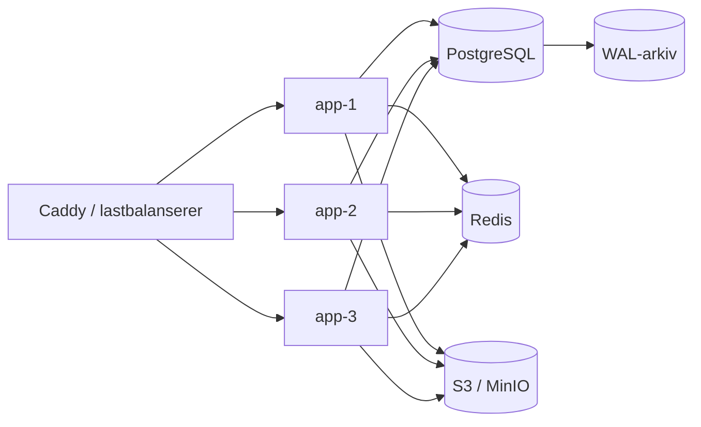

# Skalering og høytilgjengelighet

Denne guiden beskriver hvordan appen kjøres med flere replikaer uten å miste
jobber, rate limits eller filer. Standardoppsettet (én app, lokal disk,
databasekø) er fortsatt fullt støttet og krever ingen nye tjenester.

## Arkitektur



- **PostgreSQL** er kilden til sannhet for jobber, rate limits og all
  forretningsdata. Alle replikaer bruker samme database.
- **S3/MinIO** gjør opplastinger og kundeoverførings-staging delt. Uten dette
  får hver replika sin egen disk og tilgangen blir tilfeldig. Se
  [`STORAGE.md`](STORAGE.md).
- **Redis** er en rask varslingskanal og cache. Databasen er alltid fallback;
  Redis-utfall mister ingen jobber.
- **Lastbalanserer** må sende trafikk til alle replikaer og bruke
  `/api/health` (liveness) for medlemskap. Readiness (`/api/ready`) eies av
  Compose/orchestratoren.

## Sette opp HA-profilen

```bash
cp .env.example .env
chmod 600 .env
# Fyll inn DATABASE_RUNTIME_URL, NEXTAUTH_*, S3_*, REDIS_URL, FSM_DOMAIN ...

docker compose -f docker-compose.ha.yml up -d --scale app=3
```

`docker-compose.ha.yml` har:

- `postgres` med WAL-arkivering (`archive_mode=on`, `archive_timeout=60`),
  `max_connections=200` og helsesjekk.
- `redis` med AOF og `noeviction`. Kø og rate limits skal ikke kastes stille.
- `app` uten fast vertsport. Skaler med `--scale app=N`.
- `caddy` som laster balanserer mot `app:3000`.
- `postgres-basebackup` (profil `backup`) for verifisert base-backup.
- `minio` (profil `minio`) for lokal test av S3-driveren.

Se `deploy/ha/README.md` og `deploy/postgres/pitr/README.md`.

## Redis-køen

`QUEUE_DRIVER=db` (standard) bruker `DocumentJob` og
`FOR UPDATE SKIP LOCKED`, nøyaktig som før.

`QUEUE_DRIVER=redis` legger i tillegg hver jobb-ID i en Redis-sortert liste.
Workeren henter klare ID-er fra Redis og gjør en betinget
`UPDATE ... WHERE status='PENDING' AND runAt <= now()` i databasen. Bare én
replika vinner. Redis er dermed en vekkemekanisme, ikke en duplikatkø:

- Redis nede → fallback til databaseclaim. Jobben kjøres, men med poll-forsinkelse.
- Redis tømt → neste databaseclaim plukker fortsatt jobben.
- Samme jobb varsles flere ganger → samme ID i ZSET, og databasen avviser
  dobbeltkjøring.
- Retry skriver ny `runAt` og varsler Redis på nytt.

Det samme gjelder rate limits (`RATE_LIMIT_DRIVER`, Redis Lua) og cache
(`CACHE_DRIVER`, Redis `GET/SET EX`, DB `InfraCache` som fallback). Ved
Redis-feil logger appen og bruker databasen.

## Databasetilkoblinger

Hver appprosess åpner maks `DATABASE_POOL_MAX` tilkoblinger (standard 10).

```
app_replikaer × DATABASE_POOL_MAX + migrasjoner + drift < max_connections
```

Eksempel med 3 replikaer og `DATABASE_POOL_MAX=15`: 45 + 10 + margin = ca. 60.
Postgres i HA-profilen har `max_connections=200`, men en ekstern managed
database kan ha lavere grense. Juster bevisst, og overvåk
`pg_stat_activity`/`pgbouncer` hvis dere bruker connection pooling.

## Arbeidsfordeling og idempotens

Alle bakgrunnsjobber er allerede bygget for delt database:

- PDF/OCR: `DocumentJob` + `SKIP LOCKED`; Redis varsler bare.
- Kundeoverføring: `CustomerTransferJob` + `SKIP LOCKED`; staging i delt lager.
- Faktura/serviceavtale: advisory lock, så bare én instans genererer.
- E-post/SMS/påminnelser: vedvarende rader med status og retry.
- Rate limits: `RateLimit` eller Redis, delt mellom replikaer.
- Opprydding: idempotente `deleteMany`/betingede slettinger.

Det er derfor trygt å kjøre in-process workere i hver replika. Skal dere skille
workere i en egen prosess senere, er databasen og Redis allerede delt.

## Readiness

`/api/ready` sjekker database, database-rolle, lagring og jobbkø. Med
`READY_SECRET` returneres detaljer:

```json
{
  "status": "ready",
  "database": "up",
  "databaseRole": { "currentUser": "fsm_app", "canDdl": false },
  "disk": "not_applicable",
  "storage": { "driver": "s3", "status": "ok" },
  "queue": { "pending": 0, "failed": 0 }
}
```

`disk` er `writable` for lokal driver og `not_applicable` for S3. Readiness
skal ikke restartes i løkke: en kortvarig DB- eller S3-feil gir `unhealthy`,
men Compose restart-policyen restarter ikke containeren.

## Utrulling og rollback

1. Bygg og publiser et nytt image med uendret tag/digest-policy.
2. Kjør migreringen med DDL-rollen **før** nye replikaer starter
   (`docker-entrypoint.sh` gjør dette i dag).
3. Rull én replika om gangen. Caddy fjerner en replika fra LB når
   `/api/health` feiler.
4. Kontroller `/api/ready` med `READY_SECRET` og en ekte opplasting/PDF.
5. Rollback: bytt `APP_IMAGE` til forrige digest og rull tilbake. Redis kan
   tømmes uten datatap; databasen og S3 er kilden til sannhet.

## Kapasitet og testing

- Lasttest med to eller flere replikaer er **ikke** kjørt i denne endringen.
  Det krever et testmiljø med ekte Postgres, Redis og S3/MinIO. Se
  «Restrisiko» i [`remaining-features.md`](remaining-features.md).
- Før produksjon: kjør minst én opplasting, én PDF-generering, én
  kundeoverføring og én samtidig innlogging mot HA-profilen, og mål
  p95-latens og DB-tilkoblinger.
- Redis `maxmemory` er bevisst ikke satt. Overvåk `used_memory`; med
  `noeviction` skal dere heller skalere enn å kaste rate-limit-tellere.
- WAL-arkivet må kopieres offsite. Uten det er PITR bare lokal historikk.

## Når du **ikke** skal skru på HA

- Hvis du ikke har S3/MinIO med versjonering og egen backup: bli på lokal disk.
- Hvis du ikke kan overvåke Redis/Postgres: bli på `QUEUE_DRIVER=db`.
- Hvis databasen har lav `max_connections`: senk `DATABASE_POOL_MAX` eller
  bruk pgbouncer.
