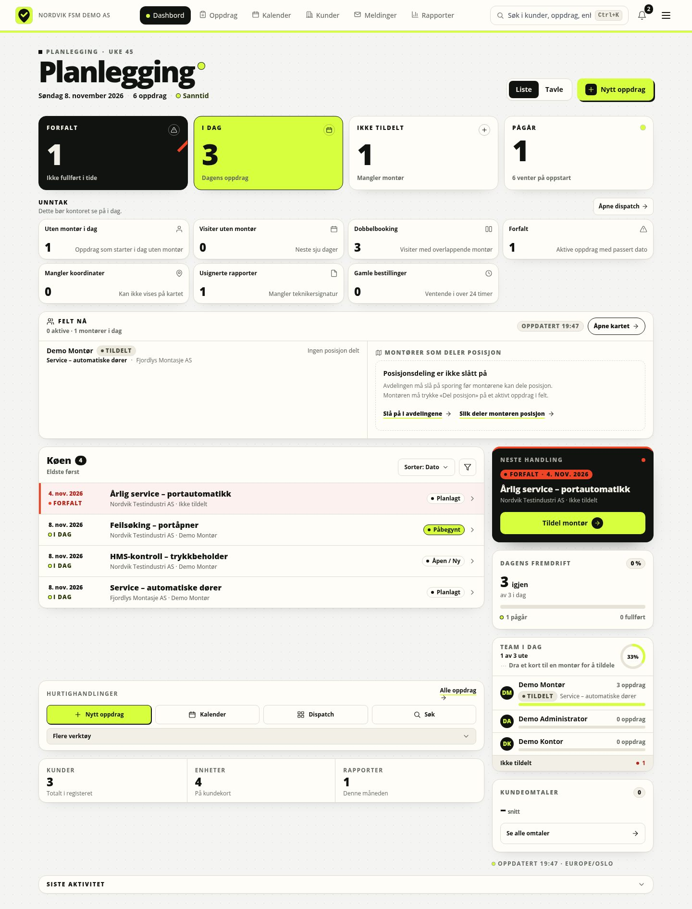
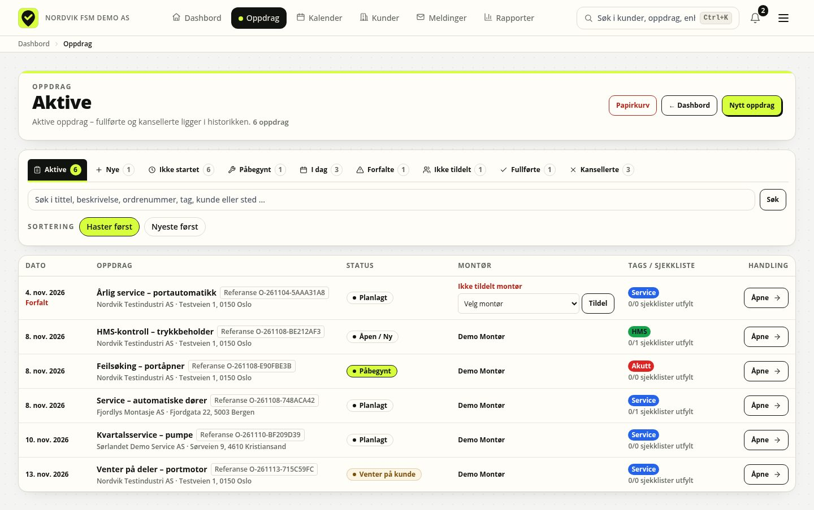
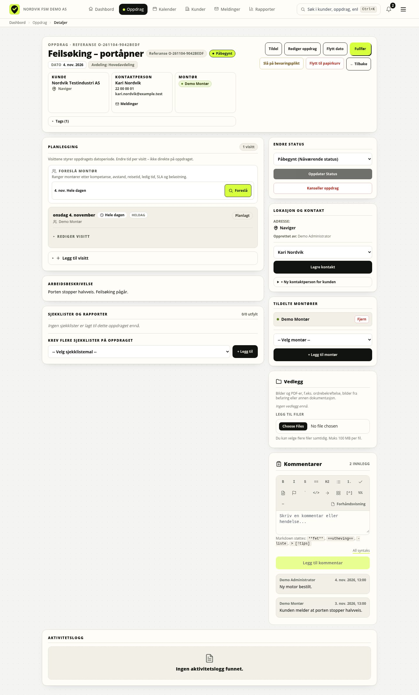
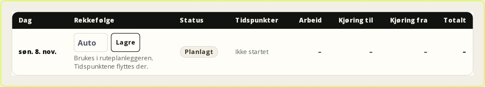
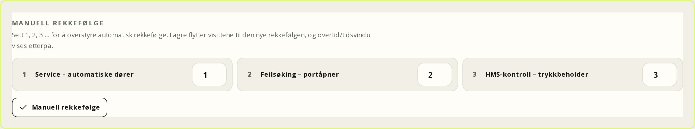
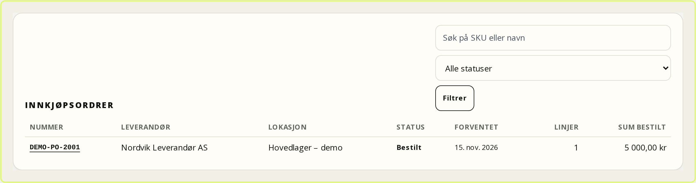
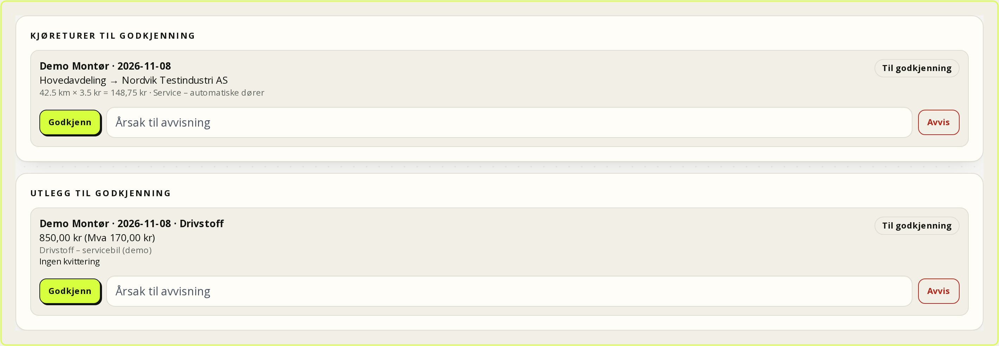
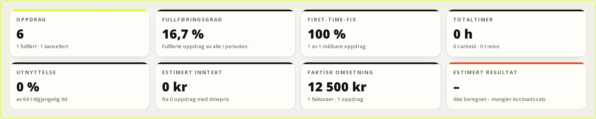

# Office: planning, dispatch and follow-up

This chapter is for office staff: you receive enquiries, create and plan work
orders, assign technicians, follow up reports and keep customer, equipment and
agreement data up to date. It applies to FSM Platform 0.9.2 (8 November 2026).

Work orders and service agreements belong to a department: you normally see only
your own department, while an administrator sees everything. Customers,
equipment and documents are shared, but every action requires the right
permission. Work time, travel and materials are recorded on the work order.
Quotes, invoicing, payments, inventory, expenses and profitability are optional
modules that must be enabled; without them, price lists are reference data and
invoicing happens outside the platform.

## Dashboard

The dashboard is at `/` and is titled **Planning**.



*Figure: The dashboard is the office's starting point for the day.*

Notice that **Exceptions needing action** sits above the queue itself. That is
where you first see whether anything is overdue, double booked or missing a
technician. The queue below shows overdue, today and unassigned in priority
order.

### List and board

**List** (`/?vis=liste`) is the default and shows one prioritised queue with
**Overdue**, **Today** and **Unassigned**.

**Board** (`/?vis=tavle`) has the columns **Overdue**, **Today**, **In progress**
and **Unassigned**. These are priority buckets, not statuses; the status is a
pill on the card.

| Card | Meaning | Click |
| --- | --- | --- |
| **Overdue** | Scheduled before today, not completed | `/oppdrag?vis=forfalte` |
| **Today** | Scheduled today, including multi-day work orders | `/oppdrag?vis=idag` |
| **Unassigned** | Active work order without a technician | `/oppdrag?vis=ikke-tildelt` |
| **In progress** | Status **In progress** | `/oppdrag?vis=pagaaende` |

The **Queue** can be sorted by **Date**, **Customer**, **Status** or **Title**;
the default is **Oldest first**. The right-hand rail shows **Next action** with
**Assign technician** or **Open work order**, **Today's progress** and **Team
today**.

### Field status and live map

Below the exceptions, **Field now** shows today's status for field staff. Each
technician has one status:

| Status | Meaning |
| --- | --- |
| **On site** | A visit has started and the technician is on site |
| **En route** | The technician has started driving to a visit |
| **Assigned** | The technician has a visit today that has not started |
| **Done for the day** | All of today's visits are completed |
| **Available** | No visits today |
| **Absent** | Absent all day with no active visit |

Status precedence is **On site** → **En route** → **Assigned** → **Done for
the day** → **Available**. If the technician has several jobs today, the active
visit is shown; otherwise the visit starting nearest to now. **Absent** is shown
only when the absence covers the whole day and the technician is not en route
or on site. The row shows the work order title and customer, plus **Last
shared** when the technician has shared a position. The same status badges
appear in **Team today**.

The **Technicians sharing location** map panel shows only technicians who have
actively started location sharing on a visit that is **En route** or **On
site**. Positions are short-lived points, not history: pings older than 24
hours are not used, and the map shows the last known point. If tracking is not
enabled for the department, the panel says **Location sharing is turned off**.
If nobody is sharing right now, it says **No technicians are sharing their
location right now**. Both states link to **Map** (`/kart`), and every marker
has a matching link in the list below the map. The list keeps the map usable
with a keyboard and screen reader.

You only see technicians, work orders and positions in your own department; an
administrator sees all departments. Names and coordinates are never shown to
customer portal users or anyone without work order access. Location sharing is
voluntary and controlled by the technician on the job; the department must also
enable tracking.

### Exceptions, quick actions and activity

At the top of the dashboard, **Exceptions needing action** shows the cards
**Unassigned today**, **Visits without technician**, **Double booked**,
**Overdue**, **Missing coordinates**, **Unsigned reports** and **Stale
bookings**. Each card shows a count and opens the relevant list or dispatch.
**Quick actions** gives **New work order**, **Calendar**, **Dispatch**,
**Search**, **My work orders**, **All work orders**, **Customers**,
**Documents**, **Checklists**, **Statistics** and **Map**. **Recent activity**
shows the latest events with **View all activity**.

### Quick assignment

1. Go to **Work orders** (`/oppdrag`).
2. Find the row that says **No technician assigned**.
3. Choose a technician in **Choose technician** and press **Assign**.

The technician appears in the row. The assignment applies to the work order; if
only one visit needs a different technician, do it in **Planning**.

### Drag and drop

Drag a card from the board to a technician in **Team today**, or from **Resource
overview** to the technician's column. Drag and drop assigns a technician,
**not** a date; use the calendar or **Planning** to move time.

### Global search

**Search** in the top bar searches customers, work orders, documents, units and
reports. Results show their type, and the search tolerates typos. Document hits
open the document in the library. Use search when you only have a name, an order
number or a keyword.

## Work orders

The work order list is at `/oppdrag` with the views **Active**, **New**, **Not
started**, **In progress**, **Today**, **Overdue**, **Unassigned**,
**Completed** and **Cancelled**.



*Figure: The work order list is the queue across customers and dates.*

Use the tabs to narrow the list before searching. **Unassigned** and **Overdue**
are the two most important entry points for daily follow-up; the rest is history
and lookup.

### Create

1. Press **New work order** (`/oppdrag/ny`). The department is fixed to your
   own; only an administrator can choose another. Enter **Work order title** and
   optionally **Order number** (unique in the department).
2. Enter **Description / Instructions**.
3. Choose **Customer** and **Contact person**, or leave the customer empty for
   an **Internal work order**. **Address**, **Postal code** and **City** override
   the customer address.
4. Set **Date of execution** and optionally **End date (optional)**. Each date
   becomes a separate workday. An empty end date means a one-day job, and a
   multi-day work order continues on the next day.
5. Choose technicians under **Assign technicians** and templates under **Add
   checklists / forms**, and add **Tags** if needed.
6. Press **Save work order**. You return to **Calendar**.

**Edit work order** changes title, customer, contact, date, technicians and
description.

### Priority and status

There is no separate priority field; priority comes from the date, the status
and whether a technician is missing. The statuses are **Open / New**, **Waiting
to be planned**, **Planned**, **In progress**, **Waiting for customer**,
**Completed** and **Cancelled**. Only an administrator can reopen a completed or
cancelled work order.

### Checklists, technicians and visits

On the create page, templates are grouped under **Service / checklists** and
**HMS documentation**. Each template produces its own report, which is always
new and empty.

You can assign several technicians; **Remove** takes one off. The assignment
applies to the whole work order. The office only plans the dates; each date
becomes one workday in the field app.



*Figure: The work order detail gathers status, contact, days and reports.*

Use **Days and time** to check actual time, and **Checklists and reports** to see
report status. Assignment and status buttons are at the top, not inside the day
list.

On the work order page, **Days and time** shows one row per workday with status,
**En route**, **On site**, **Done** and **Travel finished**, plus work, travel
to, travel from and total time. The top of the panel shows total time for the
work order with the breakdown. If the work order has no workdays, the panel
shows the date range and **Change dates**.

Each workday has an **order number** (1, 2, 3, 4 …). The number is stored on the
visit without moving the times. The route planner uses it on the next view and
moves the times when you approve the order there. An empty field or 0 means
automatic order. As soon as at least one visit for the technician and day has a
manual number, the planner sorts by number and skips nearest-neighbour/2-opt.



*Figure: The order number on each workday controls the route without changing
the time.*

Look at the number field on the right of each day row. It is not a move of the
day; it is an instruction to the route planner. Use it when the customer requires
a specific order, for example main plant first and then the gate.

The office does not create, move or delete individual days here. Change the work
order's date range and the days are reconciled automatically. A day that has
started, is completed or has recorded time cannot be removed without deliberate
cleanup. **Dispatch** and **Calendar** open the planning views for assigning
technicians per day and seeing actual time.

### HMS library and QR labels

**HMS** (`/hms`) collects HMS forms by type: **Safe Job Analysis (SJA)**,
**Hot work**, **Internal control**, **Deviations**, **Safety round**, **Written
instruction** and **General**. Under **Link HMS form to work order**, choose an
**HMS form** and an active **Work order**, then select **Link form to work
order**. The form is added to the work order and filled in there. **Recent HMS
documentation** shows completed HMS forms you have access to.

QR label: open the unit at `/enheter/<id>`, select **Print label**, and use
**Print** on the label page (`/enheter/<id>/etikett`). Scanning the label opens
the unit. **Rotate QR token** if the label is lost or shared; the old label stops
working immediately.

**Existing QR codes:** If the customer already has labels from another system,
register the value under **Existing QR codes** on the asset page. Paste or scan
the value, optionally give it a name (for example “Old QR – gate 3”), and save.
The label stays physically on the equipment and is never changed. Each value can
be linked to only one asset. Deleting removes only the mapping in FSM, not the
physical label, and is recorded in the audit log.

### Attachments, comments and completion

**Attachments** accepts images and PDFs, up to 15 MB per image and 50 MB per PDF, and is internal.
A rolling 24-hour quota of 2 GiB per user and 10 GiB total storage per customer
also applies; adjust it with `UPLOAD_QUOTA_USER_MB` and
`UPLOAD_QUOTA_CUSTOMER_MB`. **Comments** are the dialogue between office and
technician; write in the field and press **Add comment**.

**Complete** sets the status to **Completed** after the confirmation **Complete
this work order? The work order and report are locked for editing.** **Cancel
work order** requires a **Reason for cancellation**; the customer is notified,
and only an administrator can reopen it.

### Clone, related data and trash

**Clone work order** copies the details, customer, equipment, technicians,
templates, tags and visits. The clone gets the status **Waiting to be planned**,
and the **order number is cleared**. Reports and attachments are not copied.

| Data | Where | Note |
| --- | --- | --- |
| Customer/contact | Header and **Location and contact** | Locked when a report or booking exists |
| Equipment | Customer card → **Equipment** | The report remembers the units checked |
| Reports | **Checklists and reports** | Locked when submitted |
| Workdays | **Days and time** | Each date on the work order becomes one workday |
| Agreement/booking | The agreement's latest work order / booking queue | One booking per work order |

**Move to trash** is administrator-only by default; the button is shown only to
roles with `workorders.delete` and only for work orders that are not closed. An administrator can restore it from **Trash**
(`/oppdrag/slettede`). Work orders without reports can be removed after 365
days; work orders with reports are retained. **Legal hold** stops all automatic
deletion.

## Customers and contacts

The customer directory is at `/kunder`. Search by name, org. number, city or
email, or press **New customer**.

The customer card has the tabs **Overview**, **Work orders**, **Agreements**,
**Equipment** and **More**. At the top you find **New work order**, **Messages**,
**Edit** and, for an administrator, **Delete customer**. **Overview** shows
company information, contacts, portal users, overdue and upcoming work orders.

### Contacts

1. Open the customer card → **More** → **Contacts**.
2. Press **Add contact**.
3. Enter **Name**, **Role (optional)**, **Email (optional)** and **Phone
   (optional)**, and save.

A portal user must always be linked to a contact. If you delete the contact, any
portal users linked to it are deactivated.

### Department and responsible technician

**Edit customer** has **Department (optional)** and **Responsible technician
(optional)**. The responsible technician is shown as the customer's direct
contact.

### Portal users

Customer card → **More** → **Portal users**.

1. Press **Create and send invitation**.
2. Enter **Name**, **Email** and choose **Contact**.
3. Send the invitation; the user sets a password via the link.
4. Press **Activate** once the password is set.

If the email cannot be sent, the system shows **Invitation ready for {name}**
with **Copy link**; send it manually. **Deactivate** closes the portal and signs
the user out.

### Equipment, documents and agreements

**Equipment** shows units and service history. **More** → **Attachments**
holds documents, agreements and images belonging to the customer. **Agreements**
shows service agreements, coverage lines, next service, SLA and price lists.

**Sites** and **Equipment** on the customer card have their own search fields.
The search runs on the server and is limited to the open customer, so you can
search by name, address, postal code, city, model or serial number without
other customers' rows appearing. **Reset** clears the search, and the counter
shows how many matches the customer has.

## Equipment and assets

The asset register is at `/enheter`. Search by model, serial number, location or
customer, filter by status and category, or turn on **Show hierarchy**.

### Create and edit

1. Press **New asset** (`/enheter/ny`).
2. Choose **Customer**, and enter **Model** and **Serial number**.
3. Enter **Location**, **Category**, optional **Parent asset**, **Status** and
   **Criticality**.
4. Set **Installation date**, **Warranty until** and **Meter unit** if relevant.
5. Press **Register asset**.

Once a **Customer** is selected, only that customer's **Sites** and **Parent
asset** are loaded from the server. Changing customer clears and reloads the
lists, so you cannot select a site or asset belonging to another customer. The
same applies to **New work order** and **Edit work order**.

**Edit asset** changes the same fields.

The statuses are **Active**, **Out of service** and **Retired**; criticality is
**Critical**, **Normal** or **Low**. **Parent asset** builds a hierarchy, and
**Move in hierarchy** changes placement.

### Move a unit to another customer

When equipment changes owner or customer, the whole unit can be moved with its
service history. The move requires **Manage equipment** and **Manage
customers**, or an administrator.

1. Open the unit at `/enheter/<id>` and select **Move to another customer**.
2. Search for the target customer and optionally choose a target site. If you
   choose no site, the unit stays without a site at the new customer.
3. Review **What moves** and the preview. It shows the number of work orders,
   visits, reports, revisions, readings, plans, documents, attachments and QR
   codes that will follow.
4. Type the target customer's name to confirm, or tick the confirmation, and
   select **Move the unit**.

**This moves:** the unit and any child units (up to 1000), the hierarchy between
them, work orders and visits, reports with revisions, report units and PDFs,
readings, maintenance plans and occurrences, documents with versions,
attachments/uploads, registered QR codes and comments. The root unit receives
the target site. Child units lose the old site because it belonged to the
previous customer and must be placed again after the move. The root unit is no
longer linked to any former parent unit.

**This blocks the move:**

- **Contract lines belonging to another customer's agreement** that point to
  the unit or a child unit. A move cannot silently change who a financial
  obligation points to. Clear or end the contract lines first.
- Child units that already belong to another customer.
- Order numbers that collide with a number in the target customer's department.
- A missing or deleted target customer, or a target site that does not belong to
  the customer.
- More than 1000 units in the subtree.

**This does not move:** contract lines, the old customer's portal users, global
documents without a customer or unit link, or the audit log itself. Contacts
from the old customer are cleared on the work orders, and work orders that point
to another customer's agreement lose the contract link. The preview warns you
in advance. The target customer's department is used when it exists; otherwise
your own department is used, and you are told.

The move is idempotent: repeating it after the unit is at the target customer
reports that nothing changed. All validation runs before the first write, so a
rejected move leaves no half-finished changes. The action is audit-logged. To
undo it, move the unit back manually.

### Readings

1. Open the asset and find **Meter**.
2. Press **Register reading**.
3. Enter **Value**, **Date**, **Source** and optionally **Note**.
4. Press **Save reading**.

### Maintenance plans

1. Press **New maintenance plan**.
2. Enter **Title** and choose **Trigger**: **Calendar** or **Meter**.
3. For calendar: set **Interval (months)** and optionally **Lead time (days)**.
   For meter: set **Meter interval**.
4. Check **Next due** and save.

**Pause** stops the plan, and **Activate** starts it again; **Timeline** shows
occurrences. When the plan falls due, the scheduled job creates a work order for
the office to follow up.

### Service history and reports

**Service history** shows every report in which the asset was checked, with
date, result, comments, checkpoints and images.

In the form, the technician chooses **Get from the customer equipment**. Each
registered asset can be used only once in the same report. The report remembers
the asset, serial number and answers, so the customer card and asset page show
exactly what was checked.

## Calendar and dispatch

The calendar is at `/kalender` with the tabs **Resource overview**, **Month**,
**Week**, **2 weeks**, **Week (time)**, **Day**, **Dispatch**, **Capacity**,
**Route** and **Reports**.

| Tab | URL |
| --- | --- |
| **Month** | `/kalender?vis=maned` |
| **Week** | `/kalender?vis=uke` |
| **2 weeks** | `/kalender?vis=2uker` |
| **Week (time)** | `/kalender?vis=timegrid` |
| **Day** | `/kalender?vis=dag` |

At the top, **Period** shows the month or date range right next to the navigation
arrows and **Today**. The calendar loads about six months back and forward, and a
maximum of 1000 visits; visits outside the window may be missing.

**Filter the calendar** has **Technician**, **Status** and **No technician**.
**Apply filter** and **Reset** apply to all date views.

### Visits and drag and drop

The calendar shows one event per workday with the status **Planned**,
**Assigned**, **En route**, **On site**, **Done** or **Cancelled**. When the
technician has recorded time, the event shows the actual start, end and duration
instead of only the date. Drag a day to another date to move it. On conflict the
move is not saved, and you are told about the overlapping assignment. Completed
and cancelled days are locked.

**Resource overview** shows technicians, active work, unassigned work and recent
completions. **Unassigned work orders** have **Assign technician**. You can drag
cards between technicians to assign.

### Dispatch and capacity

**Dispatch** (`/kalender/dispatch`) assigns technicians to visits, with a
separate **No technician** column. **Overdue / Unassigned** is always shown,
regardless of the date. Drag a workday to a technician's column to assign it. Drop
it on **No technician** to remove the source technician; other technicians are
kept.

**Automatic assignment** is dry-run with **Dry run**; **Use {count} suggestions**
saves only when you choose it. **Suggest technician** ranks candidates by
**Skills**, **Distance**, **Travel**, **Free**, **SLA** and **Load**.

**Capacity** (`/kalender/kapasitet`) shows **Planned capacity against actual load
per department, day and technician**. Choose **From** and **To**, press **Show**,
and read **Capacity**, **Load** and **Utilisation**.

### Route plan

**Route** (`/kalender/rute`) suggests a driving order for one day, per
technician. Choose **Date** and optionally **Technician**, then **Show route**.
The page shows a map, stop numbers, **Arrival**, **Planned**, **Driving**,
**Waiting**, **Overtime**, and total **Drive time**, **Distance** and **Waiting
time** per technician.

The route starts at the technician's earliest located visit. The calculation
uses **OpenStreetMap via OSRM** for routes and the travel matrix. If
`GOOGLE_ROUTES_API_KEY` is set, **Google Routes API** is used as an optional
traffic-aware source for single legs; without it, ETA is a route and speed
estimate, not live traffic. If neither provider responds, local calculation is
used: straight-line distance × 1.35 and average speed. **Calculation** shows
which method was actually used.

**Overtime:** A visit is no longer left unassigned just because it cannot meet
the time window or working hours. It is planned with overtime, and the stop is
marked with `outsideTimeWindow`, `outsideWorkingHours` and `overtimeMinutes`.
The route sums **Total overtime**. `ROUTE_ALLOW_OVERTIME=false` disables planning
after working hours, and `ROUTE_MAX_OVERTIME_MINUTES` sets an optional cap. Only
genuinely impossible visits remain unassigned: missing coordinates, missing
skills, holiday/sickness, overtime limit, or more than 50 located visits.

**Manual order:** Every stop has a number field. Enter 1, 2, 3, 4 … and select
**Manual order**. The numbering is normalised to 1..n, stored on the visit and
moves the times with the same service layer as **Use order**. An empty field or
0 means automatic order. As long as at least one visit for the technician and
day has a manual number, the route sorts by number and skips
nearest-neighbour/2-opt.

**Use order** moves the visits to the suggested times in one transaction. The
action requires `workorders.assign`, is audit-logged per visit, and is cancelled
entirely on overlap with a fixed visit or registered holiday/sickness. Completed
and cancelled visits are never moved. If the plan has changed since it was
shown, you are asked to reload the page.



*Figure: Manual order is set with 1/2/3/4 in the route planner.*

Look at the number field at each stop and the summary at the bottom. The order is
a suggestion until you select **Manual order** or **Use order**. The numbering
does not change the date; it changes the order within the day.


*Figure: Overtime per stop and total overtime for the day.*

Notice that overtime is marked per stop, not hidden in the total. A stop can be
outside the customer's time window without creating overtime if it is still
within working hours. Check **Total overtime** before approving the route,
especially when `ROUTE_MAX_OVERTIME_MINUTES` is set.

**Assignment rules** and **Territories** are configured under **Settings →
Dispatch**. There you choose a **Mode**, adjust the **Weights** for **Skills**,
**Distance**, **Travel time**, **Free time**, **SLA** and **Load**, and add
territories with **Postal prefixes**, **Municipality codes** and **Radius (km)**.
**Capacity plans** are shown in the capacity view but are not edited in
**Settings** in 0.9.2. The same applies to skills, absence and working hours:
dispatch and booking use them, but they have no separate form in **Settings**.

## Agreements, SLA and price lists

Agreements are at `/avtaler` and on the customer card's **Agreements** tab.

### Create

1. Open the customer card → **Agreements**.
2. Enter **Title**, optional **Agreement number**, **Department**, **Start date**
   and **End date**.
3. Choose **Interval** (3, 6, 12 or 24 months), **Status** (**Draft** or
   **Active**) and **Renewal** (**Manual** or **Automatic**).
4. Set **Notice before expiry (days)** and optionally **Price adjustment (%)**.
5. Choose **Contact**, **Checklist**, **SLA policy** and **Price list**, and add
   a line with **Equipment**, **Coverage**, **Visits/year**, **Response (min)**
   and **Resolution (min)**.
6. Press **Create service agreement**.

### Lines and coverage

**Coverage ({count})** shows the agreement lines. An agreement **without lines**
covers all equipment; a line **without equipment** covers all equipment; a line
**with equipment** covers only that unit. Read equipment, coverage, visits per
year and response times. Only **Active** agreements within the start and end
dates count. No automatic “covered” badge is shown, so check manually before
promising cover.

### Interval, renewal and lifecycle

**Next service** is calculated from the start date and interval. **Renew**
extends; **Pause** and **Activate** stop and start new work orders. **Automatic**
renewal is run by the scheduled service agreement job. **Manual** renewal
becomes **Expired** after the end date.

### SLA

An SLA policy sets **Response time (minutes)** and **Resolution time
(minutes)**. It can be department-specific or global, and limited to **Count
business hours only**. **Business hours** and **Holidays** decide when the clock
runs; without saved business hours, weekdays 08–16 are used. Policies, business
hours, holidays and price lists are maintained by an administrator under
**Settings → SLA and business hours**.

SLA requires an **active service agreement** with a valid date and an active SLA
policy. Customers without an active agreement get no SLA clock, and the work
order shows no SLA panel. On the work order, **SLA** shows **Respond by**,
**Resolve by** and **On track**, **At risk**, **Breached**, **Met** or
**Cancelled**. **En route** or **On site** records response; **Done** records
resolution.

### Price lists

**Price lists are reference data for display and for the hourly rate in
profitability. Without `invoicing`, the system does not invoice or calculate
invoice amounts; with the module on, the price list is a basis when you create
an invoice.**

### Recurring work orders

At each interval a new **Planned** work order is created with the agreement's
customer, contact, department and checklist, plus one workday without
technicians. Expired agreements do not generate new work orders.

## Bookings

The booking queue is at `/bookinger` with **All**, **Pending**, **Confirmed** and
**Closed**. Each card shows **Reference**, **Customer**, **Requested time**,
**Location**, **Service**, **Technician** and status.

1. Open `/bookinger` and filter on **Pending**.
2. Fill in **Date**, **From** and **To** for the planned visit. The requested
   date is prefilled but can be changed.
3. Choose **Technician** in **Choose technician**. All active employees in the
   department can be chosen; absence, working hours and holds are checked on
   confirmation, while overlap is only shown as a busy marker.
4. Press **Confirm booking**, or **Cancel** to decline.

On confirmation the work order becomes **Planned**, the visit is created or
updated, and the customer receives an SMS if the contact has consented. If the
technician already has another visit at that time, it is shown as a **busy
marker**, not a hard block. You may still confirm, but should consider capacity
and move one of the days if needed. Absence and working hours remain hard
requirements.

The customer chooses a site, service and requested date in the portal, and
writes the desired time in the description. The customer cannot select a time
block, and the booking always creates a new work order with status
**Open/New**. No visit or confirmed time is created.

The office or technician plans the work order and sets the status to
**Planned**. If the time does not fit, it is set to **Waiting** for
replanning. The customer receives the final confirmation only then. A customer
booking is already a work order; there is no separate **Convert to work order**
button.

If the customer already has a confirmed appointment, **Request a new time** may
use a short hold while the form is filled out. That hold applies only to
rescheduling the confirmed appointment, never to new bookings.

## Inventory, spare parts and purchasing

The inventory module (`inventory`) requires the equipment module. It is used by
both office and technicians, but the office owns the item register, suppliers
and purchasing.

| Page | Use |
| --- | --- |
| `/lager` | Item list, locations, purchase suggestions and new item/location |
| `/lager/varer/<id>` | Stock per location, movements, reservations and adjustment |
| `/lager/lokasjoner/<id>` | Stock and movements for one warehouse or one service van |
| `/lager/oppdrag/<id>` | Spare parts for one work order, with reservation, release and consumption |
| `/lager/innkjop` | Purchase orders, filter and drafts from purchase suggestions |
| `/lager/innkjop/<id>` | Order lines, ordering, cancellation and goods receipt |
| `/lager/innkjop/leverandorer` | Supplier list and new supplier |

A **location** is a warehouse (`WAREHOUSE`) or a service van (`VAN`), with an
optional department and responsible user. An **item** has a SKU, name, unit,
reorder point and active flag. Stock is held per item and location. Movements
are `IN`, `OUT`, `ADJUST`, `RESERVE`, `RELEASE` and `CONSUME`.

### Reserve parts on a work order

1. Open the work order and go to the spare-parts page (`/lager/oppdrag/<id>`).
2. Choose item and location, and enter the quantity.
3. Select **Reserve**. The reservation reduces available stock but does not move
   the item physically.
4. If needed, select **Release** to drop the reservation without touching stock.
5. When the part is used, select **Consume**. The quantity is then deducted from
   physical stock.

Consumption is deliberately done from the spare-parts page, not automatically
when the visit is set to **Completed**. That avoids hidden side effects in the
field flow, but requires the office or technician to record consumption.

### Suppliers and purchase orders

1. Create the supplier under **Inventory → Purchasing → Suppliers** with name,
   organisation number, email, phone and optional department. A supplier without
   a department is shared across the installation.
2. Select **New purchase order** at `/lager/innkjop`, or build a draft from the
   purchase suggestions at `/lager`. The suggestion is
   `reorder point − (on hand − active reservations)`.
3. Choose supplier, receiving location and expected delivery. Add lines with
   item, ordered quantity and unit cost.
4. Select **Order**. The order receives a number in the form `PO-YYYY-NNNNN`.
5. On receipt, open the order and register the received quantity. Partial
   receipt is supported; the remainder stays open.
6. When everything is received, the order is **Received**. Over-receipt and
   negative quantities are rejected.

| Status | Meaning | Can move to |
| --- | --- | --- |
| **Draft** | Freely editable | Ordered, cancelled |
| **Ordered** | No goods received | Partially received, received, cancelled |
| **Partially received** | Some goods are in stock | Received |
| **Received** | Everything received | – |
| **Cancelled** | Cancelled before receipt | – |

Only drafts can change lines, supplier, location and note. Cancellation is
possible only before the first item is received. Goods receipt increases stock
and writes an `IN` movement in the same transaction as line and order status.
The order is locked with `SELECT ... FOR UPDATE`, so two concurrent receipts
cannot over-receive. Every mutation is audit-logged.

Unit cost is 0 until edited manually; the total is therefore 0 until cost is
filled in. The purchase suggestion is a calculated read-only view and orders
nothing automatically. Supplier invoices, invoice control, sending orders to the
supplier, returns/credit notes and serial/lot tracking are not part of v1.



*Figure: The purchase order shows status, lines and what remains to receive.*

Look at the status and received quantity per line. **Partially received** means
some goods are already in stock and the rest can still be received. The receipt
button applies only to the remaining quantity; the system rejects over-receipt.

**Permissions:** view inventory with `equipment.view`, manage items, locations,
suppliers and purchasing with `equipment.manage`, and reserve/release/consume
with `workorders.update` or `equipment.manage`. Department scoping follows the
location; an administrator sees all departments.

## Mileage, expenses and payroll basis

The expenses module (`fieldExpenses`) lets the technician record mileage and
expenses, and the office approve and export the payroll basis.

- **The technician** records in `/utlegg`: date, from/to, kilometres, rate,
  category, gross amount, VAT and receipt.
- **The office** approves in `/utlegg/kontor`, with preview and export per
  period.
- **The export** is downloaded from `/utlegg/kontor/eksport?start=…&end=…`.

Mileage allowance is `km × rate`, rounded to the nearest øre on the server. VAT is
`gross × rate / (100 + rate)`. The default is NOK 3.50/km and 25% VAT when the
form does not state otherwise. Rates are stored per row, so historical exports
are not changed by later rate changes. The client cannot submit a final amount
that differs.

1. Open **Expenses → Office**.
2. Choose a period and optional department.
3. Review mileage and expenses. Approve with **Approve**, or reject with
   **Reject** and a reason.
4. Select **Export payroll** for the period. The file is locked and marked with
   the export time.
5. Download the CSV and import it into the payroll system.

Mileage and expenses start as **Pending** (or **Draft** when the client asks for
it). Only approved rows are exported; rejected and unresolved rows are always
excluded. Rejection requires a reason. Department scoping prevents office A from
approving rows in office B. Export is idempotent per department and period: the
same period gives exactly the same CSV and checksum, and overlapping periods are
rejected.

The CSV is UTF-8 with BOM, semicolon-separated and uses `\r\n`, ready for
Norwegian Excel. The first row is:

```text
type;bruker;dato;referanse;beskrivelse;mengde;enhet;belop;mva
```

`type` is `WORK`, `TRAVEL`, `MILEAGE` or `EXPENSE`. Time and travel time come
from the visit timestamps; the module does not create its own time recording.
There is no integration with an external payroll provider – the CSV contract is
the interface.



*Figure: The office approves or rejects rows before the payroll CSV is locked.*

Notice that approval and export are two steps. An approved row is not exported
until the period is locked, and an exported row cannot be changed. Check the
receipt and VAT before you approve, not afterwards.

## Profitability

**Profitability** (`/lonnsomhet`) gives office and administrator one view of work
orders, time, first-time fix, **estimated** and **actual** revenue by department,
customer and technician. The module is `bi` and requires `reports.view`;
technicians and customer portal users get `403`.

1. Choose **From** and **To**, and optionally **Department**, **Customer** and
   **Technician**.
2. Read **Estimated revenue**, **Actual revenue**, **First-time fix**,
   **Utilisation** and **Result**.
3. Select **Export CSV** for the same filter and department scope.

**Estimated revenue** is the hourly rate from the agreement's price list × work
time. Travel time is not included. **Actual revenue** comes from invoices when
`invoicing` is on: net invoiced amount excluding VAT, with credit notes deducted
and drafts excluded. The invoice must be linked to a work order in the selection
and issued in the period. The period for estimate and work orders follows the
work order's planned date, while actual revenue follows the invoice date. A work
order planned in one month and invoiced in the next therefore gets the estimate
in the first and actual revenue in the second.

**Result** is calculated only when every work order in the selection has an
hourly rate and `BI_INTERNAL_COST_RATE_NOK` is set. Without the rate, "not
calculated" is shown. Actual revenue does not affect the result calculation; it
is still based on the estimate. The limit is 5,000 work orders, 5,000 invoices
and 366 days per report. CSV export is deterministic and audit-logged with
filter, row count and checksum.



*Figure: The KPIs show estimated and actual revenue side by side.*

Look for the note on whether actual revenue is available. If `invoicing` is off,
or there are no non-draft invoices in the selection, the report shows the
estimate alone and explains why. The numbers are not a guarantee of profit: the
cost is a global internal rate, not salary, vehicle, parts and expenses per work
order.

## Reports

The report list is at `/rapporter` and shows **Service reports** – completed
checklists with signatures and photos.

### List and filters

Choose **This month**, **Last month** or **All**, and filter on **Free text**,
**Customer**, **Technician**, **Deviations only** and **Acknowledgement**
(**All**, **Acknowledged**, **Not acknowledged**). **Sorting** is **Newest
first**, **Oldest first**, **Customer (A–Z)** or **Technician (A–Z)**. Press
**Filter** or **Reset filters**. The list shows **Locked**, **Open for
correction** or **Unsigned**, and **Report no.** when numbered.

### Open, PDF and content

**Open form** opens the report with **Main result**, **Signed by**, **Units that
were checked**, **Answers to checkpoints** and **General notes from the
technician**. The PDF is shown in the app's own PDF viewer. **Open in new tab**
shows the same PDF in the browser, **Download PDF** creates an attachment, and
**Close PDF** goes back. If the PDF cannot be shown, for example because it
contains active content that cannot be removed, the viewer shows an error with
**Try again** and download. Revisions are opened the same way from
**Revisions** using **Open revision (PDF)**.

A report can have a **Technician** and a **Customer** signature. Photos are added
per checkpoint or unit. Deviations appear as **Deviation found**. When a report
contains at least one deviation, the system automatically creates **one undated
remediation work order** titled “Utbedring av avvik – …”. It inherits customer,
department and contact, gets the submitter as technician, and describes the
units and checkpoints. The generated title is Norwegian (“Utbedring av avvik –
…”) in 0.9.2, even when the interface is English.

> **Note:** If a photo or signature is missing from the finished PDF, the PDF
> shows a warning with the number of images that could not be loaded. The usual
> causes are missing `Upload` metadata, a file removed from storage, or a file
> owned by another work order. Re-upload the image from the report and generate
> the PDF again. The operations log shows `report_pdf_images_missing` with a
> count, without file names or personal data.

### Status and locking

A submitted report is locked. **Unlock for editing** requires a **Reason for
unlocking** and is an administrator action.

### Customer portal and equipment history

Only submitted, locked reports can be opened. **View report** opens the PDF in
the app, and **Download PDF** creates an attachment. An unlocked report is
unavailable until it is locked again. The customer can **Acknowledge receipt**
and **Request a contact information update**; the latter does not update the
customer card automatically.

The report's units are linked to the customer's equipment. **Service history** on
the asset shows every check with date, result, comments, checkpoints and images.

## Documents

The document library is at `/dokumenter` and is internal documentation with
folders, tags, versions and full-text search.

### Folders and upload

1. Press **New folder**, or **Import folder structure** for a whole folder of
   PDFs.
2. Press **Upload PDF**, choose the **PDF file**, and enter **Title**, optional
   **Description** and **Tags**.
3. Press **Save document**.

Only PDFs are allowed. **Move to folder** and **Add tag** work on several
documents at once. **Delete selected** is an administrator action.

### Tags, search and OCR

Document tags are separate from work order tags. Search **title, description,
file name or tags**, and choose **This folder** or **Whole library**; **Filter by
tag:** narrows further. Text is extracted on upload, and scanned PDFs are run
through OCR. **Index all PDFs for search** fills in missing content.

### Versions and sharing

**Edit** → **Replace file (optional)** creates a new version. Previous versions
are under **Previous versions ({count})** with **Download** and **Restore**.

The library is internal and controlled by **View documents** and **Manage
documents**. To share with a customer, add the file to the customer card under
**More** → **Attachments**; it appears in the customer's **Documents**. Work
order attachments are internal. Reports are shown only when submitted and locked.

## Map, search, notifications and messages

**Map** (`/kart`) shows active work orders grouped by location. Filter by
**Technician**, **From date** and **To date**. **Open in Maps** gives directions.
Markers are placed at the address when geocoded; otherwise the work order is
shown at the customer's city.

**Search** (`/sok`) finds customers, work orders, equipment, contacts, reports,
comments, employees, checklists, folders and documents. Use the top bar,
**Ctrl+K** (⌘K on macOS) or **/**. Enter at least two characters. **Best
matches** appears first, **See all ({count})** opens the full list, and
**Filters** narrows by type, status, customer, technician, date, tag and HMS
type. Search is fuzzy and tolerates typos; document hits open the document in
the library. **Save this search** stores a saved search.

**Notifications** (`/varsler`) shows **{unread} unread of {total} total**,
**Unread only** and **Mark all as read**. The types are **Assignment**, **Date
change**, **Cancellation**, **Report**, **Booking**, **Service agreement**,
**Overdue** and **Contact update**. **Settings** lets you choose **In app** and
**Email** per event, and turn **Notification sound** on or off.

**Messages** (`/meldinger`) collects SMS conversations. Filter on **All** or
**Unread only**, search by customer, contact or work order, and **Start
conversation** from a work order. **Quick messages** sends
**Send booking confirmation**, **Send reminder**, **Send on my way**,
**Send completed** or **Request review**. **Consent and opt-out** shows
**Consent registered** or **Not registered**; without consent no SMS is sent.
Each outgoing message shows **Status** (Queued, Sent, Delivered or Failed).
Threads are scoped to your department; portal users see only their own.

An administrator can configure **Automatic reminders** under **Settings → SMS**.
Rules send SMS, email or both a chosen number of hours before the visit, with
quiet hours and a maximum per visit. **Recent reminders** shows what is planned,
sent or skipped — without the message text.

## Customer portal from the office

The customer sees **My Company: {customerName}** and the tabs **Overview**,
**Bookings**, **Reports**, **Documents**, **Equipment**, **Contracts**,
**Visits**, **Messages** and **Contact**.

1. Open the customer card → **More** → **Portal users**.
2. Press **Create and send invitation**, and enter name, email and contact.
3. Send the invitation; the user sets a password.
4. Press **Activate** once the password is set.

**Deactivate** revokes access immediately. A portal user must be linked to a
contact at the same customer.

**Bookings** shows requests and confirmed appointments. **Reports** lets the
customer acknowledge. **Documents** shows files you have shared through the
customer card's **Attachments**. **Equipment** shows status, warranty, latest
reading and plans. **Contracts** shows service agreements and coverage lines.
**Visits** shows tracking links and reviews. The tracking page shows the planned
time when the technician has not shared a location, and a live ETA only when the
latest position is fresh (under ten minutes). If the position is older, it says
explicitly how old it is; the page never pretends an old ping is live. The ETA
refreshes automatically every 30 seconds. **Messages** lets the customer reply by
SMS with consent.

The customer can **Send a date request**, **Request a new time**, **Cancel
request**, **Acknowledge receipt** and **Request a contact information update**.
Booking and cancellation notify the office; contact updates must be made manually
on the customer card.

## Daily and periodic routines

**Morning:** Check **Overdue**, **Today**, **Unassigned**. Assign anything that
is without a technician today, and check double bookings and visits without a
technician.

**During the day:** Follow **In progress** and **Overdue**. Move visits in the
calendar, use dispatch for sickness or urgent work, and answer customers in
**Messages**. Register consent before sending SMS.

**End of day:** Check that today's work orders are **Completed** or have a
follow-up. Review **Unsigned reports**, check tomorrow's visits, and clear
**Bookings** and **Notifications**.

**Weekly:** Review **Overdue** and **Unassigned**, next week's **Capacity**,
**Expires within 60 days**, **Reports** with **Deviations only**, and customer
portal users.

**Monthly:** Review expired agreements and agreement lines. Deactivate portal
users who have left, and review equipment without readings or with expired
warranty. SLA policies, business hours, holidays and price lists are managed by
an administrator; ask for changes when needed.

## Customer transfer (administrator only)

The **Customer transfer** tab is under **Settings** and is shown only to an
active administrator who also has **Manage settings**. Office staff,
technicians and portal users get `403` even if they call the route directly. The
tab moves one or more customers between installations; it is not a backup.

**Export**

1. Open **Settings → Customer transfer**, search for the customer and tick it.
2. Choose whether files, revision snapshots, deleted rows and legal hold should
   be included. Signature images are off by default and require a documented
   assessment.
3. Read the personal-data notice and tick the confirmation.
4. Select **Start export**. You get a ZIP with `manifest.json`,
   `checksums.sha256`, data files and files. The package is available for 24
   hours and can only be downloaded by you.
5. Optionally verify manually with `sha256sum -c checksums.sha256`. The
   checksums detect corruption but do not prove who created the package.

The package never contains passwords, password hashes, 2FA secrets, sessions or
API keys. Portal users follow as metadata and are imported deactivated without
a password.

**Import**

1. Upload the ZIP. The server validates structure, checksums, file types and
   references, and shows a preview. Nothing is written yet.
2. Review counts, warnings and errors. Errors block the import. For conflicts,
   choose **skip** (default), **create new** or — for customer and equipment —
   **update**. Reports are never updated.
3. Tick the confirmation and select **Import the package**. All rows and files
   are written in one transaction; if anything fails, the database is unchanged
   and temporary files are cleaned up.
4. After import, each portal user has a new id, is deactivated and has no
   password. Send a normal invitation or reset the password before sign-in.
   Employees and templates are never created automatically.

**Repeated attempts and errors:** export is idempotent. The same administrator,
the same customer selection and the same choices within ten minutes reuse the
same job instead of starting a new one, so a double click does not consume
another attempt. There are at most 10 export starts per hour; exceeding the
limit gives a clear message to wait. Errors are stored on the job and shown in
the interface, so you can correct the cause and try again without guessing. The
preview is valid for 30 minutes; if the package or selection changed since it
was shown, upload and preview again. Import errors block writing, and an
aborted import rolls back the whole transaction and cleans up temporary files.

**Limits:** the package is limited to 500 MiB and 50 MiB per file, and the
export runs as a durable background job with progress. Global documents without
a customer or unit owner are not included. Signatures, SLA clocks, bookings,
notifications, SMS, tracking and report drafts are deliberately excluded. See
`docs/BACKLOG.md` for the full list.

## Interface with the technician and administrator parts

| The office does | The technician does | Where it is described |
| --- | --- | --- |
| Creates work orders with customer, contact, equipment and checklists | Takes the work order, opens the form and completes checkpoints | Technician part (Part 2) |
| Plans the date and technician per workday | Starts **En route**, marks **On site**, **Done** and **Finish travel** | Technician part |
| Reads reports, deviations and signatures | Signs, attaches images, submits the report | Technician part |

The administrator part describes **Employees & Roles**,
**Roles & permissions**, **Departments**, **Checklists / Templates**,
**SLA and business hours**, branding, API keys, audit log, legal hold and
restoration. See the administrator part (Part 3).

## Common mistakes and troubleshooting

| Symptom | Common cause | Do this |
| --- | --- | --- |
| Cannot find the work order | Wrong department, view or filter | Reset search/filter, check department |
| Cannot assign | Missing **Assign technicians**, locked or legal hold | Request permission, or reopen as administrator |
| Drag and drop did not change the date | Drag and drop assigns a technician | Move the day in the calendar |
| Calendar is empty | No workdays, filter or outside ±6 months | Reset filter, choose **Today**, check the date range |
| Overlapping workday | Technician has several jobs at the same time | Check capacity and move one of the days if needed |
| Report is locked | Submitted report | Ask an administrator to **Unlock for editing** |
| Customer cannot see the report | Not locked, or missing portal/document access | Lock the report, check portal user |
| Customer cannot book | Missing contact/active user, or date outside the window | Check contact, user, 24 hours and requested date |
| SMS is not sent | Missing consent, phone, quota or dry run | Register consent, check number/settings |
| Agreement creates no work orders | Paused/expired, future start or job not running | Activate, check start date and job |
| SLA is not shown | No active agreement with an active policy | Activate the agreement and link a policy to it |
| Price list does not invoice | Reference data, or `invoicing` is off | Enable invoicing and create the invoice under **Invoices** |
| The payment button does not appear | Provider or webhook secret is missing | Check `PAYMENTS_PROVIDER` and the keys |
| Accounting sync is failed | Wrong key, account or VAT | Read the error code and sync again |
| Stock does not match | Reservation not consumed, or manual adjustment missing | Check reservations and movements on the item |
| Expenses cannot be exported | The period overlaps a locked export, or the row is not approved | Choose a new period and approve the row |
| Attachment is not in the portal | Work order attachments are internal | Add the file to the customer card → **More** → **Attachments** |
| Unit cannot be moved | Active contract lines, number conflict, cross-customer reference or invalid target | Read the blocker in the preview, clear the contract line, or choose the right customer/site |
| Upload is rejected | File too large, user/customer quota reached, or proxy limit | Check file size, `UPLOAD_QUOTA_*`, disk and the proxy body limit |
| Customer transfer does not start | 10 starts per hour used up, an existing job is reused, or the preview expired | Wait, follow the existing job, or upload and preview the package again |
