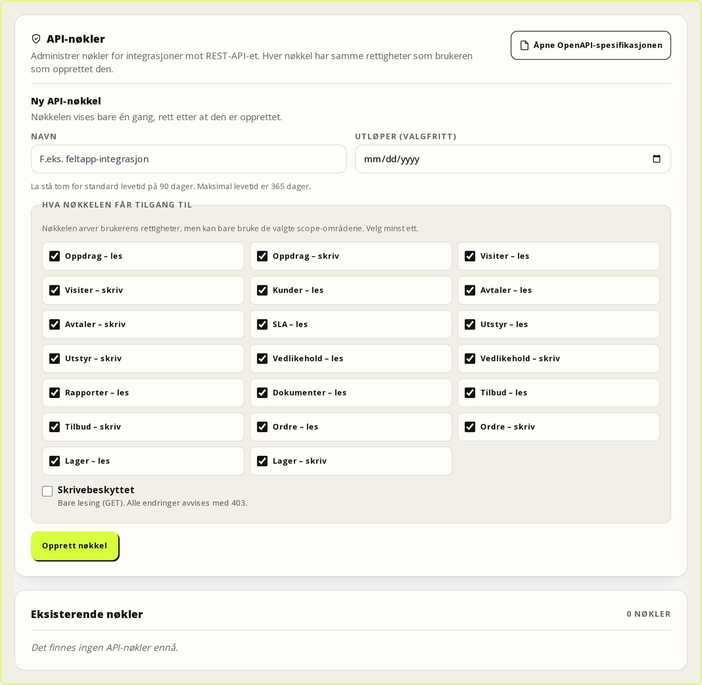
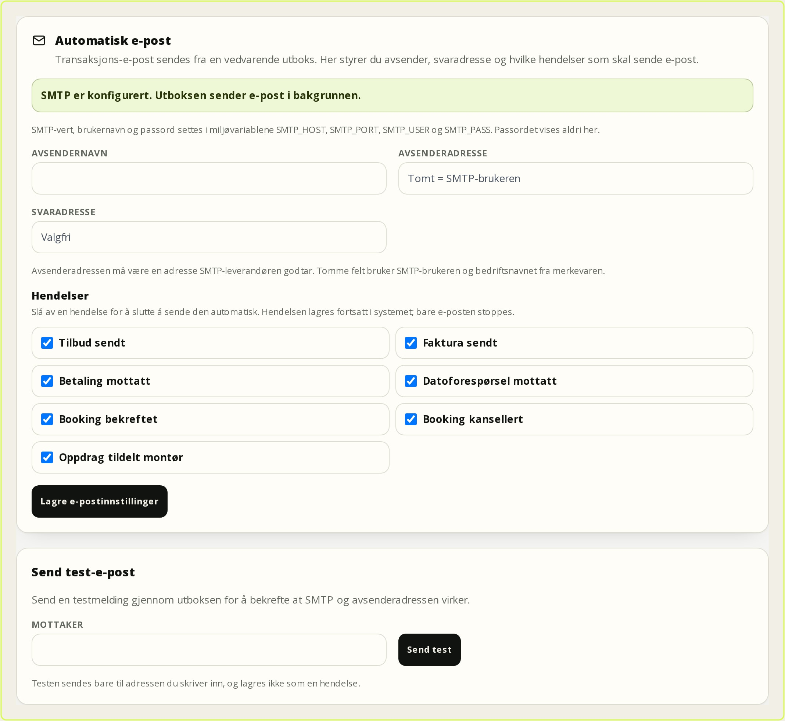
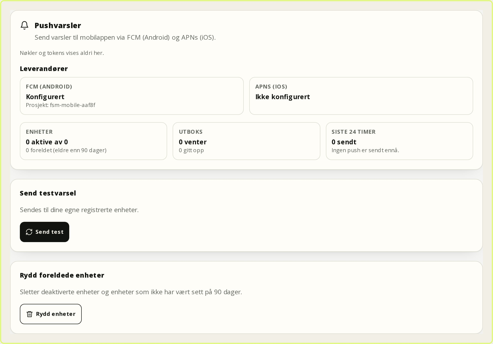

# Administrator

Applies to FSM Platform **0.9.1** (2026-11-08). This chapter is for system administrators who configure the platform, manage users and permissions, set up integrations, and are responsible for data, security and operations. It covers configuration and governance. Day-to-day workflows for office, technician and customer portal users are described in their own chapters.

## 1. The administrator role and delegation

Administrators always have every permission, including deletion, unlocking submitted reports, legal hold, roles, departments and API keys. The Office role is an operations role with broad access inside its own department, but without the most security-sensitive actions.

| Task | Administrator | Office | Recommendation |
| --- | --- | --- | --- |
| Roles, departments and API keys | Yes | No | Keep with administrators. |
| Administrators, deletion and moves | Yes | No | Keep with administrators. |
| 2FA, report unlocking and legal hold | Yes | No | Keep with administrators. |
| Activity log | Yes | No | Grant `audit.view` deliberately. |
| Employees in own department | Yes, all | Yes, own department | Delegate to the department lead. |
| Customers, work orders, agreements, templates and reports | Yes | Yes | Delegate to office and subject-matter owners. |

Office has `settings.manage`, `users.manage` and `dispatch.configure` by default, so it can change branding, map, SMS and dispatch settings. If that is too broad, create a separate role, for example **Service manager**, without `settings.manage`. Changes to the built-in Office role affect everyone who has it.

**Least privilege:** grant the weakest role that solves the task, use dedicated roles for leads and integrations, and keep at least two active administrators.

## 2. Departments and department scoping

Work orders, service agreements and employees belong to a department. Employees only see work orders in their own department. Customers and documents are shared; reports are department-scoped unless the user has `reports.viewAllDepartments`.

**Create a department:**

1. Go to **Settings → Departments**.
2. Enter **Name** and optional contact details.
3. Leave **Enable live tracking** off until privacy has been assessed.
4. Select **Create department**.

**Expected result:** the department appears with counts for employees, work orders and agreements. One department is the **Default** and is used when a work order or booking does not specify another. The default department cannot be deactivated until another department is set as default.

**Warning:** deactivating a department signs out all employees in it, clears calendar subscriptions and makes its work orders unavailable, because work-order queries require an active department. Accounts are kept and the department can be reactivated. Notify users in advance.


## Modules

The platform has a core and a catalogue of modules. The core (customers, work
orders, workdays, time, revisions and settings) can run without optional modules.
Modules are switched on and off under **Settings → Modules**. The module guard
returns `404` for pages and APIs when the module is off, and removes navigation,
settings, search hits, export/import and background jobs for that area. The data
is kept.

| Module | Key | Depends on | Provides |
| --- | --- | --- | --- |
| **Quotes** | `quotes` | Customers, work orders | Quotes, versions, approval link |
| **Invoicing** | `invoicing` | Customers, work orders | Invoice, payment, credit note, accounting sync |
| **Inventory** | `inventory` | Equipment | Items, stock, reservations, purchasing |
| **Expenses** | `fieldExpenses` | Calendar | Mileage, expenses and payroll CSV |
| **Profitability** | `bi` | Reports | Estimated and actual revenue |
| **Customer portal** | `portal` | Customers | The customer's own surface |
| **API** | `api` | – | REST API under `/api/v1` |

Existing installations get every delivered module enabled. `MODULE_PRESET` can be
used at startup to choose a predefined set. If you turn off a module that others
depend on, validation stops and you get a clear error. Every module change is
audit-logged.

> **Note:** Turning a module off hides the feature but does not delete data. An
> invoice, stock item or expense row remains and returns when the module is
> switched on again.

## 3. Users, invitations and sessions

**Create a user:** go to **Settings → Employees & Roles** or `/brukere`, select **Add new user**, enter **Full name**, **Email address** and optional **Phone**, choose **Role / Access level** and **Department**, then select **Create and generate invitation**. Employees need a department to see and create work orders.

The user is created inactive. You either get confirmation that the invitation email was sent, or an **Invitation link** you can send manually. The link is shown only in the page content, is valid for seven days, and can only be used by an inactive account. Without `SMTP_HOST` and `SMTP_USER`, the app cannot send email. Active users must use **Forgot password**.

**Activate the account:** the user opens the link and chooses a password. The account is still inactive. Find the user under **Employees & Roles** and select **Activate**. Only then can the user sign in. Ask the user to set up 2FA under **Settings → Security**.

**Deactivate and delete:** **Deactivate** signs the user out, clears the calendar subscription and blocks sign-in and API access. **Activate** restores access. **Delete user** is administrator-only and cannot be used on yourself or the last active administrator.

**Passwords and 2FA:** administrators cannot see or set a password. **Forgot password** sends a one-time link valid for one hour, rate-limited per email and IP. **Reset 2FA** disables two-factor authentication, deletes recovery codes and signs out all sessions. Use it only when a device is lost or misuse is suspected.

**Sessions:** there is no session list or “sign out everywhere” button. Sessions are invalidated when the password changes, 2FA changes or is reset, the user is deactivated, or the user’s role, permissions or department change. Editing a role definition applies on the next request without signing users out.

### Change password, 2FA and recovery codes

1. To change your password, sign out and use **Forgot password** on the sign-in page. 0.9.1 has no separate change-password page. The link is valid for one hour, and all other sessions are invalidated when the new password is set.
2. Go to **Settings → Security** to turn on **Two-factor authentication**. Scan the QR code with your authenticator app and enter the 6-digit code.
3. Store the **Recovery codes** in a safe place. They are shown only once, and each code can be used once. **Create new codes** invalidates the old ones.
4. Use **Log out** on shared devices. If misuse is suspected, change the password via **Forgot password** and reset 2FA.

An administrator can reset a user’s 2FA but cannot see the password. A reset deletes the recovery codes and signs out all sessions.

### SSO and SCIM

SSO is configured with `SSO_PROVIDERS` and the `SSO_<SLUG>_*` variables, not in
the interface. Entra ID, Keycloak, Authentik and Zitadel are supported with
OIDC, PKCE, state/nonce and verified email. The redirect URL is
`https://<NEXTAUTH_URL>/api/auth/callback/sso-<slug>`. After a restart,
**Settings → SSO and SCIM** shows the provider status, issuer, default role and
allowed domains. Password sign-in always remains as break-glass.

SAML 2.0 is additive and uses `SAML_PROVIDERS` and `SAML_<SLUG>_*`; OIDC stays
untouched, so one installation can run both. Register the SP entity ID and ACS
URL from `/api/auth/saml/<slug>/metadata` in the IdP. The server validates the
signed assertion, audience, recipient and time window, and rejects assertion
replay. `ALLOW_IDP_INITIATED=true` is only for IdP-initiated sign-in; signature,
audience, recipient and replay checks remain active. SAML uses the same account,
role, department and 2FA rules as OIDC.

SCIM 2.0 is served at `/api/scim/v2` with a dedicated Bearer token created,
rotated and revoked in the same tab. `DELETE` deactivates the user without
deleting it, and `ADMIN` requires both an explicit group mapping and
`SCIM_ALLOW_ADMIN=true`. **SCIM Groups** at `/api/scim/v2/Groups` mirror group
membership. A group only affects role or department through
`SCIM_GROUP_ROLE_MAP` / `SCIM_GROUP_DEPARTMENT_MAP`; without a mapping nothing
happens, and conflicting mappings change nothing. Use one token per
integration, and keep at least two local administrators with strong passwords
and 2FA.

## 4. Roles and permissions

| Role | Key | Default content |
| --- | --- | --- |
| **Administrator** | `ADMIN` | All permissions; the list cannot be changed. |
| **Office** | `OFFICE` | Work orders, customers, agreements, equipment, reports, documents, templates, employees and settings in its own department. |
| **Technician** | `TECHNICIAN` | View and create work orders, update status, view customers, agreements and equipment, fill in reports, view documents and templates. |
| **User** | `USER` | No permissions by default. |
| **Customer** | `CUSTOMER` | The customer portal, controlled by the customer link. |

Administrator and Customer are locked. Office and Technician can be edited, but system roles cannot be deleted.

**Custom role:** go to **Settings → Roles & permissions → New role**, enter **Name**, optional **Description**, select **Permissions** and choose **Create role**. The role gets a fixed key based on its name; the key does not change if the display name changes. A role in use cannot be deleted until its users are moved.

**Per user:** open **Permissions for this user**, select the list and choose **Save permissions**. The list overrides the role completely; if it matches the role’s list, the override is removed. **Use the role's permissions** does the same. Customisation does not apply to administrators or portal users, and changing a role clears the list.

**Field-level access:** sensitive fields are masked on the server before they reach the API, search, exports or the UI. ADMIN and OFFICE keep full access. Technicians do not see customer contact details or invoice amounts, and only their own payroll and expense amounts. The customer portal sees only its own contact and billing data. An administrator can grant one field group explicitly with `fields.customerContact`, `fields.billingAmounts`, `fields.reportSignatures` or `fields.payrollAmounts` in a user's permissions; in v1 this is done directly in the database/API because the settings list filters unknown keys. This never grants ADMIN. See `docs/RBAC.md`.

The permission groups are **Work orders** (`workorders.*`, `dispatch.configure`), **Customers and equipment** (`customers.*`, `equipment.*`), **Agreements and SLA** (`contracts.*`, `sla.manage`), **Reports and documents** (`reports.*`, `documents.*`) and **Administration** (`templates.*`, `users.*`, `settings.manage`, `audit.view`).

**Test a role:** use a dedicated account, try a direct URL it should not have (for example `/innstillinger?tab=roller`) and one mutation, confirm both are rejected, then deactivate. Authorisation is enforced on the server; hidden buttons are not security.

**Common mistakes:** giving a broad role to everyone, forgetting a per-user override, deleting a system role or a role in use, and giving Office `settings.manage` when it is not intended.

## 5. Customers and customer portal users

Customers are created under **Customers → New customer**. The customer card has **Overview**, **Work orders**, **Agreements**, **Equipment** and **More**. Portal users are created under **More → Portal users**.

**Create a portal user:**

1. Create the customer and at least one **Contact** with an email address.
2. Go to **More → Portal users**.
3. Enter **Name**, **Email** and choose **Contact**.
4. Select **Create and send invitation**.
5. Send the link manually if the email fails.
6. Select **Activate** after the user has chosen a password.

The user receives the `CUSTOMER` role, a customer link and a contact link, and remains inactive until you activate the account. **New link** only works for inactive accounts.

The portal shows the customer’s own overview, bookings, reports, documents, equipment, agreements, visits, messages and contact details. Reports appear only when submitted and locked; documents only when shared with the customer (`CUSTOMER`-owned).

Portal users never see other customers, internal notes, internal permissions, drafts or unlocked reports. `/uploads/...` is checked per file, and PDF responses are `no-store`.

**Security:** use separate accounts per person. **Deactivate** when someone leaves; this signs them out, clears the calendar subscription and revokes portal access. Deleting the customer deactivates all portal users, invalidates sessions and closes booking. After restoring, each portal user must be activated again. A portal user must always have a valid contact on the same customer.

**Delegation:** the portal has server-enforced capabilities for booking, documents, agreements and equipment, but 0.9.1 has no form for editing them. A contact without a delegation row gets full portal access; restricted access must be configured and tested with the actual account.

## 6. Checklists and templates

**Create a template:**

1. Go to **Settings → Checklists / Templates**.
2. Select **+ Create**, enter **Checklist name** and choose **Category**.
3. Select **Edit**, add fields under **Add a new checkpoint**, and set **Required field** where needed.
4. Use **Move up**/**Move down**, then select **Save template with logic**.

Field types are **Short text**, **Long text** (Markdown), **Checkbox**, **Dropdown**, **Condition + comment** (OK/Deviation/To be fixed/Not applicable), **Number**, **Signature**, **Image upload** and **Date**.

**Required and conditional:** required fields must be answered before submission. **Condition (If This Then That)** shows a field only when another field has a specific value, for example `Deviation`. **A comment is required for these options** applies to condition fields; the default is `Deviation` and `To be fixed`. Clear it to never require one.

**Units and report name:** **Link the report to equipment units** is on by default and gives one assessment per unit. Turn it off for reports that concern the whole work order. **Report name** appears in the PDF and report lists; an empty field uses the template name.

**Category and HMS:** **Service** or **HMS form**. HMS requires an **HMS type**: general, SJA, hot work, internal control, deviation, safety round or written instruction. Category and HMS type are frozen at submission.

**Linking and versioning:** templates can be linked to work orders, service agreements and maintenance plans. At submission, a snapshot of the template, report name, unit requirement, category and HMS type is stored. Later changes do not affect existing reports, even when unlocked; new fields apply only to new reports.

**Delete a template:** administrator only. A template cannot be deleted while it is used by reports, work orders or active agreements. A blocked attempt is logged.


### HMS library and QR labels

The **HMS library** is at `/hms`. It groups HMS forms by type and lists templates
and completed HMS documentation. **Link HMS form to work order** chooses a form
and an active work order; the form is added to the work order and completed
there. HMS templates are managed under **Settings → Checklists / Templates**
with category **HMS form**.

**QR label:** open the unit at `/enheter/<id>`, go to **QR label** and use
**Rotate QR token** if the label is lost or shared. Print the label from
`/enheter/<id>/etikett`. A rotated token invalidates the old label.

## 7. Work orders and reports

The statuses are **Open / New** (`OPEN`), **Waiting for planning** (`PENDING`, the system start status), **Planned** (`PLANNED`), **Waiting for customer** (`WAITING`), **In progress** (`IN_PROGRESS`), **Completed** (`COMPLETED`) and **Cancelled** (`CANCELLED`).

Office and technicians with `workorders.update` can change open statuses freely. Completed and cancelled are closed; only an administrator can reopen them, with a reason. Cancellation requires `workorders.edit`. The report has its own lock and is not affected by the work order status.

**Unlock a report:** open the work order, find the checklist, select **Unlock for correction**, enter **Reason for unlocking** and confirm. The report becomes **Unlocked**, can be edited, and a revision of the previous version is stored. The customer’s acknowledgement is withdrawn. On resubmission, the report is locked automatically and gets a new revision. Legal hold blocks unlocking.

**Revisions:** every unlock and submission creates a revision that freezes the form, units, comments, signatures, report number, category, HMS type and acknowledgement. **Revisions** shows the content and lets you download it as a PDF.

**Report numbers:** HMS reports receive an automatic `abc1234` number (three lowercase letters and four digits) on first submission. It is kept across revisions. Ordinary service reports have no automatic number.

**PDF and branding:** the PDF uses the company name, logo and primary colour from **Branding**, is stored as a `WORK_ORDER` upload and requires `reports.view`. The response is `no-store`. Branding is part of the PDF hash, so changes apply next time the PDF is generated. Report PDF labels are Norwegian in 0.9.1; agreement PDFs support all four languages. The generated remediation work order title is also Norwegian (“Utbedring av avvik – …”) in 0.9.1.

**Legal hold and retention:** legal hold prevents hard deletion and freezes the report. On a work order, all reports inherit the flag. Releasing it requires a reason and does not release the reports’ own flags; **Report hold** must be released per report with its own reason. Soft-deleted work orders can be hard-deleted after `RETENTION_DAYS` (default 365) only when they have no reports. **Recycle bin** and **Restore** are administrator-only.

## 8. Service agreements, SLA and price lists

**SLA policy:** go to **Settings → SLA and business hours**, enter **Name**, **Department** or **All departments**, **Response time (minutes)**, **Resolution time (minutes)** and **Count business hours only**, then select **Create policy**. A clock starts only when the work order has an active, date-valid agreement whose SLA policy is active. There is no fallback to a department default or a global policy, so a customer without an active agreement gets no SLA clock. The clock starts at creation, response is recorded on `EN_ROUTE`/`ON_SITE`, resolution on `DONE`, and `CANCELLED` cancels it. Travel from (`travelFromEndedAt`) never moves the clock. States: `ON_TRACK`, `AT_RISK`, `BREACHED`, `MET`, `CANCELLED`.

**Business hours and holidays:** choose **Department**, select **Show**, set **Opens**/**Closes** or **Closed** per weekday, and select **Save business hours**. Add **Holidays** with date, name and optional department. Global holidays apply to all; department-specific rows override only that department. Without business hours, weekdays 08–16 in Europe/Oslo are used. All deadlines are calculated through this calendar.

**Service agreement:** create it from the customer card, **Agreements** tab, or via **Agreements**. Enter **Title**, **Start date**, **Interval** (3, 6, 12 or 24 months), optional **Contact**, **Checklist** and **Department**, then select **Create service agreement**. The agreement becomes **Active** (or **Draft** if selected) with a next service date. A start date today creates the first work order immediately; a past date uses the next future interval. Each interval creates a work order with customer data, a checklist and the previous report as a PDF.

**Coverage:** an agreement without lines covers all equipment. A line without a product also covers all; a line with a product covers only that product. A line can have **Coverage**, **Visits/year**, **Response (min)** and **Resolution (min)**.

**Renewal:** **Automatic** renews after the end date and generates a new work order. **Manual** becomes **Expired** after the end date. **Notice (days)** controls the expiry notice. Automatic renewal runs exactly once even with multiple instances.

**Price lists:** create them under **SLA and business hours → Price lists** with **Code**, **Description**, **Unit** and **Amount**. They are reference data for agreement PDFs and settings, and for the hourly rate in profitability. Invoicing happens only when `invoicing` is on, and the price list does not automatically determine an invoice amount.

## 9. Booking, SMS, tracking and reviews

**Booking:** the customer chooses a requested date (up to 60 days ahead) and writes the desired time in the description; the customer cannot select a time block. The request creates a new work order with status **Open/New** and no visit or confirmed time. The office or technician plans it and sets **Planned**, or **Waiting** if the time does not fit. **Bookings** shows unconfirmed requests; they can be declined, but planning happens on the work order.

**SMS:** the provider is selected with `SMS_PROVIDER`, not in the UI. The default `console` is a dry run; `linkmobility`, `pswincom` and `twilio` are supported. **Sender** comes from `SMS_SENDER_ID`. Under **Settings → SMS and messaging** you can see the provider, sender, dry-run state and **Webhook signature**, and set **Default language**, **Opt-out keywords**, **Opt-in keywords**, **Monthly cap** and **Templates per event**.

SMS is sent only when the recipient has `optedIn = true` and `optedOut = false`. STOP/START is enforced from the keywords, and consent is checked when queuing and before sending. `SMS_ALLOWLIST` can restrict test and staging. The webhook at `/api/webhooks/sms/<provider>` requires an HMAC or Twilio signature; without `SMS_WEBHOOK_SECRET`, deliveries are rejected (except console in development). Outgoing SMS is a queue with three attempts; provider delivery status updates **Sent**, **Delivered** or **Failed** in the same conversation without creating a new message. Conversations appear under **Messages**.

**Reminders:** under **Settings → SMS → Automatic reminders** you create rules per department. A rule has a **Channel** (SMS, email or both), **Hours before visit** (for example 24 or 2), **SMS template**, **Quiet hours**, **Time zone** and **Maximum reminders per visit**. The worker sweeps every five minutes, skips customers without consent, respects quiet hours, and cancels the reminder if the visit is moved, cancelled or completed. **Recent reminders** shows planned, sent and skipped rows with a reason — without message text or phone numbers. Sending happens in the background, so a slow SMTP or SMS provider never blocks a page.

**Tracking:** off by default per department. Enable it under **Departments → Edit department → Enable live tracking** after a DPIA, because the technician’s location is personal data. An assigned technician can share location while the visit is `EN_ROUTE`. The public link shows only first name, status, ETA, planned time and last updated — never coordinates, a map or history. Pings are kept for 24 hours and deleted on `DONE`/`CANCELLED`; the link expires two hours after the visit, and there is one active link per visit. `TRACKING_AVERAGE_SPEED_KMH` (default 50) controls the fallback estimate. With `OSRM_BASE_URL`, an external routing provider is used for ETA; without it, ETA is calculated locally. A ping older than ten minutes is shown as **last known position**, not as live. The public ETA endpoint is polled every 30 seconds and has its own per-token rate limit.

**Reviews:** internal and never published. The customer can request a review in the portal after a completed visit, or the office can send an SMS with “Request review”. A review requires a completed visit, can be submitted once and is stored with a hashed token. Reviews are not shown as a separate dashboard in 0.9.1.

## 10. Branding, map, language and notifications

**Dispatch and workforce:** under **Settings → Dispatch**, configure **Assignment rules** (weights for skills, distance, travel time, availability, SLA and load) and **Territories**. Weights are relative. **Capacity plans** are shown under **Calendar → Capacity** but are not edited in **Settings** in 0.9.1. Skills, absence and working hours feed the suggestions but also have no separate form in **Settings**; keep the data updated outside the interface.

**Routing and overtime:** the route plan uses `OSRM_BASE_URL` for routes and the travel matrix, and `GOOGLE_ROUTES_API_KEY` for optional traffic-aware ETA on single legs. Without the key, ETA is a route and speed estimate, not live traffic; without either, it falls back to straight-line distance × 1.35. `ROUTE_ALLOW_OVERTIME` (default `true`) and `ROUTE_MAX_OVERTIME_MINUTES` (0 = no limit) control whether visits may be planned outside working hours. `ROUTING_PROVIDER=haversine` deliberately disables all external route and traffic calls. Monitor Google quota and cost; cache and rate limit are per process. See `docs/ROUTING.md`.

**Branding:** under **Settings → Branding**, set **Company name**, **Primary colour (hex code)** and **Company logo (optional)**. The logo must be uploaded through the app; external URLs are rejected. It is used in reports, email and the dashboard header, and applies to office and customer portal, not the dark field app. Customers can have their own colour and logo in the portal.

**Map and geocoding:** under **Settings → Map**, choose a **Map provider**. **OpenStreetMap (no key)** is the default; **MapTiler** and **Mapbox** require an **API key**. The key is stored on the server and sent only to the map in the browser; use a domain-restricted key. Set **Default layer**, **Default zoom (2–19)**, **Center** and **Enable scroll wheel zoom**. Geocoding is on by default (`GEOCODE_ENABLED=true`) and tries OpenStreetMap/Nominatim, then Kartverket and Photon. Set `GEOCODE_USER_AGENT` to identify the installation, or disable with `GEOCODE_ENABLED=false`. The **Geocode addresses** button on the map reports whether no address was found, the service did not respond, or geocoding is disabled.

**Language:** Norwegian, English, Polish and German have complete catalogues. The top-bar selector stores the `NEXT_LOCALE` cookie and uses `router.refresh()`, without a URL prefix. Dates and numbers follow `nb-NO`, `en-GB`, `pl-PL` and `de-DE`. SMS uses the recipient contact’s `locale`; email notifications use the user’s `locale`. Reports have Norwegian PDF labels in 0.9.1; translations live in `messages/` and are checked with `npm run check:i18n`.

**Notifications:** in-app and email. Each user chooses events and channels under **Notifications → Settings**; there is no global default. Make sure SMTP is configured. The `Notification` queue retries five times with backoff, skips deactivated users and uses a lease (a time-limited lock) to prevent double sending. Types include assignment, date change, cancellation, report ready, booking, agreement, overdue, contact update, SLA and warranty.

**Messages:** **Messages** collects customer conversations. Threads are scoped to a department or customer; office users see their own departments, portal users only their own threads. Outgoing messages can be sent as SMS with consent; incoming SMS lands in the same thread and is idempotent per provider ID.

## 11. API keys and the REST API

The API is under `/api/v1` and uses Bearer keys prefixed `fsm_`. NextAuth cookies are never accepted.

**Create a key:** go to **Settings → API keys**, enter **Name** and optional **Expires (optional)**, select **Create key**, copy the key into a secret manager and select **I have saved the key**.

The key is shown only once. The server stores only a SHA-256 hash and a short display prefix. If you lose it, revoke it and create a new one.

A key inherits the owner's permissions, department and customer scope, and has
explicit **scopes** in addition. A key can be marked read-only. New keys need at
least one scope. A key with only read scopes gets `403` on write endpoints. The
default lifetime is 90 days, maximum 365.

| Scope | Covers |
| --- | --- |
| `workorders:read` / `workorders:write` | Work orders and changes |
| `visits:read` / `visits:write` | Visits |
| `customers:read` | Customers |
| `contracts:read` / `contracts:write` | Service agreements and PDF |
| `sla:read` | SLA policies |
| `equipment:read` / `equipment:write` | Equipment and readings |
| `maintenance:read` / `maintenance:write` | Maintenance plans |
| `reports:read` | Reports and PDF |
| `documents:read` | Documents |
| `quotes:read` / `quotes:write` | Quotes and sending |
| `orders:read` / `orders:write` | External orders |
| `inventory:read` / `inventory:write` | Inventory and reservations |

**Quotes, external orders and inventory:** `/api/v1/quotes` creates and sends
quotes; `/api/v1/orders` receives orders from an external order system;
`/api/v1/inventory/**` reads items, locations and stock and creates, releases or
consumes reservations. The order endpoint uses `source` + `externalId` as the
idempotency key and accepts `Idempotency-Key` as a secondary key. A replay with
the same content returns `200` with `Idempotent-Replay: true`; the same key with
different content returns `409`. The API sends no webhooks back – the source
system must poll.

**Important:** in the UI, the key is created for the signed-in administrator and
therefore gets all administrator permissions. Treat it as an administrator
secret. For lower privilege, create a dedicated active integration user with a
narrow role and use `scripts/create-api-key.mjs` with `API_KEY_USER_EMAIL`,
`API_KEY_NAME` and optionally `API_KEY_EXPIRES_AT`.

**Revoke** takes effect immediately and returns `401`. Expired keys also return `401`. The list shows **Owner**, **Created**, **Last used**, **Expires** and status **Active**, **Expired** or **Revoked**.

Each key can make **120 requests per minute**; exceeding the limit returns `429` with `Retry-After`. Pagination uses `page` and `limit` (maximum 100). OpenAPI 3.1 is at `/api/v1/openapi.json`; documentation with examples is in `docs/API.md`.



*Figure: The API overview shows keys, scopes and last used.*

Check **Scopes** and **Last used** before rotating or revoking. A key without
scopes is an old key treated as "all scopes" until it is rotated. Use one key per
integration, and confirm that read-only keys cannot use write endpoints.

**Safe use:** use HTTPS, one key per integration, an expiry date, a secret manager and **Last used**. To rotate: create a new key, deploy it, verify with `GET /me`, then revoke the old one. On suspected leakage, revoke first, create a new key and review the activity log.

## Automatic email and the outbox

Transactional email (quotes, invoices, payments, bookings and assignments) is
sent from a durable outbox in the database, not directly from the request path.
A slow or unavailable SMTP server can therefore never roll back an invoice, quote
or booking, and every send has retry, history and idempotency.

| Event | Triggered by | Recipient |
| --- | --- | --- |
| `quoteSent` | Quote sent | Customer contact |
| `invoiceSent` | Invoice sent | Customer contact |
| `paymentReceived` | Invoice paid | Customer contact |
| `bookingRequested` | Customer books | Customer |
| `bookingConfirmed` | Office confirms | Customer |
| `bookingCancelled` | Cancellation | Customer |
| `workOrderAssigned` | Assignment or move | Technician |

1. Set `SMTP_HOST`, `SMTP_PORT`, `SMTP_SECURE`, `SMTP_USER`, `SMTP_PASS` and
   `APP_URL`. Without username and password the outbox is a safe no-op: messages
   stay `PENDING` without counting as failed attempts.
2. Open **Settings → Automatic email**.
3. Set **Sender name**, **Sender address** and **Reply-to**. An empty sender uses
   `SMTP_USER`; an empty name uses the company name from branding.
4. Turn each event on or off. Off only means the email is not sent; the business
   event is stored as before.
5. Select **Send test email**. The test goes through the outbox but is sent
   immediately, and does not change the on/off settings.

The outbox retries after 60 seconds, then exponentially up to one hour, and
gives up after five attempts. Only a short error code is stored, never the raw
SMTP message or recipient address in the log. `FOR UPDATE SKIP LOCKED` lets
several app instances share the queue. Rows left in `SENDING` by a crashed
process are reset after 15 minutes. If the module for an event is off, the
message is postponed rather than discarded.



*Figure: Automatic email is controlled per event, with sender and test.*

Notice that **Send test email** is a separate form. The test proves that SMTP and
the sender address work, but does not change the on/off choices. Also check
**Reply-to** and the sender name before enabling customer events.

## Push notifications

Push complements in-app notifications. Each notification is first stored in
`Notification`, then one row per active mobile device is added to the
`PushMessage` outbox. The worker sends in the background, so a slow provider
never blocks the action that triggered the notification.

- **Android:** FCM HTTP v1 with a Google service account in
  `FCM_SERVICE_ACCOUNT_JSON`.
- **iOS:** APNs with a `.p8` key in `APNS_KEY_P8`, `APNS_KEY_ID`, `APNS_TEAM_ID`,
  `APNS_BUNDLE_ID` and `APNS_ENV`.
- `PUSH_WORKER=false` disables the worker. Without a provider, the feature is a
  safe no-op.

The app registers the device after sign-in and on token rotation. On
`UNREGISTERED` or `BadDeviceToken`, the device is deactivated. Under **Settings →
Push notifications** you can see whether providers are configured, and clean up
deactivated devices and devices not seen for 90 days. A test notification uses a
random key and goes to the administrator's own registered devices.

Push follows the module that owns the notification type. If the module is off, no
push row is created, and an already queued row is skipped. Deep links always
contain an internal path starting with `/`; the app must never open external
URLs. Operational metrics are in `/api/metrics` as
`fsm_push_messages{status="pending"}` and
`fsm_push_messages{status="dead_letter"}`.



*Figure: Push settings show whether FCM and APNs are configured.*

Look at the provider status, not just the test button. If only FCM is set,
Android notifications are sent while iOS devices are skipped with
`not_configured`. The test returns 0 devices if the administrator has not
registered a device on their own account.

## 12. Activity log, privacy and data

**Activity log:** **Settings → Activity log** shows system events, security events such as failed 2FA attempts, and user activity with search, **From date** and **To date**, 50 rows per page. Work orders and customers have their own activity tabs; reports have revisions. The log is written in the same transaction as the mutation, cannot be edited or deleted in the UI, and is not hash-chained in 0.9.1.

**Privacy:** collect only necessary data, use department and customer scope, and grant `reports.viewAllDepartments` only when needed. Use separate portal accounts and deactivate them on leaving. Assess DPIA before tracking in a new department; tracking is opt-in, limited to `EN_ROUTE`, shows no route or coordinates and deletes pings after 24 hours. Obtain SMS consent and keep reviews internal. Deleting a customer deactivates portal users.

**GDPR erasure:** **Privacy / Erase customer data** on the customer card anonymises the customer's direct identifiers. The preview shows affected row counts and blocks when a work order, report or audit hold has a retention obligation. Enter a reason and confirm with the customer's current name. Work orders, reports, revisions, technician signatures and the audit log are preserved; the customer's own attachments and document library are deleted. Signed report PDFs are kept unchanged as service evidence and may still contain the original data. A second run is a no-op. See `docs/privacy-erasure.md` for the retention matrix and evidence.

**Export:** there is no automatic export job or self-service GDPR export. Evidence is exported through the database backup or an administrator-controlled query against `WorkOrder`, `Report`, `ReportRevision` and `AuditLog` for one work order at a time. Never export reports from the client or a public route.

**Retention:** `RETENTION_DAYS` (default 365) controls hard deletion of soft-deleted work orders without reports. Work orders with reports are kept indefinitely. Legal hold stops all automatic deletion. Files are removed only when no rows reference them.

**Backup and upgrade:** take a backup before migration and rollback. Follow `docs/OPERATIONS.md` and `docs/BACKUP-RESTORE.md`, use `scripts/backup.sh`, `scripts/restore-test.sh` and `restore-pitr.sh` for PITR. In production, set `REQUIRE_BACKUP_BEFORE_MIGRATE=true` so the app refuses to migrate without `BACKUP_CONFIRMED=true`. That only confirms a backup was taken, not that it is good; run the restore test first. Restore database and uploads from the same timestamp, stop the app before switching databases, use `prisma migrate deploy` and never `prisma db push`. Pin `APP_IMAGE` to a published version or digest, not `latest`, and never run `docker system prune --volumes`.

For PITR: choose a time **before** the failure, restore into a separate
environment first, check data integrity and file references, and only then switch
production. Document RPO/RTO and the result of the exercise. A backup without a
tested restore is not proof that data can be recovered.

## 13. Operations and health

`GET /api/health` is liveness and returns 200 when the Node process is alive, without database, disk or queue calls; Docker uses it so a slow database does not cause a restart loop. `GET /api/ready` is readiness: unauthenticated calls get a short status and a database check, rate-limited per IP. With `READY_SECRET` or `CRON_SECRET`, the upload volume and job queue are also checked; it returns 503 when something is missing. Production Compose uses readiness but does not restart on `unhealthy`; a database outage gives 503 from the proxy. Both return `requestId`.

**Migrations:** the app runs `prisma migrate deploy` at startup. `DATABASE_MIGRATION_URL` can be used for a DDL role, `DATABASE_RUNTIME_URL` for the app. To run migrations separately, start with `SKIP_MIGRATIONS=true` and run them manually. Verify with `npx prisma migrate diff --from-config-datasource --to-schema prisma/schema.prisma --exit-code`.

**Jobs:** `RECURRING_SCHEDULER=true` runs service agreements and maintenance plans every six hours and at startup. The SLA cleanup runs in the same scheduler with `SLA_CLEANUP_INTERVAL_HOURS` (default 6) and can be disabled with `SLA_CLEANUP_ENABLED=false`. `POST /api/cron/recurring` and `/api/cron/cleanup` require `Authorization: Bearer <CRON_SECRET>`. `PDF_JOB_WORKER` controls OCR/document jobs with at most two concurrent jobs per instance; report PDFs render in-process with a separate concurrency limit. `SMS_WORKER` is independent.

**Uploads and OCR:** files are stored in `UPLOAD_DIR` (default `./uploads`, `/app/uploads` in Docker). `/uploads/...` requires sign-in and checks the `Upload` row. Limits are 15 MB for images and 50 MB for PDFs. A rolling 24-hour quota of 2 GiB per user and 10 GiB total storage per customer also applies. Adjust it with `UPLOAD_QUOTA_USER_MB` and `UPLOAD_QUOTA_CUSTOMER_MB`; the proxy still needs its own body limit (55 MB in the Caddy example). Over quota the user gets a clear error, and the upload is not written. OCR uses `TESSDATA_DIR` and `/tmp`; large PDFs can fill `/tmp`, and the job then fails without filling the root filesystem. Check `DocumentJob`, `PDF_JOB_WORKER` and disk.

**Environment variables:** the most important are `DATABASE_URL`, `NEXTAUTH_URL`, `APP_URL`, `NEXTAUTH_SECRET`, `SMTP_*`, `SMS_*`, `SSO_*`, `SAML_*`, `SCIM_*`, `PAYMENTS_*`, `ACCOUNTING_*`, `FCM_*`, `APNS_*`, `STORAGE_DRIVER`, `S3_*`, `QUEUE_DRIVER`, `REDIS_URL`, `RATE_LIMIT_DRIVER`, `CACHE_DRIVER`, `DATABASE_POOL_MAX`, `PDF_JOB_WORKER`, `PUSH_WORKER`, `RECURRING_SCHEDULER`, `SLA_CLEANUP_ENABLED`, `SLA_CLEANUP_INTERVAL_HOURS`, `CRON_SECRET`, `READY_SECRET`, `RETENTION_DAYS`, `UPLOAD_*`, `TESSDATA_DIR`, `GEOCODE_*`, `ROUTING_*`, `GOOGLE_ROUTES_*`, `ROUTE_ALLOW_OVERTIME`, `ROUTE_MAX_OVERTIME_MINUTES`, `TRACKING_AVERAGE_SPEED_KMH`, `TRUST_PROXY` and `BACKUP_*`. `.env` must be `chmod 600` and never shared; changes require a new deploy or restart.

**Before escalating:** is `/api/health` 200 and `/api/ready` 200/503? Is `app` `healthy`, and is `RestartCount` increasing? What do the logs say? Does Postgres respond? Is there free disk and a writable upload volume? Are `DocumentJob`, `Notification` or `SmsMessage` stuck? Include `requestId`, timestamp and error message, never secrets or personal data.

## Storage, Redis and high availability

The default setup with one app, local disk and a database queue is fully
supported. A separate HA profile exists for multiple replicas or external
storage.

### Storage (S3/MinIO)

Uploads go through a shared `StorageDriver` interface. `STORAGE_DRIVER=local` is
the default; `STORAGE_DRIVER=s3` makes files shared between replicas. URLs and
stored file names are unchanged (`/uploads/<file name>`).

1. Set `S3_BUCKET`, `S3_REGION`, `S3_PREFIX` and optionally `S3_ENDPOINT`,
   `S3_ACCESS_KEY_ID` and `S3_SECRET_ACCESS_KEY`.
2. Run `npm run storage:migrate -- --dry-run`, then without `--dry-run` **before**
   switching the driver.
3. Verify with `--verify` and check with `--check`.
4. Stop the app, run the migration once more, set `STORAGE_DRIVER=s3` and start
   the app.
5. Enable versioning and encryption on the bucket, and block public access.
   `/uploads` still enforces access control.

The migration never deletes source files. Keep them until at least one successful
backup/restore and an operating period on S3 have passed. Rollback means switching
back to `STORAGE_DRIVER=local`, but files written while S3 was active exist only
in S3. See `docs/STORAGE.md`.

### Redis and the job queue

`QUEUE_DRIVER=db` is the default and uses `DocumentJob` with `FOR UPDATE SKIP
LOCKED`. `QUEUE_DRIVER=redis` also puts each job ID in a Redis sorted list. Redis
is a wake-up mechanism, not a duplicate queue: the database decides whether the
job runs. Redis down falls back to database claim, and an empty Redis loses no
jobs. The same applies to `RATE_LIMIT_DRIVER` and `CACHE_DRIVER`; the database is
always the fallback.

### HA and PITR

`docker-compose.ha.yml` has multiple app replicas, Caddy, Redis, shared S3 and
Postgres with WAL archiving. Start with:

```bash
docker compose -f docker-compose.ha.yml up -d --scale app=3
```

Each app process opens at most `DATABASE_POOL_MAX` connections. Plan for
`app_replicas × DATABASE_POOL_MAX + migrations + operations < max_connections`.
Roll one replica at a time, and check `/api/ready` with `READY_SECRET` and a real
upload/PDF. The WAL archive must be copied offsite; without it, PITR is local
history only. Restore with `restore-pitr.sh` and the exercise checklist in
`docs/BACKUP-RESTORE.md`; capacity, readiness and when **not** to enable HA are
in `docs/SCALING.md`.

> **Warning:** S3, Redis and PITR are not verified in production without real
> credentials and an environment. Always run a restore test and a real
> upload/PDF generation against the HA profile before promising high
> availability.

## Compliance, ISO 27001 and SOC 2

The compliance package in `docs/compliance/` is a **readiness basis**, not a
certification, attestation or audit report. It describes how the platform is
intended to be governed, operated and evidenced, and what remains.

- **ISO/IEC 27001:** the Statement of Applicability covers all 93 Annex A
  controls, but only an accredited certification body can issue a certificate.
- **SOC 2:** the TSC mapping covers 51 criteria. A SOC 2 Type I or Type II
  requires an independent CPA firm and an examination period.
- **Status:** 29 controls are implemented in design/repo, 50 partial, 11 planned
  and 3 not applicable. This is design evidence, not tested operating
  effectiveness.
- **Evidence:** `npm run compliance:evidence` collects repository, CI and
  operational evidence without cloud credentials. `npm run compliance:links`
  checks documentation links.

Use `docs/compliance/GAP-ANALYSIS.md` as the work list. Do not describe the
service as "ISO 27001 certified" or "SOC 2 compliant" in customer replies until
the certificate or report actually exists and its scope matches the customer's
use.

## 14. Administrator routines

**Onboard a department:** create it, enter contact details, set business hours and holidays, create a default SLA policy and optional price list, leave tracking off until DPIA is assessed, and create employees.

**Onboard a user:** create with the right role and department, send the invitation, let the user set a password, activate, ask for 2FA, and test that the user sees the right work orders and not other departments.

**Customer and portal user:** create the customer, add a contact with email, create the portal user under **More → Portal users**, send the invitation, activate and test the portal. Deactivate the test account afterwards.

**Publish a template:** build it, set the report name, unit requirement and HMS type, test on an internal work order, check the PDF, **A comment is required for these options** and conditional fields, then link it to agreements or work orders. Inform office and technicians.

**Launch an agreement and SLA:** choose or create a policy, check business hours and holidays, create any price list, create the agreement with the right interval and checklist, add lines and coverage, set renewal and notice, activate and check the next service date and SLA clock.

**Rotate an API key:** create a new key with a clear name, store it in the secret manager, deploy it, verify with `GET /api/v1/me`, revoke the old key, confirm it returns `401`, and update the documentation.

**Monthly review:** review administrators, employees, roles and departments. Review API keys, **Last used** and expiry. Review the **Activity log** for deletions, role changes, unlocks and legal hold. Check 2FA, portal users and unlocked reports. Run `scripts/restore-test.sh` and check disk, `/api/ready`, `RestartCount` and pending migrations.

## 15. Common problems

| Symptom | Cause | Action |
| --- | --- | --- |
| User cannot sign in | Inactive, missing password or deactivated. | Activate, send a new invitation, or use **Forgot password**. |
| Customer portal is empty | Portal user inactive, customer deleted or contact missing. | Activate, restore and link a valid contact. |
| Template is missing, or changes do not apply | Wrong category/permission, or the report has a frozen template snapshot. | Check category and `templates.view`; create a new report for new fields. |
| Report cannot be unlocked | Legal hold or missing administrator. | Release the hold with a reason, or use an administrator. |
| SMS is not sent | `console`, missing consent, allowlist or cap. | Set the provider, record consent, check the cap. |
| SMS webhook rejects | `SMS_WEBHOOK_SECRET` missing or signature wrong. | Set the secret and check the signature. |
| Upload is rejected by quota | User or customer quota reached, or the proxy rejects the body. | Check `UPLOAD_QUOTA_*`, disk and the proxy body limit; remove unused attachments. |
| Unit cannot be moved | Active contract lines, number conflict or cross-customer reference. | Clear the contract lines, choose another order number, or check the preview. |
| SLA has the wrong deadline | Wrong policy, business hours or holiday. | Check the policy, department and calendar. |
| API returns `401`/`403`/`429` | Expired key, missing permission or rate limit. | Create a new key, grant permission, or wait for `Retry-After`. |
| `/api/ready` returns 503 | Database, upload volume or job queue. | Check Postgres, `UPLOAD_DIR`, disk and queue. |
| App restarts in a loop | Migration gate, OOM or `.env` error. | Check logs, `dmesg` and `REQUIRE_BACKUP_BEFORE_MIGRATE`. |
| Email stays `PENDING` | SMTP missing, or the event is off | Check `SMTP_*`, `APP_URL` and **Automatic email** |
| Test email fails | Wrong host, port, TLS or sender | Check the SMTP settings and sender address |
| Push returns `not_configured` | FCM/APNs missing in all app instances | Set `FCM_*`/`APNS_*` and restart all replicas |
| Push returns `invalid_token` | Device unregistered or token rotated | Let the app register the device again |
| S3 returns 404 for old files | Files were not migrated | Run `storage:migrate --check` and migrate |
| `/api/ready` returns 503 after HA start | Redis, S3 or database missing from the environment | Check `REDIS_URL`, `S3_*` and `/api/ready` with `READY_SECRET` |

## 16. Relationship to the office and technician chapters

The administrator chapter covers setup and governance; the office and technician chapters cover daily use. **Department and role** determine which work orders and actions staff see; the customer portal is controlled by the customer link. **Templates, SLA, branding and SMS** provide the forms, deadlines and messages staff work with. **Legal hold** freezes data for all parties.

See `10-office.md` for customer cards, work orders, agreements, the booking queue and reports. See `20-technician.md` for the field app, offline drafts, forms, submission and tracking. See `90-reference.md` for concepts, error codes and reference material.

Administrators can choose which work order statuses are open, planned or
closed under **Settings → Work order status**. The default setup keeps the
built-in statuses. New work orders start as “open, waiting for planning”
(PENDING) unless another open or planned default is selected. A status marked
as closed counts as finished in lists, search, reports, the portal,
notifications, routing and locking. At least one open and one closed status
must be active. Changes are audited.
