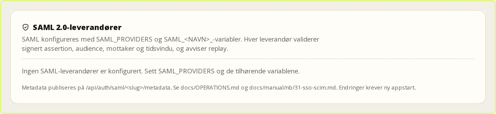
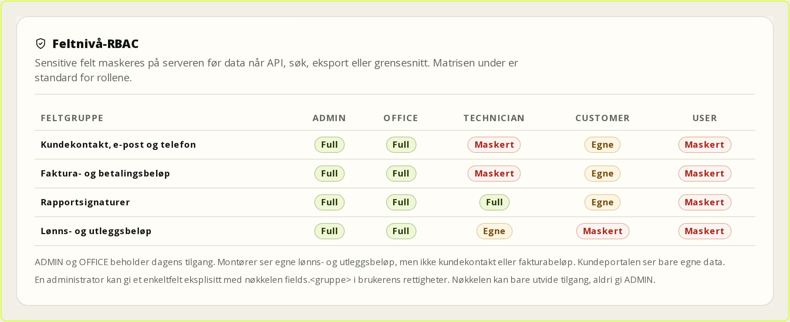

# SSO and SCIM

This chapter is for administrators who will connect FSM to an external identity
provider (IdP) and automate user creation and deactivation. Configuration is done
with environment variables and requires an app restart. Password sign-in always
remains as the break-glass path. It applies to FSM Platform 0.8.11
(8 November 2026).

## 1. Before you begin

Agree these points with the customer before changing production:

- Which IdP is used: Microsoft Entra ID, Keycloak, Authentik or Zitadel?
- Which email domains may sign in?
- Should unknown users be created automatically, or must an administrator
  activate them first?
- Which groups grant `OFFICE`, `TECHNICIAN` and optionally `ADMIN`?
- Who is the local break-glass administrator if the IdP is down?

**Least privilege:** start with `DEFAULT_ROLE=USER` and auto-provisioning off.
Add only a small, named group to `ADMIN`.

## 2. Register the application in the IdP

The redirect URL is:

```text
https://<your-fsm-address>/api/auth/callback/sso-<slug>
```

`<slug>` is the name you choose in `SSO_PROVIDERS`, for example `entra`. The URL
must be exactly the same in the IdP. FSM uses authorization code flow with PKCE,
state and nonce.

- **Entra ID:** Web application, redirect URL above, API access `openid`,
  `email`, `profile`. Add `email` and `groups` as optional claims in the ID
  token. Entra uses `xms_edov` instead of `email_verified`; both are accepted.
- **Keycloak:** Confidential client with standard flow and PKCE. Add the redirect
  URL under *Valid redirect URIs*, and a group-membership mapper that emits the
  `groups` claim.
- **Authentik:** OAuth2/OpenID provider with the redirect URL. Scope mapping for
  groups to `groups`.
- **Zitadel:** OIDC application of type Web. Request
  `urn:zitadel:iam:org:project:roles` and use the same name as `GROUPS_CLAIM`.

## 3. Set environment variables

Example for Entra ID:

```dotenv
SSO_PROVIDERS=entra
SSO_ENTRA_DISPLAY_NAME=Microsoft Entra ID
SSO_ENTRA_ISSUER=https://login.microsoftonline.com/<tenant-id>/v2.0
SSO_ENTRA_CLIENT_ID=<client-id>
SSO_ENTRA_CLIENT_SECRET=<client-secret>
SSO_ENTRA_ALLOWED_EMAIL_DOMAINS=example.no
SSO_ENTRA_AUTO_PROVISION=false
SSO_ENTRA_AUTO_PROVISION_ACTIVE=false
SSO_ENTRA_DEFAULT_ROLE=USER
SSO_ENTRA_DEFAULT_DEPARTMENT=Oslo
SSO_ENTRA_GROUPS_CLAIM=groups
SSO_ENTRA_GROUP_ROLE_MAP={"FSM-Office":"OFFICE","FSM-Technicians":"TECHNICIAN"}
SSO_ENTRA_SYNC_ROLES=false
```

### SAML 2.0

SAML is configured with `SAML_PROVIDERS` and `SAML_<SLUG>_`. The OIDC variables
are untouched, so an installation can run both. Example:

```dotenv
SAML_PROVIDERS=entra-saml
SAML_ENTRA_SAML_DISPLAY_NAME=Entra SAML
SAML_ENTRA_SAML_ENTRY_POINT=https://login.microsoftonline.com/<tenant>/saml2
SAML_ENTRA_SAML_IDP_CERT=<certificate>
SAML_ENTRA_SAML_ALLOWED_EMAIL_DOMAINS=example.no
SAML_ENTRA_SAML_GROUPS_ATTRIBUTE=groups
SAML_ENTRA_SAML_GROUP_ROLE_MAP={"FSM-Office":"OFFICE"}
SAML_ENTRA_SAML_GROUP_DEPARTMENT_MAP={"FSM-Oslo":"Oslo"}
SAML_ENTRA_SAML_AUTO_PROVISION=false
SAML_ENTRA_SAML_DEFAULT_ROLE=USER
```

Register the **SP entity ID** and **ACS URL** from
`/api/auth/saml/<slug>/metadata` in the IdP. The app validates the signed
assertion, audience, recipient and time window, and rejects replay of the same
assertion. `ALLOW_IDP_INITIATED=true` is only for IdP-initiated sign-in;
signature, audience, recipient and replay checks remain active. SAML uses the
same account, role, department and 2FA rules as OIDC.

Restart the app. Open **Settings → SSO and SCIM**. The provider should appear as
**Active**, with issuer, default role and allowed domains. Red configuration
errors mean a required variable is missing or invalid.



*Figure: SAML is configured per provider and shown with status in settings.*

Look at **Status**, **Issuer** and the **Redirect/ACS** details. SAML and OIDC
appear side by side, and the OIDC setup is untouched when you add SAML. If the
status is red, a required variable is missing or the certificate is invalid – fix
it before testing sign-in.

**Expected result:** the sign-in page shows a button with the provider's name
above the password form.

## 4. Test sign-in

1. Sign out, or use a private window.
2. Select the SSO button and sign in at the IdP.
3. An existing, active user with the same verified email should get in.
4. An unknown user should get a clear error when auto-provisioning is off.
5. A deactivated user should be rejected.
6. If 2FA is required for the role, you should get the code step or 2FA setup
   before access.

**Check:** the role should not change just because the email matched. A role
change happens only with `SYNC_ROLES=true` and an explicit group mapping. Look
for the audit row "SSO: linked account …" in **Activity log**.

## 5. Auto-provisioning

With `AUTO_PROVISION=true`, unknown users are created without a password. The
default is `AUTO_PROVISION_ACTIVE=false`, which gives an inactive account. Go to
**Employees & Roles**, check role and department, and activate the account.

Enable `AUTO_PROVISION_ACTIVE=true` only when the IdP is authoritative for the
whole user population and the department is set correctly. A user who is a member
of several groups with different roles is rejected – clean up the mapping instead
of granting the highest role automatically.

## 6. SCIM token

1. Go to **Settings → SSO and SCIM**.
2. Enter a descriptive name, for example "Entra provisioning".
3. Leave the expiry date empty for the default lifetime, or choose a date.
4. Select **Create token**.
5. Copy the token immediately. It is shown only this time.

Use one token per integration. If leakage is suspected, select **Rotate token**.
The old token is revoked in the same operation, and the integration must be
updated immediately. **Revoke** blocks the token without deleting history.

## 7. Set up SCIM in the IdP

- Tenant URL: `https://<your-fsm-address>/api/scim/v2`
- Authentication: Bearer token from the previous step.
- Test connection, and enable provisioning for users.

Field mapping:

| SCIM | FSM |
| --- | --- |
| `userName` / `emails` | Email (unique) |
| `externalId` | External ID (unique when set) |
| `active` | Active/inactive |
| `name` | Name |
| enterprise `department` | Department |
| `roles` / `groups` | Role through explicit mapping |

`DELETE` deactivates the user; it does not delete them. Passwords are never set.
Changes to role, department, email or active status sign out existing sessions.
`ADMIN` requires `SCIM_ALLOW_ADMIN=true` in addition to an explicit mapping.

### SCIM groups

Groups are served at `/api/scim/v2/Groups` with the same token and error format
as users. A group has `displayName`, optional `externalId` and `members` with the
local user ID in `value`. `PATCH` supports `displayName`, `externalId`, `members`
and `members[value eq "…"]`.

Groups grant access **only** through explicit mapping:

```dotenv
SCIM_GROUP_ROLE_MAP={"FSM-Office":"OFFICE"}
SCIM_GROUP_DEPARTMENT_MAP={"FSM-Oslo":"Oslo"}
```

Without a mapping nothing happens. Two groups pointing to different roles or
departments change nothing, only an audit row. `ADMIN` still requires
`SCIM_ALLOW_ADMIN=true`. `DELETE` deletes the group and memberships but keeps the
users.

### Field-level visibility

Field-level RBAC is enforced on the server, not only in the interface. Every read
service that returns a sensitive field masks it before the response reaches the
API, search, export or UI. Masking is the default: email and phone are masked,
amounts and signature URLs are set to `null`, and `redactedFields` explains why.

| Field group | ADMIN | OFFICE | TECHNICIAN | CUSTOMER | USER |
| --- | --- | --- | --- | --- | --- |
| `customerContact` – customer contact, email, phone | Full | Full | Masked | Own | Masked |
| `billingAmounts` – invoice and payment amounts | Full | Full | Masked | Own | Masked |
| `reportSignatures` – report signature images | Full | Full | Full | Own | Masked |
| `payrollAmounts` – payroll, mileage and expenses | Full | Full | Own | Masked | Masked |

"Own" means `ownerId` or `customerId` must match the actor. A technician sees
their own mileage claims and expenses, but not colleagues'. The customer portal
sees its own invoice amounts and contact details, but no internal amounts or
signatures. The contact's name and the customer's address are not masked in v1,
because they are needed to do the job. The report's `technicianName` and
`customerName` are kept for the same reason, while the signature image itself is
hidden.

An administrator can grant one field to one user with the key in the user's
`permissions` list:

```text
fields.customerContact
fields.billingAmounts
fields.reportSignatures
fields.payrollAmounts
```

The key extends access to the whole field group for that user, is not inherited
from the role and cannot grant ADMIN. In v1 it is set through direct
database/API access, because the settings permission list filters out unknown
keys. An editable field matrix in the UI is a residual.



*Figure: The field policy shows which roles see which field groups.*

Notice that the matrix is role-based and read-only in v1. It shows which groups
are masked, not which individual fields are visible. To give a technician access
to invoice amounts, the field key must be set explicitly; that is a deliberate
action, not a role change. See `docs/RBAC.md`.

## 8. Break-glass and troubleshooting

Keep at least two local administrators with strong passwords and 2FA. The
password form at `/logg-inn` does not disappear when SSO is on.

| Symptom | Check |
| --- | --- |
| No SSO button | `SSO_PROVIDERS`, `ENABLED`, required variables, and that the app has restarted. |
| `redirect_uri` error | The redirect URL in the IdP must be exactly `.../api/auth/callback/sso-<slug>`. |
| "not created in FSM" | Auto-provisioning is off, or the email does not exist. Create the user or enable provisioning. |
| "email not verified" | The IdP is missing `email_verified`/`xms_edov`. Add the claim to the ID token. |
| Role conflict | The user is in groups that map to different roles. Remove one group. |
| SCIM 401 | The token is wrong, expired or revoked. Rotate and update the IdP. |
| SCIM 403 | Customer portal user, or the administrator who created the token is inactive. |
| SCIM 409 | Email or `externalId` is already in use. Clean up the duplicate in FSM. |
| SAML assertion rejected | Check signature certificate, ACS URL, audience, recipient and clock. |
| Field missing or masked | Check the field group and the user's explicit `fields.*` key. |
