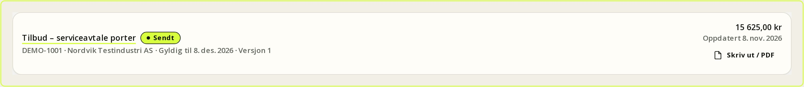
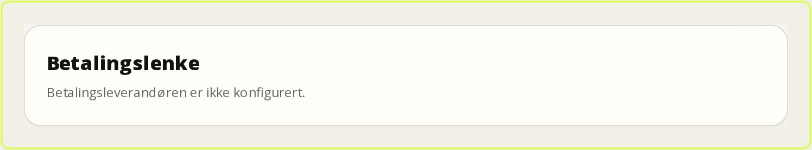
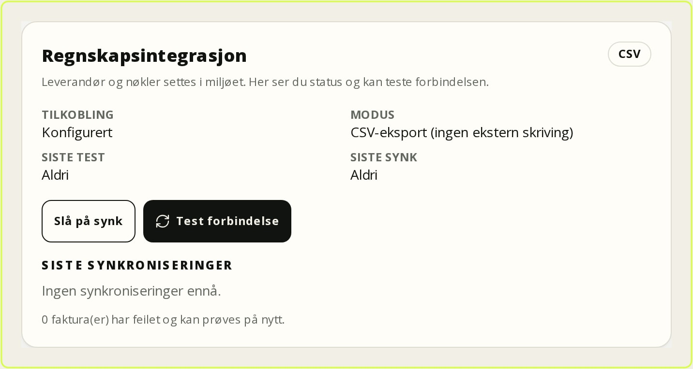

# Quotes, invoicing and accounting

This chapter describes the optional **quotes** (`quotes`), **invoicing**
(`invoicing`), **payments** and **accounting sync** modules. An administrator
must enable them under **Settings → Modules** before `/tilbud`, `/faktura` and
the invoice tab in the customer portal are available. When a module is off,
both the page and the API return `404`, even if you enter the address directly.

The platform core works without these modules. Quotes, invoices, payments and
accounting records are separate data with their own permissions and audit
trail; they do not change work order locking or the report. All amounts are
calculated on the server. The client cannot submit totals that differ from the
lines.

*Figure: The quote list collects drafts, sent and accepted quotes.*

Notice the status filter at the top and the validity column: a quote that has
been sent but not accepted is still an open commitment. Use the list to find
quotes nearing expiry, and open a row to resend or convert it to a work order.

## Quotes

A quote can be edited only while it is a **Draft**. When it is sent, the lines
are frozen in a version and the customer receives a one-time link.

### Create and send

1. Choose **Quotes → New quote** (`/tilbud/ny`).
2. Select **Customer**, optional **Contact**, **Work order**, **Contract** and
   **Equipment**. A customer name can be entered without a customer card, but
   invoicing requires a customer card link.
3. Add lines with **Description**, **Quantity**, **Unit**, **Price** and
   **VAT**. Totals, VAT and rounding are calculated per line on the server.
4. Save the draft. You can edit, clone and create a new version.
5. Select **Send quote**. The system assigns a quote number, freezes the lines,
   creates the approval link and queues the email in the automatic outbox.
6. Share the link with the customer. The customer accepts or rejects it in a
   browser without signing in.

An approval link can be used only once and has a short lifetime. If it expires,
send the quote again; this creates a new version and a new link. **Print**
(`/tilbud/<id>/skriv`) gives a print-friendly page. PDF is produced with the
browser's **Print → Save as PDF**; there is no server-generated quote PDF.

### Status and versions

| Status | Meaning | Editable |
| --- | --- | --- |
| **Draft** | Being prepared | Yes |
| **Sent** | The customer has the link | No |
| **Accepted** | The customer accepted | No |
| **Rejected** | The customer rejected | No |
| **Expired** | Validity has passed | No |

Every send and change to a sent quote creates a new version. The version keeps
the lines, prices, VAT and totals, so a later price change does not alter a
quote the customer has already seen. A scheduled job marks expired quotes; it is
idempotent and runs once per quote.

### Convert to a work order

An **accepted** quote can be converted with **Convert to work order**. The action
requires `customers.manage` and `workorders.create`, runs in one transaction and
reuses or creates the customer. Equipment on the quote is linked to the work
order. The report and invoice remain separate objects; conversion does not create
an invoice automatically.

## Invoicing

Invoices can be created manually, from an accepted quote, from a completed work
order or from a submitted report. Work orders and reports must be **Completed**
before they can be used as a basis.

### Create and send

1. Choose **Invoices → New invoice** (`/faktura/ny`).
2. Select **Customer** and optionally a **Work order**, **Report** or
   **Accepted quote**.
3. Add lines with quantity, unit, price and VAT. The invoice is saved as a draft
   and can be edited.
4. Select **Send invoice**. The invoice receives a unique number, the lines are
   frozen, and the customer receives an email with a link to the customer
   portal.
5. Register payment manually with **Amount**, **Date**, **Method** and
   **Reference**. Partial payments are supported and update the outstanding
   amount.
6. If needed, register a **Credit note**. It cannot exceed the outstanding
   amount.

**Print** (`/faktura/<id>/skriv`) gives a print-friendly invoice using the same
print-to-PDF flow as quotes. The invoice number is assigned on sending.
Concurrent sends can leave gaps in the number sequence; the gaps do not affect
uniqueness.

### Status and payment

| Status | Meaning |
| --- | --- |
| **Draft** | Not sent; editable |
| **Sent** | Number assigned, lines frozen |
| **Partially paid** | Payment registered, outstanding remains |
| **Paid** | Outstanding is zero |
| **Overdue** | Due date passed with an outstanding amount |
| **Credited** | A credit note has been registered |

Overdue invoices are updated manually with **Update overdue**, or by the
scheduled invoicing job. A payment carries an idempotency key, so double clicks
and repeated webhooks never produce a double amount. Refunds are not created
from the payment provider; use a credit note.

*Figure: The invoice shows lines, payments and outstanding amount together.*

Check **Outstanding** and **Payment status** before creating a new link. The
payment button is active only when the provider is configured and the invoice
still has an outstanding amount. Partial payments appear as separate rows, and
credit notes are kept apart from payments.

## Payment links (Stripe and Vipps)

Payment is optional. Without configuration, every payment action is a silent
no-op: no network call, no database mutation, and no button that promises more
than the system can deliver. Card numbers, CVC, BankID and the confirmation
itself stay with the payment provider. FSM stores only the provider's id, the
link and the status.

### Enable

1. Set the provider with `PAYMENTS_PROVIDER=stripe` or `PAYMENTS_PROVIDER=vipps`.
2. Set the keys and webhook secret in the environment. A provider counts as
   configured only when both the API key and the webhook secret exist.
3. Register the webhook URL in the provider's console:
   `https://<app-url>/api/webhooks/payments/stripe` or
   `https://<app-url>/api/webhooks/payments/vipps`.
4. Restart the app and confirm that **Pay** appears on a sent invoice with an
   outstanding amount.

Stripe uses **Checkout** as the hosted payment page. Vipps uses ePayment with
`WEB_REDIRECT` and wallet. Only NOK is supported in v1, and each link covers one
amount. If the outstanding amount changes after the link is created, create a
new link.

### Flow and security

1. Office staff or an administrator open the invoice and select **Create
   payment link**.
2. The customer pays at Stripe or Vipps.
3. The provider calls the webhook. The signature is verified against the raw
   body, the event is idempotent, and amount and currency are checked.
4. The payment is registered through the same service as a manual payment, and
   the invoice becomes **Partially paid** or **Paid**.

The webhook returns `200` also for duplicates and events the system deliberately
ignores, so the provider stops retrying. Unknown providers return `404`, and
missing keys return `503`. Failed or expired links set the payment status but do
not change the invoice's accounting status. Refund and capture are not done in
FSM; handle them with a credit note and, if needed, in the provider's portal.

> **Warning:** The payment link is a secret on par with the invoice. Share it
> only with the customer. Never display webhook secrets in the interface or put
> them in git.

## Accounting sync (Fiken, Tripletex, PowerOffice Go and CSV)

Accounting sync is manual and per invoice. It creates or reuses the customer,
invoice and positive payments at the provider, stores external IDs and a
retryable state. It never pretends an external call succeeded.

*Figure: Accounting settings show the selected provider and whether the
integration is active.*

Notice that the integration is **off** until an administrator enables it, even
when `ACCOUNTING_PROVIDER` is set. **Test connection** stores the result, and
**Last sync** shows whether anything was actually sent. CSV is always available
but is marked **Exported**, never **Synced**.

### Enable and test

1. Set `ACCOUNTING_PROVIDER` to `fiken`, `tripletex`, `poweroffice` or `csv`,
   and fill in the provider's keys and account codes.
2. Open **Settings → Accounting**.
3. Enable sync and select **Test connection**. A green result means the provider
   responded; it does not prove every account code is correct.
4. Open a sent invoice and select **Sync to accounting**.
5. Check that the external ID and status appear. On failure, fix the cause and
   try again; the customer is reused and the invoice has a stable key.

### Provider differences

| Provider | Customer | Invoice | Payment |
| --- | --- | --- | --- |
| **Fiken** | Contact | Invoice | Free journal entry: debit bank, credit accounts receivable |
| **Tripletex** | Customer | Order + invoice | Payment on the invoice |
| **PowerOffice Go** | Customer | Outgoing invoice | Bank journal |
| **CSV** | Local row | Local row | Local row, no external write |

Fiken requires a bank account for invoices and account codes for payments.
Tripletex requires a VAT type and payment type; without the payment type, the
payment sync fails with `not_configured` instead of guessing. PowerOffice paths
can be overridden because resource names vary between API versions. The CSV file
contains customer names and invoice lines and must be treated as business data.

### Status and limits

| Status | Meaning |
| --- | --- |
| **Synced** | The provider acknowledged customer, invoice and payments |
| **Exported** | CSV was written; no external state changed |
| **Failed** | The last attempt failed; the error code is in `lastError` |
| **Not synced** | No sync attempted |

Sync is neither automatic nor two-way. There is no background job retrying
failed syncs, no update of an already sent invoice, and no credit note, refund or
e-invoice sync. VAT mapping is simple and must be checked manually for special
rates. Resetting a sync does not delete the audit trail. Always verify the Fiken,
Tripletex and PowerOffice connectors against the provider's sandbox before
production.

## Customer portal

When both the customer portal and invoicing are enabled, the customer sees
**Invoices** in the portal (`/kundeportal/faktura`). The customer sees their own
sent invoices, lines, payment status and an optional **Pay** button. They cannot
see other customers' invoices, internal notes or drafts. Payment status is
updated only after the webhook has been received and processed.

The customer cannot pay by card outside the payment link. If the provider is not
configured, a short explanation appears instead of a button. Acknowledging a
report and paying an invoice are two separate actions.

## Permissions, audit and routines

| Action | Permission |
| --- | --- |
| View quotes and invoices | `customers.view`, `customers.manage` or `workorders.view` |
| Create, edit and send quotes | `customers.manage` |
| Create and send invoices | `customers.manage` |
| Register payment and credit note | `customers.manage` or administrator |
| Create a payment link | `customers.manage` or administrator |
| Enable, test and reset accounting sync | `settings.manage` |
| Sync one invoice | `customers.manage`, and the invoice must be visible to the actor |

Every mutation, send, payment, credit note, payment event and sync attempt writes
an audit row in the same transaction. The audit log contains provider, external
ID, status and a short error code — never tokens, raw payloads or personal data.

**Daily:** send drafts, follow **Overdue**, register received payments and check
that webhook payments have the right status.

**Weekly:** sync sent invoices, review **Failed** and **Outstanding**, and
reconcile against the accounting system.

**Monthly:** check the number series, VAT, credit notes, the payment provider's
reconciliation and that no invoice is stuck in **Draft**.

## Common problems

| Symptom | Cause | Action |
| --- | --- | --- |
| `/tilbud` or `/faktura` returns 404 | The module is off | Enable `quotes` or `invoicing` under **Settings → Modules** |
| The customer does not receive the approval link | Email missing, or SMTP not configured | Copy the link manually or configure automatic email |
| The link has expired | Short lifetime or already used | Send the quote again |
| Cannot convert the quote | It is not accepted, or permission is missing | Accept the quote and check `customers.manage` and `workorders.create` |
| The invoice cannot be sent | The draft lacks lines or a customer | Add a customer and at least one line |
| The payment button does not appear | Provider or webhook secret is missing, or the amount is paid | Check `PAYMENTS_PROVIDER` and keys, and create a new link if needed |
| The payment is not registered | Webhook rejected, or currency/amount mismatch | Check signature, `APP_URL` and the audit log; reconcile manually |
| Overpayment is rejected | The outstanding amount changed after the link was created | Create a new link after the partial payment |
| Accounting sync is **Failed** | Wrong key, account code or VAT setup | Read `lastError`, fix the cause and sync again |
| CSV appears as **Exported** | CSV is an export, not a sync | Import the file into accounting; no external state changed |
| The credit note is rejected | The amount exceeds the outstanding amount | Check payments and outstanding first |

## Customer and contact

The contact field is shown only after a customer has been selected. The
contacts are loaded for that customer and contain only people who actually
belong to the customer. Changing the customer clears the contact and reloads
the list, so a contact from another customer can neither be selected nor
submitted.

The server validates the same rule on save. If a contact does not belong to the
selected customer, the quote or invoice is rejected even if the form is
bypassed.
