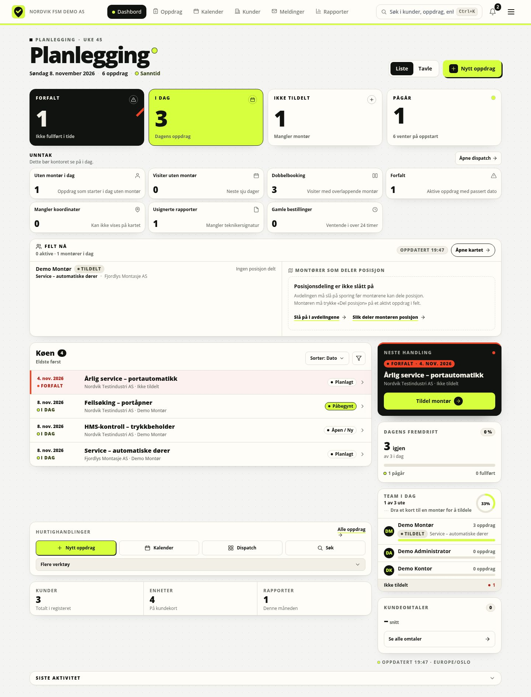
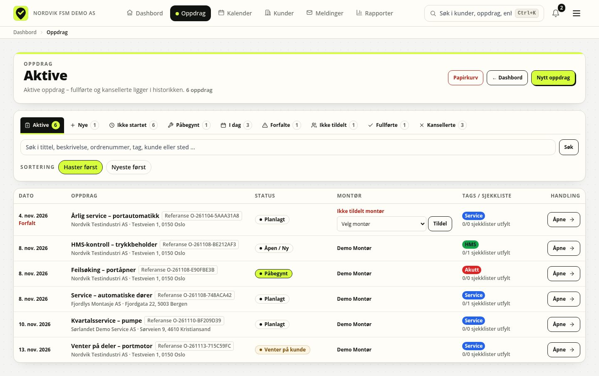
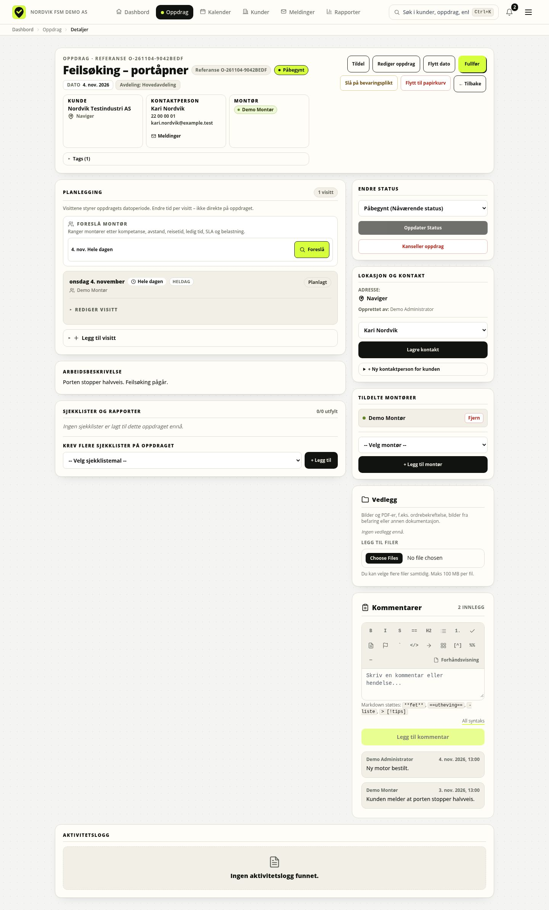
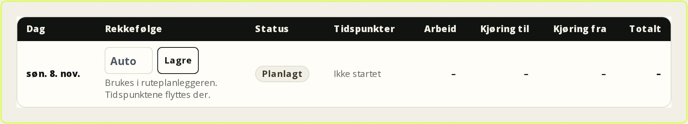
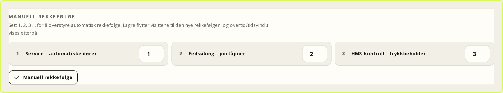
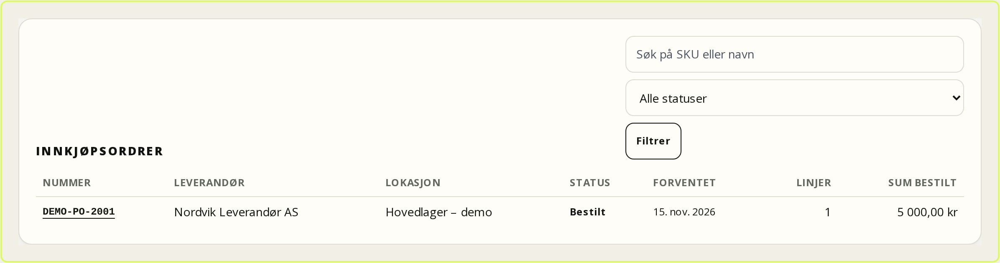
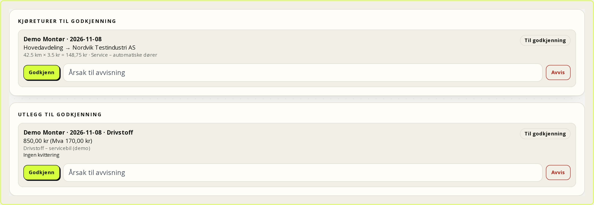
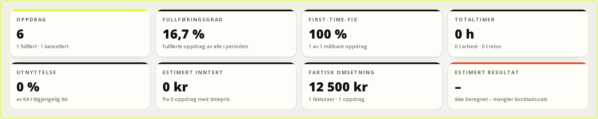

# Kontor: planlegging, fordeling og oppfølging

Dette kapitlet er for deg som jobber på kontoret: du tar imot henvendelser,
oppretter og planlegger oppdrag, fordeler montører, følger opp rapporter og
holder kunde-, utstyrs- og avtaledata oppdatert. Det gjelder FSM-plattformen
0.9.4 (08.11.2026).

Oppdrag og serviceavtaler tilhører en avdeling: du ser normalt bare egen
avdeling, mens administrator ser alt. Kunder, utstyr og dokumenter er felles,
men hver handling krever riktig rettighet. Arbeidstid, kjøring og materialer
registreres på oppdraget. Tilbud, fakturering, betaling, lager, utlegg og
lønnsomhet er valgfrie moduler som må være slått på; uten dem er prislister
referansedata og faktureringen skjer utenfor plattformen.

## Dashbordet

Dashbordet ligger på `/` og har tittelen **Planlegging**. Øverst står dato,
ukenummer, antall oppdrag og **Sanntid**.



*Figur: Dashbordet er kontorets utgangspunkt for dagen.*

Legg merke til at **Unntak som krever handling** står over selve køen. Det er
der du først ser om noe er forfalt, dobbeltbooket eller mangler montør. Køen
under viser forfalt, i dag og ikke tildelt i prioritert rekkefølge.

### Liste og tavle

**Liste** (`/?vis=liste`) er standard og viser én prioritert kø med **Forfalt**,
**I dag** og **Ikke tildelt**. Rekkefølgen er forfalt → i dag → ikke tildelt, og
hvert oppdrag vises én gang. Køen viser maks fem per gruppe og femten totalt.

**Tavle** (`/?vis=tavle`) har kolonnene **Forfalt**, **I dag**, **Pågår** og
**Ikke tildelt**. Dette er prioritetsbøtter, ikke status; statusen står som pill
på kortet.

| Kort | Betyr | Klikk |
| --- | --- | --- |
| **Forfalt** | Planlagt før i dag, ikke fullført | `/oppdrag?vis=forfalte` |
| **I dag** | Planlagt til i dag, også flerdagersoppdrag | `/oppdrag?vis=idag` |
| **Ikke tildelt** | Aktivt oppdrag uten montør | `/oppdrag?vis=ikke-tildelt` |
| **Pågår** | Status **Påbegynt** | `/oppdrag?vis=pagaaende` |

**Køen** sorteres på **Dato**, **Kunde**, **Status** eller **Tittel**; standard
er **Eldste først**. Høyrekolonnen viser **Neste handling** med **Tildel montør**
eller **Åpne oppdrag**, **Dagens fremdrift** og **Team i dag**.

### Feltstatus og livekart

Under unntakene viser **Felt nå** dagens status for feltstaben. Hver montør har
én status:

| Status | Betyr |
| --- | --- |
| **På stedet** | En visitt er startet og montøren er på stedet |
| **På vei** | Montøren har startet kjøring til en visitt |
| **Tildelt** | Montøren har en visitt i dag, men den er ikke startet |
| **Ferdig for dagen** | Alle dagens visiter er fullført |
| **Ledig** | Ingen visiter i dag |
| **Fravær** | Heldagsfravær uten aktiv visitt |

Statusen følger rekkefølgen **På stedet** → **På vei** → **Tildelt** →
**Ferdig for dagen** → **Ledig**. Har montøren flere oppdrag i dag, velges den
aktive visitten; ellers vises den som starter nærmest nå. **Fravær** vises bare
når fraværet dekker hele dagen og montøren ikke er på vei eller på stedet.
Raden viser oppdragets tittel og kunde, og **Sist delt** når montøren har delt
posisjon. De samme statusmerkene vises i **Team i dag**.

Kartpanelet **Montører som deler posisjon** viser bare montører som aktivt har
startet posisjonsdeling på en visitt som er **På vei** eller **På stedet**.
Posisjoner er korte levende punkt, ikke historikk: ping eldre enn 24 timer
brukes ikke, og kartet viser siste kjente punkt. Er sporing ikke slått på for
avdelingen, står det **Posisjonsdeling er ikke slått på**. Deler ingen posisjon
akkurat nå, står det **Ingen montører deler posisjon nå**. Begge tilstandene har
lenke til **Kart** (`/kart`), og hver markør har en tilsvarende lenke i listen
under kartet. Listen gjør kartet tilgjengelig med tastatur og skjermleser.

Du ser bare montører, oppdrag og posisjoner i din egen avdeling; administrator
ser alle avdelinger. Navn og koordinater vises aldri til kundeportalbrukere
eller andre uten oppdragstilgang. Posisjonsdeling er frivillig og styres av
montøren på oppdraget; avdelingen må i tillegg ha sporing slått på.

### Unntak, hurtighandlinger og aktivitet

Øverst på dashbordet ligger **Unntak som krever handling** med kortene **Uten
montør i dag**, **Visiter uten montør**, **Dobbelbooking**, **Forfalt**,
**Mangler koordinater**, **Usignerte rapporter** og **Gamle bestillinger**. Hvert
kort viser antall og går til riktig liste eller dispatch. **Hurtighandlinger**
gir **Nytt oppdrag**, **Kalender**, **Dispatch**, **Søk**, **Mine oppdrag**,
**Alle oppdrag**, **Kunder**, **Dokumenter**, **Sjekklister**, **Statistikk** og
**Kart**. **Siste aktivitet** viser de nyeste hendelsene med **Se all
aktivitet**.

### Rask tildeling

1. Gå til **Oppdrag** (`/oppdrag`).
2. Finn raden med **Ikke tildelt montør**.
3. Velg montør i **Velg montør** og trykk **Tildel**.

Montøren vises i raden. Tildelingen gjelder oppdraget og speiles til de øvrige
planlagte dagene. Dispatch kan planlegge én arbeidsdag om gangen.

### Dra og slipp

Dra et kort fra tavlen til en montør i **Team i dag**, eller fra
**Ressursoversikt** til montørens kolonne. Slippet tildeler montør og oppdaterer
siden. Ved feil vises en forklaring: manglende tilgang, ugyldig data, låst
oppdrag eller bevaringsplikt. Dra og slipp tildeler **ikke** dato; bruk
kalenderen for å flytte en arbeidsdag.

### Globalt søk

**Søk** i topplinjen søker i kunder, oppdrag, dokumenter, utstyr og rapporter.
Treffene viser hvilken type de er, og søket tåler skrivefeil. Dokumenttreff åpner
dokumentet i biblioteket. Bruk søket når du bare har et navn, et ordrenummer
eller et stikkord.

## Oppdrag

Oppdragslisten ligger på `/oppdrag` med fanene **Aktive**, **Nye**, **Ikke
startet**, **Påbegynt**, **I dag**, **Forfalte**, **Ikke tildelt**,
**Fullførte** og **Kansellerte**.



*Figur: Oppdragslisten er arbeidskøen på tvers av kunder og datoer.*

Bruk fanene til å snevre inn før du søker. **Ikke tildelt** og **Forfalte** er
de to viktigste inngangene for daglig oppfølging; resten er historikk og
oppslag.

### Opprette

1. Trykk **Nytt oppdrag** (`/oppdrag/ny`). Avdelingen er låst til din egen;
   bare administrator kan velge en annen. Skriv **Oppdragstittel** og eventuelt
   **Ordrenummer** (unikt i avdelingen).
2. Skriv **Beskrivelse / Instrukser**; Markdown støttes.
3. Velg **Kunde** og **Kontaktperson**, eller la kunden stå tom for et **Internt
   oppdrag**. **Adresse**, **Postnummer** og **By** overstyrer kundens adresse.
4. Sett **Dato for utførelse** og eventuelt **Til dato (valgfritt)**. Hver
   dato blir en egen arbeidsdag. Tom sluttdato betyr éndagsoppdrag, og et
   flerdagers oppdrag fortsetter på neste dag.
5. Velg montører under **Tildel montører** og maler under **Legg til
   sjekklister / skjemaer**, og legg eventuelt på **Tags**.
6. Trykk **Lagre oppdrag**. Du kommer tilbake til **Kalender**.

**Rediger oppdrag** endrer tittel, kunde, kontakt, dato, montører og
beskrivelse.

### Prioritet og status

Det finnes ikke et eget prioritetsfelt; prioritet kommer fra dato, status og om
montør mangler. Statusene er **Åpen / Ny**, **Venter på planlegging**,
**Planlagt**, **Påbegynt**, **Venter på kunde**, **Fullført** og **Kansellert**.
Åpne statuser kan byttes fritt. Bare administrator kan gjenåpne et fullført
eller kansellert oppdrag, og da kreves en grunn.

### Sjekklister, montører og visiter

På opprettelsessiden er malene delt i **Service / sjekklister** og
**HMS-dokumentasjon**. Hver mal gir en egen rapport som alltid er ny og tom. Du
kan legge til flere under **Sjekklister og rapporter** med **Krev flere
sjekklister på oppdraget**, **-- Velg sjekklistemal --** og **+ Legg til**.

Du kan tildele flere montører; **Fjern** tar en av. Tildelingen gjelder hele
oppdraget. Kontoret planlegger bare datoene; hver dato blir én arbeidsdag i
feltportalen.



*Figur: Oppdragsdetaljen samler status, kontakt, dager og rapporter.*

Bruk **Dager og tid** når du skal kontrollere faktisk tid, og **Sjekklister og
rapporter** når du skal se rapportstatus. Knappene for tildeling og status
ligger øverst, ikke inne i dagslisten.

På oppdragssiden viser **Dager og tid** én rad per arbeidsdag med status,
**På vei**, **På stedet**, **Ferdig** og **Kjøring avsluttet**, og tid for
arbeid, kjøring til, kjøring fra og totalt. Øverst står total tid for oppdraget
med fordeling. Har oppdraget ingen arbeidsdager, viser flaten datoperioden og
**Endre datoer**.

Hver arbeidsdag har et **rekkefølgenummer** (1, 2, 3, 4 …). Nummeret lagres på
visitten uten å flytte tidspunktene. Ruteplanleggeren bruker nummeret ved neste
visning og flytter tidene når du godkjenner rekkefølgen der. Tomt felt eller 0
betyr automatisk rekkefølge. Så snart minst én visitt for montøren og dagen har
et manuelt nummer, sorterer planleggeren etter nummeret og hopper over
nærmeste-nabo/2-opt.



*Figur: Rekkefølgenummeret på hver arbeidsdag styrer ruten uten å endre tiden.*

Se på nummerfeltet til høyre i hver dagsrad. Det er ikke en flytting av dagen;
det er en bestilling til ruteplanleggeren. Bruk det når kunden krever en
bestemt rekkefølge, for eksempel først hovedanlegg og deretter port.

Kontoret oppretter ikke, flytter eller sletter enkeltdager her. Endre
datoperioden på oppdraget, så avstemmes dagene automatisk. En dag som er
startet, fullført eller har tidsregistrering kan ikke fjernes uten videre – da
må historikken ryddes bevisst. **Dispatch** og **Kalender** åpner
planleggingsflatene for å tildele montører per dag og se faktisk tid.

### HMS-bibliotek og QR-etiketter

**HMS** (`/hms`) samler HMS-skjemaene etter type: **Sikker Jobb Analyse (SJA)**,
**Varme arbeider**, **Internkontroll**, **Avvik**, **Vernerunde**, **Skriftlig
instruks** og **Generelt**. Under **Knytt HMS-skjema til oppdrag** velger du
**HMS-skjema** og et aktivt **Oppdrag**, og trykker **Knytt skjema til
oppdrag**. Skjemaet legges på oppdraget og fylles ut der. **Siste
HMS-dokumentasjon** viser fullførte HMS-skjemaer du har tilgang til.

QR-etikett: Åpne enheten på `/enheter/<id>`, trykk **Skriv ut etikett**, og bruk
**Skriv ut** på etikettsiden (`/enheter/<id>/etikett`). Etiketten fører til
enheten ved skanning. **Roter QR-token** hvis etiketten er mistet eller delt; den
gamle etiketten slutter å virke med en gang.

**Eksisterende QR-koder:** Har kunden allerede etiketter fra et annet system,
registrerer du verdien under **Eksisterende QR-koder** på enhetssiden. Lim inn
eller skann verdien, gi den gjerne et navn (for eksempel «Gammel QR – port 3»),
og lagre. Etiketten blir liggende fysisk på utstyret og endres ikke. Hver verdi
kan bare kobles til én enhet. Sletting fjerner bare koblingen i FSM, ikke den
fysiske etiketten, og føres i revisjonsloggen.

### Vedlegg, kommentarer, fullføring

**Vedlegg** tar bilder og PDF-er, maks 15 MB per bilde og 50 MB per PDF, og er interne.
I tillegg gjelder en rullerende døgnkvote på 2 GiB per bruker og 10 GiB samlet
lagring per kunde. Standardverdiene kan endres med `UPLOAD_QUOTA_USER_MB` og
`UPLOAD_QUOTA_CUSTOMER_MB`. **Kommentarer** er dialogen mellom kontor og montør;
skriv i feltet og trykk **Legg til kommentar**.

**Fullfør** setter status **Fullført** etter bekreftelsen **Fullføre oppdraget?
Oppdraget og rapporten låses for redigering.** **Kanseller oppdrag** krever
**Grunn til kansellering**; kunden varsles, og bare administrator kan gjenåpne.

### Klone, relaterte data og papirkurv

**Klon oppdrag** lager en ny sak med samme tittel, beskrivelse, kunde, kontakt,
utstyr, avdeling, montører, maler, tags og visiter. Klonen får status **Venter
på planlegging**, og **ordrenummeret tømmes**. Rapporter og vedlegg kopieres
ikke.

| Data | Hvor | Merk |
| --- | --- | --- |
| Kunde/kontakt | Header og **Lokasjon og kontakt** | Låses når rapport eller bestilling finnes |
| Utstyr | Kundekortet → **Utstyr** | Rapporten husker kontrollerte enheter |
| Rapporter | **Sjekklister og rapporter** | Låses når de sendes inn |
| Arbeidsdager | **Dager og tid** | Hver dato på oppdraget blir én arbeidsdag |
| Avtale/bestilling | Avtalens siste oppdrag / bookingkøen | Én bestilling per oppdrag |

**Flytt til papirkurv** er forbeholdt administrator som standard; knappen vises
bare for roller med `workorders.delete` og bare på oppdrag som ikke er lukket. Administrator kan gjenopprette fra **Papirkurv**
(`/oppdrag/slettede`). Oppdrag uten rapporter kan fjernes etter 365 dager;
oppdrag med rapporter beholdes. **Bevaringsplikt** stopper all automatisk
sletting.

## Kunder og kontakter

Kundekatalogen ligger på `/kunder`. Søk på navn, org.nr, sted eller e-post, eller
trykk **Ny kunde**. Katalogen viser **Åpne oppdrag** og **Siste service**.

Kundekortet har fanene **Oversikt**, **Oppdrag**, **Avtaler**, **Utstyr** og
**Mer**. Øverst finner du **Nytt oppdrag**, **Meldinger**, **Rediger** og, for
administrator, **Slett kunde**. **Oversikt** viser bedriftsinformasjon,
kontaktpersoner, portalbrukere, forfalte og kommende oppdrag og aktivitet.

### Kontaktpersoner

1. Åpne kundekortet → **Mer** → **Kontaktpersoner**.
2. Trykk **Legg til kontaktperson**.
3. Fyll ut **Navn**, **Rolle (valgfritt)**, **E-post (valgfritt)** og
   **Telefon (valgfritt)**, og lagre.

En portalbruker må alltid kobles til en kontaktperson. Sletter du kontakten,
deaktiveres portalbrukere som var koblet til den.

### Avdeling og ansvarlig montør

**Rediger kunde** har **Tilhørende avdeling (valgfritt)** og **Ansvarlig montør
(valgfritt)**. Avdelingen styrer avdelingsinformasjonen i portalen, og den
ansvarlige montøren vises som direkte kontakt for kunden.

### Portalbrukere

Kundekortet → **Mer** → **Portalbrukere**.

1. Trykk **Opprett og send invitasjon**.
2. Fyll ut **Navn**, **E-post** og velg **Kontaktperson**.
3. Send invitasjonen; brukeren setter eget passord via lenken.
4. Trykk **Aktiver** når passordet er satt.

Kunne e-posten ikke sendes, viser systemet **Invitasjon klar for {name}** med
**Kopier lenke**; send den manuelt. **Deaktiver** stenger portalen og logger ut
brukeren.

### Utstyr, dokumenter og avtaler

**Utstyr** viser enheter og servicehistorikk. **Mer** → **Vedlegg** tar
dokumenter, avtaler og bilder som hører til kunden. **Avtaler** viser
serviceavtaler, dekningslinjer, neste service, SLA og prislister.

**Steder** og **Utstyr** på kundekortet har egne søkefelt. Søket kjøres på
serveren og er avgrenset til den åpne kunden, så du kan søke på navn, adresse,
postnummer, sted, modell eller serienummer uten at andre kunders rader dukker
opp. **Nullstill** fjerner søket, og telleren viser hvor mange treff kunden har.

## Utstyr og enheter

Utstyrsregisteret ligger på `/enheter`. Søk på modell, serienummer, plassering
eller kunde, filtrer på status og kategori, eller slå på **Vis hierarki**.

### Opprette og redigere

1. Trykk **Ny enhet** (`/enheter/ny`).
2. Velg **Kunde**, skriv **Modell** og **Serienummer**.
3. Fyll ut **Plassering**, **Kategori**, eventuell **Overordnet enhet**,
   **Status** og **Kritikalitet**.
4. Sett **Installasjonsdato**, **Garanti til** og **Måleenhet** hvis det er
   relevant.
5. Trykk **Registrer enhet**.

Når du har valgt **Kunde**, lastes bare den kundens **Steder** og
**Overordnet enhet** fra serveren. Bytter du kunde, tømmes og lastes listene på
nytt, så du kan ikke velge et sted eller en enhet som hører til en annen kunde.
Det samme gjelder **Nytt oppdrag** og **Rediger oppdrag**.

**Rediger enhet** endrer de samme feltene.

Statusene er **Aktiv**, **Ute av drift** og **Utfaset**; kritikalitet er
**Kritisk**, **Normal** eller **Lav**. En utfaset enhet kan ikke få nye
målinger. En enhet med underenheter, historikk eller planer kan ikke slettes.
**Overordnet enhet** bygger hierarki, og **Flytt i hierarkiet** endrer
plassering.

### Flytte enhet til en annen kunde

Når utstyr bytter eier eller kunde, kan hele enheten flyttes med
servicehistorikken. Flyttingen krever **Administrer utstyr** og **Administrer
kunder**, eller administrator.

1. Åpne enheten på `/enheter/<id>` og velg **Flytt til annen kunde**.
2. Søk opp målkunden og velg eventuelt målsted. Velger du ikke sted, blir
   enheten stående uten sted hos den nye kunden.
3. Kontroller **Hva som flyttes** og forhåndsvisningen. Den viser antall
   oppdrag, visiter, rapporter, revisjoner, målinger, planer, dokumenter,
   vedlegg og QR-koder som følger med.
4. Skriv målkundens navn for å bekrefte, eller kryss av bekreftelsen, og trykk
   **Flytt enheten**.

**Dette flyttes:** enheten og eventuelle underenheter (maks 1000), hierarkiet
mellom dem, oppdrag og visiter, rapporter med revisjoner, rapportenheter og
PDF-er, målinger, vedlikeholdsplaner og forekomster, dokumenter med versjoner,
vedlegg/opplastinger, registrerte QR-koder og kommentarer. Rotenheten får
målstedet. Underenheter mister det gamle stedet fordi det tilhørte den forrige
kunden, og må plasseres på nytt etter flyttingen. Rotenheten kobles ikke lenger
til en eventuell gammel overordnet enhet.

**Dette blokkerer flyttingen:**

- **Kontraktslinjer som tilhører en avtale hos en annen kunde** og peker på
  enheten eller en underenhet. En flytting kan ikke bare endre hvem en
  økonomisk forpliktelse peker på. Rydd eller avslutt avtalelinjene først.
- Underenheter som allerede tilhører en annen kunde.
- Oppdragsnummer som kolliderer med et nummer i målkundens avdeling.
- Manglende eller slettet målkunde, eller et målsted som ikke tilhører kunden.
- Mer enn 1000 enheter i undertreet.

**Dette flyttes ikke:** kontraktslinjer, den gamle kundens portalbrukere,
globale dokumenter uten kunde- eller enhetstilknytning, og selve revisjonsloggen.
Kontaktpersoner fra den gamle kunden tømmes på oppdragene, og oppdrag som peker
på en avtale hos en annen kunde mister avtalelenken. Du får varsel om dette i
forhåndsvisningen. Målkundens avdeling brukes hvis den finnes; ellers brukes
din egen avdeling, og du får beskjed.

Flyttingen er idempotent: gjentas den etter at enheten står hos målkunden, får
du beskjed om at ingenting ble endret. Alle valideringer kjøres før første
skriving, så en avvist flytting etterlater ikke halve endringer. Handlingen
revisjonslogges. Vil du angre, må du flytte enheten tilbake manuelt.

### Målinger

1. Åpne enheten og finn **Måler**.
2. Trykk **Registrer måling**.
3. Fyll ut **Verdi**, **Dato**, **Kilde** og eventuelt **Notat**.
4. Trykk **Lagre måling**.

Målingen vises i listen og i **Målerutvikling**. Diagrammet krever minst to
målinger.

### Vedlikeholdsplaner

1. Trykk **Ny vedlikeholdsplan**.
2. Skriv **Tittel** og velg **Utløser**: **Kalender** eller **Måler**.
3. Ved kalender: sett **Intervall (måneder)** og eventuelt **Ledetid (dager)**.
   Ved måler: sett **Målerintervall**.
4. Kontroller **Neste forfall** og lagre.

**Pause** stopper planen, og **Aktiver** starter den igjen; **Tidslinje** viser
forekomster. Når planen forfaller, lager den planlagte jobben et oppdrag som
kontoret følger opp.

### Servicehistorikk og rapporter

**Servicehistorikk** viser alle rapporter der enheten ble kontrollert, med
dato, resultat, kommentarer, sjekkpunkter og bilder. Historikken er et
øyeblikksbilde og endres ikke om malen eller enheten redigeres senere.

I skjemaet velger montøren **Hent fra kundens utstyr**. Hvert registrerte utstyr
kan bare brukes én gang i samme rapport. Rapporten husker enhet, serienummer og
svar, så kundekortet og enhetssiden viser nøyaktig hva som ble kontrollert.

## Kalender og dispatch

Kalenderen ligger på `/kalender` med fanene **Ressursoversikt**, **Måned**,
**Uke**, **2 uker**, **Uke (time)**, **Dag**, **Dispatch**, **Kapasitet**,
**Rute** og **Rapporter**.

| Fane | URL |
| --- | --- |
| **Måned** | `/kalender?vis=maned` |
| **Uke** | `/kalender?vis=uke` |
| **2 uker** | `/kalender?vis=2uker` |
| **Uke (time)** | `/kalender?vis=timegrid` |
| **Dag** | `/kalender?vis=dag` |

Øverst står **Periode** med måned eller datointervall rett ved siden av
navigasjonspilene og **I dag**. Kalenderen laster omtrent seks måneder bakover
og fremover, og maks 1000 visiter; utenfor vinduet kan visiter mangle.

**Filtrer kalenderen** har **Montør**, **Status** og **Uten montør**. **Bruk
filter** og **Nullstill** gjelder alle datavisningene.

### Visiter og dra/slipp

Kalenderen viser én hendelse per arbeidsdag med status **Planlagt**,
**Tildelt**, **På vei**, **På stedet**, **Fullført** eller **Kansellert**. Når
montøren har registrert tid, viser hendelsen faktisk start, slutt og varighet i
stedet for bare datoen. Dra en dag til en annen dato for å flytte den. Ved
konflikt lagres ikke flyttingen, og du får beskjed om overlappet. Fullførte og
kansellerte dager er låst.

**Ressursoversikt** viser montører, aktive oppdrag, oppdrag uten montør og nylig
fullførte. **Ufordelte oppdrag** har **Tildel montør**. Du kan dra kort mellom
montører for å tildele.

### Dispatch og kapasitet

**Dispatch** (`/kalender/dispatch`) fordeler montører på visiter, med egen
kolonne **Uten montør**. **Forfalte / Ufordelte** vises alltid, uavhengig av
dato. Dra en arbeidsdag til en montørs kolonne for å tildele den. Slipp på **Uten
montør** for å fjerne kilden montør; andre montører beholdes. **Legg til**
setter på en ekstra montør, **Fjern {name}** tar en av, og **Se detaljer** åpner
oppdraget.

**Automatisk tildeling** tørrkjøres med **Tørrkjør**; **Bruk N forslag** lagrer
først når du velger det. **Foreslå montør** rangerer etter **Kompetanse**,
**Avstand**, **Reise**, **Ledig**, **SLA** og **Belastning**. Kompetanse, fravær,
arbeidstid er harde krav; overlapp er bare en opptatt-markering.

**Kapasitet** (`/kalender/kapasitet`) viser **Planlagt kapasitet mot faktisk
belastning per avdeling, dag og montør**. Velg **Fra** og **Til**, trykk **Vis**,
og les **Kapasitet**, **Belastning** og **Utnyttelse**.

### Ruteplan

**Rute** (`/kalender/rute`) foreslår kjøreorden for én dag, per montør. Velg
**Dato** og eventuelt **Montør**, og trykk **Vis rute**. Siden viser kart,
stoppnummer, **Ankomst**, **Planlagt**, **Kjøring**, **Venting**, **Overtid** og
total **Kjøretid**, **Avstand** og **Ventetid** per montør.

Ruten starter ved montørens tidligste lokaliserte visitt. Beregningen bruker
**OpenStreetMap via OSRM** for ruter og reisematrise. Er `GOOGLE_ROUTES_API_KEY`
satt, brukes **Google Routes API** som trafikkbevisst tillegg for enkeltstrekninger;
uten den er ETA et rute- og hastighetsanslag, ikke sanntidstrafikk. Svarer ingen
leverandør, brukes lokal beregning: luftlinje × 1,35 og gjennomsnittsfart. Se
**Beregning** i ruten for å se hvilken metode som faktisk ble brukt.

**Overtid:** En visitt blir ikke lenger ufordelt bare fordi den ikke rekker
tidsvinduet eller arbeidstiden. Den planlegges med overtid, og stoppet merkes med
`outsideTimeWindow`, `outsideWorkingHours` og `overtimeMinutes`. Ruten summerer
**Total overtid**. `ROUTE_ALLOW_OVERTIME=false` slår av planlegging etter
arbeidstid, og `ROUTE_MAX_OVERTIME_MINUTES` setter et valgfritt tak. Bare
genuint umulige visiter blir ufordelte: manglende koordinater, manglende
kompetanse, ferie/sykdom, overtidsgrense eller mer enn 50 lokaliserte visiter.

**Manuell rekkefølge:** Hvert stopp har et nummerfelt. Skriv 1, 2, 3, 4 … og
trykk **Manuell rekkefølge**. Nummereringen normaliseres til 1..n, lagres på
visitten og flytter tidspunktene med samme tjenestelag som **Bruk rekkefølge**.
Tomt felt eller 0 betyr automatisk rekkefølge. Så lenge minst én visitt for
montøren og dagen har et manuelt nummer, sorteres ruten etter nummeret og
nærmeste-nabo/2-opt hoppes over.

**Bruk rekkefølge** flytter visittene til de foreslåtte tidspunktene i én
transaksjon. Handlingen krever `workorders.assign`, revisjonslogges per visitt
og avbrytes helt ved overlapp med en fast visitt eller registrert ferie/sykdom.
Fullførte og kansellerte visiter flyttes aldri. Hvis planen er endret siden den
ble vist, får du beskjed om å laste siden på nytt.



*Figur: Manuell rekkefølge settes med 1/2/3/4 i ruteplanleggeren.*

Se på nummerfeltet ved hvert stopp og på summen nederst. Rekkefølgen er et
forslag helt til du trykker **Manuell rekkefølge** eller **Bruk rekkefølge**.
Nummereringen endrer ikke datoen; den endrer rekkefølgen innenfor dagen.


*Figur: Overtid per stopp og total overtid for dagen.*

Legg merke til at overtid er merket per stopp, ikke skjult i totalen. Et stopp
kan ligge utenfor kundens tidsvindu uten å gi overtid dersom det fortsatt er
innenfor arbeidstiden. Sjekk **Total overtid** før du godkjenner ruten, særlig
når `ROUTE_MAX_OVERTIME_MINUTES` er satt.

**Fordelingsregler** og **Territorier** settes opp under **Innstillinger →
Dispatch**. Der velger du **Modus**, justerer **Vektene** for **Kompetanse**,
**Avstand**, **Reisetid**, **Ledig tid**, **SLA** og **Belastning**, og legger
inn territorier med **Postnummerprefikser**, **Kommunekoder** og **Radius (km)**.
**Kapasitetsplaner** vises i kapasitetsvisningen, men redigeres ikke i
**Innstillinger** i 0.9.4. Det samme gjelder kompetanse, fravær og arbeidstid:
de brukes av dispatch og booking, men har ikke eget skjema i **Innstillinger**.

## Avtaler, SLA og prislister

Avtaler ligger på `/avtaler` og på kundekortets **Avtaler**-fane.

### Opprette

1. Åpne kundekortet → **Avtaler**.
2. Fyll ut **Tittel**, eventuelt **Avtalenummer**, **Avdeling**, **Startdato**
   og **Sluttdato**.
3. Velg **Intervall** (3, 6, 12 eller 24 måneder), **Status** (**Utkast** eller
   **Aktiv**) og **Fornyelse** (**Manuell** eller **Automatisk**).
4. Sett **Varsel før utløp (dager)** og eventuelt **Prisjustering (%)**.
5. Velg **Kontaktperson**, **Sjekkliste**, **SLA-policy** og **Prisliste**, og
   legg eventuelt til en linje med **Utstyr**, **Dekning**, **Besøk/år**,
   **Svartid (min)** og **Løsningstid (min)**.
6. Trykk **Opprett serviceavtale**.

### Linjer og dekning

**Dekning ({count})** viser avtalens linjer. En avtale **uten linjer** dekker alt
utstyr; en linje **uten utstyr** dekker alt utstyr; en linje **med utstyr**
dekker bare den enheten. Ved dekningskontroll leser du utstyr, dekning, besøk per
år og svartider. Bare **Aktive** avtaler innenfor start- og sluttdato teller.
Plattformen viser ikke et automatisk «dekket»-merke, så kontroller linjene
manuelt før du lover kunden dekning.

### Intervall, fornyelse og livssyklus

**Neste service** regnes fra startdato og intervall. **Forny** forlenger
avtalen. **Pause** og **Aktiver** stopper og starter nye oppdrag. **Automatisk**
fornyelse kjøres av den planlagte serviceavtalejobben.
**Manuell** fornyelse blir **Utløpt** ved passert sluttdato og må fornyes med
**Forny**.

### SLA

En SLA-policy setter **Svartid (minutter)** og **Løsningstid (minutter)**.
Policyen kan gjelde én avdeling eller alle, og kan begrenses med **Tell bare
innenfor åpningstid**. **Åpningstider** og **Helligdager** avgjør når klokken
går; uten lagrede åpningstider brukes hverdager 08–16. Policyer, åpningstider,
helligdager og prislister vedlikeholdes av administrator under **Innstillinger →
SLA og åpningstider**.

SLA krever en **aktiv serviceavtale** med gyldig dato og en aktiv SLA-policy.
Kunder uten aktiv avtale får ingen SLA-klokke, og oppdraget viser ingen
SLA-panel. På oppdraget vises **SLA** med **Svar innen**, **Løs innen** og
**I rute**, **I fare**, **Brutt**, **Oppfylt** eller **Kansellert**. Første
**På vei** eller **På stedet** registrerer respons; **Ferdig** registrerer
løsning.

### Prislister

**Prislister** er referansedata for visning og for timepris i lønnsomhet. Uten
`invoicing` fakturerer ikke systemet og beregner ikke fakturabeløp; med modulen
på brukes prislisten som grunnlag når du oppretter en faktura.

### Gjentagende oppdrag

Ved hvert intervall opprettes et nytt oppdrag med avtalens tittel, kunde,
kontaktperson, avdeling og sjekklistemal. Det får status **Planlagt**, en
én arbeidsdag uten montører, og SLA-klokken starter når avtalen er aktiv. Rapporten er ny og tom;
forrige rapport legges ved som PDF. Har jobben vært nede, brukes siste forfalte
forekomst. Utløpte avtaler genererer ikke nye oppdrag.

## Bookinger

Bookingkøen ligger på `/bookinger` med **Alle**, **Venter**, **Bekreftet** og
**Avsluttet**. Hvert kort viser **Referanse**, **Kunde**, **Ønsket tid**,
**Sted**, **Tjeneste**, **Montør** og status.

1. Åpne `/bookinger` og filtrer på **Venter**.
2. Fyll inn **Dato**, **Fra** og **Til** for den planlagte visitten. Ønsket
   dato er forhåndsutfylt, men kan endres.
3. Velg **Montør** i **Velg montør**. Alle aktive ansatte i avdelingen kan
   velges; fravær, arbeidstid og reservasjoner kontrolleres når du bekrefter,
   mens overlapp bare vises som en opptatt-markering.
4. Trykk **Planlegg og bekreft**, eller **Avlys** for å avvise.

Ved bekreftelse settes oppdraget til **Planlagt**, visitten opprettes eller
oppdateres, og kunden får SMS hvis kontakten har samtykket. Hvis montøren
allerede har et annet oppdrag i tidsrommet, vises det som en
**opptatt-markering**, ikke en hard sperre. Du kan bekrefte likevel, men bør
vurdere kapasiteten og flytte en av dagene ved behov. Fravær og arbeidstid er
fortsatt harde krav.

Kunden velger sted, tjeneste og ønsket dato i portalen, og skriver ønsket
klokkeslett i beskrivelsen. Kunden kan ikke velge tidsblokk, og bestillingen
opprettes alltid som et nytt oppdrag med status **Åpen/Ny**. Det opprettes
ingen visitt eller bekreftet tid. Kontoret planlegger derfor tid og montør
direkte i bookingkøen; eldre bestillinger som allerede har et lagret
tidsvindu, kan fortsatt bekreftes med dette vinduet.

Kontoret eller montøren planlegger oppdraget og setter status **Planlagt**.
Passer ikke tiden, settes det til **Venter** til ny planlegging. Kunden får
endelig bekreftelse først da. En kundebestilling er allerede et oppdrag; det
finnes ingen egen **Konverter til oppdrag**-knapp.

Har kunden en allerede bekreftet avtale, kan **Be om ny tid** bruke en kort
reservasjon mens skjemaet fylles ut. Den reservasjonen gjelder bare ombooking
av den bekreftede avtalen, aldri nye bestillinger.

## Lager, reservedeler og innkjøp

Lagermodulen (`inventory`) krever at utstyrsmodulen er på. Den brukes av både
kontor og montør, men kontoret eier vareregister, leverandører og innkjøp.

| Side | Bruk |
| --- | --- |
| `/lager` | Vareliste, lokasjoner, kjøpsforslag og ny vare/lokasjon |
| `/lager/varer/<id>` | Beholdning per lokasjon, bevegelser, reservasjoner og justering |
| `/lager/lokasjoner/<id>` | Beholdning og bevegelser for ett lager eller én montørbil |
| `/lager/oppdrag/<id>` | Reservedeler for ett oppdrag, med reservasjon, frigjøring og forbruk |
| `/lager/innkjop` | Innkjøpsordrer, filter og utkast fra kjøpsforslag |
| `/lager/innkjop/<id>` | Ordrelinjer, bestilling, avbestilling og varemottak |
| `/lager/innkjop/leverandorer` | Leverandørliste og ny leverandør |

En **lokasjon** er et lager (`WAREHOUSE`) eller en montørbil (`VAN`), med valgfri
avdeling og ansvarlig bruker. En **vare** har SKU, navn, enhet, bestillingspunkt
og aktiv-flagg. Beholdningen ligger per vare og lokasjon. Bevegelsene er `IN`,
`OUT`, `ADJUST`, `RESERVE`, `RELEASE` og `CONSUME`.

### Reserve deler på et oppdrag

1. Åpne oppdraget og gå til reservedelssiden (`/lager/oppdrag/<id>`).
2. Velg vare og lokasjon, og skriv antall.
3. Trykk **Reserver**. Reservasjonen reduserer tilgjengelig beholdning, men
   flytter ikke varen fysisk.
4. Ved behov, trykk **Frigjør** for å slippe reservasjonen uten å trekke lager.
5. Når delen er brukt, trykk **Forbruk**. Da trekkes mengden fra fysisk
   beholdning.

Forbruk gjøres bevisst fra reservedelssiden, ikke automatisk når visitten settes
til **Fullført**. Det gir ingen skjulte sideeffekter i feltflyten, men krever at
kontoret eller montøren faktisk registrerer forbruket.

### Leverandører og innkjøpsordrer

1. Opprett leverandøren under **Lager → Innkjøp → Leverandører** med navn,
   organisasjonsnummer, e-post, telefon og eventuell avdeling. Leverandør uten
   avdeling er felles for installasjonen.
2. Trykk **Ny innkjøpsordre** på `/lager/innkjop`, eller bygg et utkast fra
   kjøpsforslagene på `/lager`. Forslaget er
   `bestillingspunkt − (på lager − aktive reservasjoner)`.
3. Velg leverandør, mottakslokasjon og forventet levering. Legg inn linjer med
   vare, bestilt mengde og enhetskost.
4. Trykk **Bestill**. Ordren får et nummer på formen `PO-ÅÅÅÅ-NNNNN`.
5. Ved mottak, åpne ordren og registrer mottatt mengde. Delvis mottak er
   støttet; resten står åpent.
6. Når alt er mottatt, er ordren **Mottatt**. Overmottak og negative mengder
   avvises.

| Status | Betyr | Kan gå til |
| --- | --- | --- |
| **Utkast** | Kan redigeres fritt | Bestilt, avbestilt |
| **Bestilt** | Ingen varer mottatt | Delvis mottatt, mottatt, avbestilt |
| **Delvis mottatt** | Noe er på lager | Mottatt |
| **Mottatt** | Alt er mottatt | – |
| **Avbestilt** | Avbestilt før mottak | – |

Bare utkast kan endre linjer, leverandør, lokasjon og notat. Avbestilling er
bare mulig før første vare er mottatt. Varemottak øker beholdningen og skriver
en `IN`-bevegelse i samme transaksjon som linje- og ordrestatus. Ordren låses
med `SELECT ... FOR UPDATE`, slik at to samtidige mottak ikke kan overmotta.
Hver mutasjon revisjonslogges.

Enhetskost settes til 0 til den redigeres manuelt; totalsummen er derfor 0 til
kostnad er fylt inn. Kjøpsforslaget er en beregnet lesevisning og bestiller
ingenting automatisk. Leverandørfaktura, fakturakontroll, ordreutsending til
leverandør, retur/kreditnota og serie-/lotsporing er ikke en del av v1.



*Figur: Innkjøpsordren viser status, linjer og hva som gjenstår å motta.*

Se på statusen og mottatt mengde per linje. **Delvis mottatt** betyr at noe
allerede er på lager og at resten fortsatt kan mottas. Knappen for mottak gjelder
bare gjenstående mengde; systemet avviser overmottak.

**Rettigheter:** Se lager med `equipment.view`, administrer varer, lokasjoner,
leverandører og innkjøp med `equipment.manage`, og reserver/frigjør/forbruk med
`workorders.update` eller `equipment.manage`. Avdelingssperren følger
lokasjonen; administrator ser alle avdelinger.

## Kjøreturer, utlegg og lønnsgrunnlag

Utleggsmodulen (`fieldExpenses`) lar montøren registrere kjøreturer og utlegg, og
kontoret godkjenne og eksportere grunnlaget for lønn.

- **Montøren** registrerer i `/utlegg`: dato, fra/til, kilometer, sats, kategori,
  brutto beløp, MVA og kvittering.
- **Kontoret** godkjenner i `/utlegg/kontor`, med forhåndsvisning og eksport per
  periode.
- **Eksporten** lastes ned fra `/utlegg/kontor/eksport?start=…&end=…`.

Kjøregodtgjørelse er `km × sats`, avrundet til øre på serveren. MVA er
`brutto × sats / (100 + sats)`. Standard er 3,50 kr/km og 25 % MVA når skjemaet
ikke oppgir annet. Satsene lagres per rad, slik at historiske eksporter ikke
endres av senere satsendringer. Klienten kan ikke sende et ferdig beløp som
avviker.

1. Åpne **Utlegg → Kontor**.
2. Velg periode og eventuell avdeling.
3. Les gjennom kjøreturer og utlegg. Godkjenn med **Godkjenn**, eller avvis med
   **Avvis** og en begrunnelse.
4. Trykk **Eksporter lønn** for perioden. Filen er låst og merket med
   eksporttidspunkt.
5. Last ned CSV-en og importer den i lønnssystemet.

Kjøretur og utlegg starter som **Venter** (eller **Utkast** når klienten ber om
det). Bare godkjente rader eksporteres; avviste og uavklarte rader er alltid
utelatt. Avvisning krever begrunnelse. Avdelingssperren gjør at kontor A ikke kan
godkjenne rader i kontor B. Eksporten er idempotent per avdeling og periode:
samme periode gir nøyaktig samme CSV og kontrollsum, og overlappende perioder
avvises.

CSV-en er UTF-8 med BOM, semikolon og `\r\n`, klar for norsk Excel. Første rad
er:

```text
type;bruker;dato;referanse;beskrivelse;mengde;enhet;belop;mva
```

`type` er `WORK`, `TRAVEL`, `MILEAGE` eller `EXPENSE`. Tid og reisetid hentes fra
visittens tidsstempler; modulen lager ingen egen timeføring. Det finnes ingen
integrasjon mot en ekstern lønnsleverandør – CSV-kontrakten er grensesnittet.



*Figur: Kontoret godkjenner eller avviser rader før lønns-CSV-en låses.*

Legg merke til at godkjenning og eksport er to steg. En godkjent rad er ikke
eksportert før perioden er låst, og en eksportert rad kan ikke endres. Kontroller
kvittering og MVA før du godkjenner, ikke etterpå.

## Lønnsomhet

**Lønnsomhet** (`/lonnsomhet`) gir kontor og administrator ett samlet bilde av
oppdrag, tid, first-time-fix, **estimert** og **faktisk** inntekt per avdeling,
kunde og montør. Modulen er `bi` og krever `reports.view`; montører og
kundeportalbrukere får `403`.

1. Velg **Fra** og **Til**, eventuelt **Avdeling**, **Kunde** og **Montør**.
2. Les **Estimert inntekt**, **Faktisk inntekt**, **First-time-fix**,
   **Utnyttelse** og **Resultat**.
3. Trykk **Eksporter CSV** for samme filter og samme avdelingsomfang.

**Estimert inntekt** er timepris fra avtalens prisliste × arbeidstid. Reisetid
inngår ikke. **Faktisk inntekt** hentes fra fakturaer når `invoicing` er på:
netto fakturert beløp uten MVA, med kreditnotaer trukket fra, og kladder
utelatt. Fakturaen må være knyttet til et oppdrag i utvalget og utstedt i
perioden. Perioden for estimat og oppdrag følger oppdragets planlagte dato, mens
faktisk inntekt følger fakturadato. Et oppdrag som planlegges i én måned og
faktureres i neste, får derfor estimat i første og faktisk inntekt i andre.

**Resultat** beregnes bare når alle oppdrag i utvalget har timepris og
`BI_INTERNAL_COST_RATE_NOK` er satt. Uten satsen vises «ikke beregnet». Faktisk
omsetning påvirker ikke resultatberegningen; den er fortsatt basert på estimatet.
Maks 5 000 oppdrag, 5 000 fakturaer og 366 dager per rapport. CSV-eksporten er
deterministisk og revisjonslogges med filter, radantall og sjekksum.



*Figur: KPI-ene viser estimat og faktisk omsetning side om side.*

Se etter merknaden om faktisk inntekt er tilgjengelig. Er `invoicing` av, eller
finnes det ingen ikke-kladde fakturaer i utvalget, viser rapporten estimatet
alene og forklarer hvorfor. Tallene er ikke en garanti for lønnsomhet: kostnaden
er en global intern sats, ikke lønn, bil, deler og utlegg per oppdrag.

## Rapporter

Rapportlisten ligger på `/rapporter` og viser **Servicerapporter** – utfylte
sjekklister med signaturer og bilder.

### Liste og filtre

Velg **Denne måneden**, **Forrige måned** eller **Alle**, og filtrer på
**Fritekst**, **Kunde**, **Montør**, **Kun avvik** og **Kvittering** (**Alle**,
**Kvittert**, **Ikke kvittert**). **Sortering** er **Nyeste først**, **Eldste
først**, **Kunde (A–Å)** eller **Montør (A–Å)**. Trykk **Filtrer** eller
**Nullstill filtre**. Listen viser **Låst**, **Åpen for retting** eller **Ikke
signert**, og **Rapportnr.** når rapporten har nummer.

### Åpne, PDF og innhold

**Åpne skjema** åpner rapportvisningen med **Hovedresultat**, **Signert av**,
**Enheter som ble kontrollert**, **Svar på sjekkpunkter** og **Generelle notater
fra montør**, med bilder og vedlegg. PDF-en vises i appens eget PDF-vindu.
**Åpne i ny fane** viser samme PDF i nettleseren, **Last ned PDF** lager et
vedlegg, og **Lukk PDF** går tilbake. Hvis PDF-en ikke kan vises, for eksempel
fordi den inneholder aktivt innhold som ikke kan fjernes, viser viseren en
feilmelding med **Prøv igjen** og nedlasting. Revisjoner åpnes på samme måte fra
**Revisjoner** med **Åpne revisjonen (PDF)**.

En rapport kan ha **Montør / tekniker**- og **Kunde**-signatur, tegnet på
skjermen. Bilder lastes opp per sjekkpunkt eller enhet. Avvik vises som **Avvik
funnet**. Når en rapport har minst ett avvik, oppretter systemet automatisk
**ett udatert utbedringsoppdrag** med tittelen «Utbedring av avvik – …». Det
arver kunde, avdeling og kontakt, får innsenderen som montør, og beskriver
enhetene og sjekkpunktene. Du finner det i oppdragslisten som **Åpen / Ny** uten
dato.

> **Merk:** Hvis et bilde eller en signatur mangler i den ferdige PDF-en, viser
> PDF-en en advarsel med antall bilder som ikke kunne hentes. Årsaken er som
> regel at filen mangler `Upload`-metadata, er slettet fra filvolumet, eller
> tilhører et annet oppdrag. Last opp bildet på nytt fra rapporten, og generer
> PDF-en igjen. Driftsloggen viser `report_pdf_images_missing` med antall, uten
> filnavn eller personopplysninger.

> **Merk:** Tittelen på utbedringsoppdraget er norsk i 0.9.4, også når
> grensesnittet er engelsk. Det er samme språkbegrensning som i rapport-PDF-en.

### Status og låsing

En innsendt rapport låses. **Lås opp for retting** krever **Årsak til opplåsing**
og er en administratorhandling. Etter retting låses rapporten igjen.

### Kundeportalen og utstyrshistorikk

Kunden ser **Rapporter** i portalen. Bare innsendte, låste rapporter kan åpnes;
**Vis rapport** åpner PDF-en i appen, og **Last ned PDF** lager et vedlegg. En
opplåst rapport er utilgjengelig til den låses igjen. Kunden kan **Kvitter
mottatt** med kommentar og **Be om oppdatering av kontaktinformasjon**; det
siste oppdaterer ikke kundekortet automatisk.

Rapportens enheter er koblet til kundens utstyr. **Servicehistorikk** på enheten
viser alle kontroller med dato, resultat, kommentarer, sjekkpunkter og bilder.

## Dokumenter

Dokumentbiblioteket ligger på `/dokumenter` og er intern dokumentasjon med
mapper, tags, versjoner og fulltekstsøk.

### Mapper og opplasting

1. Trykk **Ny mappe**, eller **Importer mappestruktur** for en hel mappe med
   PDF-er.
2. Trykk **Last opp PDF**, velg **PDF-fil**, og skriv **Tittel**, eventuell
   **Beskrivelse** og **Tags**.
3. Trykk **Lagre dokument**.

Bare PDF er tillatt. **Flytt til mappe** og **Legg til tag** virker på flere
dokumenter samtidig. **Slett valgte** er en administratorhandling.

### Tags, søk og OCR

Dokumenttags er egne og blandes ikke med oppdragstags. Søk i **tittel,
beskrivelse, filnavn eller tags**, og velg **Denne mappen** eller **Hele
biblioteket**; **Filter på tag:** snevrer inn. Tekst ekstraheres ved opplasting,
og skannede PDF-er kjøres gjennom OCR. **Indekser alle PDF-er for søk** fyller ut
manglende innhold.

### Versjoner og deling

**Rediger** → **Erstatt fil (valgfritt)** lager ny versjon. Gamle versjoner
ligger under **Tidligere versjoner ({count})** med **Last ned** og
**Gjenopprett**.

Biblioteket er internt og styres av **Se dokumenter** og **Administrere
dokumenter**. For å dele med kunden, legg filen på kundekortet under **Mer** →
**Vedlegg**; den vises i kundens **Dokumenter**. Oppdragsvedlegg er interne.
Rapporter vises bare når de er innsendte og låste.

## Kart, søk, varsler og meldinger

**Kart** (`/kart`) viser aktive oppdrag gruppert etter sted. Filtrer på
**Montør**, **Fra dato** og **Til dato**. **Statusfarger** forklarer fargene, og
**Åpne i Maps** gir veibeskrivelse. Markørene plasseres på adressen når den er
geokodet; ellers vises oppdraget på kundens by.

**Søk** (`/sok`) finner kunder, oppdrag, utstyr, kontakter, rapporter,
kommentarer, ansatte, sjekklister, mapper og dokumenter. Bruk topplinjen,
**Ctrl+K** (⌘K på macOS) eller **/**. Skriv minst to tegn. **Beste treff** vises
øverst, **Se alle (N)** går til hele listen, og **Filtre** begrenser på type,
status, kunde, montør, dato, tag og HMS-type. Søket er fuzzy og tåler
skrivefeil; dokumenttreff åpner dokumentet i biblioteket. **Lagre dette søket**
lager et lagret søk.

**Varsler** (`/varsler`) viser **x uleste av y totalt**, **Bare uleste** og
**Merk alle som lest**. Typene er **Tildeling**, **Datoendring**,
**Kansellering**, **Rapport**, **Booking**, **Serviceavtale**, **Forfalt** og
**Kontaktoppdatering**. **Innstillinger** lar deg velge **I appen** og
**E-post** per hendelse, og slå **Varsellyd** av eller på.

**Meldinger** (`/meldinger`) samler SMS-samtaler. Filtrer på **Alle** eller
**Bare uleste**, søk på kunde, kontakt eller oppdrag, og **Start samtale** fra et
oppdrag. Åpne en samtale for å lese kundens svar og svare med SMS; hver utgående
melding viser **Status** (I kø, Sendt, Levert eller Feilet). **Hurtigmeldinger** sender **Send bookingbekreftelse**, **Send påminnelse**,
**Send «på vei»**, **Send «ferdig»** eller **Be om vurdering**. **Samtykke og
reservasjon** viser **Samtykke registrert** eller **Ikke registrert**; uten
samtykke sendes ingen SMS. Tørrkjøring betyr at ingen meldinger forlater
systemet. Du ser bare samtaler i din egen avdeling; kundeportalbrukere ser bare
sine egne.

Administrator kan sette opp **Automatiske påminnelser** under **Innstillinger →
SMS**. Reglene kan sende SMS, e-post eller begge deler et valgt antall timer før
besøket, med stille timer og en maksgrense per besøk. **Siste påminnelser** viser
hva som er planlagt, sendt eller hoppet over – uten meldingstekst.

## Kundeportalen fra kontoret

Kunden ser **Min Bedrift: {customerName}** og fanene **Oversikt**,
**Bestillinger**, **Rapporter**, **Dokumenter**, **Utstyr**, **Avtaler**,
**Besøk**, **Meldinger** og **Kontakt**.

1. Åpne kundekortet → **Mer** → **Portalbrukere**.
2. Trykk **Opprett og send invitasjon**, og fyll ut navn, e-post og
   kontaktperson.
3. Send invitasjonen; brukeren setter passord.
4. Trykk **Aktiver** når passordet er satt.

**Deaktiver** tilbakekaller tilgangen med en gang. En portalbruker må være koblet
til en kontaktperson på samme kunde, og e-postadressen må være unik.

**Bestillinger** viser forespørsler og bekreftede avtaler med historikk.
**Rapporter** lar kunden kvittere. **Dokumenter** viser filer dere har delt via
kundekortets **Vedlegg**. **Utstyr** viser status, garanti, siste måling og
planer. **Avtaler** viser serviceavtaler og dekningslinjer. **Besøk** viser
sporingslenke og omtale. Sporingssiden viser planlagt tid når montøren ikke har
delt posisjon, og en live ETA bare når siste posisjon er fersk (under ti
minutter). Er posisjonen eldre, står det eksplisitt hvor gammel den er; siden
later aldri som et gammelt ping er live. ETA-en oppdateres automatisk hvert 30.
sekund. **Meldinger** lar kunden svare på SMS ved samtykke.

Kunden kan **Send en datoforespørsel**, **Be om ny tid**, **Kanseller forespørsel**,
**Kvitter mottatt** og **Be om oppdatering av kontaktinformasjon**. Booking og
avbestilling varsler kontoret; kontaktoppdatering må gjøres manuelt i
kundekortet.

## Daglige og periodiske rutiner

**Morgen:** Se **Forfalt**, **I dag** og **Ikke tildelt**. Tildel
det som er **Uten montør i dag**, sjekk **Dobbelbooking** og **Visiter uten
montør**, og sjekk **Bookinger** og **Meldinger**.

**I løpet av dagen:** Følg **Pågår** og **Forfalt**. Flytt arbeidsdager i kalenderen,
bruk dispatch ved sykdom eller hastverk, og svar kunder i **Meldinger**.
Registrer samtykke før SMS.

**Slutten av dagen:** Kontroller at dagens oppdrag er **Fullført** eller har en
oppfølging. Se **Usignerte rapporter**, kontroller morgendagens arbeidsdager, og rydd
**Bookinger** og **Varsler**.

**Ukentlig:** Gå gjennom **Forfalte** og **Ikke tildelt**, neste ukes
**Kapasitet**, **Utløper innen 60 dager**, **Rapporter** med **Kun avvik**, og
kundeportalbrukere.

**Månedlig:** Gå gjennom utløpte avtaler og avtalelinjer. Deaktiver
portalbrukere som har sluttet, og se over utstyr uten målinger eller med utløpt
garanti. SLA-policyer, åpningstider, helligdager og prislister forvaltes av
administrator; be om endring ved behov.

## Kundeoverføring (bare administrator)

Fanen **Kundeoverføring** ligger under **Innstillinger** og vises bare for en
aktiv administrator som også har rettigheten **Administrere innstillinger**.
Kontor, montører og kundeportalbrukere får `403` også om de kaller ruten direkte.
Fanen brukes til å flytte én eller flere kunder mellom installasjoner – den er
ikke en sikkerhetskopi.

**Eksport**

1. Åpne **Innstillinger → Kundeoverføring**, søk opp kunden og kryss av.
2. Velg om filer, revisjonssnapshot, slettede rader og bevaringsplikt skal med.
   Signaturbilder er av som standard og krever en egen, dokumentert vurdering.
3. Les personopplysningsvarselet og kryss av bekreftelsen.
4. Trykk **Start eksport**. Du får en ZIP med `manifest.json`,
   `checksums.sha256`, datafiler og filer. Pakken er tilgjengelig i 24 timer og
   kan bare lastes ned av deg.
5. Verifiser gjerne manuelt med `sha256sum -c checksums.sha256`. Sjekksummene
   oppdager korrupsjon, men beviser ikke hvem som lagde pakken.

Pakken inneholder aldri passord, passordhasher, 2FA-hemmeligheter, sesjoner
eller API-nøkler. Portalerbrukere følger med som metadata og importeres
deaktivert uten passord.

**Import**

1. Last opp ZIP-en. Serveren validerer struktur, sjekksummer, filtyper og
   referanser, og viser en forhåndsvisning. Ingenting skrives ennå.
2. Kontroller antall, advarsler og feil. Feil blokkerer importen. For
   konflikter velger du **hopp over** (standard), **opprett ny** eller – for
   kunde og utstyr – **oppdater**. Rapporter oppdateres aldri.
3. Kryss av bekreftelsen og trykk **Importer pakken**. Alle rader og filer
   skrives i én transaksjon; feiler noe, blir databasen uendret og midlertidige
   filer ryddes.
4. Etter importen får hver portalerbruker ny id, er deaktivert og mangler
   passord. Send vanlig invitasjon eller tilbakestill passord før innlogging.
   Ansatte og maler opprettes aldri automatisk.

**Gjentatte forsøk og feil:** Eksporten er idempotent. Samme administrator,
samme kundeutvalg og samme valg innen ti minutter gjenbruker den samme jobben i
stedet for å starte en ny, så et dobbeltklikk koster ikke et nytt forsøk. Det er
maks 10 eksportstarter per time; overskridelse gir en tydelig melding om å vente.
Feil lagres på jobben og vises i grensesnittet, slik at du kan rette årsaken og
prøve igjen uten å gjette. Forhåndsvisningen er gyldig i 30 minutter; er pakken
eller utvalget endret siden den ble vist, må du laste opp og forhåndsvise på
nytt. Importfeil blokkerer skriving, og en avbrutt import ruller tilbake hele
transaksjonen og rydder midlertidige filer.

**Begrensninger:** Pakken er begrenset til 500 MiB og 50 MiB per fil, og
eksporten kjører som en durabel bakgrunnsjobb med fremdrift. Globale dokumenter
uten kunde-/utstyrseier følger ikke med. Signaturer, SLA-klokker, bookinger,
varsler, SMS, sporing og rapportkladder er bevisst utelatt. Se
`docs/BACKLOG.md` for full liste.

## Grensesnitt mot tekniker- og administratordelen

| Kontoret gjør | Teknikeren gjør | Hvor det står |
| --- | --- | --- |
| Oppretter oppdrag med kunde, kontakt, utstyr og sjekklister | Tar oppdraget, åpner skjema og fyller ut sjekkpunkter | Teknikerdelen (del 2) |
| Planlegger dato og montør per arbeidsdag | Starter **På vei**, markerer **På stedet**, **Ferdig** og **Avslutt kjøring** | Teknikerdelen |
| Leser rapport, avvik og signaturer | Signerer, legger ved bilder, sender rapport | Teknikerdelen |
| Følger opp utbedringsoppdrag | Utfører utbedringen og ny rapport | Teknikerdelen |

Administratordelen beskriver **Ansatte & Roller**, **Roller & rettigheter**,
**Avdelinger**, **Sjekklister / Maler**, **SLA og åpningstider**, merkevare,
API-nøkler, aktivitetslogg, bevaringsplikt og gjenoppretting. Se
administratordelen (del 3).

## Vanlige feil og feilsøking

| Symptom | Vanlig årsak | Gjør dette |
| --- | --- | --- |
| Finner ikke oppdraget | Feil avdeling, fane eller filter | Nullstill søk/filter, kontroller avdeling |
| Får ikke tildelt | Mangler **Tildele montører**, låst eller bevaringsplikt | Be om rettighet, eller gjenåpne som administrator |
| Dra og slipp endret ikke dato | Dra og slipp tildeler montør | Flytt dagen i kalenderen |
| Kalenderen er tom | Ingen arbeidsdager, filter eller utenfor ±6 måneder | Nullstill filter, velg **I dag**, kontroller datoperioden |
| Overlappende arbeidsdag | Montøren har flere oppdrag samtidig | Vurder kapasiteten og flytt en dag ved behov |
| Rapporten er låst | Innsendt rapport | Be administrator **Lås opp for retting** |
| Kunden ser ikke rapporten | Ikke låst, eller mangler portal-/dokumenttilgang | Lås rapporten, kontroller portalbruker |
| Kunden kan ikke booke | Mangler kontakt/aktiv bruker, eller datoen er utenfor vinduet | Sjekk kontakt, bruker, 24 timer og ønsket dato |
| SMS sendes ikke | Mangler samtykke, telefon, kvote eller tørrkjøring | Registrer samtykke, kontroller nummer/innstillinger |
| Avtalen lager ingen oppdrag | Pauset/utløpt, fremtidig start eller jobben kjører ikke | Aktiver, kontroller startdato og jobb |
| SLA vises ikke | Ingen aktiv avtale med aktiv policy | Aktiver avtalen og knytt policy til den |
| Prislisten fakturerer ikke | Referansedata, eller `invoicing` er av | Slå på fakturering og opprett faktura i **Faktura** |
| Betalingsknappen vises ikke | Leverandør eller webhook-hemmelighet mangler | Kontroller `PAYMENTS_PROVIDER` og nøklene |
| Regnskapssynken står som feilet | Feil nøkkel, konto eller MVA | Les feilkoden og synkroniser på nytt |
| Lagerbeholdningen stemmer ikke | Reservasjon er ikke forbrukt, eller manuell justering mangler | Kontroller reservasjoner og bevegelser på varen |
| Utlegg kan ikke eksporteres | Perioden overlapper en låst eksport, eller raden er ikke godkjent | Velg ny periode og godkjenn raden |
| Vedlegg vises ikke i portalen | Oppdragsvedlegg er interne | Legg filen på kundekortet → **Mer** → **Vedlegg** |
