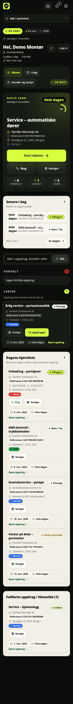
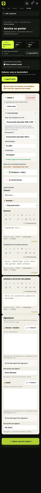

# Tekniker

Feltappen for rollen **Montør**: innlogging, «Mine oppdrag», oppdragsdetaljer, sjekklister, enheter, skanning, offline-kladder og innsending. Versjon 0.9.1 (2026-11-08).

Bunnlinjen har **I dag** (`/mine-oppdrag`), **Oppdrag**, **Varsler** og **Mer**. «Mer» åpner samme meny som hamburgerknappen øverst. Språk, varsellyd, rapporter, kunder/utstyr og innstillinger ligger i menyen.

*Figur: I dag er feltappens startsiden.*

Legg merke til **Neste jobb** øverst og gruppene **Forfalt** og **Ledige** under.
Det er her du ser om noe er tildelt deg, om du kan ta en ledig jobb, og om noe
har blitt liggende fra tidligere dager.

## Første gang: innlogging, 2FA og språk

### Logg inn

1. Åpne `/logg-inn`.
2. Skriv **E-post** og **Passord**.
3. Trykk **Logg inn**.

Du kommer til **I dag** på mobil. På datamaskin kommer du til kontordashbordet. Feil passord gir «Feil e-post eller passord.» En konto som ikke er aktivert, gir «Kontoen din er ikke aktivert ennå. En administrator må aktivere den før du kan logge inn.»

Økten varer normalt i 12 timer. Lokale kladder beholdes når økten utløper, men sendes ikke før du er innlogget igjen.

### To-trinns verifisering

2FA er valgfritt, men anbefalt. Har du slått det på, kommer du til `/logg-inn/2fa` etter passordet.

1. Åpne autentiseringsappen.
2. Skriv den 6-sifrede **Engangskoden** for selskapet.
3. Trykk **Verifiser**.

Får du «Feil engangskode. Prøv igjen.», vent til neste kode. Har du mistet telefonen, trykker du **Logg inn med gjenopprettingskode**, skriver en av kodene du lagret da du slo på 2FA, og trykker **Logg inn med kode**. En administrator kan nullstille 2FA.

Du kan ikke bytte passord i feltappen. Logg ut og bruk **Glemt passord** på innloggingssiden, eller be administrator sende en ny lenke. 2FA og gjenopprettingskoder administreres under **Innstillinger → Sikkerhet**.

### Bytt språk

1. Åpne **Meny** med hamburgerknappen øverst, eller trykk **Mer** i bunnlinjen.
2. Rull til bunnen. Der ligger **Endre språk**.
3. Velg **Norsk**, **English**, **Polski** eller **Deutsch**.

Valget lagres i `NEXT_LOCALE`-cookien og slår inn uten at URL-en endres. Datoer, tall og relativ tid følger språket. Rapport-PDF-ens faste etiketter er fortsatt norske i 0.9.1.

### Installer feltappen (PWA)

Feltappen er en installérbar nettapp. Den åpnes i eget vindu, starter på `/mine-oppdrag` på mobil (på datamaskin åpnes kontordashbordet) og er låst til stående skjermretning.

- **Android/Chrome:** Nettlesermenyen → **Installer app** eller **Legg til på startskjermen**.
- **iPhone/iPad/Safari:** Delikonet → **Legg til på Hjem-skjermen**.
- **Chrome/Edge på datamaskin:** Installasjonsikonet i adressefeltet, eller menyen → **Installer**.

Det finnes ingen egen «Installer»-knapp i appen. Installasjonen bruker manifestet og krever HTTPS. Service workeren registreres bare i produksjonsbygget. Den cacher alle samme-origins GET-sider, API-GET og filer under `/uploads/` i sju døgn per bruker.

Når appen er installert, kan du holde inne appikonet og velge **Mine oppdrag**, **Skann** eller **I dag**. De samme valgene ligger i appen. Når en ny versjon er lastet ned, viser appen **En ny versjon av feltappen er klar.** Trykk **Oppdater** når du ikke står midt i et skjema. **Senere** skjuler meldingen til neste oppstart.

### Native app og serveradresse

Android- og iOS-appen ligger i det egne repoet `fsm-mobile` og bygges og
signeres der. Plattformen inneholder ikke lenger Capacitor-prosjekter, skall
eller signeringsfiler.

1. Installer appen fra bedriftens distribusjon eller appbutikk.
2. Ved første start kommer du til en lokal oppsettside. Skriv inn
   **FSM-serverens URL**, for eksempel `https://fsm.example.no`.
3. Adressen lagres native på enheten og er ikke bygget inn i appen. Trykk
   **Koble til**.
4. Senere kan du endre adressen fra tannhjulet i appen, eller bruke **Bytt
   server**. Da tømmes cache og innlogging for den gamle serveren.

Bruker du nettleser eller PWA i stedet, gjelder samme adresse og samme
innlogging. Den native appen og PWA-en bruker samme API og samme
tilgangskontroll.

### Pushvarsler

Push er et supplement til varslene i appen. Hvert varsel lagres først i
**Varsler**, og deretter sendes en kopi til de aktive mobilenhetene dine.

1. Logg inn i appen og tillat varsler når systemet spør.
2. Appen registrerer enheten med push-token etter innlogging og når tokenet
   roteres.
3. Trykk på et varsel for å åpne riktig side. Dype lenker går alltid til en
   intern sti, for eksempel `/oppdrag/<id>`, `/bookinger` eller `/varsler`.
4. Ved utlogging avregistreres enheten. En enhet som er logget inn på nytt med
   en annen konto, flyttes til den nye kontoen, og gamle ventende varsler
   slettes.

Varsellyd slås av og på i menyen. Selve push-oppsettet (FCM for Android og APNs
for iOS) gjøres av administrator og krever legitimasjon i miljøet. Er ingen
leverandør konfigurert, kan enheten registreres, men ingenting sendes.

> **Merk:** Push er ikke det samme som SMS. Push krever at appen er installert og
> at enheten har tillatt varsler; SMS krever samtykke og telefonnummer.

### Skann QR og strekkode

1. Trykk **Skann** på **I dag**, i topplinjen eller i menyen.
2. Trykk **Start kamera** og gi kameratilgang første gang.
3. Hold QR-koden på enhetsetiketten rolig i rammen. Appen åpner enheten eller oppdraget hvis du har tilgang.
4. Får du ikke kamera, skriver du koden i **Kode eller referanse** og trykker **Slå opp**. Du kan lime inn hele lenken fra etiketten.

Kameraet krever at appen åpnes over **HTTPS** (en sikker adresse). På en vanlig `http://`-adresse, for eksempel en LAN-adresse under utvikling, blokkerer nettleseren kameraet og appen viser en egen HTTPS-melding. Bruk den installerte appen eller `https://`-adressen i produksjon.

- **iPhone/iPad (Safari):** Gi kameratilgang når Safari spør. Har du avslått, går du til **Innstillinger → Safari → Kamera** (eller **Innstillinger → appen**) og velger **Spør hver gang** eller **Tillat**. Kameraskanning virker i iOS Safari også uten nettleserens innebygde strekkode-API; appen bruker da en reserve.
- **Android (Chrome):** Trykk **Tillat** på kamera-spørsmålet. Har du avslått, åpner du låseikonet ved adressen → **Tillatelser** → **Kamera**, eller **Innstillinger → Apper → Chrome → Tillatelser → Kamera**.
- **Kameraet er opptatt:** Lukk andre apper som bruker kameraet, og trykk **Start kamera** igjen.
- **Koden leses ikke:** Hold etiketten roligere, unngå motlys og sørg for godt lys. Appen fortsetter å lete og viser en egen melding hvis bildet ikke kan dekodes.

Hvis nettleseren ikke har kamerastøtte i det hele tatt, vises det en melding om det – men på iPhone og Android skal reserve-skanneren være tilgjengelig så lenge appen kjører over HTTPS og du har gitt kameratilgang.

Appen godtar enhets-QR, enhets-ID, oppdragsreferanse (for eksempel `O-261103-ABCD1234`) og ordrenummer. Ukjent kode, manglende tilgang og gjentatte skann gir en forklaring i stedet for å åpne feil side. Tilgangen kontrolleres på nytt på serveren; et skann gir aldri mer tilgang enn du har fra før.

Har kunden allerede QR-etiketter fra et annet system, virker de også: Kontoret registrerer den eksisterende verdien under **Eksisterende QR-koder** på enheten. Du skanner etiketten på samme måte som vår egen, og appen åpner enheten hvis du har tilgang. Verdien er en opak streng – appen følger aldri en lenke eller henter innhold fra internett.

### Naviger, ring og kopier adresse

**Naviger** åpner den innebygde kartappen: Apple Maps på iPhone/iPad, Google Maps eller valgt kartapp på Android, og Google Maps i nettleseren på datamaskin. Appen bruker koordinater når de finnes, ellers en URL-kodet adresse. Mangler både adresse og koordinater, skjules knappen.

**Ring** åpner telefonappen med oppdragets kontaktperson, kundens kontaktperson eller hovedtelefon. **Kopier adresse** legger hele adressen på utklippstavlen, slik at den kan limes inn i SMS, e-post eller et annet system.

### Før du mister nettet

1. Åpne **I dag** og hvert oppdrag du skal utføre.
2. Åpne hvert skjema du trenger, slik at siden havner i offline-cachen.
3. Vent til **kladd lagret**.
4. Last opp bilder mens du er på nett; et påkrevd bildefelt godkjennes ikke før bildet er lastet opp.
5. Åpne PDF-er du trenger mens du er på nett.
6. Ikke tøm nettleser- eller appdata.

Side-, API- og filcachen varer i **sju døgn per bruker**. Cacheene slettes ved utlogging, utløpt økt og **Bytt server**. Appen ber om persistent lagring, men operativsystemet kan rydde lagringen hvis enheten er full. Lokale kladder varer i sju dager.

## Mine oppdrag / I dag

`/mine-oppdrag` er startsiden på mobil. På datamaskin starter montøren på kontordashbordet. Øverst ser du navnet ditt, **På vakt**, **På nett** eller **Frakoblet**, dagens dato, antall jobber i dag, antall **Forfalt**, og en beregnet rutedistanse når dagens oppdrag har koordinater. Mangler koordinatene, står det **Rute beregnes** eller ingenting – appen dikter ikke opp en avstand.

### Neste jobb

Kortet **Neste jobb** viser dagens første gjenstående jobb, eller neste kommende jobb hvis dagen er tom. Det viser dato og status for dagens økt, tittel, kunde, ordrenummer, adresse, kontaktperson, **Jobb 1 av N**, og **Start skjema**, **Fortsett skjema** eller **Åpne jobb**, **Ring** og **Naviger**.

**Start skjema** åpner første sjekkliste som mangler låst rapport. **Fortsett skjema** brukes ved kladd eller ulåst rapport. Har oppdraget ingen mal, sier knappen **Åpne jobb**. **Naviger** åpner kartappen med koordinater eller adresse.

### Forfalt, ledige og senere

**Forfalt** viser dine åpne oppdrag med planlagt dato før i dag, eldste først. **Ledige** viser åpne oppdrag uten montør. Har du rettighet til å oppdatere oppdrag, får hvert ledig kort **Ta oppdraget**; du blir da montør på jobben og får «Oppdraget er tatt og ligger nå under dine oppdrag.» Uten rettighet skjules knappen. Er oppdraget fullført eller kansellert, får du «Oppdraget er fullført eller kansellert og kan ikke tas.»

**Senere i dag** viser resten av dagen kompakt, **Dagens kjøreliste** viser hele listen, og **Fullførte oppdrag / Historikk** viser fullførte jobber med **Vis flere**.

### Søk

Søkefeltet i **I dag** søker i tittel, beskrivelse, ordrenummer, kundenavn, kundens by, kundens adresse og kontaktpersonens navn. Trykk **Søk**. **Nullstill** fjerner søket.

### Jobbkort og statuschips

Kortet er én stor trykkflate med tittel, statuschip, kunde, ordrenummer, kontaktperson/telefon, adresse, tags og dato. Finnes en kladd, vises **Kladd 14:32 · Fortsett**. **Ring** og **Naviger** ligger oppå kortet og starter telefon eller kartappen uten å åpne oppdraget.

| Chip | Betydning |
| --- | --- |
| **Åpen / Ny** | Opprettet, ikke planlagt eller startet |
| **Venter på planlegging** | Systemets startstatus; velges ikke manuelt |
| **Planlagt** | Har planlagt dato og arbeidsdag |
| **Påbegynt** | Det jobbes med oppdraget |
| **Venter på kunde** | Arbeidet står i påvente av kunden |
| **Fullført** | Avsluttet og låst |
| **Kansellert** | Avsluttet; vises ikke i feltportalen |

**Forfalt** og **Ledige** er grupper, ikke statuser.

### Varsler

**Varsler** i bunnlinjen åpner `/varsler`, med **Bare uleste**, **Merk alle som lest**, **Merk lest** og **Åpne**. Varselklokken øverst viser antall uleste. I menyen slår du varsellyd på eller av med **Slå på varsellyd** / **Slå av varsellyd**.

### Ingen jobber?

Står det **Ingen aktive oppdrag i din kalender akkurat nå**:

1. Trykk **Nullstill** hvis et søk står på.
2. Trykk oppdateringsikonet øverst.
3. Se under **Ledige** – der kan det ligge oppdrag du kan ta.
4. Kontroller at du er i riktig avdeling; avdelingssperren skjuler andre avdelingers oppdrag.
5. Meld fra til kontoret hvis jobben mangler montør eller ligger på feil dato.

## Oppdragsdetaljen

Åpne et kort for å komme til `/mine-oppdrag/<oppdrag-id>`. Øverst ligger en mørk jobbflate med statuschip, tittel, kunde, adresse, avdeling, ordrenummer, planlagt dato, tildelte montører, kontaktperson og antall sjekklister.

### Kunde, kontakt, adresse og kart

**Hurtighandlinger** gir **Ring kontakt**, **Naviger**, **Kunde**, **Utstyr** og **Dokumenter**. **Ring kontakt** bruker oppdragets kontaktperson, deretter kundens kontaktperson eller hovedtelefon. **Naviger** åpner kartappen med koordinater eller adresse og skjules når begge mangler. **Kopier adresse** ligger under adressen i **Lokasjon og kontakt**.

**Lokasjon og kontakt** viser full adresse, firma-telefon, oppdragets kontaktperson og kundens øvrige kontakter med telefon og e-post. Mangler data, står det **Ikke oppgitt** eller **Ingen spesifikk kontaktperson registrert**.

### Dagens økt: på vei, på stedet, ferdig

Øktkortet viser **Dagens økt** eller **Neste økt** med dato, status og montører. Hver kalenderdag er én økt; et flerdagers oppdrag fortsetter neste dag selv om dagen i dag er fullført. Flyten er **På vei** → **På stedet** → **Ferdig**. Hvert trykk registrerer tidspunktet på serveren. Trykk først når du faktisk kjører, ankommer eller er ferdig; ikke bruk knappene for å rydde dagen i etterkant.

Etter **Ferdig** viser kortet **Avslutt kjøring** helt til returkjøringen er avsluttet. Da låses dagen, og det står **Dagen er fullført.** Neste dags økt kan startes med **På vei** selv om en tidligere dag fortsatt venter på **Avslutt kjøring**; da lukkes den forrige kjørebiten automatisk.

Kortet viser tid i dag for **Kjøring til**, **Arbeid**, **Kjøring fra** og **Totalt**, og total tid for hele oppdraget med fordeling. **Dager** lister hver arbeidsdag i oppdraget med status og tid, slik at du ser hvilke dager som er fullført og hvilke som gjenstår. En fullført dag som mangler **Avslutt kjøring**, har knappen i dagslisten.

Med live-sporing kan du dele posisjon mens økten er **På vei**: **Del posisjon** / **Stopp deling**. Posisjonen slettes etter 24 timer.

### Status, arbeidsbeskrivelse og kommentarer

**Oppdragsstatus** lar deg velge ny status og trykke **Oppdater**. **Fullfør** krever bekreftelse: «Fullføre oppdraget? Oppdraget og rapporten låses for redigering.» Kansellering ligger under **Flere handlinger** for roller med redigeringstilgang. Fullførte oppdrag er låst; gjenåpning gjøres av administrator.

**Arbeidsbeskrivelse / Instrukser** vises som Markdown. **Kommentarer og oppdateringer** er en Markdown-logg: **Skriv kommentar** → **Legg til kommentar**.

### Vedlegg, personell og historikk

**Vedlegg** tar bilder og PDF-er via **Legg til filer**. Filene lastes opp én og én; feiler én, vises navnet og du kan prøve igjen.

**Tildelt personell og kontor** viser hvem som er på oppdraget. **Fjern meg** fjerner deg selv, med **Angre** i toasten. **Legg til kollega eller kontor for oppfølging** brukes når noen skal se eller overta.

**Aktivitetslogg** viser statusendringer, tildelinger, kommentarer, rapporter og låsing. Servicehistorikken ligger på enheten, se «Enheter øverst i hver sjekkliste».

### Sjekklister og rapporter

**Sjekklister for oppdraget** viser alle maler på jobben, med HMS-type, **Rapportnr.** når det finnes, **Låst**/**Låst opp**, **Fyll ut skjema →**, **Rediger** ved opplåst retting, og **Se rapport (PDF)** når rapporten finnes.

Fremdriftsringen viser besvarte sjekkpunkter, avvik og kladdestatus. **Trenger du et ekstra skjema?** legger til en mal du har tilgang til; ellers må kontoret gjøre det.

Står det **Ingen sjekklister er knyttet til dette oppdraget ennå**, kan du ikke fylle ut noe før kontoret legger til en mal.

## Rapportskjemaet

Skjemaet åpnes på `/mine-oppdrag/<oppdrag-id>/skjema/<mal-id>`.

*Figur: Rapportskjemaet er bygget for én hånd og ustabilt nett.*

Legg merke til stegstripen øverst og enhetsblokkene. Hvert sjekkpunkt hører til
en enhet, og signaturen ligger nederst. Statusen for kladd står hele tiden
synlig, slik at du vet om det du har fylt ut er lagret lokalt eller på serveren.

### Låst rapport og gjenoppretting av kladd

Er rapporten innsendt og låst, viser siden **Rapporten er låst**. Du kan åpne **Se rapporten (PDF)** eller gå tilbake. Bare administrator kan låse opp for retting.

Finnes en lagret kladd, åpnes skjemaet med feltene slik du forlot dem, og du får «📝 En lagret kladd er gjenopprettet med alle feltene slik du forlot dem.» En innsendt rapport overskrives aldri av en lokal kladd.

### Stegstripen

Øverst ligger en fast stripe med **Sjekkpunkter** (besvarte av totalt), **Bilder** (opplastede) og **Signer** (antall signaturer av to).

Stripen viser **kladd lagres automatisk**, **lagrer kladd**, **kladd lagret**, **kladd lagret lokalt** eller **kladd feilet**, med klokkeslett. **Lagre kladd nå** tvinger en lagring.

### Enheter øverst i hver sjekkliste

Hver enhet er en blokk. Øverst ligger enhetsdetaljene, slik at du vet hva du kontrollerer:

- **Hent fra kundens utstyr** – velg registrert enhet; betegnelse, serienummer og plassering fylles ut.
- **Ny enhet (ikke registrert fra før)** – når utstyret ikke står på kunden.
- **Betegnelse** \* – påkrevd; skriv det du ser, for eksempel «Port Nord».
- **Serienummer** og **Plassering** – valgfritt, men viktig for historikken.

Koblet enhet viser **🔗 Koblet til registrert enhet på kundekortet**. Ny enhet med navn viser **＋ Lagres som ny enhet på kunden**. Ved innsending opprettes eller gjenbrukes enheten på kunden.

**Én registrert enhet kan bare brukes én gang i samme rapport.** Duplikatvalg avvises med «Dette utstyret er allerede valgt i en annen enhet. Velg et annet utstyr.» Gamle kladder med duplikater ryddes og må velges på nytt.

**Legg til enhet** gir ny rad; **Fjern enhet** bekrefter og sletter sjekkpunktene. Bruk **Ny enhet** bare for et nytt fysisk utstyr, ikke for å omgå duplikatkontrollen.

Enhetene gir servicehistorikk per enhet, kundens utstyrsliste, kontorets oversikt og grunnlag for QR-etikett og neste service.

### Sjekkpunkter

Hvert sjekkpunkt kommer fra malen:

- **Statusvalg** – OK / Avvik / Utbedres / Ikke aktuelt. Valg som krever oppfølging gir påkrevd kommentar: «💬 Kommentar til «…» – påkrevd».
- **Avkrysning** – må være krysset av når feltet er påkrevd.
- **Fritekst/tekstområde** – tekstområdet støtter Markdown.
- **Tall, dato, nedtrekksliste** – vanlige felt med påkrevd-markering.
- **Bilde** – **Ta bilde** / **Velg bilde**. Komprimeres og lastes opp med én gang; uten nett blir de **Klar til opplasting** eller **Opplasting feilet** og prøves automatisk når nettet kommer tilbake.
- **Signatur** – tekstfelt der du skriver fullt navn.

Felt med `*` er påkrevd og må ha en faktisk verdi. En avkrysning må være krysset av, og et bildefelt må ha minst ett opplastet bilde; tom bildeliste teller ikke.

**Betingede felt** vises først når et annet felt har bestemt verdi. Endrer du kilden, kan feltet forsvinne. Sjekk at alle synlige, påkrevde felt er besvart; skjulte felt kreves ikke.

Ved oppfølgingsbehov vises «Ett sjekkpunkt krever oppfølging» eller «N sjekkpunkter krever oppfølging». Er enheten likevel **Godkjent / utført**, spør appen, og du kan trykke **Sett resultatet til «Avvik funnet»**.

### Bilder som bevis

Bilder er dokumentasjon, ikke dekorasjon. Ta bilde av avviket, måleren, skaden eller det som er utbedret. Bildene komprimeres til maksimalt 1600 piksler og JPEG-kvalitet 0,78 når filen er stor nok. Opplastingen krever nett.

Feiler opplastingen, viser feltet **Opplasting feilet** og **Prøv igjen** / **Prøv alle på nytt**. Når nettet kommer tilbake, prøves det automatisk.

### Signaturer

**Signaturer** nederst er valgfrie – tekniker, kunde eller begge. Tegn med finger eller mus, bruk **Fullskjerm**, og **Tøm** for å starte på nytt. **Montør / tekniker** forhåndsfylles med ditt navn; **Kunde** med oppdragets kontaktperson.

En tidligere signatur beholdes hvis du ikke signerer på nytt: **Beholdes hvis du ikke signerer på nytt.** Navnet må være en av oppdragets kontaktpersoner eller teknikere, ellers avvises innsendingen med «Signeringsnavnet må være en av kontaktpersonene/teknikerne på oppdraget.»

### Markdown i notater og kommentarer

Fritekstfelt, enhetskommentar, generelle notater og oppdragskommentarer bruker Markdown. Verktøylinjen har fet, kursiv, gjennomstreking, utheving, overskrift, lister, oppgaveliste, sitat, varselboks, kode, lenke, tabell, fotnote og skjult kommentar. **Forhåndsvisning** viser resultatet.

Markdownen renses på serveren og vises likt i nettleseren og PDF-en. Bruk **Generelle notater for jobben** til helheten, og **Kommentar for denne enheten** til det som gjelder én enhet.

### Mobilsveip: fullfør enhet

På mobil kan du godkjenne en enhet med sveip:

1. Sveip **høyre** på enhetshodet. Du ser prosent og **Sveip videre**.
2. Ved terskelen står det **Slipp for å fullføre**.
3. Slipp. Enheten settes til **Godkjent / utført**.

Sveipen krever 84 piksler. Loddrett bevegelse ruller og avbryter. Knapper, lenker og skjemafelt eier sin egen gest. Fallback-knappen **Fullfør enhet** er alltid minst 48 piksler høy og gjør det samme.

Etter godkjenning får du **Angre** i tre sekunder: «Enhet N er godkjent. Angre er tilgjengelig i 3 sekunder.» **Angre** gir nøyaktig forrige status.

Sveip og knapp blokkeres når enheten allerede er **Godkjent**, er satt til **Avvik funnet**, mangler **Betegnelse** («Kan ikke fullføre: enheten mangler navn.»), mangler påkrevd svar («Kan ikke fullføre: N påkrevde sjekkpunkter mangler svar: …»), mangler påkrevd bilde eller avkrysning, eller et statusvalg krever kommentar/oppfølging («Kan ikke fullføre: «…» er satt til «…». Bruk Godkjent/Avvik-valgene.»).

Derfor kan en rask gest ikke godkjenne en ufullstendig eller avvikende enhet. Sveipen bruker samme kontroll som skjemaet og serveren og kan ikke omgå påkrevde felt, bilder eller avvik.

## Send inn og signer

### Forhåndskontroll

**Signer og send rapport** åpner **Signer og send rapporten?** med **Enheter: N**, **Avvik: N**, **Bilder: N**, **Signaturer: montør … , kunde …**, og **Når du sender, låses rapporten og kan ikke endres uten at en administrator låser den opp.**

Fjern avkrysningen **Marker oppdraget som fullført** hvis oppdraget skal forbli åpent. Den er krysset av som standard og setter oppdraget til **Fullført** ved innsending.

Trykk **Signer og send rapport**, eller **Tilbake til skjemaet** for å rette.

### Krav for innsending

Rapporten kan sendes når du er på nett, malen hører til oppdraget, du har `reports.write` i riktig avdeling, og rapporten ikke er låst eller fryst av bevaringsplikt. Når malen krever enheter, må rapporten ha minst én enhet, og hver enhet må ha **Betegnelse** og være vurdert som **Godkjent / utført** eller **Avvik funnet**.

Alle synlige, påkrevde sjekkpunkter må være besvart; påkrevde bilder lastet opp og avkrysninger krysset av. Samme registrerte enhet kan ikke brukes i flere rader. Kansellerte oppdrag kan ikke fylles ut av montører. Eventuelle signaturnavn må være personer knyttet til oppdraget.

Signatur er valgfri; rapporten kan sendes uten. Er den låst opp av administrator, låses den automatisk igjen ved lagring.

### Etter innsending

Serveren bekrefter med **Rapporten er sendt og låst**, **Åpne rapport (PDF)**, **Åpne oppdraget** og **Neste oppdrag** i feltportalen.

Samtidig låses rapporten med låsetidspunkt og låser, lokal kladd og outbox for rapporten ryddes, og skjemasiden fjernes fra offline-cachen. Kontoret ser rapporten, kunden kan se den innsendte rapporten og kvittere, og enhetene oppdaterer servicehistorikken. Har rapporten avvik, opprettes ett udatert utbedringsoppdrag med deg som montør og lenke til avvikene.

Er **Marker oppdraget som fullført** krysset av, settes oppdraget til **Fullført** i samme transaksjon. Rapporten er låst; retting krever administratoropplåsing med årsak. Ny innsending lager revisjon og nullstiller kundens kvittering.

### PDF i appen eller som nedlasting

**Se rapport (PDF)** åpner rapporten i appens eget PDF-vindu. Der kan du bla,
zoome og lukke uten å forlate oppdraget. **Last ned PDF** lager en fil du kan
sende eller lagre. En direkte lenke til PDF-ruten gir alltid nedlasting, fordi
bare appens eget vindu ber om inline-visning.

PDF-en saniteres før den vises. Inneholder den aktivt innhold som ikke kan
fjernes trygt, viser viseren en feilmelding med **Prøv igjen** og nedlasting i
stedet for å åpne noe usikkert. Rapportdataene og låsen er uendret. Mangler et
bilde eller en signatur, viser PDF-en en advarsel med antall bilder som ikke
kunne hentes; last opp bildet på nytt fra rapporten og generer PDF-en igjen.

Åpne PDF-er du trenger mens du er på nett. PDF-visning krever nett, og en
direkte nedlasting bør gjøres før du mister dekningen.

## Kjøreturer, utlegg og reservedeler

### Registrer kjøretur og utlegg

1. Åpne **Mer → Utlegg** (`/utlegg`).
2. Velg **Kjøretur** eller **Utlegg**.
3. For kjøretur: fyll ut **Dato**, **Fra**, **Til**, **Kilometer** og eventuelt
   **Oppdrag**. Satsen foreslås, men lagres per rad.
4. For utlegg: velg **Kategori**, skriv **Brutto beløp**, kontroller **MVA** og
   last opp **Kvittering**.
5. Lagre som **Utkast**, eller send inn til godkjenning.
6. Følg statusen: **Venter**, **Godkjent**, **Avvist** eller **Eksportert**. En
   avvisning viser begrunnelsen fra kontoret.

Du ser bare egne kjøreturer og utlegg. Du kan ikke godkjenne egne rader; det gjør
kontoret. Beløp og MVA regnes på serveren, og et ferdig beløp fra klienten
avvises hvis det avviker. Kvitteringen er dokumentasjonen – last den opp mens du
har den foran deg, ikke dagen etter.

### Reservedeler på oppdraget

Har du tilgang til lager, kan du reservere og forbruke deler fra
`/lager/oppdrag/<id>`:

1. Velg vare og lokasjon, og skriv antall.
2. Trykk **Reserver** før du bruker delen.
3. Trykk **Forbruk** når delen er montert. Da trekkes den fra beholdningen.
4. Bruker du ikke delen likevel, trykk **Frigjør**.

Forbruk skjer ikke automatisk når du fullfører visitten. Kontroller at
reservasjonen blir forbrukt eller frigjort før du forlater jobben.

## Offline, kladder og outbox

### Autolagring

Skjemaet lagrer lokalt ca. 200 ms etter endring, på serveren ca. 1,2 sekunder etter endring, når fanen skjules/lukkes, og når du trykker **Lagre kladd nå**.

Den lokale kladden inneholder enheter, svar, betingelser, notater, navn og signaturer, og overlever nettbrudd, fanelukking og restart. Serverkladden følger brukeren til en annen enhet. Er lokal kladd nyere, gjenopprettes den når skjemaet åpnes.

Kladder er per bruker, oppdrag og mal, og ryddes etter sju dager.

### Offline-banneret

Banneret øverst er synlig når du er offline eller har ventende kladder:

- **📴 Du er offline – kladder lagres på denne enheten og sendes når appen er åpen og nettet er tilbake**
- **📴 Offline · N kladd(er) venter**
- **📤 N kladd(er) venter på sending**
- **⚠️ N kladd(er) kunne ikke sendes**
- **🔄 Sender kladder …**
- **✓ N sendt**

**Åpne kladselisten** går til `/offline.html` med lagrede sider, kladder, feilede sendinger og **Forkast mine kladder**.

### Outbox og bakgrunnssynk

Outboxen har bare nyeste kladd per rapport; en ny lagring erstatter den eldre. Outboxen er den lokale sendekøen i nettleseren, payload er innholdet som sendes til serveren, og backoff er ventetiden mellom nye forsøk.

- **Chromium** kan bruke Background Sync: nettleseren vekker service workeren og sender selv uten åpen fane. Nettleseren bestemmer når.
- **Safari/Firefox** mangler Background Sync. Der sendes kladden når appen er åpen og nettet tilbake, når fanen blir synlig, eller via 30-sekunderstimeren. Hold appen åpen til **✓ sendt**.

Backoff er 15 sekunder til 30 minutter, maks 10 forsøk, deretter terminal **kunne ikke sendes**. Payload over 2 MB avvises; 400/413 er terminale med en gang; 429/5xx stopper køen og lar backoffen virke.

### 401/403 og utløpt økt

401/403 betyr at økten eller tilgangen er borte, ikke at kladden er ødelagt. Service workeren stopper replay uten å brenne forsøk, side-cachene og offline-markøren ryddes, og kladden/outboxen beholdes. Logg inn på nytt, og trykk **Send nå** eller åpne skjemaet og lagre. En 403 kan også bety mistet rettighet; da må kontoret eller administrator gi tilgang.

### Forkast kladder

**Forkast mine kladder** sletter alle lokale kladder og ventende sendinger for brukeren på enheten. Du får «Forkaste alle lokale kladder og ventende sendinger på denne enheten? Dette kan ikke angres.» Bruk dette bare når du er sikker, og alltid på en delt enhet før du forlater den.

## Sikkerhet og kvalitet i felt

- **Sveip/«Fullfør enhet» er bare for ferdig dokumenterte, ikke-avvikende enheter.** Bruk **Avvik funnet** når noe er galt, mangler eller må utbedres.
- **Godkjenn aldri noe du vil rette senere.** «Godkjent» betyr kontrollert og i orden nå; utbedring hører i avviket eller eget oppdrag.
- **Beskriv avviket konkret:** hva, hvor, måling og hva som må gjøres. Legg ved bilde når det er relevant.
- **Bruk tidspunktene som registreres.** På vei, på stedet, ferdig og avslutt kjøring registreres når du trykker; ikke pynt i etterkant.
- **Kontroller enhetsidentiteten.** Riktig betegnelse, serienummer og plassering gjør historikken brukbar; én registrert enhet brukes én gang.
- **Signer bare det du har gjennomgått.** Signatur er valgfri, men navnet må tilhøre en person på oppdraget.
- **Rapporten låses ved innsending.** Retting krever administratoropplåsing og logges som revisjon.
- **Bevaringsplikt stopper alt.** Fryst rapport kan ikke sendes eller endres.
- **Ikke del innlogging.** Kladder og side-cache er per bruker; logg ut og forkast kladder på delt enhet.
- **Ikke finn opp tid, avstand eller data.** **Tid ikke satt** betyr at tiden ikke er satt.

## Vanlige problemer i felt

| Problem | Sannsynlig årsak | Slik løser du det |
| --- | --- | --- |
| **Ingen aktive oppdrag** | Søk, feil avdeling, ingen tildeling, eller ingen ledige jobber | Nullstill søket, oppdater, se under **Ledige**, og meld fra til kontoret hvis jobben mangler |
| **Rapporten er låst** | Rapporten er innsendt og låst | Åpne PDF-en, eller be administrator låse opp med årsak |
| **Ingen sjekklister** | Malen er ikke lagt til | Be kontoret legge til malen. Har du tilgang, bruk **Trenger du et ekstra skjema?** |
| **Opplasting feilet** | Nettbrudd, stor fil, kamera-/fillagring | Sjekk nett, trykk **Prøv igjen**, velg bildet på nytt, eller bruk **Velg bilde** |
| **Kladd venter / synk står** | Offline, utløpt økt, 429/5xx eller terminal feil | Kom på nett, hold appen åpen, trykk **Send nå**. Ved 401/403: logg inn på nytt. Ved **kunne ikke sendes**: **Prøv igjen** eller forkast bevisst |
| **Feil eller duplikat enhet** | Feil rad, eller samme registrerte enhet i to rader | **Fjern enhet** og legg til riktig. Ved duplikat: velg en annen, eller **Ny enhet** hvis det er et annet fysisk utstyr |
| **Kan ikke sende rapporten** | Mangler enhet, vurdering, påkrevd svar, bilde, avkrysning eller navn; låst; offline | Les den røde meldingen, rett feltet og prøv igjen. **Mangler vurdering** betyr at hver enhet må ha **Godkjent** eller **Avvik** |
| **Kan ikke fullføre med sveip** | Enheten mangler navn, har avvik, eller et påkrevd felt mangler | Fyll ut feltet, last opp bildet, eller bruk **Avvik funnet** bevisst |
| **2FA-koden virker ikke** | Feil kode, klokkeavvik, brukt gjenopprettingskode | Vent på ny kode, sjekk klokken, bruk en ubrukt gjenopprettingskode, eller be administrator nullstille 2FA |
| **Øktknappene mangler / status låst** | Dagen eller oppdraget er avsluttet, eller du mangler rettighet | Kontakt kontoret; bare åpne dager og oppdrag kan endres |
| **PDF åpnes ikke** | Ingen nett, rapporten finnes ikke, manglende tilgang eller aktivt innhold som ikke kan saniteres | Kom på nett, åpne via **Se rapport (PDF)**, last ned filen, og meld fra hvis tilgang mangler |
| **Bilde mangler i PDF** | Filen er slettet, mangler metadata eller tilhører et annet oppdrag | Last opp bildet på nytt fra rapporten, og generer PDF-en igjen |
| **Offline-siden viser ikke jobben** | Siden er ikke cachet, eller cachen er eldre enn sju døgn | Åpne jobben på nytt mens du er på nett, og hold appen installert |
| **Får ingen pushvarsler** | Varsler er avslått, enheten er avregistrert, eller leverandøren er ikke konfigurert | Tillat varsler i appen, logg inn på nytt, og be administrator kontrollere FCM/APNs |
| **Push åpner feil side** | Gammel versjon eller ugyldig dyp lenke | Oppdater appen og åpne varselet på nytt fra **Varsler** |
| **Kan ikke registrere utlegg** | Manglende kvittering, ugyldig beløp eller periode | Last opp kvittering, kontroller MVA og prøv igjen |

## Slik henger teknikerarbeidet sammen med resten

| Flate | Det du gjør i felt | Der ser andre det |
| --- | --- | --- |
| **Kontoret** | Oppdaterer status, kommenterer og sender rapport | `/oppdrag`, `/rapporter`, dashbordet og varsler. Kontoret tildeler, flytter og legger til maler; administrator låser opp |
| **Kundeportalen** | Signerer og sender en komplett rapport | Kunden ser innsendte, låste rapporter i `/kundeportal/rapporter`, laster ned PDF og kvitterer med **Kvitter mottatt** |
| **Utstyrsmodulen** | Velger eller oppretter enhet, fører serienummer og plassering | Servicehistorikk, tidslinje, målinger og QR-etikett på `/enheter/<id>` og på kundekortets **Utstyr**-fane |
| **Administrator** | Følger malens krav og bruker riktig avdeling og bruker | Styrer **Sjekklister / Maler**, **Ansatte**, avdelinger, rettigheter, 2FA, bevaringsplikt og opplåsing i **Innstillinger** |
| **Lager** | Reserverer og forbruker deler på oppdraget | Beholdning, bevegelser og reservasjoner på `/lager` og varen |
| **Utlegg** | Registrerer kjøretur og utlegg med kvittering | Kontoret godkjenner og eksporterer lønns-CSV |

En ryddig rapport gir kontoret riktig oppfølging, kunden dokumentasjonen sin og utstyret en historikk som varer. Derfor betyr enhetsnavn, serienummer, bilder, kommentarer og riktig resultat like mye som innsendingen.
