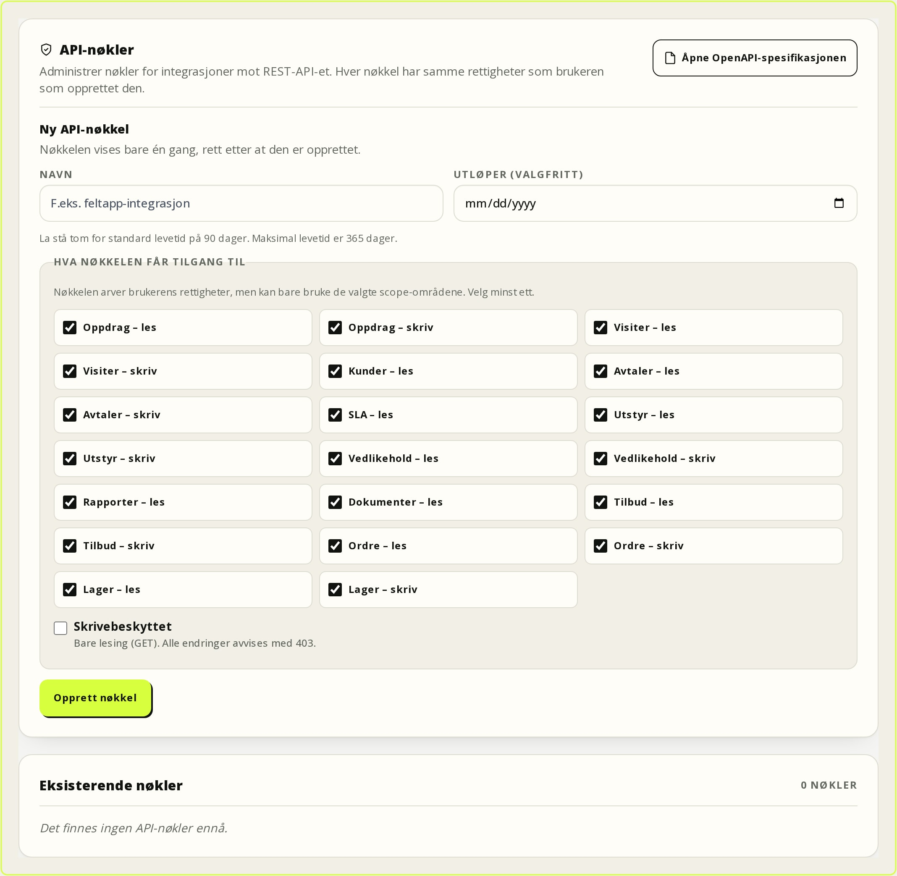
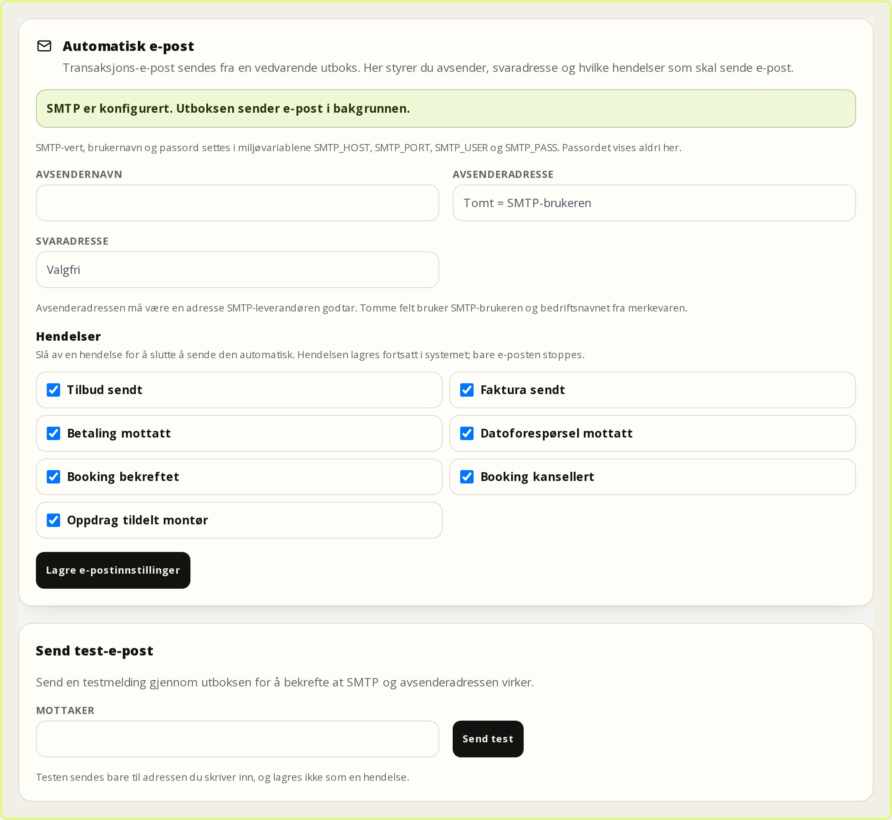
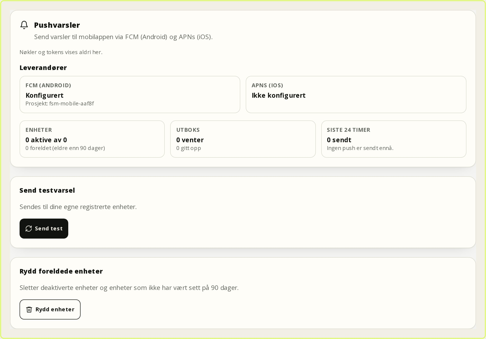

# Administrator

Gjelder FSM-plattformen **0.8.11** (2026-11-08). Målgruppen er systemadministratorer som konfigurerer plattformen, administrerer brukere og tilganger, setter opp integrasjoner og har ansvar for data, sikkerhet og drift. Kapitlet beskriver konfigurasjon og governance. Daglige arbeidsflyter for kontor, tekniker og kundeportal står i egne kapitler.

## 1. Administratorrollen og delegering

Administrator har alltid alle rettigheter, også sletting, opplåsing av innsendte rapporter, bevaringsplikt, roller, avdelinger og API-nøkler. Kontorrollen er en driftsrolle med bred tilgang i egen avdeling, men uten de mest sikkerhetskritiske handlingene.

| Oppgave | Administrator | Kontor | Anbefaling |
| --- | --- | --- | --- |
| Roller, avdelinger og API-nøkler | Ja | Nei | Hold hos administrator. |
| Administratorer, sletting og flytting | Ja | Nei | Hold hos administrator. |
| 2FA, opplåsing og bevaringsplikt | Ja | Nei | Hold hos administrator. |
| Aktivitetslogg | Ja | Nei | Gi `audit.view` bevisst. |
| Ansatte i egen avdeling | Ja, alle | Ja, egen avdeling | Deleger til avdelingsleder. |
| Kunder, oppdrag, avtaler og maler | Ja | Ja | Deleger til kontor og fagansvarlig. |
| Rapporter | Ja | Ja | Deleger til felt og kontor. |

Kontor har som standard `settings.manage`, `users.manage` og `dispatch.configure`, og kan dermed endre merkevare, kart, SMS og fordelingsregler. Er det for vidt, lag en egen rolle, for eksempel **Serviceleder**, uten `settings.manage`. Endringer i den innebygde kontorrollen gjelder alle som har rollen.

**Minste privilegium:** gi svakeste rolle som løser oppgaven, bruk egne roller for avdelingsledere og integrasjoner, og ha minst to aktive administratorer. Kontroller at vanlige brukere ikke har `workorders.delete`, `settings.manage` eller `audit.view` uten dokumentert grunn.

## 2. Avdelinger og avdelingssperre

Oppdrag, serviceavtaler og ansatte hører til en avdeling. Ansatte ser bare oppdrag i egen avdeling. Kunder og dokumenter er felles; rapporter er avdelingssperret med mindre brukeren har `reports.viewAllDepartments`.

**Opprette avdeling:**

1. Gå til **Innstillinger → Avdelinger**.
2. Fyll ut **Navn** og eventuelt kontaktinfo.
3. La **Aktiver live-sporing** stå av til personvern er vurdert.
4. Trykk **Opprett avdeling**.

**Forventet resultat:** Avdelingen vises med antall ansatte, oppdrag og avtaler. Én avdeling er **Standard** og brukes når et oppdrag eller en bestilling ikke peker på en annen. Standardavdelingen kan ikke deaktiveres før en annen er satt som standard.

**Advarsel:** Deaktivering logger ut alle ansatte i avdelingen, sletter kalenderabonnementer og gjør oppdragene utilgjengelige fordi spørringene krever en aktiv avdeling. Kontoene beholdes, og avdelingen kan aktiveres igjen. Varsle brukerne på forhånd.


## Moduler

Plattformen har en kjerne og en katalog med moduler. Kjernen (kunder, oppdrag,
arbeidsdager, tid, revisjon og innstillinger) kan kjøres uten valgfrie moduler.
Modulene slås av og på under **Innstillinger → Moduler**. Modulvakten gir `404`
på sider og API-er når modulen er av, og fjerner navigasjon, innstillinger,
søketreff, eksport/import og bakgrunnsjobber for området. Dataene beholdes.

| Modul | Nøkkel | Avhenger av | Gir |
| --- | --- | --- | --- |
| **Tilbud** | `quotes` | Kunder, oppdrag | Tilbud, versjoner, godkjenningslenke |
| **Fakturering** | `invoicing` | Kunder, oppdrag | Faktura, betaling, kreditnota, regnskapssynk |
| **Lager** | `inventory` | Utstyr | Varer, beholdning, reservasjoner, innkjøp |
| **Utlegg** | `fieldExpenses` | Kalender | Kjøreturer, utlegg og lønns-CSV |
| **Lønnsomhet** | `bi` | Rapporter | Estimert og faktisk omsetning |
| **Kundeportal** | `portal` | Kunder | Kundens egen flate |
| **API** | `api` | – | REST-API under `/api/v1` |

Eksisterende installasjoner får alle leverte moduler på. `MODULE_PRESET` kan
brukes ved oppstart for å velge et forhåndsdefinert sett. Slår du av en modul som
andre avhenger av, stopper valideringen og du får en tydelig feil. Alle
modulendringer revisjonslogges.

> **Merk:** Å slå av en modul skjuler funksjonen, men sletter ikke data. En
> faktura, et lager eller en utleggsrad blir liggende og kommer tilbake når
> modulen slås på igjen.

## 3. Brukere, invitasjoner og økter

**Opprette bruker:**

1. Gå til **Innstillinger → Ansatte & Roller** eller `/brukere`.
2. Trykk **Legg til ny bruker**.
3. Fyll ut **Fullt navn**, **E-postadresse** og eventuelt **Telefon**.
4. Velg **Rolle / Tilgangsnivå** og **Avdeling**. Ansatte må ha avdeling for å se og opprette oppdrag.
5. Trykk **Opprett og lag invitasjon**.

Brukeren opprettes inaktiv. Du får en bekreftelse på at invitasjonen er sendt, eller en **Invitasjonslenke** du kan sende manuelt. Lenken vises bare i sideinnholdet, er gyldig i sju dager og kan bare brukes av en inaktiv konto. Uten `SMTP_HOST` og `SMTP_USER` kan appen ikke sende e-post. Aktive brukere må bruke **Glemt passord**.

**Aktivere konto:** Brukeren åpner lenken og velger passord. Kontoen er fortsatt inaktiv. Finn brukeren i **Ansatte & Roller** og trykk **Aktiver**. Først da kan brukeren logge inn. Be brukeren sette opp 2FA under **Innstillinger → Sikkerhet**.

**Deaktivere og slette:** **Deaktiver** logger ut brukeren, sletter kalenderabonnementet og stenger innlogging og API. **Aktiver** gir tilgang igjen. **Slett bruker** er bare for administrator og kan ikke brukes på deg selv eller den siste aktive administratoren.

**Passord og 2FA:** Administrator kan ikke se eller sette passord. **Glemt passord** sender en engangslenke med én times gyldighet, hastighetsbegrenset per e-post og IP. **Tilbakestill 2FA** slår av to-trinns verifisering, sletter gjenopprettingskoder og logger ut alle økter. Bruk den bare når enheten er mistet eller misbruk mistenkes.

**Økter:** Det finnes ingen egen øktliste eller global «logg ut alle»-knapp. Økter ugyldiggjøres når passordet endres, 2FA endres eller tilbakestilles, brukeren deaktiveres, eller brukerens rolle, rettigheter eller avdeling endres. Endring av selve rolledefinisjonen gjelder ved neste forespørsel og logger ikke ut enkeltbrukere.

### Endre passord, 2FA og gjenopprettingskoder

1. For å bytte passord, logg ut og bruk **Glemt passord** på innloggingssiden. 0.8.11 har ingen egen «endre passord»-side. Lenken er gyldig i én time, og alle andre økter avvises når passordet er satt.
2. Gå til **Innstillinger → Sikkerhet** for å slå på **To-trinns verifisering**. Skann QR-koden med autentiseringsappen og skriv den 6-sifrede koden.
3. Lagre **Gjenopprettingskodene** på et sikkert sted. De vises bare én gang, og hver kode kan brukes én gang. **Lag nye koder** gjør de gamle ugyldige.
4. Bruk **Logg ut** på delte enheter. Ved mistanke om misbruk: bytt passord via **Glemt passord** og tilbakestill 2FA.

Administrator kan tilbakestille 2FA for en bruker, men ikke se passordet. En tilbakestilling sletter gjenopprettingskodene og logger ut alle økter.

### SSO og SCIM

SSO konfigureres med `SSO_PROVIDERS` og `SSO_<SLUG>_*`-variablene, ikke i
grensesnittet. Entra ID, Keycloak, Authentik og Zitadel støttes med OIDC,
PKCE, state/nonce og verifisert e-post. Redirect-URL-en er
`https://<NEXTAUTH_URL>/api/auth/callback/sso-<slug>`. Etter restart viser
**Innstillinger → SSO og SCIM** leverandørens status, issuer, standardrolle og
tillatte domener. Passordinnlogging blir alltid stående som break-glass.

**SAML 2.0** er additivt og bruker `SAML_PROVIDERS` og `SAML_<SLUG>_*`. OIDC-
variablene er urørt, så en installasjon kan ha begge deler. Registrer SP entity
ID og ACS-URL fra `/api/auth/saml/<slug>/metadata` i IdP-en. Serveren validerer
signert assertion, audience, recipient og tidsvindu, og avviser replay av samme
assertion. `ALLOW_IDP_INITIATED=true` gjelder bare IdP-initierte innlogginger;
signatur, audience, recipient og replay er fortsatt på.

SCIM 2.0 ligger på `/api/scim/v2` og bruker et eget Bearer-token som opprettes,
roteres og tilbakekalles i samme fane. `DELETE` deaktiverer brukeren uten å
slette den, og `ADMIN` krever både eksplisitt gruppemapping og
`SCIM_ALLOW_ADMIN=true`. **SCIM Groups** ligger på `/api/scim/v2/Groups`.
Gruppemedlemskap gir bare rolle og avdeling gjennom `SCIM_GROUP_ROLE_MAP` og
`SCIM_GROUP_DEPARTMENT_MAP`; uten mapping skjer ingenting, og motstridende
mappinger endrer ingenting. Full oppskrift, feltmapping og feilsøking står i
[SSO og SCIM](31-sso-scim.md).

## 4. Roller og rettigheter

| Rolle | Nøkkel | Standardinnhold |
| --- | --- | --- |
| **Administrator** | `ADMIN` | Alle rettigheter; listen kan ikke endres. |
| **Kontor** | `OFFICE` | Oppdrag, kunder, avtaler, utstyr, rapporter, dokumenter, maler, ansatte og innstillinger i egen avdeling. |
| **Montør** | `TECHNICIAN` | Se og opprette oppdrag, oppdatere status, se kunder, avtaler og utstyr, fylle ut rapporter, se dokumenter og maler. |
| **Bruker** | `USER` | Ingen rettigheter som standard. |
| **Kunde** | `CUSTOMER` | Kundeportalen, styrt av kundetilknytningen. |

Administrator og Kunde er låst. Kontor og Montør kan redigeres, men systemroller kan ikke slettes.

**Egen rolle:** Gå til **Innstillinger → Roller & rettigheter → Ny rolle**, skriv **Navn**, valgfri **Beskrivelse**, velg **Rettigheter** og trykk **Opprett rolle**. Rollen får en fast nøkkel basert på navnet; nøkkelen endres ikke om visningsnavnet endres. En rolle som er i bruk, kan ikke slettes før brukerne er flyttet.

**Per bruker:** Åpne **Rettigheter for denne brukeren**, velg listen og trykk **Lagre rettigheter**. Listen overstyrer rollen helt; er den lik rollens liste, fjernes overstyringen. **Bruk rollens rettigheter** gjør det samme. Tilpasning gjelder ikke administratorer eller kundeportalbrukere, og bytte av rolle tømmer listen.

| Gruppe | Styrer |
| --- | --- |
| Oppdrag | Se, opprette, status, metadata, montører, sletting og dispatch (`workorders.*`, `dispatch.configure`). |
| Kunder og utstyr | Kundekort, kontakter, avtaler, portalbrukere og utstyr (`customers.*`, `equipment.*`). |
| Avtaler og SLA | Avtaler, dekning, prislister, policyer og åpningstider (`contracts.*`, `sla.manage`). |
| Rapporter og dokumenter | Rapporter, alle avdelinger og dokumentbibliotek (`reports.*`, `documents.*`). |
| Administrasjon | Maler, ansatte, innstillinger og aktivitetslogg (`templates.*`, `users.*`, `settings.manage`, `audit.view`). |

**Teste rolle:** Opprett en testbruker i riktig avdeling, gi rollen, aktiver og logg inn i et privat vindu. Kontroller meny, kundeliste, oppdrag, rapporter og **Innstillinger**. Prøv en direkte URL brukeren ikke skal ha, for eksempel `/innstillinger?tab=roller`; du skal sendes bort eller få feil. Test én mutasjon og kontroller at den avvises. Deaktiver testbrukeren etterpå.

Autorisasjon håndheves på serveren; skjulte knapper er ikke sikkerhet.

**Vanlige feil:** å gi en bred rolle til alle, glemme en per-bruker-overstyring, slette en systemrolle eller en rolle som er i bruk, og å gi kontor `settings.manage` uten at det er ønsket.

## 5. Kunder og kundeportalbrukere

Kunder opprettes under **Kunder → Ny kunde**. Kortet har **Oversikt**, **Oppdrag**, **Avtaler**, **Utstyr** og **Mer**. Portalbrukere opprettes under **Mer → Portalbrukere**.

**Opprette portalbruker:**

1. Opprett kunden og minst én **Kontaktperson** med e-post.
2. Gå til **Mer → Portalbrukere**.
3. Fyll ut **Navn**, **E-post** og velg **Kontaktperson**.
4. Trykk **Opprett og send invitasjon**.
5. Send lenken manuelt hvis e-posten feiler.
6. Trykk **Aktiver** etter at brukeren har valgt passord.

Brukeren får rollen `CUSTOMER`, kundetilknytning og kontaktkobling, og er inaktiv til du aktiverer. **Ny lenke** virker bare på inaktive kontoer.

Portalen viser egen kundes oversikt, bestillinger, rapporter, dokumenter, utstyr, avtaler, besøk, meldinger og kontaktinfo. Rapporter vises bare når de er innsendte og låste, og dokumenter bare når de er delt med kunden (`CUSTOMER`-eide). Utstyr og avtaler er kundens egne, med målinger, dekning og SLA.

Portalbrukere ser aldri andre kunder, interne notater, interne rettigheter, kladder eller ulåste rapporter. `/uploads/...` kontrolleres per fil, og PDF-svar er `no-store`.

**Sikkerhet:** Bruk egne kontoer per person. **Deaktiver** når noen slutter; det logger ut, sletter kalenderabonnementet og tilbakekaller portaltilgangen. Sletter du kunden, deaktiveres alle portalbrukere, øktene ugyldiggjøres og booking stenges. Ved gjenoppretting må hver portalbruker aktiveres bevisst på nytt. En portalbruker må alltid ha gyldig kontakt på samme kunde.

**Delegasjon:** Portalen har serverhåndhevede kapabiliteter for booking, dokumenter, avtaler og utstyr, men 0.8.11 har ikke eget skjema for å redigere dem. En kontakt uten delegasjonsrad får full portaltilgang. Begrenset portal må settes opp og testes med den aktuelle kontoen.

## 6. Sjekklister og maler

**Opprette mal:**

1. Gå til **Innstillinger → Sjekklister / Maler**.
2. Trykk **+ Opprett**, skriv **Navn på sjekkliste** og velg **Kategori**.
3. Trykk **Rediger**, legg til felter under **Legg til nytt sjekkpunkt**, og sett **Påkrevd felt** der det trengs.
4. Bruk **Flytt opp**/**Flytt ned**, og trykk **Lagre Mal med Logikk**.

Felttypene er **Kort Tekst**, **Lang Tekst** (Markdown), **Avkrysningsboks**, **Nedtrekksmeny**, **Tilstand + kommentar** (OK/Avvik/Utbedres/Ikke aktuelt), **Tallverdi**, **Signatur**, **Bildeopplasting** og **Dato**.

**Påkrevd og betinget:** Påkrevde felt må besvares før innsending. **Betingelse (If This Then That)** viser feltet bare når et annet felt har en bestemt verdi, for eksempel `Avvik`. **Kommentar kreves ved disse valgene** gjelder tilstandsfelt; standard er `Avvik` og `Utbedres`. Tøm feltet for å aldri kreve kommentar. Skjulte felt skal ikke blokkere innsending.

**Enheter og rapportnavn:** **Knytt rapporten til enheter** er på som standard og gir én vurdering per enhet. Slå av for rapporter som gjelder hele oppdraget. **Rapportnavn** vises i PDF og rapportlister; tomt felt bruker malens navn.

**Kategori og HMS:** **Service** eller **HMS-skjema**. HMS krever **HMS-type**: generelt, SJA, varmt arbeid, internkontroll/risikovurdering, avvik, vernerunde eller skriftlig instruks. Kategori og HMS-type fryses ved innsending.

**Kobling og versjonering:** Maler kan knyttes til oppdrag, serviceavtaler og vedlikeholdsplaner. Ved innsending lagres et øyeblikksbilde av mal, rapportnavn, enhetskrav, kategori og HMS-type. Senere malendringer påvirker ikke eksisterende rapporter, heller ikke når de låses opp; nye felter gjelder bare nye rapporter.

**Slette mal:** Bare administrator. Malen kan ikke slettes når den er i bruk av rapporter, oppdrag eller aktive avtaler. Blokkert forsøk logges.


### HMS-bibliotek og QR-etiketter

**HMS-biblioteket** ligger på `/hms`. Der ser du HMS-skjemaer gruppert etter
type, maler og fullførte HMS-dokumenter. **Knytt HMS-skjema til oppdrag** velger
et skjema og et aktivt oppdrag; skjemaet legges på oppdraget og fylles ut der.
HMS-maler administreres under **Innstillinger → Sjekklister / Maler** med
kategori **HMS-skjema**.

**QR-etikett:** Åpne enheten på `/enheter/<id>`, gå til **QR-etikett** og bruk
**Roter QR-token** hvis etiketten er mistet eller delt. Skriv ut etiketten fra
`/enheter/<id>/etikett`. Et rotert token gjør den gamle etiketten ugyldig.

## 7. Oppdrag og rapporter

| Status | Betydning | Kan settes av |
| --- | --- | --- |
| **Åpen / Ny** (`OPEN`) | Nytt, ikke planlagt. | Kontor, montør med `workorders.update`. |
| **Venter på planlegging** (`PENDING`) | Systemets startstatus. | Systemet; settes normalt ikke manuelt. |
| **Planlagt** (`PLANNED`) | Dato eller visitt er satt. | Kontor, montør. |
| **Venter på kunde** (`WAITING`) | Stoppet i påvente av kunden. | Kontor, montør. |
| **Påbegynt** (`IN_PROGRESS`) | Arbeidet er i gang. | Kontor, montør. |
| **Fullført** (`COMPLETED`) | Avsluttet og låst. | Kontor, montør. |
| **Kansellert** (`CANCELLED`) | Avsluttet uten utførelse. | Kontor med `workorders.edit`. |

Åpne statuser kan byttes fritt. Fullført og kansellert er lukket; bare administrator kan gjenåpne med grunn. Rapporten har egen lås og påvirkes ikke av oppdragets status.

**Låse opp rapport:** Åpne oppdraget, finn sjekklisten, trykk **Lås opp for retting**, skriv **Årsak til opplåsing** og bekreft. Rapporten blir **Låst opp**, kan redigeres, og en revisjon av den forrige versjon lagres. Kundens kvittering trekkes tilbake fordi den gjaldt forrige versjon. Ved ny innsending låses rapporten automatisk og får ny revisjon. Bevaringsplikt blokkerer opplåsing.

**Revisjoner:** Hver opplåsing og innsending lager en revisjon som fryser skjema, enheter, kommentarer, signaturer, rapportnummer, kategori, HMS-type og kvittering. **Revisjoner** viser innholdet og lar deg laste ned revisjonen som PDF; revisjoner kan ikke redigeres.

**Rapportnummer:** HMS-rapporter får automatisk `abc1234` (tre små bokstaver og fire tall) ved første innsending. Nummeret beholdes ved revisjoner. Vanlige servicerapporter har ikke automatisk nummer.

**PDF og merkevare:** PDF-en bruker firmanavn, logo og primærfarge fra **Merkevare**, lagres som `WORK_ORDER`-opplasting og krever `reports.view`. Svaret er `no-store`. Merkevaren inngår i PDF-hashen, så endringer slår inn neste gang PDF-en genereres. Rapport-PDF-etikettene er norske i 0.8.11; avtale-PDF har etiketter for alle fire språk. Tittelen på automatiske utbedringsoppdrag er også norsk («Utbedring av avvik – …»).

**Bevaringsplikt og retensjon:** Bevaringsplikt hindrer hard sletting og fryser rapporten. På oppdrag arver alle rapporter flagget. Å slå av krever grunn og frigjør ikke rapportenes egne flagg; **Rapport-hold** oppheves per rapport med egen grunn. Mykt slettede oppdrag kan hard-slettes etter `RETENTION_DAYS` (standard 365) bare når de ikke har rapporter. Oppdrag med rapporter beholdes på ubestemt tid. **Papirkurv** og **Gjenopprett** er bare for administrator.

## 8. Serviceavtaler, SLA og prislister

**SLA-policy:** Gå til **Innstillinger → SLA og åpningstider**, fyll ut **Navn**, **Avdeling** eller **Alle avdelinger**, **Svartid (minutter)**, **Løsningstid (minutter)** og **Tell bare innenfor åpningstid**, og trykk **Opprett policy**. Klokken starter bare når oppdraget har en aktiv, datogyldig avtale med en aktiv SLA-policy. Det finnes ingen reserve til avdelingens standard eller en global policy, så en kunde uten aktiv avtale får ingen SLA-klokke. Klokken starter ved opprettelse, respons registreres ved første `EN_ROUTE`/`ON_SITE`, løsning ved `DONE`, og `CANCELLED` kansellerer. Returkjøring (`travelFromEndedAt`) flytter ikke klokken. Tilstander: `ON_TRACK`, `AT_RISK`, `BREACHED`, `MET`, `CANCELLED`.

**Åpningstider og helligdager:** Velg **Avdeling**, trykk **Vis**, sett **Åpner**/**Stenger** eller **Stengt** per ukedag, og trykk **Lagre åpningstider**. Legg til **Helligdager** med dato, navn og eventuell avdeling. Globale gjelder alle; avdelingsspesifikke overstyrer bare den avdelingen. Mangler åpningstider, brukes hverdager 08–16 i Europe/Oslo. Alle frister regnes gjennom denne kalenderen.

**Serviceavtale:** Opprettes fra kundekortet, fanen **Avtaler**, eller via **Avtaler**. Fyll ut **Tittel**, **Startdato**, **Intervall** (3, 6, 12 eller 24 måneder), eventuell **Kontaktperson**, **Sjekkliste** og **Avdeling**, og trykk **Opprett serviceavtale**. Avtalen blir **Aktiv** (eller **Utkast** hvis du velger det) med neste servicedato. Start i dag gir første oppdrag med en gang; start i fortiden bruker neste framtidige intervall. Hvert intervall gir nytt oppdrag med kundedata, ny tom sjekkliste og forrige rapport som PDF.

**Dekning:** Avtale uten linjer dekker alt utstyr. Linje uten produkt dekker også alt; linje med produkt dekker bare det produktet. Linjen kan ha **Dekning**, **Besøk/år**, **Svartid (min)** og **Løsningstid (min)**.

**Fornyelse:** **Automatisk** fornyer ved passert sluttdato og genererer nytt oppdrag. **Manuell** blir **Utløpt** ved passert sluttdato. **Varsel (dager)** styrer forfallsvarsel. Automatisk fornyelse er betinget og kjører nøyaktig én gang selv med flere instanser.

**Prislister:** Opprettes under **SLA og åpningstider → Prislister** med **Kode**, **Beskrivelse**, **Enhet** og **Beløp**. De er referansedata for visning i avtale-PDF og innstillinger, og for timepris i lønnsomhet. Fakturering skjer bare når `invoicing` er på, og prislisten oppgir ikke automatisk et fakturabeløp.

## 9. Booking, SMS, sporing og omtaler

**Booking:** Kunden velger ønsket dato (inntil 60 dager fram) og skriver ønsket klokkeslett i beskrivelsen; kunden kan ikke velge tidsblokk. Bestillingen opprettes som et nytt oppdrag med status **Åpen/Ny**, uten visitt eller bekreftet tid. Kontoret eller montøren planlegger og setter status **Planlagt**, eller **Venter** hvis tiden ikke passer. **Bookinger** viser ubekreftede forespørsler; de kan avvises, men planlegges i oppdraget.

**SMS:** Leverandør velges med `SMS_PROVIDER`, ikke i grensesnittet. Standard `console` er tørrkjøring; `linkmobility`, `pswincom` og `twilio` støttes. **Avsender** kommer fra `SMS_SENDER_ID`. Under **Innstillinger → SMS og meldinger** ser du leverandør, avsender, tørrkjøring og **Webhook-signatur**, og kan sette **Standardspråk**, **Reservasjonsord**, **Samtykkeord**, **Månedlig grense** og **Maler per hendelse**.

SMS sendes bare når mottakeren har `optedIn = true` og `optedOut = false`; STOP/START håndheves fra nøkkelordene, og samtykket kontrolleres ved køing og før sending. `SMS_ALLOWLIST` kan begrense test og staging. Webhooken ligger på `/api/webhooks/sms/<leverandør>`, krever HMAC- eller Twilio-signatur og er idempotent; uten `SMS_WEBHOOK_SECRET` avvises leveringene (unntatt console i utvikling). Utgående SMS er en databasekø med tre forsøk. Leverandøren kan sende leveringsstatus til samme webhook; statusen oppdaterer **Sendt**, **Levert** eller **Feilet** i samtalen uten å lage en ny melding. Samtaler vises under **Meldinger**.

**Påminnelser:** Under **Innstillinger → SMS → Automatiske påminnelser** oppretter du regler per avdeling. En regel har **Kanal** (SMS, e-post eller begge), **Timer før besøk** (for eksempel 24 eller 2), **SMS-mal**, **Stille timer**, **Tidssone** og **Maks påminnelser per besøk**. Jobbworkeren sveiper hvert femte minutt, hopper over kunder uten samtykke, respekterer stille timer, og avlyser påminnelsen hvis besøket er flyttet, avlyst eller fullført. **Siste påminnelser** viser planlagte, sendte og hoppede rader med årsak – uten meldingstekst eller telefonnummer. Selve sendingen skjer i bakgrunnen, slik at en treg SMTP- eller SMS-leverandør aldri blokkerer en side.

**Sporing:** Av som standard per avdeling. Slå på i **Avdelinger → Rediger avdeling → Aktiver live-sporing** etter en DPIA, fordi montørens posisjon er en personopplysning. Tildelt montør kan dele posisjon mens visitten er `EN_ROUTE`. Offentlig lenke viser bare fornavn, status, ETA, planlagt tid og sist oppdatert – aldri koordinater, kart eller historikk. Ping lagres i maks 24 timer og slettes ved `DONE`/`CANCELLED`. Lenken lever til visittens slutt pluss to timer, gir 404 etter utløp. Det er én aktiv lenke per visitt. `TRACKING_AVERAGE_SPEED_KMH` (standard 50) styrer reserveberegningen. Med `OSRM_BASE_URL` brukes ekstern ruteleverandør for ETA; uten den beregnes ETA lokalt. Et ping eldre enn ti minutter vises som **sist kjente posisjon**, ikke som live. Den offentlige ETA-ruten polles hvert 30. sekund og har egen rate limit per token.

**Omtaler:** Interne, publiseres ikke. Kunden kan be om omtale i portalen etter fullført visitt, eller kontoret kan sende SMS med «Be om vurdering». Omtalen krever fullført visitt, kan sendes én gang og lagres med hashet token. Omtalene er ikke vist som eget dashboard i 0.8.11.

## 10. Merkevare, kart, språk og varsler

**Dispatch og arbeidsstyrke:** Under **Innstillinger → Dispatch** settes **Fordelingsregler** (vekter for kompetanse, avstand, reisetid, ledighet, SLA og belastning) og **Territorier**. Vektene er relative. **Kapasitetsplaner** vises i **Kalender → Kapasitet**, men redigeres ikke i **Innstillinger** i 0.8.11. Kompetanse, fravær og arbeidstid brukes av forslagene, men har heller ikke eget skjema i **Innstillinger**; hold dataene oppdatert utenfor grensesnittet.

**Ruting og overtid:** Ruteplanen bruker `OSRM_BASE_URL` for ruter og reisematrise, og `GOOGLE_ROUTES_API_KEY` for valgfri trafikkbevisst ETA på enkeltstrekninger. Uten nøkkel er ETA et rute- og hastighetsanslag, ikke sanntidstrafikk; uten begge faller den tilbake til luftlinje × 1,35. `ROUTE_ALLOW_OVERTIME` (standard `true`) og `ROUTE_MAX_OVERTIME_MINUTES` (0 = ingen grense) styrer om visiter kan planlegges utenfor arbeidstiden. `ROUTING_PROVIDER=haversine` slår bevisst av alle eksterne rute- og trafikkall. Overvåk Google-kvote og kostnader; cache og rate limit er per prosess. Se `docs/ROUTING.md`.

**Merkevare:** Under **Innstillinger → Merkevare** setter du **Firmanavn**, **Hovedfarge (Hex-kode)** og **Firmalogo (valgfritt)**. Logoen må lastes opp gjennom appen; eksterne URL-er avvises. Den brukes i rapporter, e-post og dashbordheader, og gjelder kontor og kundeportal, ikke feltappens mørke flate. Kunder kan ha egen farge og logo i portalen.

**Kart og geokoding:** Under **Innstillinger → Kart** velger du **Kartleverandør**. **OpenStreetMap (ingen nøkkel)** er standard; **MapTiler** og **Mapbox** krever **API-nøkkel**. Nøkkelen lagres på serveren og sendes bare til kartet i nettleseren; bruk en domenebegrenset nøkkel. Du kan sette **Standardkartlag**, **Standard zoom (2–19)**, **Senter** og **Aktiver zoom med scrollhjulet**. Geokoding er på som standard (`GEOCODE_ENABLED=true`) og prøver OpenStreetMap/Nominatim, deretter Kartverket og Photon. Sett `GEOCODE_USER_AGENT` for å identifisere installasjonen, eller slå av med `GEOCODE_ENABLED=false`. Knappen **Geokod adresser** på kartet viser om adressen ikke ble funnet, om tjenesten ikke svarte eller om geokoding er slått av.

**Språk:** Norsk, engelsk, polsk og tysk har komplette kataloger. Språkvelgeren i topplinjen lagrer `NEXT_LOCALE`-cookien og bruker `router.refresh()`, uten URL-prefiks. Datoer og tall følger `nb-NO`, `en-GB`, `pl-PL` og `de-DE`. SMS bruker mottakerens kontakt-`locale`; e-postvarsler bruker brukerens `locale`. Rapporter har norske PDF-etiketter i 0.8.11; oversettelser redigeres i `messages/` og kontrolleres med `npm run check:i18n`.

**Varsler:** In-app og e-post. Hver bruker velger hendelser og kanaler under **Varsler → Innstillinger**; det finnes ingen global standard. Sørg for at SMTP er konfigurert. E-postkoen ligger i `Notification`, prøver fem ganger med backoff, hopper over deaktiverte brukere og bruker en lease (en tidsbegrenset lås) mot dobbeltsending. Varseltyper inkluderer tildeling, datoendring, kansellering, rapport klar, booking, avtale, forfalt, kontaktoppdatering, SLA og garanti.

**Meldinger:** **Meldinger** samler kundesamtaler. Tråder er avgrenset til avdeling eller kunde; kontor ser egne avdelinger, portalbrukere bare egne tråder. Utgående kan sendes som SMS ved samtykke. Innkommende SMS havner i samme tråd og er idempotent per leverandør-id. Kontor og administrasjon kan svare og se leveringsstatus; brukere uten tilgang til kundens oppdrag ser verken tråden eller meldingsteksten. Kundeportalen viser samme tråd lesbar for kundens egne portalbrukere, og kan svare når kontaktpersonen har SMS-samtykke.

## 11. API-nøkler og REST-API

API-et ligger under `/api/v1` og bruker Bearer-nøkler med prefikset `fsm_`. NextAuth-informasjonskapsler godtas aldri.

**Opprette nøkkel:**

1. Gå til **Innstillinger → API-nøkler**.
2. Skriv **Navn** og eventuelt **Utløper (valgfritt)**.
3. Trykk **Opprett nøkkel**.
4. Kopier nøkkelen og lagre den i et hemmelighetslager.
5. Trykk **Jeg har lagret nøkkelen**.

Nøkkelen vises bare én gang. Serveren lagrer bare SHA-256-hash og et kort visningsprefiks. Mister du den, må du tilbakekalle og lage ny.

Nøkkelen arver rettighetene, avdelingen og kundeomfanget til eieren, og har i
tillegg eksplisitte **scopes** og kan merkes skrivebeskyttet. Nye nøkler må ha
minst ett scope. En nøkkel med bare lese-scopes får `403` på skriveendepunkter.
Standard levetid er 90 dager, maks 365.

| Scope | Dekker |
| --- | --- |
| `workorders:read` / `workorders:write` | Oppdrag og endringer |
| `visits:read` / `visits:write` | Visiter |
| `customers:read` | Kunder |
| `contracts:read` / `contracts:write` | Serviceavtaler og PDF |
| `sla:read` | SLA-policyer |
| `equipment:read` / `equipment:write` | Utstyr og målinger |
| `maintenance:read` / `maintenance:write` | Vedlikeholdsplaner |
| `reports:read` | Rapporter og PDF |
| `documents:read` | Dokumenter |
| `quotes:read` / `quotes:write` | Tilbud og sending |
| `orders:read` / `orders:write` | Eksterne ordrer |
| `inventory:read` / `inventory:write` | Lager og reservasjoner |

**Tilbud, eksterne ordrer og lager:** `/api/v1/quotes` oppretter og sender
tilbud; `/api/v1/orders` tar imot ordrer fra et eksternt ordresystem;
`/api/v1/inventory/**` leser varer, lokasjoner og beholdning og oppretter,
frigjør eller forbruker reservasjoner. Ordreendepunktet bruker `source` +
`externalId` som idempotensnøkkel og godtar `Idempotency-Key` som sekundær
nøkkel. En replay med samme innhold gir `200` med `Idempotent-Replay: true`;
samme nøkkel med annet innhold gir `409`. API-et sender ingen webhooks tilbake –
kildesystemet må polle.

**Viktig:** I grensesnittet opprettes nøkkelen for administratoren som er
innlogget, og får dermed alle administratorens rettigheter. Behandle den som en
administratorhemmelighet. Trenger du lavere privilegium, opprett en egen aktiv
integrasjonsbruker med smal rolle og bruk `scripts/create-api-key.mjs` med
`API_KEY_USER_EMAIL`, `API_KEY_NAME` og eventuelt `API_KEY_EXPIRES_AT`.

**Tilbakekall** virker umiddelbart og gir `401`. Utløpte nøkler gir også `401`. Listen viser **Eier**, **Opprettet**, **Sist brukt**, **Utløper** og status **Aktiv**, **Utløpt** eller **Tilbakekalt**.

Hver nøkkel kan bruke **120 forespørsler per minutt**; overskridelse gir `429` med `Retry-After`. Paginering bruker `page` og `limit` (maks 100). OpenAPI 3.1 ligger på `/api/v1/openapi.json`; dokumentasjon med eksempler i `docs/API.md`.



*Figur: API-oversikten viser nøkler, scopes og sist brukt.*

Se på **Scopes** og **Sist brukt** før du roterer eller tilbakekaller. En nøkkel
uten scopes er en gammel nøkkel som regnes som «alle scopes» til den roteres.
Bruk én nøkkel per integrasjon, og kontroller at skrivebeskyttede nøkler ikke
får skriveendepunkter.

**Sikker bruk:** Bruk HTTPS, én nøkkel per integrasjon, utløpsdato, hemmelighetslager og **Sist brukt**. Ved rotasjon: opprett ny, rull ut, verifiser med `GET /me`, tilbakekall den gamle. Ved lekkasje: tilbakekall først, opprett ny og undersøk aktivitetsloggen.

## Automatisk e-post og utboks

Transaksjons-e-post (tilbud, faktura, betaling, booking og tildeling) sendes fra
en vedvarende utboks i databasen, ikke direkte fra request-stien. Da kan en treg
eller nede SMTP-server aldri rulle tilbake en faktura, et tilbud eller en
booking, og hver utsendelse har retry, historikk og idempotens.

| Hendelse | Utløses av | Mottaker |
| --- | --- | --- |
| `quoteSent` | Tilbud sendes | Kundens kontakt |
| `invoiceSent` | Faktura sendes | Kundens kontakt |
| `paymentReceived` | Faktura blir betalt | Kundens kontakt |
| `bookingRequested` | Kunden bestiller | Kunden |
| `bookingConfirmed` | Kontoret bekrefter | Kunden |
| `bookingCancelled` | Avbestilling | Kunden |
| `workOrderAssigned` | Tildeling eller flytting | Montøren |

1. Sett `SMTP_HOST`, `SMTP_PORT`, `SMTP_SECURE`, `SMTP_USER`, `SMTP_PASS` og
   `APP_URL`. Uten brukernavn og passord er utboksen en trygg no-op: meldingene
   blir liggende `PENDING` uten å telle som feilede forsøk.
2. Åpne **Innstillinger → Automatisk e-post**.
3. Sett **Avsendernavn**, **Avsenderadresse** og **Reply-to**. Tom avsender
   bruker `SMTP_USER`; tomt navn bruker bedriftsnavnet fra merkevaren.
4. Slå hver hendelse av eller på. Av betyr bare at e-posten ikke sendes;
   forretningshendelsen lagres som før.
5. Trykk **Send test-e-post**. Testen går gjennom utboksen, men sendes
   umiddelbart, og påvirker ikke av/på-innstillingene.

Utboksen prøver på nytt etter 60 sekunder, deretter eksponentielt opp til én
time, og gir opp etter fem forsøk. Bare en kort feilkode lagres, aldri rå
SMTP-melding eller mottakeradresse i loggen. `FOR UPDATE SKIP LOCKED` gjør at
flere app-instanser kan dele køen. Rader som blir stående i `SENDING` av en
krasjet prosess settes tilbake etter 15 minutter. Er modulen for en hendelse av,
utsettes meldingen i stedet for å forkastes.



*Figur: Automatisk e-post styres per hendelse, med avsender og test.*

Legg merke til at **Send test-e-post** er et eget skjema. Testen bekrefter at
SMTP og avsenderadressen virker, men endrer ikke av/på-valgene. Sjekk også
**Reply-to** og avsendernavnet før du slår på kundehendelsene.

## Pushvarsler

Push er et supplement til in-app-varslene. Hvert varsel lagres først i
`Notification`, deretter legges én rad per aktiv mobilenhet i utboksen
`PushMessage`. Workeren sender i bakgrunnen, slik at en treg leverandør aldri
blokkerer handlingen som utløste varselet.

- **Android:** FCM HTTP v1 med en Google-tjenestekonto i
  `FCM_SERVICE_ACCOUNT_JSON`.
- **iOS:** APNs med `.p8`-nøkkel i `APNS_KEY_P8`, `APNS_KEY_ID`, `APNS_TEAM_ID`,
  `APNS_BUNDLE_ID` og `APNS_ENV`.
- `PUSH_WORKER=false` slår av workeren. Uten leverandør er funksjonen en trygg
  no-op.

Appen registrerer enheten etter innlogging og ved tokenrotasjon. Ved
`UNREGISTERED` eller `BadDeviceToken` deaktiveres enheten. Under **Innstillinger
→ Pushvarsler** ser du om leverandørene er konfigurert, og kan rydde deaktiverte
enheter og enheter som ikke er sett på 90 dager. Testvarsel bruker en tilfeldig
nøkkel og går til administratorens egne registrerte enheter.

Push følger modulene som eier varseltypen. Er modulen av, lages ingen push-rad,
og en allerede køet rad hoppes over. Dype lenker inneholder alltid en intern sti
som starter med `/`; appen skal aldri åpne eksterne URL-er. Driftsmålinger ligger
i `/api/metrics` som `fsm_push_messages{status="pending"}` og
`fsm_push_messages{status="dead_letter"}`.



*Figur: Pushinnstillingene viser om FCM og APNs er konfigurert.*

Se på leverandørstatusen, ikke bare på knappen for testvarsel. Er bare FCM satt,
sendes Android-varsler, mens iOS-enheter hoppes over med `not_configured`.
Testvarselet gir 0 enheter hvis administratoren ikke har registrert sin egen
enhet.

## 12. Aktivitetslogg, personvern og data

**Aktivitetslogg:** **Innstillinger → Aktivitetslogg** viser systemhendelser, sikkerhetshendelser som feilede 2FA-forsøk og brukeraktivitet med søk, **Fra dato** og **Til dato**, 50 rader per side. Oppdrag og kunder har egne aktivitetsfaner; rapporter har revisjoner. Loggen skrives i samme transaksjon som mutasjonen, kan ikke redigeres eller slettes i grensesnittet, og er ikke hash-kjedet i 0.8.11.

**Personvern:** Samle bare nødvendige data, bruk avdelings- og kundeomfang, og gi `reports.viewAllDepartments` bare ved behov. Bruk egne portalbrukere og deaktiver ved avslutning. Vurder DPIA før sporing i en ny avdeling; sporing er opt-in, begrenset til `EN_ROUTE`, viser ikke rute eller koordinater og sletter ping etter 24 timer. Innhent SMS-samtykke, og hold omtaler interne. Kundesletting deaktiverer portalbrukere og stenger booking; gjenoppretting krever manuell reaktivering.

**GDPR-sletting:** **Personvern / Slett kundedata** på kundekortet anonymiserer kundens direkte identifikatorer. Forhåndsvisningen viser antall berørte rader og blokkerer hvis et oppdrag, en rapport eller et revisjonshold har bevaringsplikt. Skriv grunn og bekreft med kundens nåværende navn. Oppdrag, rapporter, revisjoner, teknikersignaturer og revisjonslogg bevares; kundens egne vedlegg og dokumentbibliotek slettes. Signerte rapport-PDF-er bevares uendret som tjenestebevis og kan fortsatt inneholde opprinnelige data. Andre kjøring er en no-op. Se `docs/privacy-erasure.md` for retensjonsmatrise og bevis.

**Eksport:** Det finnes ingen automatisk eksportjobb eller selvbetjent GDPR-eksport. Bevis eksporteres via databasebackup eller en administratorstyrt spørring mot `WorkOrder`, `Report`, `ReportRevision` og `AuditLog` for ett oppdrag om gangen. Eksporter ikke rapporter fra klienten eller en offentlig rute.

**Retensjon:** `RETENTION_DAYS` (standard 365) styrer hard sletting av mykt slettede oppdrag uten rapporter. Oppdrag med rapporter beholdes på ubestemt tid. Bevaringsplikt stopper all automatisk sletting. Filer ryddes først når ingen rader refererer til dem.

**Backup og oppgradering:** Ta backup før migrering og rollback. Følg `docs/OPERATIONS.md` og `docs/BACKUP-RESTORE.md`, bruk `scripts/backup.sh`, `scripts/restore-test.sh` og `restore-pitr.sh` for PITR. I produksjon bør `REQUIRE_BACKUP_BEFORE_MIGRATE=true` stå på, slik at appen nekter å migrere uten `BACKUP_CONFIRMED=true`. Det bekrefter bare at backup er tatt, ikke at den er god; kjør restore-testen først. Gjenopprett database og opplastingsvolum fra samme tidsstempel, stopp appen før databasebytte, bruk `prisma migrate deploy` og aldri `prisma db push`. Pinn `APP_IMAGE` til en publisert versjon eller digest, ikke `latest`. Kjør aldri `docker system prune --volumes`.

Ved PITR: velg et tidspunkt **før** feilen, gjenopprett til et eget miljø først,
kontroller dataintegritet og filreferanser, og bytt først deretter produksjon.
Dokumenter RPO/RTO og resultatet av øvelsen. Backup uten testet gjenoppretting er
ikke et bevis på at data kan reddes.

## 13. Drift og helse

`GET /api/health` er liveness og svarer 200 når Node-prosessen lever, uten database-, disk- eller køkall. Docker-healthchecken bruker denne, så en treg database ikke gir restart-løkke. `GET /api/ready` er readiness: uautentiserte kall får kort status og en billig databasekontroll, rate-limitert per IP. Med `READY_SECRET` eller `CRON_SECRET` sjekkes også skrivbart opplastingsvolum og jobbkø. Den svarer 503 når noe mangler. Produksjons-Compose bruker readiness som healthcheck, men restarter ikke på `unhealthy`; et databaseutfall gir 503 fra proxyen. Begge svarer med `requestId`.

**Migrasjoner:** Appen kjører `prisma migrate deploy` ved oppstart. `DATABASE_MIGRATION_URL` kan brukes for DDL-rolle, `DATABASE_RUNTIME_URL` for appen. Vil du kjøre migrasjonene separat, start med `SKIP_MIGRATIONS=true` og kjør manuelt. Verifiser med `npx prisma migrate diff --from-config-datasource --to-schema prisma/schema.prisma --exit-code`.

**Jobber:** `RECURRING_SCHEDULER=true` kjører serviceavtaler og vedlikeholdsplaner hver sjette time og ved oppstart. SLA-oppryddingen kjører i samme scheduler med `SLA_CLEANUP_INTERVAL_HOURS` (standard 6) og kan slås av med `SLA_CLEANUP_ENABLED=false`. `POST /api/cron/recurring` og `/api/cron/cleanup` krever `Authorization: Bearer <CRON_SECRET>`. `PDF_JOB_WORKER` styrer OCR/dokumentjobber med maks to samtidige per instans; rapport-PDF-er rendres i prosessen med en egen samtidighetsgrense. `SMS_WORKER` er uavhengig.

**Opplasting og OCR:** Filer ligger i `UPLOAD_DIR` (standard `./uploads`, i Docker `/app/uploads`). `/uploads/...` krever innlogging og sjekker `Upload`-raden. Grensene er 15 MB for bilder og 50 MB for PDF. I tillegg gjelder en rullerende døgnkvote på 2 GiB per bruker og 10 GiB samlet lagring per kunde. Juster med `UPLOAD_QUOTA_USER_MB` og `UPLOAD_QUOTA_CUSTOMER_MB`; proxyen må fortsatt ha egen body-grense (55 MB i Caddy-eksempelet). Over kvoten får brukeren en tydelig feil, og opplastingen skrives ikke. OCR bruker `TESSDATA_DIR` og `/tmp`; store PDF-er kan fylle `/tmp`, og da feiler jobben uten å fylle rotfilsystemet. Sjekk `DocumentJob`, `PDF_JOB_WORKER` og disk.

**Miljøvariabler:** De viktigste er `DATABASE_URL`, `NEXTAUTH_URL`, `APP_URL`, `NEXTAUTH_SECRET`, `SMTP_*`, `SMS_*`, `SSO_*`, `SCIM_*`, `PDF_JOB_WORKER`, `RECURRING_SCHEDULER`, `SLA_CLEANUP_ENABLED`, `SLA_CLEANUP_INTERVAL_HOURS`, `CRON_SECRET`, `READY_SECRET`, `RETENTION_DAYS`, `UPLOAD_*`, `TESSDATA_DIR`, `GEOCODE_*`, `ROUTING_*`, `TRACKING_AVERAGE_SPEED_KMH`, `TRUST_PROXY` og `BACKUP_*`. `.env` skal ha `chmod 600`, aldri committes eller deles. Endringer krever ny deploy eller restart.

**Sjekk før eskalering:** Er `/api/health` 200 og `/api/ready` 200/503? Er `app` `healthy`, og øker `RestartCount`? Hva sier loggen? Svarer Postgres? Er det ledig disk og skrivbart opplastingsvolum? Står `DocumentJob`, `Notification` eller `SmsMessage` fast? Stoppet appen på `REQUIRE_BACKUP_BEFORE_MIGRATE`? Ta med `requestId`, tidspunkt og feilmelding – aldri hemmeligheter eller persondata.

## Lagring, Redis og høy tilgjengelighet

Standardoppsettet med én app, lokal disk og databasekø er fullt støttet. For
flere replikaer eller ekstern lagring finnes en egen HA-profil.

### Lagring (S3/MinIO)

Opplastinger går gjennom et felles `StorageDriver`-grensesnitt. `STORAGE_DRIVER=local`
er standard; `STORAGE_DRIVER=s3` gjør filene delt mellom replikaer. URL-ene og de
lagrede filnavnene er uendret (`/uploads/<filnavn>`).

1. Sett `S3_BUCKET`, `S3_REGION`, `S3_PREFIX` og eventuelt `S3_ENDPOINT`,
   `S3_ACCESS_KEY_ID` og `S3_SECRET_ACCESS_KEY`.
2. Kjør `npm run storage:migrate -- --dry-run` og deretter uten `--dry-run`
   **før** du bytter driver.
3. Verifiser med `--verify` og kontroller med `--check`.
4. Stopp appen, kjør migreringen en siste gang, sett `STORAGE_DRIVER=s3` og
   start appen.
5. Slå på versjonering og kryptering i bøtta, og blokker offentlig tilgang.
   `/uploads` håndhever fortsatt tilgangskontrollen.

Kildefilene slettes ikke av migreringen. Behold dem til minst én vellykket
backup/restore og en driftsperiode med S3 har gått. Rollback er å bytte tilbake
til `STORAGE_DRIVER=local`, men filer skrevet mens S3 var aktiv ligger bare i S3.
Se `docs/STORAGE.md`.

### Redis og jobbkø

`QUEUE_DRIVER=db` er standard og bruker `DocumentJob` med `FOR UPDATE SKIP LOCKED`.
`QUEUE_DRIVER=redis` legger i tillegg hver jobb-ID i en Redis-sortert liste.
Redis er en vekkemekanisme, ikke en duplikatkø: databasen avgjør om jobben skal
kjøres. Redis nede gir fallback til databaseclaim, og Redis tømt mister ingen
jobber. Det samme gjelder `RATE_LIMIT_DRIVER` og `CACHE_DRIVER`; databasen er
alltid fallback.

### HA og PITR

`docker-compose.ha.yml` har flere app-replikaer, Caddy, Redis, delt S3 og
Postgres med WAL-arkivering. Start med:

```bash
docker compose -f docker-compose.ha.yml up -d --scale app=3
```

Hver appprosess åpner maks `DATABASE_POOL_MAX` tilkoblinger. Regn med
`app_replikaer × DATABASE_POOL_MAX + migrasjoner + drift < max_connections`.
Rull én replika om gangen, og kontroller `/api/ready` med `READY_SECRET` og en
ekte opplasting/PDF. WAL-arkivet må kopieres offsite; uten det er PITR bare lokal
historie. Gjenoppretting med `restore-pitr.sh` og øvelsesoppskriften står i
`docs/BACKUP-RESTORE.md`; kapasitet, readiness og når du **ikke** bør skru på HA
står i `docs/SCALING.md`.

> **Advarsel:** S3, Redis og PITR er ikke verifisert i produksjon uten ekte
> legitimasjon og miljø. Kjør alltid en restore-test og en ekte
> opplasting/PDF-generering mot HA-profilen før du lover høytilgjengelighet.

## Etterlevelse, ISO 27001 og SOC 2

Etterlevelsespakken i `docs/compliance/` er et **readiness-grunnlag**, ikke en
sertifisering, attestering eller revisjonsrapport. Den beskriver hvordan
plattformen er tenkt styrt, driftet og dokumentert, og hva som gjenstår.

- **ISO/IEC 27001:** Statement of Applicability dekker alle 93 Annex A-kontroller,
  men bare et akkreditert sertifiseringsorgan kan utstede sertifikat.
- **SOC 2:** TSC-mappingen dekker 51 kriterier. En SOC 2 Type I eller Type II
  krever en uavhengig CPA-firma og en eksamensperiode.
- **Status:** 29 kontroller er implementert i design/repo, 50 delvise, 11
  planlagte og 3 ikke relevante. Dette er designbevis, ikke testet operasjonell
  effektivitet.
- **Bevis:** `npm run compliance:evidence` samler repository-, CI- og
  driftsbevis uten skyLegitimasjon. `npm run compliance:links` kontrollerer
  dokumentlenkene.

Bruk `docs/compliance/GAP-ANALYSIS.md` som arbeidsliste. Ikke omtal tjenesten som
«ISO 27001-sertifisert» eller «SOC 2-compliant» i kundesvar før sertifikatet
eller rapporten faktisk foreligger og omfanget stemmer med kundens bruk.

## 14. Administratorrutiner

**Onboarde avdeling:** Opprett avdelingen, fyll inn kontaktinfo, sett åpningstider og helligdager, opprett standard SLA-policy og eventuell prisliste, la sporing stå av til DPIA er vurdert, og opprett ansatte. Test med et internt oppdrag.

**Onboarde bruker:** Opprett med riktig rolle og avdeling, send invitasjon, la brukeren sette passord, aktiver, be om 2FA, og test at brukeren ser riktige oppdrag og ikke andre avdelinger.

**Kunde og portalbruker:** Opprett kunden, legg til kontakt med e-post, opprett portalbruker under **Mer → Portalbrukere**, send invitasjon, aktiver og test portalen. Deaktiver testkontoen etterpå.

**Publisere mal:** Bygg malen, sett rapportnavn, enhetskrav og eventuell HMS-type, test på et internt oppdrag, kontroller PDF, **Kommentar kreves ved disse valgene** og betingede felt, og knytt malen til avtaler eller oppdrag. Informer kontor og montører.

**Lansere avtale og SLA:** Velg eller opprett policy, kontroller åpningstider og helligdager, opprett eventuell prisliste, opprett avtalen med riktig intervall og sjekkliste, legg inn linjer og dekning, sett fornyelse og varsel, aktiver og kontroller neste service og SLA-klokke.

**Rotere API-nøkkel:** Opprett ny med tydelig navn, lagre i hemmelighetslager, rull ut, verifiser med `GET /api/v1/me`, tilbakekall den gamle, kontroller at den gir `401`, og oppdater dokumentasjonen.

**Månedlig revisjon:** Gå gjennom administratorer, ansatte, roller og avdelinger. Se gjennom API-nøkler, **Sist brukt** og utløp. Se gjennom **Aktivitetslogg** for slettinger, rolleendringer, opplåsinger og bevaringsplikt. Kontroller 2FA, portalbrukere og opplåste rapporter. Kjør `scripts/restore-test.sh`, og sjekk disk, `/api/ready`, `RestartCount` og ventende migrasjoner.

## 15. Vanlige problemer

| Symptom | Årsak | Tiltak |
| --- | --- | --- |
| Bruker får ikke logget inn | Inaktiv, mangler passord eller deaktivert. | Aktiver, send ny invitasjon, eller bruk **Glemt passord**. |
| Kundeportalen er tom | Portalbruker inaktiv, kunde slettet eller kontakt mangler. | Aktiver, gjenopprett og koble gyldig kontakt. |
| Malen vises ikke, eller endringen slår ikke inn | Feil kategori/rettighet, eller rapporten har frosset maløyeblikksbilde. | Kontroller kategori og `templates.view`; lag en ny rapport for nye felter. |
| Rapport kan ikke låses opp | Bevaringsplikt eller manglende administrator. | Opphev hold med grunn, eller bruk administrator. |
| SMS sendes ikke | `console`, manglende samtykke, allowlist eller grense. | Sett leverandør, registrer samtykke, kontroller grensen. |
| SMS-webhook avviser | `SMS_WEBHOOK_SECRET` mangler eller signatur er feil. | Sett hemmeligheten og kontroller signaturen. |
| Opplasting avvises med kvote | Bruker- eller kundekvoten er nådd, eller proxyen avviser body. | Sjekk `UPLOAD_QUOTA_*`, disk og proxyens body-grense; rydd ubrukte vedlegg. |
| Enhet kan ikke flyttes | Aktive kontraktslinjer, nummerkonflikt eller krysskundereferanse. | Rydd avtalelinjene, velg annet oppdragsnummer eller kontroller forhåndsvisningen. |
| SLA har feil frist | Feil policy, åpningstider eller helligdag. | Kontroller policy, avdeling og kalender. |
| API gir `401`/`403`/`429` | Utløpt nøkkel, manglende rettighet eller rate limit. | Lag ny nøkkel, gi rettighet, eller vent på `Retry-After`. |
| `/api/ready` gir 503 | Database, opplastingsvolum eller jobbkø. | Sjekk Postgres, `UPLOAD_DIR`, disk og kø. |
| Appen restarter i loop | Migrasjonssperre, OOM eller feil i `.env`. | Se logger, `dmesg` og `REQUIRE_BACKUP_BEFORE_MIGRATE`. |
| E-post blir liggende `PENDING` | SMTP mangler, eller hendelsen er slått av | Kontroller `SMTP_*`, `APP_URL` og **Automatisk e-post** |
| Test-e-post feiler | Feil vert, port, TLS eller avsender | Kontroller SMTP-innstillingene og avsenderadressen |
| Push gir `not_configured` | FCM/APNs mangler i alle app-instanser | Sett `FCM_*`/`APNS_*` og restart alle replikaer |
| Push gir `invalid_token` | Enheten er avregistrert eller tokenet er rotert | La appen registrere enheten på nytt |
| S3 gir 404 på gamle filer | Filene er ikke migrert | Kjør `storage:migrate --check` og migrer |
| `/api/ready` gir 503 etter HA-oppstart | Redis, S3 eller database mangler i miljøet | Kontroller `REDIS_URL`, `S3_*` og `/api/ready` med `READY_SECRET` |

## 16. Sammenheng med kontor- og teknikerkapitlene

Administratorkapitlet beskriver oppsett og styring; kontor- og teknikerkapitlene beskriver daglig bruk. Unngå duplisering og oppdater riktig kapittel.

- **Avdeling og rolle** avgjør hvilke oppdrag og handlinger kontor og tekniker ser. Kundeportalen styres av kundetilknytningen.
- **Maler, SLA, merkevare og SMS** gir kontor og tekniker de skjemaene, fristene og meldingene de arbeider med. Kunden ser innsendte rapporter, avtaler, ETA og egne dokumenter.
- **Bevaringsplikt** fryser data for alle parter; bare administrator kan oppheve den.

Se `10-kontor.md` for kundekort, oppdrag, avtaler, bookingkø og rapporter. Se `20-tekniker.md` for feltapp, offline-kladd, skjema, innsending og sporing. Se `90-oppslag.md` for begreper, feilkoder og oppslag.

Administrator kan tilpasse hvilke oppdragsstatuser som er åpne, planlagte
eller lukkede under **Innstillinger → Oppdragsstatus**. Standardoppsettet
beholder de innebygde statusene. Nye oppdrag starter som «åpen, venter på
planlegging» (PENDING) med mindre du velger en annen åpen eller planlagt
standardstatus. En status markert som lukket regnes som avsluttet i lister,
søk, rapporter, portal, varsler, ruting og låsing. Minst én åpen og én lukket
status må være aktiv. Endringer revideres.
