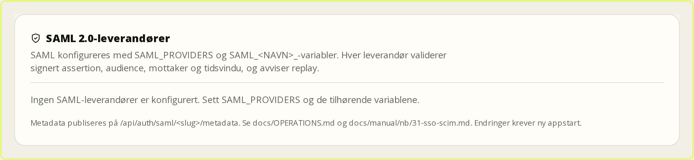
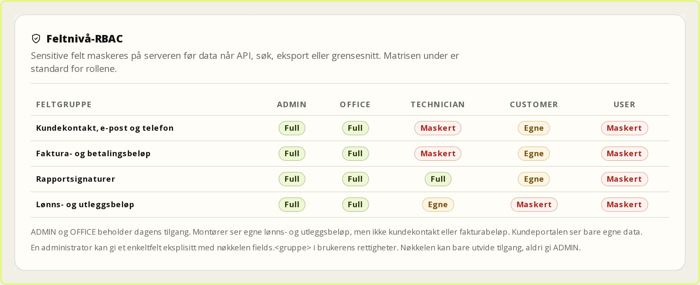

# SSO og SCIM

Dette kapitlet gjelder administratorer som skal koble FSM til en ekstern
identitetsleverandør (IdP) og automatisere oppretting og deaktivering av
brukere. Oppsettet gjøres med miljøvariabler og krever ny appstart. Passord-
innlogging blir alltid stående som nødvei. Kapitlet gjelder FSM-plattformen
0.9.0 (8. november 2026).

## 1. Før du begynner

Avklar disse punktene med kunden før du endrer produksjon:

- Hvilken IdP brukes: Microsoft Entra ID, Keycloak, Authentik eller Zitadel?
- Hvilke e-postdomener skal få logge inn?
- Skal ukjente brukere opprettes automatisk, eller skal en administrator
  aktivere dem først?
- Hvilke grupper skal gi `OFFICE`, `TECHNICIAN` og eventuelt `ADMIN`?
- Hvem er lokal break-glass-administrator hvis IdP-en er nede?

**Minste privilegium:** start med `DEFAULT_ROLE=USER` og auto-provisjonering av.
Legg bare en liten, navngitt gruppe til `ADMIN`.

## 2. Registrer applikasjonen i IdP-en

Redirect-URL-en er:

```text
https://<din-fsm-adresse>/api/auth/callback/sso-<slug>
```

`<slug>` er navnet du velger i `SSO_PROVIDERS`, for eksempel `entra`. URL-en må
være eksakt lik i IdP-en. FSM bruker authorization code flow med PKCE, state og
nonce.

- **Entra ID:** Webapplikasjon, redirect-URL over, API-tilgang `openid`,
  `email`, `profile`. Legg `email` og `groups` som optional claims i ID-tokenet.
  Entra bruker `xms_edov` i stedet for `email_verified`; begge godtas.
- **Keycloak:** Confidential client med standard flow og PKCE. Legg redirect-
  URL-en under *Valid redirect URIs*, og en group-membership-mapper som gir
  `groups`-claimet.
- **Authentik:** OAuth2/OpenID-provider med redirect-URL-en. Scope-mapping for
  grupper til `groups`.
- **Zitadel:** OIDC-applikasjon av typen Web. Be om
  `urn:zitadel:iam:org:project:roles` og bruk samme navn som `GROUPS_CLAIM`.

## 3. Sett miljøvariabler

Eksempel for Entra ID:

```dotenv
SSO_PROVIDERS=entra
SSO_ENTRA_DISPLAY_NAME=Microsoft Entra ID
SSO_ENTRA_ISSUER=https://login.microsoftonline.com/<tenant-id>/v2.0
SSO_ENTRA_CLIENT_ID=<client-id>
SSO_ENTRA_CLIENT_SECRET=<client-secret>
SSO_ENTRA_ALLOWED_EMAIL_DOMAINS=example.no
SSO_ENTRA_AUTO_PROVISION=false
SSO_ENTRA_AUTO_PROVISION_ACTIVE=false
SSO_ENTRA_DEFAULT_ROLE=USER
SSO_ENTRA_DEFAULT_DEPARTMENT=Oslo
SSO_ENTRA_GROUPS_CLAIM=groups
SSO_ENTRA_GROUP_ROLE_MAP={"FSM-Office":"OFFICE","FSM-Technicians":"TECHNICIAN"}
SSO_ENTRA_SYNC_ROLES=false
```

### SAML 2.0

SAML konfigureres med `SAML_PROVIDERS` og `SAML_<SLUG>_`. OIDC-variablene er
urørt, så en installasjon kan ha begge deler. Eksempel:

```dotenv
SAML_PROVIDERS=entra-saml
SAML_ENTRA_SAML_DISPLAY_NAME=Entra SAML
SAML_ENTRA_SAML_ENTRY_POINT=https://login.microsoftonline.com/<tenant>/saml2
SAML_ENTRA_SAML_IDP_CERT=<sertifikat>
SAML_ENTRA_SAML_ALLOWED_EMAIL_DOMAINS=example.no
SAML_ENTRA_SAML_GROUPS_ATTRIBUTE=groups
SAML_ENTRA_SAML_GROUP_ROLE_MAP={"FSM-Office":"OFFICE"}
SAML_ENTRA_SAML_GROUP_DEPARTMENT_MAP={"FSM-Oslo":"Oslo"}
SAML_ENTRA_SAML_AUTO_PROVISION=false
SAML_ENTRA_SAML_DEFAULT_ROLE=USER
```

Registrer **SP entity id** og **ACS-URL** fra
`/api/auth/saml/<slug>/metadata` i IdP-en. Appen validerer signert assertion,
audience, recipient og tidsvindu, og avviser replay av samme assertion.
`ALLOW_IDP_INITIATED=true` er bare for IdP-initierte innlogginger; signatur,
audience, recipient og replay er fortsatt på. SAML bruker samme konto-, rolle-,
avdelings- og 2FA-regler som OIDC.

Start appen på nytt. Åpne **Innstillinger → SSO og SCIM**. Leverandøren skal
vises som **Aktiv**, med issuer, standardrolle og tillatte domener. Røde
konfigurasjonsfeil betyr at en påkrevd variabel mangler eller er ugyldig.



*Figur: SAML konfigureres per leverandør og vises med status i innstillingene.*

Se på **Status**, **Issuer** og **Redirect/ACS**-opplysningene. SAML og OIDC
vises side om side, og OIDC-oppsettet er urørt når du legger til SAML. Er
statusen rød, mangler en påkrevd variabel eller sertifikatet er ugyldig – rett
det før du tester innlogging.

**Forventet resultat:** Innloggingssiden viser en knapp med leverandørens navn
over passordskjemaet.

## 4. Test innloggingen

1. Logg ut, eller bruk et privat vindu.
2. Trykk SSO-knappen og logg inn i IdP-en.
3. En eksisterende, aktiv bruker med samme bekreftede e-post skal komme inn.
4. En ukjent bruker skal få en tydelig feil når auto-provisjonering er av.
5. En deaktivert bruker skal avvises.
6. Hvis 2FA er påkrevd for rollen, skal du få kode-steget eller oppsett av
   2FA før du slipper inn.

**Kontroller:** Rollen skal ikke ha endret seg bare fordi e-posten matchet.
Rolleendring skjer bare med `SYNC_ROLES=true` og en eksplisitt gruppemapping.
Se etter revisjonsraden «SSO: koblet konto …» i **Aktivitetslogg**.

## 5. Auto-provisjonering

Med `AUTO_PROVISION=true` opprettes ukjente brukere uten passord. Standard er
`AUTO_PROVISION_ACTIVE=false`, som gir en inaktiv konto. Gå til **Ansatte &
Roller**, kontroller rolle og avdeling, og aktiver kontoen.

Slå bare på `AUTO_PROVISION_ACTIVE=true` når IdP-en er autoritativ for hele
brukerpopulasjonen og avdelingen er riktig satt. En bruker som er medlem av
flere grupper med ulike roller avvises – rydd mappingen i stedet for å gi
høyeste rolle automatisk.

## 6. SCIM-token

1. Gå til **Innstillinger → SSO og SCIM**.
2. Skriv et beskrivende navn, for eksempel «Entra-provisjonering».
3. La utløpsdato stå tom for standard levetid, eller velg en dato.
4. Trykk **Opprett token**.
5. Kopier tokenet med én gang. Det vises bare denne gangen.

Bruk ett token per integrasjon. Ved mistanke om lekkasje: trykk **Roter token**.
Det gamle tilbakekalles i samme operasjon, og integrasjonen må oppdateres med en
gang. **Tilbakekall** sperrer tokenet uten å slette historikken.

## 7. Sett opp SCIM i IdP-en

- Tenant-URL: `https://<din-fsm-adresse>/api/scim/v2`
- Authentication: Bearer-token fra forrige steg.
- Test connection, og slå på provisjonering for brukere.

Feltmapping:

| SCIM | FSM |
| --- | --- |
| `userName` / `emails` | E-post (unik) |
| `externalId` | Ekstern id (unik når satt) |
| `active` | Aktiv/inaktiv |
| `name` | Navn |
| enterprise `department` | Avdeling |
| `roles` / `groups` | Rolle via eksplisitt mapping |

`DELETE` deaktiverer brukeren; den slettes ikke. Passord settes aldri. Endringer
i rolle, avdeling, e-post eller aktiv status logger ut eksisterende økter.
`ADMIN` krever `SCIM_ALLOW_ADMIN=true` i tillegg til eksplisitt mapping.

### SCIM-grupper

Grupper ligger på `/api/scim/v2/Groups` med samme token og feilformat som
brukere. En gruppe har `displayName`, valgfri `externalId` og `members` med
lokal bruker-id i `value`. `PATCH` støtter `displayName`, `externalId`,
`members` og `members[value eq "…"]`.

Grupper gir **bare** tilgang gjennom eksplisitt mapping:

```dotenv
SCIM_GROUP_ROLE_MAP={"FSM-Office":"OFFICE"}
SCIM_GROUP_DEPARTMENT_MAP={"FSM-Oslo":"Oslo"}
```

Uten mapping skjer ingenting. To grupper som peker på ulike roller eller
avdelinger gir ingen endring, bare en revisjonsrad. `ADMIN` krever fortsatt
`SCIM_ALLOW_ADMIN=true`. `DELETE` sletter gruppen og medlemskapene, men beholder
brukerne.

### Feltnivå i visningen

Feltnivå-RBAC håndheves på serveren, ikke bare i grensesnittet. Hver lesetjeneste
som returnerer et sensitivt felt maskerer det før svaret går til API, søk,
eksport eller UI. Maskering er standard: e-post og telefon maskeres, beløp og
signatur-URL-er settes til `null`, og `redactedFields` forteller hvorfor.

| Feltgruppe | ADMIN | OFFICE | TECHNICIAN | CUSTOMER | USER |
| --- | --- | --- | --- | --- | --- |
| `customerContact` – kundekontakt, e-post, telefon | Full | Full | Maskert | Egne | Maskert |
| `billingAmounts` – faktura- og betalingsbeløp | Full | Full | Maskert | Egne | Maskert |
| `reportSignatures` – rapportens signaturbilder | Full | Full | Full | Egne | Maskert |
| `payrollAmounts` – lønn, kjøretur og utlegg | Full | Full | Egne | Maskert | Maskert |

«Egne» betyr at `ownerId` eller `customerId` må matche aktøren. En montør ser
egne reiseregninger og utlegg, men ikke kollegenes. Kundeportalen ser egne
fakturabeløp og egen kontaktinfo, men ingen interne beløp eller signaturer.
Kontaktpersonens navn og kundens adresse er ikke maskert i v1, fordi de trengs
for å utføre oppdraget. Rapportens `technicianName` og `customerName` beholdes
av samme grunn, mens selve signaturbildet skjules.

En administrator kan gi ett felt til én bruker med nøkkelen i brukerens
`permissions`-liste:

```text
fields.customerContact
fields.billingAmounts
fields.reportSignatures
fields.payrollAmounts
```

Nøkkelen utvider tilgang til hele feltgruppen for den brukeren, arves ikke fra
rollen og kan ikke gi ADMIN. I v1 settes den med direkte database-/API-tilgang,
fordi innstillingenes vanlige rettighetsliste filtrerer bort ukjente nøkler.
En redigerbar feltmatrise i UI er residual.



*Figur: Feltpolicyen viser hvilke roller som ser hvilke feltgrupper.*

Legg merke til at matrisen er rollebasert og skrivebeskyttet i v1. Den viser
hvilke grupper som maskeres, ikke hvilke enkeltfelter som er synlige. Vil du gi
en montør tilgang til fakturabeløp, må feltnøkkelen settes eksplisitt; det er en
bevisst handling, ikke en rolleendring. Se `docs/RBAC.md`.

## 8. Break-glass og feilsøking

Behold minst to lokale administratorer med sterkt passord og 2FA. Passordskjemaet
på `/logg-inn` forsvinner ikke når SSO er på.

| Symptom | Sjekk |
| --- | --- |
| Ingen SSO-knapp | `SSO_PROVIDERS`, `ENABLED`, påkrevde variabler og at appen er restartet. |
| `redirect_uri`-feil | Redirect-URL i IdP-en må være eksakt `.../api/auth/callback/sso-<slug>`. |
| «ikke opprettet i FSM» | Auto-provisjonering er av, eller e-posten finnes ikke. Opprett brukeren eller slå på provisjonering. |
| «e-post ikke bekreftet» | IdP-en mangler `email_verified`/`xms_edov`. Legg claimet til i ID-tokenet. |
| Rollekonflikt | Brukeren er i grupper som mapper til ulike roller. Fjern en av gruppene. |
| SCIM 401 | Tokenet er feil, utløpt eller tilbakekalt. Roter og oppdater IdP-en. |
| SCIM 403 | Kundeportalbruker, eller administratoren som opprettet tokenet er inaktiv. |
| SCIM 409 | E-post eller `externalId` er allerede i bruk. Rydd duplikatet i FSM. |
