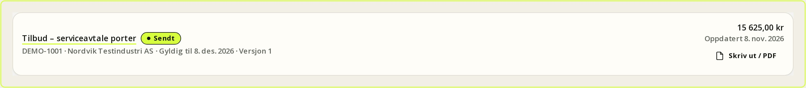
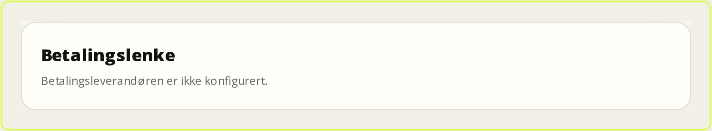
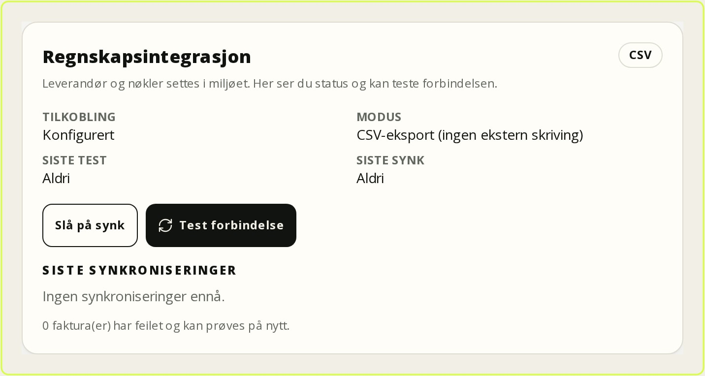

# Tilbud, fakturering og regnskap

Dette kapitlet beskriver de valgfrie modulene **tilbud** (`quotes`), **fakturering**
(`invoicing`), **betaling** og **regnskapssynk**. Modulene må være slått på av
administrator under **Innstillinger → Moduler** før sidene `/tilbud`, `/faktura`
og fakturafanen i kundeportalen er tilgjengelige. Er en modul av, svarer både
siden og API-et `404`, også når du skriver adressen direkte.

Kjernen i plattformen fungerer uten modulene. Tilbud, fakturaer, betalinger og
regnskap er egne data med egne rettigheter og revisjonsspor; de påvirker ikke
oppdragets låsing eller rapporten. Alle beløp regnes på serveren. Klienten kan
ikke sende inn ferdige totaler som avviker fra linjene.

*Figur: Tilbudslisten samler kladder, sendte og godkjente tilbud.*

Legg merke til statusfilteret øverst og kolonnen for gyldighet: et tilbud som er
sendt, men ikke godkjent, er fortsatt en åpen forpliktelse. Bruk listen til å
finne tilbud som nærmer seg utløp, og åpne raden for å sende på nytt eller
konvertere til oppdrag.

## Tilbud

Tilbud er redigerbare bare mens de er **Kladd**. Når tilbudet sendes, fryses
linjene i en versjon, og kunden får en engangslenke.

### Opprette og sende

1. Velg **Tilbud → Nytt tilbud** (`/tilbud/ny`).
2. Velg **Kunde**, eventuelt **Kontaktperson**, **Oppdrag**, **Avtale** og
   **Utstyr**. Kunden kan oppgis med kundenavn selv om kundekort mangler, men
   fakturering krever en kundekortkobling.
3. Legg inn linjer med **Beskrivelse**, **Antall**, **Enhet**, **Pris** og
   **MVA**. Totaler, MVA og øreavrunding beregnes per linje på serveren.
4. Lagre kladden. Du kan redigere, klone og lage ny versjon.
5. Trykk **Send tilbud**. Systemet tildeler tilbudsnummer, fryser linjene,
   lager godkjenningslenken og legger e-posten i den automatiske utboksen.
6. Del lenken med kunden. Kunden godkjenner eller avslår i nettleseren uten
   innlogging.

En godkjenningslenke kan bare brukes én gang og har kort levetid. Er lenken
utløpt, må tilbudet sendes på nytt; det lager en ny versjon og en ny lenke.
**Skriv ut** (`/tilbud/<id>/skriv`) gir en utskriftsvennlig side. PDF lages med
nettleserens **Skriv ut → Lagre som PDF**; det finnes ingen server-generert
tilbuds-PDF.

### Status og versjoner

| Status | Betyr | Kan redigeres |
| --- | --- | --- |
| **Kladd** | Under arbeid | Ja |
| **Sendt** | Kunden har fått lenken | Nei |
| **Godkjent** | Kunden har godtatt | Nei |
| **Avslått** | Kunden har avslått | Nei |
| **Utløpt** | Gyldigheten er passert | Nei |

Hver sending og endring av et sendt tilbud gir en ny versjon. Versjonen bevarer
linjer, priser, MVA og totaler, slik at en senere prisendring ikke endrer et
tilbud kunden allerede har sett. En planlagt jobb markerer utløpte tilbud; den
er idempotent og kjører bare én gang per tilbud.

### Konvertere til oppdrag

Et **godkjent** tilbud kan konverteres til et oppdrag med **Konverter til
oppdrag**. Handlingen krever `customers.manage` og `workorders.create`, kjører i
én transaksjon og gjenbruker eller oppretter kunden. Utstyret på tilbudet kobles
til oppdraget. Rapporten og fakturaen er fortsatt separate objekter; en
konvertering oppretter ikke faktura automatisk.

## Fakturering

Fakturaer kan opprettes manuelt, fra et godkjent tilbud, fra et fullført
oppdrag eller fra en innsendt rapport. Oppdrag og rapport må være **Fullført**
før de kan brukes som grunnlag.

### Opprette og sende

1. Velg **Faktura → Ny faktura** (`/faktura/ny`).
2. Velg **Kunde** og eventuelt **Oppdrag**, **Rapport** eller **Godkjent
   tilbud**.
3. Legg inn linjer med antall, enhet, pris og MVA. Fakturaen lagres som kladd
   og kan redigeres.
4. Trykk **Send faktura**. Fakturaen får et unikt nummer, linjene fryses, og
   kunden får e-post med lenke til kundeportalen.
5. Registrer betaling manuelt med **Beløp**, **Dato**, **Metode** og
   **Referanse**. Delbetaling er støttet og oppdaterer utestående.
6. Ved behov, registrer **Kreditnota**. Den kan ikke overstige utestående
   beløp.

**Skriv ut** (`/faktura/<id>/skriv`) gir en utskriftsvennlig faktura med samme
print-til-PDF-flyt som tilbudet. Fakturanummeret tildeles ved sending. Ved
samtidige sendinger kan nummerserien få hull; hullene påvirker ikke
entydigheten.

### Status og betaling

| Status | Betyr |
| --- | --- |
| **Kladd** | Ikke sendt; kan redigeres |
| **Sendt** | Nummer tildelt, linjer fryst |
| **Delvis betalt** | Betaling registrert, men utestående gjenstår |
| **Betalt** | Utestående er null |
| **Forfalt** | Forfallsdato passert med utestående |
| **Kreditert** | Kreditnota er registrert |

Forfalte fakturaer oppdateres manuelt med **Oppdater forfall**, eller av den
planlagte fakturajobben. En betaling arver idempotensnøkkel, slik at dobbeltklikk
og gjentatte webhooks ikke gir dobbeltbeløp. Refusjon opprettes ikke fra
betalingsleverandøren; bruk kreditnota.

*Figur: Fakturaen viser linjer, betalinger og utestående i samme bilde.*

Se etter **Utestående** og **Betalingsstatus** før du oppretter en ny lenke.
Betalingsknappen er bare aktiv når leverandøren er konfigurert og fakturaen
fortsatt har et utestående beløp. Delbetalinger vises som egne rader, og
kreditnotaen ligger atskilt fra betalingene.

## Betalingslenker (Stripe og Vipps)

Betaling er valgfritt. Uten konfigurasjon er alle betalingshandlinger en stille
no-op: ingen nettverkskall, ingen databasemutasjon og ingen knapp som lover mer
enn systemet kan. Kortnummer, CVC, BankID og selve bekreftelsen ligger hos
betalingsleverandøren. FSM lagrer bare leverandørens id, lenken og status.

### Slå på

1. Velg leverandør med `PAYMENTS_PROVIDER=stripe` eller `PAYMENTS_PROVIDER=vipps`.
2. Sett nøklene og webhook-hemmeligheten i miljøet. En leverandør regnes som
   konfigurert bare når både API-nøkkel og webhook-hemmelighet finnes.
3. Registrer webhook-URL-en i leverandørens kontrollpanel:
   `https://<app-url>/api/webhooks/payments/stripe` eller
   `https://<app-url>/api/webhooks/payments/vipps`.
4. Start appen på nytt og kontroller at **Betal** vises på en sendt faktura med
   utestående beløp.

Stripe bruker **Checkout** som vertet betalingsside. Vipps bruker ePayment med
`WEB_REDIRECT` og lommebok. Bare NOK støttes i v1, og hver lenke gjelder ett
beløp. Endres utestående etter at lenken er laget, må du lage en ny lenke.

### Flyt og sikkerhet

1. Kontor eller administrator åpner fakturaen og trykker **Opprett
   betalingslenke**.
2. Kunden betaler hos Stripe eller Vipps.
3. Leverandøren kaller webhooken. Signaturen verifiseres mot rå kropp,
   hendelsen er idempotent, og beløp og valuta kontrolleres.
4. Betalingen registreres gjennom samme tjeneste som manuell betaling, og
   fakturaen blir **Delvis betalt** eller **Betalt**.

Webhooken svarer `200` også for duplikater og hendelser systemet bevisst
ignorerer, slik at leverandøren slutter å prøve. Ukjente leverandører gir `404`,
manglende nøkler gir `503`. Feilede eller utløpte lenker setter
betalingsstatus, men endrer ikke fakturaens bokføringsstatus. Refusjon og
capture gjøres ikke i FSM; det håndteres med kreditnota og eventuelt i
leverandørens portal.

> **Advarsel:** Betalingslenken er en hemmelighet på linje med fakturaen. Del
> den bare med kunden. Åpne aldri webhook-hemmeligheter i grensesnittet eller
> legg dem i git.

## Regnskapssynk (Fiken, Tripletex, PowerOffice Go og CSV)

Regnskapssynken er manuell og per faktura. Den oppretter eller gjenbruker kunde,
faktura og positive betalinger hos leverandøren, lagrer eksterne id-er og en
retrybar tilstand. Den later aldri som et eksternt kall lyktes.

*Figur: Regnskapsinnstillingene viser valgt leverandør og om integrasjonen er
aktiv.*

Legg merke til at integrasjonen er **av** til en administrator slår den på, selv
om `ACCOUNTING_PROVIDER` er satt. **Test forbindelse** lagrer resultatet, og
**Siste synk** viser om noe faktisk er sendt. CSV er alltid tilgjengelig, men
markeres **Eksportert**, aldri **Synkronisert**.

### Slå på og teste

1. Sett `ACCOUNTING_PROVIDER` til `fiken`, `tripletex`, `poweroffice` eller
   `csv`, og fyll inn leverandørens nøkler og kontokoder.
2. Åpne **Innstillinger → Regnskap**.
3. Slå på synken og trykk **Test forbindelse**. Grønt resultat betyr at
   leverandøren svarte; det bekrefter ikke at alle kontokoder er riktige.
4. Åpne en sendt faktura og trykk **Synk til regnskap**.
5. Kontroller at ekstern id og status vises. Ved feil, rett årsaken og prøv
   igjen – kunden gjenbrukes, og fakturaen har stabil nøkkel.

### Leverandørforskjeller

| Leverandør | Kunde | Faktura | Betaling |
| --- | --- | --- | --- |
| **Fiken** | Kontakt | Faktura | Fri journalpost: debet bank, kredit kundefordring |
| **Tripletex** | Kunde | Ordre + faktura | Betaling på fakturaen |
| **PowerOffice Go** | Kunde | Utgående faktura | Bankjournal |
| **CSV** | Lokal rad | Lokal rad | Lokal rad, ingen ekstern skriving |

Fiken krever bankkonto for faktura og kontokoder for betaling. Tripletex krever
MVA-type og betalingstype; mangler betalingstypen, feiler betalingssynken med
`not_configured` i stedet for å gjette. PowerOffice-stiene kan overstyres fordi
ressursnavnene varierer mellom API-versjoner. CSV-filen inneholder kundenavn og
fakturalinjer og skal behandles som forretningsdata.

### Status og begrensninger

| Status | Betyr |
| --- | --- |
| **Synkronisert** | Leverandøren har kvittert for kunde, faktura og betalinger |
| **Eksportert** | CSV er skrevet; ingen ekstern tilstand er endret |
| **Feilet** | Siste forsøk feilet; feilkoden står i `lastError` |
| **Ikke synkronisert** | Ingen synk er forsøkt |

Synken er ikke automatisk og ikke toveis. Det finnes ingen bakgrunnsjobb som
prøver feilede synker, ingen oppdatering av en allerede sendt faktura, og ingen
kredittnota-, refusjons- eller e-fakturasynk. MVA-mappingen er enkel og må
kontrolleres manuelt ved spesielle satser. Nullstilling av en synk sletter ikke
revisjonssporet. Verifiser alltid Fiken-, Tripletex- og PowerOffice-koblingene
mot leverandørens sandbox før produksjon.

## Kundeportalen

Når både kundeportal og fakturering er på, ser kunden **Faktura** i portalen
(`/kundeportal/faktura`). Kunden ser egne sendte fakturaer, linjer,
betalingsstatus og eventuell **Betal**-knapp. Kunden kan ikke se andre kunders
fakturaer, interne notater eller kladder. Betalingsstatus oppdateres først når
webhooken er mottatt og behandlet.

Kunden kan ikke betale med kort utenfor betalingslenken. Er leverandøren ikke
konfigurert, vises en kort forklaring i stedet for en knapp. Kvittering for
rapport og betaling av faktura er to separate handlinger.

## Rettigheter, revisjon og daglige rutiner

| Handling | Rettighet |
| --- | --- |
| Se tilbud og fakturaer | `customers.view`, `customers.manage` eller `workorders.view` |
| Opprette, endre og sende tilbud | `customers.manage` |
| Opprette og sende faktura | `customers.manage` |
| Registrere betaling og kreditnota | `customers.manage` eller administrator |
| Opprette betalingslenke | `customers.manage` eller administrator |
| Slå regnskapssynk av/på, teste og nullstille | `settings.manage` |
| Synkronisere én faktura | `customers.manage`, og fakturaen må være synlig for aktøren |

Alle mutasjoner, sendinger, betalinger, kreditnotaer, betalingshendelser og
synkforsøk skriver revisjonsrad i samme transaksjon. Revisjonsloggen inneholder
leverandør, ekstern id, status og en kort feilkode – aldri tokens, rå payload
eller persondata.

**Daglig:** send kladder, følg **Forfalt**, registrer mottatte betalinger og
kontroller at webhook-betalinger har riktig status.

**Ukentlig:** synkroniser sendte fakturaer, kontroller **Feilet** og
**Utestående**, og stem av mot regnskapet.

**Månedlig:** kontroller nummerserie, MVA, kreditnotaer, betalingsleverandørens
avstemming og at ingen fakturaer står fast i **Kladd**.

## Vanlige problemer

| Symptom | Årsak | Tiltak |
| --- | --- | --- |
| Sidene `/tilbud` eller `/faktura` gir 404 | Modulen er av | Slå på `quotes` eller `invoicing` under **Innstillinger → Moduler** |
| Kunden får ikke godkjenningslenke | E-post mangler, eller SMTP er ikke konfigurert | Kopier lenken manuelt, eller konfigurer automatisk e-post |
| Lenken er utløpt | Kort levetid eller brukt én gang | Send tilbudet på nytt |
| Kan ikke konvertere tilbud | Tilbudet er ikke godkjent, eller rettighet mangler | Godkjenn tilbudet og kontroller `customers.manage` og `workorders.create` |
| Fakturaen kan ikke sendes | Kladden mangler linjer eller kunde | Fyll ut kunde og minst én linje |
| Betalingsknappen vises ikke | Leverandør eller webhook-hemmelighet mangler, eller beløpet er betalt | Kontroller `PAYMENTS_PROVIDER` og nøklene, og lag ny lenke ved behov |
| Betalingen blir ikke registrert | Webhook avvises, eller valuta/beløp avviker | Kontroller signatur, `APP_URL` og revisjonsloggen; avstem manuelt |
| Overbetaling avvises | Utestående er endret siden lenken ble laget | Lag en ny lenke etter delbetalingen |
| Regnskapssynken står som **Feilet** | Feil nøkkel, kontokode eller MVA-oppsett | Les `lastError`, rett årsaken og synkroniser på nytt |
| CSV vises som **Eksportert** | CSV er eksport, ikke synk | Importer filen i regnskapet; ingen ekstern tilstand er endret |
| Kreditnota avvises | Beløpet overstiger utestående | Kontroller betalinger og utestående først |

## Kunde og kontaktperson

Kontaktfeltet vises først når du har valgt kunde. Kontaktene som vises, hentes
for den valgte kunden og inneholder bare personer som faktisk tilhører kunden.
Bytter du kunde, tømmes kontaktvalget og listen lastes på nytt. En kontakt fra
en annen kunde kan derfor verken velges eller sendes inn.

Serveren validerer det samme ved lagring. Hvis en kontakt ikke tilhører den
valgte kunden, avvises tilbudet eller fakturaen selv om noen skulle omgå
skjemaet.
